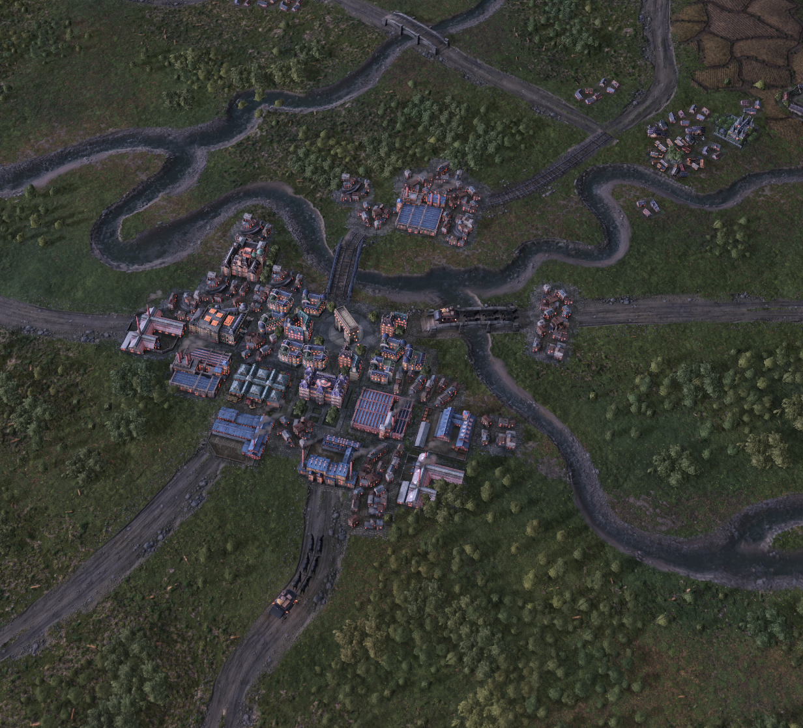
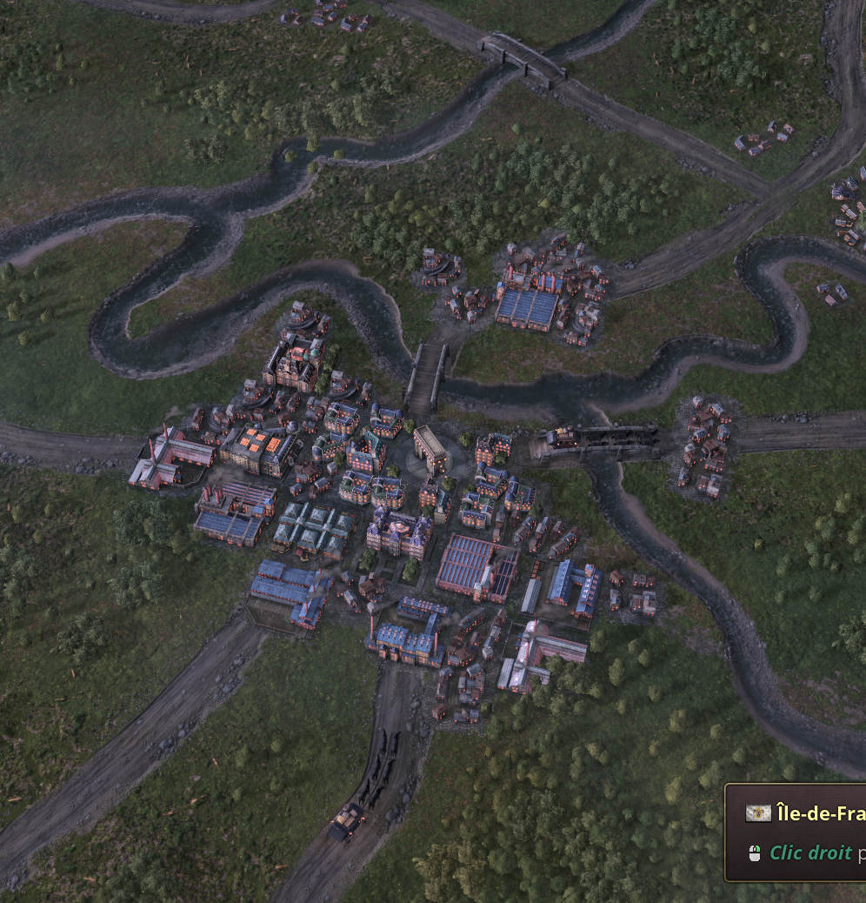

# Rails au sol — validation visuelle manuelle, périmètre limité

**PASS_RUNTIME_USER_VALIDATED**, le 16 octobre 2026, pour l'apparition et le
retrait des rails sur les tronçons montrés. Ce n'est pas un test moteur automatisé
ni une acceptation de l'ensemble du prototype.

Le joueur confirme explicitement « la creation des rail est confirmé visuellement »
avec deux captures, puis précise « après avoir retiré le témoin » pour la troisième.
Les rails visibles sur le pont central et la liaison vers le haut à droite ne
sont plus visibles dans cette dernière vue. Les routes et surfaces du pont restent
présentes. Cela étaye une commutation du **rail au sol**, pas seulement des trains.

Les journaux avaient séparément montré le témoin **0 → 1 → 0**, avec 17 niveaux
régionaux et les mêmes PM économiques. La correspondance exacte des horodatages
de ces captures avec chaque bloc de journal n'est pas établie.

## Captures conservées

Rails visibles :

Après retrait du témoin :

La deuxième capture conservée donne le contexte « Orléanais-Berry » ; la troisième
indique « Île-de-France ». Le site est reconnaissable dans les vues, mais cela ne
valide pas une frontière précise ou l'isolation du rendu entre États voisins.
Les copies originales et leurs SHA-256 sont référencées dans le reçu JSON.

## Restent à vérifier

- Apparition/retrait automatiques avec un **vrai PM ferroviaire**, technologie disponible.
- Frontières d'États, parts d'État de propriétaires différents et cas voisins.
- Rechargement, neutralité des connexions militaires/IA et effets économiques indirects.
- Densité des rails, croissance des routes, textures selon PM et canaux : non implémentés/validés.

Le test du 15 octobre demeure archivé comme initialement non concluant ; cette
nouvelle preuve complète uniquement son volet d'apparition/retrait local. Aucune
intégration dans le mod principal n'est effectuée ni déduite de cette confirmation.
