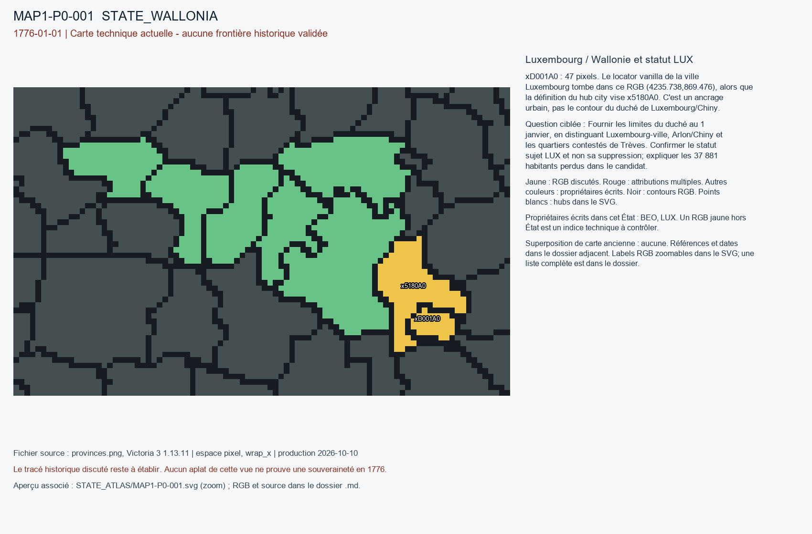

# MAP1-P0-001 — Luxembourg / Wallonie et statut LUX

Statut : revue historique et géographique ouverte. Aucun transfert approuvé.

[Vue RGB zoomable](STATE_ATLAS/MAP1-P0-001.svg)

## Résultat de localisation technique

xD001A0 : 47 pixels. Le locator vanilla de la ville Luxembourg tombe dans ce RGB (4235.738,869.476), alors que la définition du hub city vise x5180A0. C'est un ancrage urbain, pas le contour du duché de Luxembourg/Chiny.

Décision de cette passe : REJECT_CANDIDATE_AS_IS; KEEP_LUX_PENDING_REVIEW

## Question pour la recherche régionale

Fournir les limites du duché au 1 janvier, en distinguant Luxembourg-ville, Arlon/Chiny et les quartiers contestés de Trèves. Confirmer le statut sujet LUX et non sa suppression; expliquer les 37 881 habitants perdus dans le candidat.

## Références et limites

### R1_WESTERN_EUROPE-S001

Archives nationales de Luxembourg; ingénieur Bergé; Martin Uhrmacher. Dispute entre voisins sur le tracé de la frontière (cartes CP-A-45, CP-A-46; dossier A-XI-11-02). Publication : 2016-12-20. Document : 1776.

Référence : https://anlux.public.lu/fr/actualites/2016/Carte.html

Pages/carte : CP-A-45; CP-A-46; A-XI-11-02 (325 p.; document daté 1776-05-02)

Pertinence : Concerne l année 1776 mais certains relevés/dossiers postérieurs au 01-01.

Biais/limites : Frontière Luxembourg/Trèves contestée dans les pièces elles-mêmes; ne couvre pas Wallonie entière.

Accès MAP-1 : ACCESSED_CONTEXT_CONFIRMED. ANLux notice confirms two disputed 1776 maps; May dossier is after cutoff. Map endpoints could not be fetched.

### R1_WESTERN_EUROPE-S002

Archives nationales de Luxembourg. Fonds anciens: Conseil provincial et souverain et Trois États du Luxembourg. Publication : 2016-08-26. Document : 762-1795.

Référence : https://anlux.public.lu/fr/rechercher/fonds-collections/fonds-anciens.html

Pages/carte : Présentation des fonds Conseil provincial et souverain; Trois États

Pertinence : Institutions existant sous Ancien Régime au Luxembourg

Biais/limites : Présentation archivistique, non liste de provinces ou frontières.

Accès MAP-1 : CATALOG_ONLY_NOT_FETCHED. Notice importée, source originale non consultée indépendamment.

### R1_WESTERN_EUROPE-S003

Archives nationales de Luxembourg. Mise en ligne du fonds Cadastre de Marie-Thérèse. Publication : 2023-05-04. Document : seconde moitié du XVIIIe siècle.

Référence : https://anlux.public.lu/fr/actualites/2023/mise-en-ligne-cadastre-marie-therese.html

Pages/carte : Fonds A-XIV; 342 dossiers, Luxembourg et comté de Chiny

Pertinence : Fiscalité et propriété foncière de la période 1776

Biais/limites : Description des fonds; registre nominatif non entièrement dépouillé.

Accès MAP-1 : CATALOG_ONLY_NOT_FETCHED. Notice importée, source originale non consultée indépendamment.

### R1_WESTERN_EUROPE-S034

Puissances signataires France/Provinces-Unies; transcription Wikisource. Traité de paix conclu à Utrecht le 11 avril 1713. Publication : 1713-04-11. Document : 1713-04-11.

Référence : https://fr.wikisource.org/wiki/Traité_de_paix_conclu_à_Utrecht_le_11_avril_1713

Pages/carte : Articles VII–XI (Gueldre, Luxembourg, Namur, frontières des Pays-Bas)

Pertinence : Définit catégories de souveraineté en Gueldre et Luxembourg antérieures à 1776

Biais/limites : Les arrangements provisoires de 1713 ont pu évoluer; vérifier accords ultérieurs et droits maintenus.

Accès MAP-1 : CATALOG_ONLY_NOT_FETCHED. Notice importée, source originale non consultée indépendamment.

## Géoréférencement

Bitmap exact et contours pixel extraits. Aucun fond historique superposé, aucune projection GPS adoptée, aucun résidu de calage inventé. Les points des locators sont contrôlés dans le raster, pas contre un cadastre historique. Les noms de hubs peuvent être anachroniques ou erronés. Trois points indépendants et un point de contrôle hors ajustement restent requis pour un calage local de carte ancienne.

## RGB et propriétaires écrits

| RGB | Propriétaire(s) | Pixels | Hub déclaré |
|---|---|---:|---|
| x2D32D7 | BEO | 164 | STATE_WALLONIA:wood:Charleroi |
| x3A5FB9 | BEO | 369 |  |
| x5180A0 | BEO | 181 | STATE_WALLONIA:city:Luxembourg |
| x8080A0 | BEO | 148 |  |
| x916574 | BEO | 147 | STATE_WALLONIA:farm:Namur |
| xB0A0C0 | BEO | 160 |  |
| xD001A0 | LUX | 47 |  |
| xEF2040 | BEO | 237 | STATE_WALLONIA:mine:Liège |
