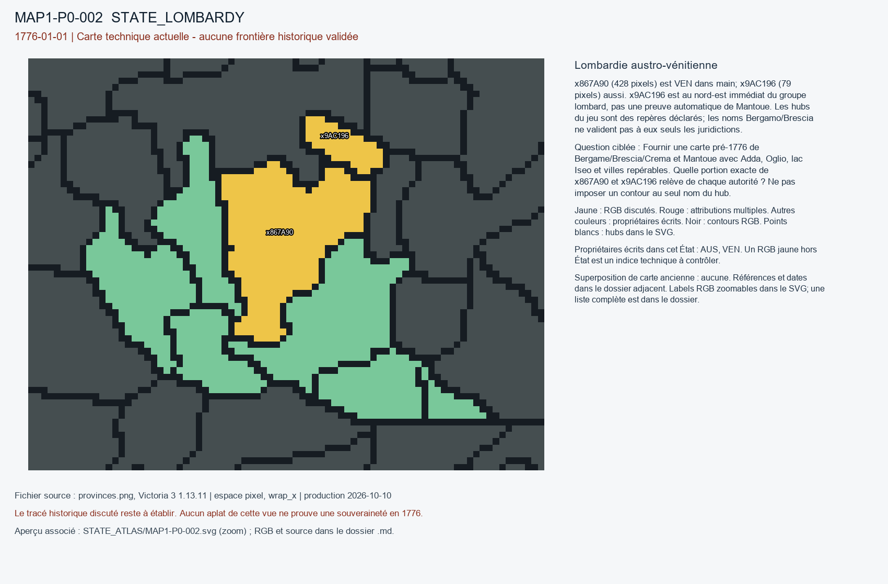

# MAP1-P0-002 — Lombardie austro-vénitienne

Statut : revue historique et géographique ouverte. Aucun transfert approuvé.

[Vue RGB zoomable](STATE_ATLAS/MAP1-P0-002.svg)

## Résultat de localisation technique

x867A90 (428 pixels) est VEN dans main; x9AC196 (79 pixels) aussi. x9AC196 est au nord-est immédiat du groupe lombard, pas une preuve automatique de Mantoue. Les hubs du jeu sont des repères déclarés; les noms Bergamo/Brescia ne valident pas à eux seuls les juridictions.

Décision de cette passe : REJECT_DUPLICATE_AUS_VEN; NO_OWNER_ARBITRATION

## Question pour la recherche régionale

Fournir une carte pré-1776 de Bergame/Brescia/Crema et Mantoue avec Adda, Oglio, lac Iseo et villes repérables. Quelle portion exacte de x867A90 et x9AC196 relève de chaque autorité ? Ne pas imposer un contour au seul nom du hub.

## Références et limites

### R1_WESTERN_EUROPE-S008

Lombardia Beni Culturali; Regione Lombardia. Il dominio della terraferma veneta: Bergamo, Brescia, Crema (sec. XV-1797). Publication : UNKNOWN. Document : 1427-1797.

Référence : https://www.lombardiabeniculturali.it/istituzioni/storia/?unita=03.03

Pages/carte : Sections Bergamo: juridictions; Brescia: territoire; Crema: enclave et institutions fiscales

Pertinence : Institution et contrôle vénitiens en 1776

Biais/limites : Divisions historiques très fines; ne donne aucun RGB du jeu.

Accès MAP-1 : FETCH_FAILED. 502/failed fetch. Regional conclusion retained as unverified externally.

### R1_WESTERN_EUROPE-S009

Lombardia Beni Culturali; Regione Lombardia. Lombardia austriaca, 1749-1796. Publication : UNKNOWN. Document : 1749-1796.

Référence : https://www.lombardiabeniculturali.it/istituzioni/schede/8000357/

Pages/carte : Édit de 1757; administrations Milano/Pavia/Lodi/Cremona/Como/Casal Maggiore; Mantova

Pertinence : Administration des Habsbourg en vigueur en 1776

Biais/limites : Des réformes citées (1786) sont postérieures à la date cible.

Accès MAP-1 : FETCH_FAILED. 502. No historical polygon inspected.

### R1_WESTERN_EUROPE-S010

Lombardia Beni Culturali; Regione Lombardia. La Lombardia della dominazione austriaca, 1700-1796. Publication : UNKNOWN. Document : 1700-1796.

Référence : https://www.lombardiabeniculturali.it/istituzioni/storia/?unita=03.06

Pages/carte : Sections organisation territoriale, gouvernement, justice et fiscalité, édits 1757/1771

Pertinence : Détails de contrôle fiscal et administratif sous Marie-Thérèse

Biais/limites : Frontières locales exigent croisement cartographique des juridictions.

Accès MAP-1 : CATALOG_ONLY_NOT_FETCHED. Notice importée, source originale non consultée indépendamment.

### R1_WESTERN_EUROPE-S037

Lombardia Beni Culturali; Regione Lombardia. Ducato di Mantova, sec. XIV–1786. Publication : UNKNOWN. Document : 1750-1786.

Référence : https://www.lombardiabeniculturali.it/istituzioni/schede/7001603/

Pages/carte : Passage sur restitution des tribunaux au Mantouan en 1750

Pertinence : Autonomie administrative mantouane sous souveraineté autrichienne en 1776

Biais/limites : Reforme de 1784–1786 postérieure à la date cible.

Accès MAP-1 : CATALOG_ONLY_NOT_FETCHED. Notice importée, source originale non consultée indépendamment.

## Géoréférencement

Bitmap exact et contours pixel extraits. Aucun fond historique superposé, aucune projection GPS adoptée, aucun résidu de calage inventé. Les points des locators sont contrôlés dans le raster, pas contre un cadastre historique. Les noms de hubs peuvent être anachroniques ou erronés. Trois points indépendants et un point de contrôle hors ajustement restent requis pour un calage local de carte ancienne.

## RGB et propriétaires écrits

| RGB | Propriétaire(s) | Pixels | Hub déclaré |
|---|---|---:|---|
| x3F1E38 | AUS | 240 | STATE_LOMBARDY:mine:Como |
| x4713EE | AUS | 325 | STATE_LOMBARDY:wood:Bergamo |
| x50C060 | AUS | 52 |  |
| x70B8A9 | AUS | 149 |  |
| x867A90 | VEN | 428 | STATE_LOMBARDY:farm:Brescia |
| x9AC196 | VEN | 79 |  |
| xA40CE9 | AUS | 188 |  |
| xD04060 | AUS | 139 | STATE_LOMBARDY:city:Milan |
