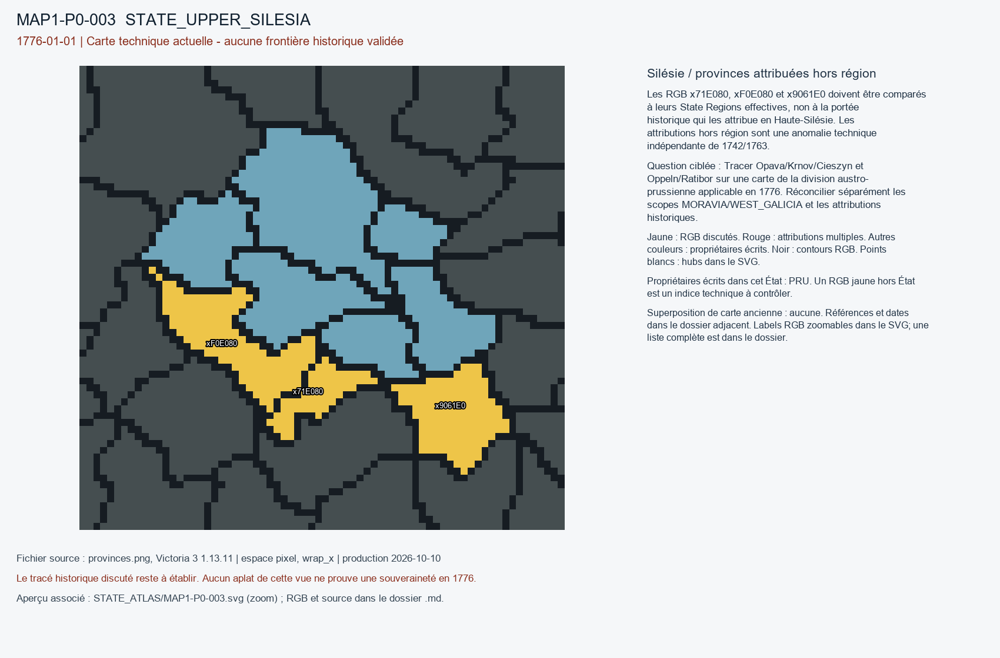

# MAP1-P0-003 — Silésie / provinces attribuées hors région

Statut : revue historique et géographique ouverte. Aucun transfert approuvé.

[Vue RGB zoomable](STATE_ATLAS/MAP1-P0-003.svg)

## Résultat de localisation technique

Les RGB x71E080, xF0E080 et x9061E0 doivent être comparés à leurs State Regions effectives, non à la portée historique qui les attribue en Haute-Silésie. Les attributions hors région sont une anomalie technique indépendante de 1742/1763.

Décision de cette passe : SEPARATE_STATE_SCOPE_REPAIR_FROM_SOVEREIGNTY

## Question pour la recherche régionale

Tracer Opava/Krnov/Cieszyn et Oppeln/Ratibor sur une carte de la division austro-prussienne applicable en 1776. Réconcilier séparément les scopes MORAVIA/WEST_GALICIA et les attributions historiques.

## Références et limites

### R2_NORTHERN_CENTRAL_EASTERN_EUROPE-SRC-0001

Arkadiusz Kuzio-Podrucki. The House of Schaffgotsch between Austria and Prussia during the Silesian Wars 1740–1763. Publication : 2022-12-22. Document : 1742 / 1763.

Référence : https://zaranieslaskie.bs.katowice.pl/en/article/view/44

Pages/carte : Zaranie Śląskie 8 (2022), pp. 9–23, abstract (treaties of Breslau and Berlin)

Pertinence : Division effective by 1776

Biais/limites : Article does not resolve RGB polygons or exact all enclave boundaries.

Accès MAP-1 : CATALOG_ONLY_NOT_FETCHED. Notice importée, source originale non consultée indépendamment.

## Géoréférencement

Bitmap exact et contours pixel extraits. Aucun fond historique superposé, aucune projection GPS adoptée, aucun résidu de calage inventé. Les points des locators sont contrôlés dans le raster, pas contre un cadastre historique. Les noms de hubs peuvent être anachroniques ou erronés. Trois points indépendants et un point de contrôle hors ajustement restent requis pour un calage local de carte ancienne.

## RGB et propriétaires écrits

| RGB | Propriétaire(s) | Pixels | Hub déclaré |
|---|---|---:|---|
| x5E9091 | PRU | 108 | STATE_UPPER_SILESIA:wood:Rybnik |
| x7B2F62 | PRU | 154 |  |
| x821F52 | PRU | 81 | STATE_UPPER_SILESIA:mine:Königshütte |
| x88194B | PRU | 158 |  |
| x90B12B | PRU | 353 | STATE_UPPER_SILESIA:city:Oppeln |
| xAF9F20 | PRU | 188 | STATE_UPPER_SILESIA:farm:Ratibor |
