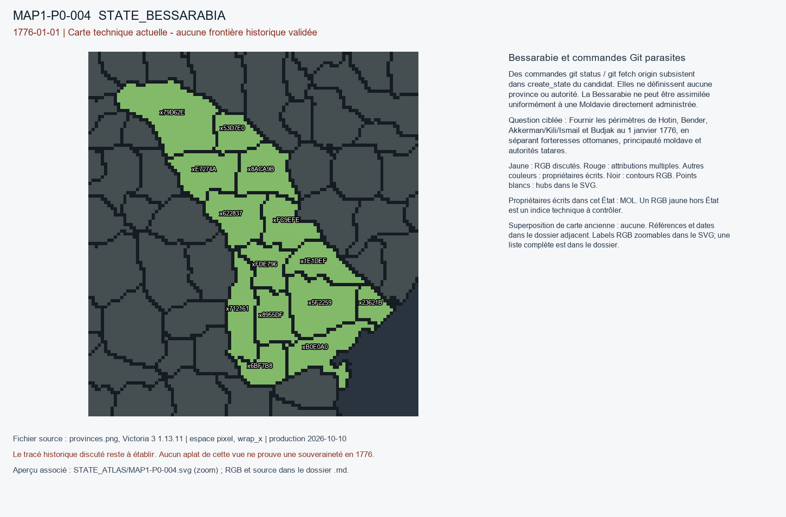

# MAP1-P0-004 — Bessarabie et commandes Git parasites

Statut : revue historique et géographique ouverte. Aucun transfert approuvé.

[Vue RGB zoomable](STATE_ATLAS/MAP1-P0-004.svg)

## Résultat de localisation technique

Des commandes git status / git fetch origin subsistent dans create_state du candidat. Elles ne définissent aucune province ou autorité. La Bessarabie ne peut être assimilée uniformément à une Moldavie directement administrée.

Décision de cette passe : PROPOSE_SYNTAX_ONLY_PATCH_NOT_APPLIED; TERRITORIAL_REVIEW_PENDING

## Question pour la recherche régionale

Fournir les périmètres de Hotin, Bender, Akkerman/Kili/Ismail et Budjak au 1 janvier 1776, en séparant forteresses ottomanes, principauté moldave et autorités tatares.

## Références et limites

### R2_NORTHERN_CENTRAL_EASTERN_EUROPE-SRC-0006

Ottoman Empire and Russian Empire (treaty parties). Treaty of Küçük Kaynarca. Publication : 1774-07-21. Document : 1774-07-21.

Référence : https://tr.wikisource.org/wiki/K%C3%BC%C3%A7%C3%BCk_Kaynarca_Antla%C5%9Fmas%C4%B1

Pages/carte : Articles 3, 16 and 19 (Turkish transcription/translation)

Pertinence : In effect for 1776 baseline

Biais/limites : Web transcription/translation not critical scholarly edition; treaty categories and execution disputed.

Accès MAP-1 : CATALOG_ONLY_NOT_FETCHED. Notice importée, source originale non consultée indépendamment.

### R2_NORTHERN_CENTRAL_EASTERN_EUROPE-SRC-0008

Iulian Oncescu. Towards the End of the Romanian Middle Ages: The Instauration of the Phanariote Regime in Moldavia and Wallachia (1711/1716). Publication : 2018. Document : 1711–1821.

Référence : https://doi.org/10.3406/valah.2018.1285

Pages/carte : Annales d’Université Valahia 20, pp. 97–104

Pertinence : Phanariote princely institutions before and after 1776

Biais/limites : General legal regime; does not locate exact 1776 frontier fortresses.

Accès MAP-1 : CATALOG_ONLY_NOT_FETCHED. Notice importée, source originale non consultée indépendamment.

### R2_NORTHERN_CENTRAL_EASTERN_EUROPE-SRC-0009

Gheorghe Zane. Structures économiques des principautés roumaines (1775–1831). Publication : 1976. Document : 1775–1831.

Référence : https://doi.org/10.3406/ahrf.1976.5016

Pages/carte : Annales historiques de la Révolution française 225, pp. 323–355, section 1

Pertinence : Starts 1775 and directly discusses Porte tributary fiscal policy

Biais/limites : Economic overview, no province-scale border proof.

Accès MAP-1 : CATALOG_ONLY_NOT_FETCHED. Notice importée, source originale non consultée indépendamment.

## Géoréférencement

Bitmap exact et contours pixel extraits. Aucun fond historique superposé, aucune projection GPS adoptée, aucun résidu de calage inventé. Les points des locators sont contrôlés dans le raster, pas contre un cadastre historique. Les noms de hubs peuvent être anachroniques ou erronés. Trois points indépendants et un point de contrôle hors ajustement restent requis pour un calage local de carte ancienne.

## RGB et propriétaires écrits

| RGB | Propriétaire(s) | Pixels | Hub déclaré |
|---|---|---:|---|
| x1E1DEF | MOL | 211 | STATE_BESSARABIA:mine:Balti |
| x23621B | MOL | 107 | STATE_BESSARABIA:port:Akkerman |
| x53D7E0 | MOL | 155 |  |
| x5F2259 | MOL | 347 |  |
| x622837 | MOL | 259 |  |
| x6BF7B8 | MOL | 160 | STATE_BESSARABIA:farm:Ishmael |
| x712161 | MOL | 263 |  |
| x79D62E | MOL | 506 |  |
| x8955DF | MOL | 194 |  |
| x8ACA9B | MOL | 254 |  |
| xB0E0A0 | MOL | 275 |  |
| xE7274A | MOL | 261 | STATE_BESSARABIA:wood:Beltsy |
| xFC9EFE | MOL | 222 | STATE_BESSARABIA:city:Chişinău |
| xFDE796 | MOL | 172 |  |
