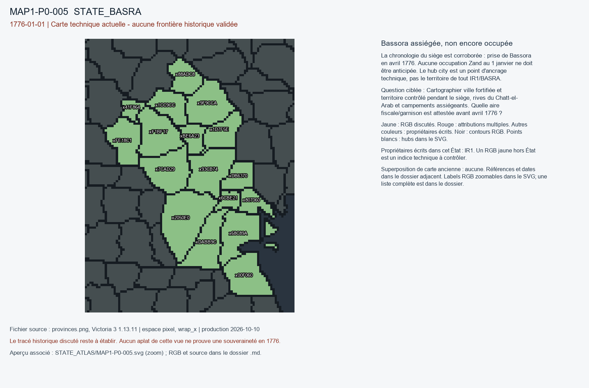

# MAP1-P0-005 — Bassora assiégée, non encore occupée

Statut : revue historique et géographique ouverte. Aucun transfert approuvé.

[Vue RGB zoomable](STATE_ATLAS/MAP1-P0-005.svg)

## Résultat de localisation technique

La chronologie du siège est corroborée : prise de Bassora en avril 1776. Aucune occupation Zand au 1 janvier ne doit être anticipée. Le hub city est un point d'ancrage technique, pas le territoire de tout IR1/BASRA.

Décision de cette passe : KEEP_OTTOMAN_SPHERE_AT_CUTOFF; DO_NOT_TRANSFER_WHOLE_STATE_TO_PER

## Question pour la recherche régionale

Cartographier ville fortifiée et territoire contrôlé pendant le siège, rives du Chatt-el-Arab et campements assiégeants. Quelle aire fiscale/garnison est attestée avant avril 1776 ?

## Références et limites

### R3_MIDDLE_EAST_NORTH_AFRICA_CAUCASUS_CENTRAL_ASIA-S003

Encyclopaedia Iranica editorial contributors. Iraq v. Afsharids to the End of the Qajars. Publication : UNKNOWN. Document : UNKNOWN.

Référence : https://www.iranicaonline.org/articles/iraq-v-afsharids-to-the-end-of-the-qajars/

Pages/carte : Passage on Sadeq Khan siege: April 1776; Baghdad Mamluk pashalik

Pertinence : 1775-1779 Basra conflict and Ottoman Iraq

Biais/limites : Page of online article; authorship not independently verified

Accès MAP-1 : ACCESSED_CHRONOLOGY_CONFIRMED. Ernest Tucker, Vol XIII pp.561-564: occupation of Basra in April 1776 after siege. Not a boundary map.

### R3_MIDDLE_EAST_NORTH_AFRICA_CAUCASUS_CENTRAL_ASIA-S004

Encyclopaedia Iranica editorial contributors. Basra. Publication : 1988. Document : UNKNOWN.

Référence : https://www.iranicaonline.org/articles/basra/

Pages/carte : Political history, siege of 1190/1776 and Persian garrison

Pertinence : Occupation distinct from initial siege 1775

Biais/limites : Article online; nomenclature of country varies

Accès MAP-1 : ACCESSED_CONTEXT_CONFIRMED. Fred M. Donner, Vol III pp.851-855: blockade, surrender during 1776, Persian garrison. Month corroborated separately.

## Géoréférencement

Bitmap exact et contours pixel extraits. Aucun fond historique superposé, aucune projection GPS adoptée, aucun résidu de calage inventé. Les points des locators sont contrôlés dans le raster, pas contre un cadastre historique. Les noms de hubs peuvent être anachroniques ou erronés. Trois points indépendants et un point de contrôle hors ajustement restent requis pour un calage local de carte ancienne.

## RGB et propriétaires écrits

| RGB | Propriétaire(s) | Pixels | Hub déclaré |
|---|---|---:|---|
| x00F060 | IR1 | 313 | STATE_BASRA:port:Kuwait |
| x1CC9CC | IR1 | 199 |  |
| x1D7F5E | IR1 | 205 |  |
| x2050E0 | IR1 | 531 |  |
| x41F864 | IR1 | 79 |  |
| x68C89A | IR1 | 359 |  |
| x6CBE21 | IR1 | 83 |  |
| x7CAD29 | IR1 | 343 | STATE_BASRA:wood:Nasiriya |
| x807060 | IR1 | 134 | STATE_BASRA:city:Basra |
| x88ADC8 | IR1 | 189 | STATE_BASRA:mine:Kut |
| x93CB74 | IR1 | 357 |  |
| x9F9CCA | IR1 | 335 | STATE_BASRA:farm:Amara |
| xBE6A23 | IR1 | 127 |  |
| xDABB9C | IR1 | 312 |  |
| xDB6370 | IR1 | 154 |  |
| xF1BF17 | IR1 | 337 |  |
| xFE18C1 | IR1 | 262 |  |
