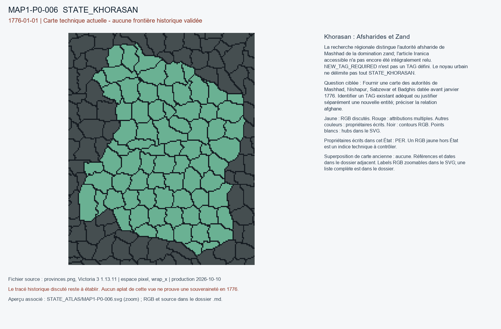

# MAP1-P0-006 — Khorasan : Afsharides et Zand

Statut : revue historique et géographique ouverte. Aucun transfert approuvé.

[Vue RGB zoomable](STATE_ATLAS/MAP1-P0-006.svg)

## Résultat de localisation technique

La recherche régionale distingue l'autorité afsharide de Mashhad de la domination zand; l'article Iranica accessible n'a pas encore été intégralement relu. NEW_TAG_REQUIRED n'est pas un TAG défini. Le noyau urbain ne délimite pas tout STATE_KHORASAN.

Décision de cette passe : NO_NEW_TAG_CREATED; REQUIRE_LOCAL_CONTROL_BOUNDARY

## Question pour la recherche régionale

Fournir une carte des autorités de Mashhad, Nishapur, Sabzevar et Badghis datée avant janvier 1776. Identifier un TAG existant adéquat ou justifier séparément une nouvelle entité; préciser la relation afghane.

## Références et limites

### R3_MIDDLE_EAST_NORTH_AFRICA_CAUCASUS_CENTRAL_ASIA-S005

John R. Perry. Karim Khan Zand. Publication : 2012. Document : UNKNOWN.

Référence : https://www.iranicaonline.org/articles/karim-khan-zand/

Pages/carte : Military and foreign relations, Basra 1775-1779

Pertinence : Zand expansion under Karim Khan

Biais/limites : Distinguish dynastic and practical autonomy, chronology

Accès MAP-1 : CATALOG_ONLY_NOT_FETCHED. Notice importée, source originale non consultée indépendamment.

### R3_MIDDLE_EAST_NORTH_AFRICA_CAUCASUS_CENTRAL_ASIA-S006

Encyclopaedia Iranica contributors. Khorasan x. History in the Safavid and Afsharid periods. Publication : UNKNOWN. Document : UNKNOWN.

Référence : https://www.iranicaonline.org/articles/khorasan-x-history-in-the-safavid-and-afsharid-periods/

Pages/carte : Final paragraphs, Shahrokh at Mashhad until 1795

Pertinence : Direct 1747-1795

Biais/limites : Historical Khorasan region wider than state bitmap

Accès MAP-1 : ACCESSED_NOT_FULLY_REVIEWED. Article accessible, Kioumars Ghereghlou. Afsharid control extent and final paragraphs still require detailed regional review.

## Géoréférencement

Bitmap exact et contours pixel extraits. Aucun fond historique superposé, aucune projection GPS adoptée, aucun résidu de calage inventé. Les points des locators sont contrôlés dans le raster, pas contre un cadastre historique. Les noms de hubs peuvent être anachroniques ou erronés. Trois points indépendants et un point de contrôle hors ajustement restent requis pour un calage local de carte ancienne.

## RGB et propriétaires écrits

| RGB | Propriétaire(s) | Pixels | Hub déclaré |
|---|---|---:|---|
| x017021 | PER | 295 |  |
| x07C3C1 | PER | 226 |  |
| x09EC79 | PER | 215 |  |
| x16AE6E | PER | 247 |  |
| x235294 | PER | 142 |  |
| x250EA9 | PER | 283 |  |
| x2CC853 | PER | 206 |  |
| x35E580 | PER | 211 |  |
| x39C083 | PER | 315 |  |
| x3DDD90 | PER | 210 |  |
| x4058BB | PER | 230 |  |
| x41B208 | PER | 319 |  |
| x4CD18D | PER | 92 |  |
| x4F3FC9 | PER | 198 |  |
| x53B53B | PER | 192 |  |
| x56E6F2 | PER | 328 |  |
| x57893E | PER | 228 |  |
| x5BAC61 | PER | 300 |  |
| x6208A0 | PER | 264 |  |
| x62D297 | PER | 189 |  |
| x639DDD | PER | 439 |  |
| x6D2203 | PER | 259 |  |
| x6E6FDC | PER | 305 |  |
| x6E99FA | PER | 301 |  |
| x6FE987 | PER | 157 |  |
| x71BA88 | PER | 259 |  |
| x746A7C | PER | 211 | STATE_KHORASAN:farm:Sabzevar |
| x84BB30 | PER | 164 |  |
| x868586 | PER | 333 |  |
| x888432 | PER | 233 |  |
| x89332A | PER | 317 |  |
| x8A3C3C | PER | 202 |  |
| x92941B | PER | 266 |  |
| x932884 | PER | 201 |  |
| x9369BF | PER | 220 |  |
| x943855 | PER | 287 | STATE_KHORASAN:wood:Bojnurd |
| x95024E | PER | 229 |  |
| x95D808 | PER | 240 |  |
| x964953 | PER | 216 |  |
| x98DCCC | PER | 175 | STATE_KHORASAN:mine:Birjand |
| x9C5383 | PER | 256 |  |
| x9C8A25 | PER | 216 |  |
| x9CB55A | PER | 238 |  |
| xA26087 | PER | 234 |  |
| xA6D67E | PER | 216 |  |
| xA7818E | PER | 250 |  |
| xA8549E | PER | 291 |  |
| xAA21EB | PER | 264 |  |
| xAC03B8 | PER | 264 |  |
| xAE765F | PER | 262 |  |
| xB0A555 | PER | 76 |  |
| xB7CE9D | PER | 269 |  |
| xB99ECB | PER | 103 |  |
| xBEA6BB | PER | 228 |  |
| xC0B020 | PER | 414 |  |
| xC0E354 | PER | 173 |  |
| xC0F0E0 | PER | 122 |  |
| xC6F164 | PER | 109 |  |
| xC7F975 | PER | 273 |  |
| xCFE904 | PER | 374 |  |
| xD37C65 | PER | 212 |  |
| xD3C02D | PER | 223 |  |
| xD6E8C2 | PER | 160 |  |
| xDEE397 | PER | 251 |  |
| xE10ECF | PER | 314 |  |
| xE3DC87 | PER | 123 |  |
| xE3E233 | PER | 259 |  |
| xE3EF67 | PER | 111 |  |
| xE91143 | PER | 301 |  |
| xEB9FD7 | PER | 324 |  |
| xEBB44F | PER | 233 |  |
| xEF1467 | PER | 157 |  |
| xF394BC | PER | 171 |  |
| xF4E0BD | PER | 198 |  |
| xF559AB | PER | 199 | STATE_KHORASAN:city:Mashhad |
