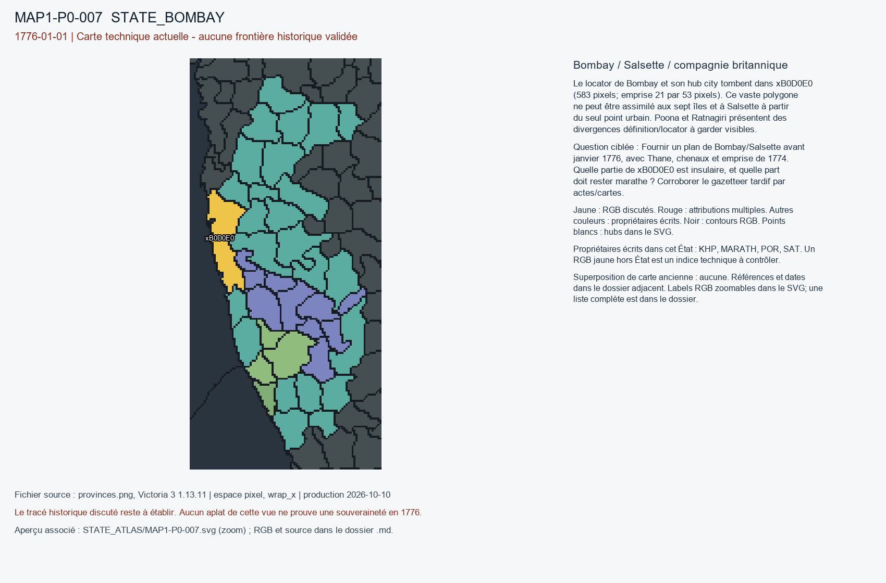

# MAP1-P0-007 — Bombay / Salsette / compagnie britannique

Statut : revue historique et géographique ouverte. Aucun transfert approuvé.

[Vue RGB zoomable](STATE_ATLAS/MAP1-P0-007.svg)

## Résultat de localisation technique

Le locator de Bombay et son hub city tombent dans xB0D0E0 (583 pixels; emprise 21 par 53 pixels). Ce vaste polygone ne peut être assimilé aux sept îles et à Salsette à partir du seul point urbain. Poona et Ratnagiri présentent des divergences définition/locator à garder visibles.

Décision de cette passe : REJECT_WHOLE_HUB_PROVINCE_AUTOMATIC_TRANSFER

## Question pour la recherche régionale

Fournir un plan de Bombay/Salsette avant janvier 1776, avec Thane, chenaux et emprise de 1774. Quelle partie de xB0D0E0 est insulaire, et quelle part doit rester marathe ? Corroborer le gazetteer tardif par actes/cartes.

## Références et limites

### R4_SOUTH_ASIA-S048

Government of India / political archive historian. Treaty of Surat. Publication : 1775-03-06. Document : 1775-03-06.

Référence : https://en.wikipedia.org/wiki/Treaty_of_Surat

Pages/carte : Terms and timing; 1776 Treaty of Purandar after cutoff

Pertinence : 1775 promise Salsette and Bassein by Raghunathrao, contested; no general Maratha territorial annexation

Biais/limites : Encyclopedia digest not authenticated treaty transcript; do not conflate de jure and 1774 occupation.

Accès MAP-1 : CATALOG_ONLY_NOT_FETCHED. Notice importée, source originale non consultée indépendamment.

### R4_SOUTH_ASIA-S057

J. M. Campbell, editor, Government Central Press, Bombay. Gazetteer of the Bombay Presidency, Vol XIII Thana (History). Publication : 1882. Document : 1774-1775.

Référence : Gazetteer of the Bombay Presidency, vol. XIII: Thana, Bombay Government Central Press, 1882, ch. VII, section Salsette Taken 1774 (digitized at https://www.scribd.com/document/795214497/cu31924070623610)

Pages/carte : Ch VII, paragraphs British conquest Salsette Dec 1774, British possessions at 1 Jan 1775

Pertinence : Bombay Company military acquisition of Salsette in Dec 1774; Bassein legally and militarily disputed

Biais/limites : Retrospective colonial report; second-hand digital copy; not a territorial shapefile.

Accès MAP-1 : CATALOG_ONLY_NOT_FETCHED. Notice importée, source originale non consultée indépendamment.

## Géoréférencement

Bitmap exact et contours pixel extraits. Aucun fond historique superposé, aucune projection GPS adoptée, aucun résidu de calage inventé. Les points des locators sont contrôlés dans le raster, pas contre un cadastre historique. Les noms de hubs peuvent être anachroniques ou erronés. Trois points indépendants et un point de contrôle hors ajustement restent requis pour un calage local de carte ancienne.

## RGB et propriétaires écrits

| RGB | Propriétaire(s) | Pixels | Hub déclaré |
|---|---|---:|---|
| x052B29 | MARATH | 141 |  |
| x1131A0 | KHP | 148 |  |
| x11B0A0 | MARATH | 398 |  |
| x187C37 | SAT | 143 |  |
| x195332 | MARATH | 251 |  |
| x1B071A | MARATH | 240 |  |
| x1C8B97 | MARATH | 103 |  |
| x2D4B90 | MARATH | 343 |  |
| x33E560 | SAT | 96 |  |
| x3E5505 | SAT | 78 |  |
| x405FB4 | MARATH | 229 |  |
| x40CE40 | KHP | 116 |  |
| x42ACA6 | KHP | 394 | STATE_BOMBAY:wood:Kolhapore |
| x47EE55 | SAT | 116 |  |
| x4D118A | MARATH | 153 | STATE_BOMBAY:farm:Poona |
| x4F5C91 | SAT | 272 |  |
| x51F0A0 | POR | 123 | STATE_BOMBAY:port:Nova Goa |
| x53A379 | MARATH | 195 |  |
| x5B30D1 | MARATH | 265 |  |
| x6CC5CE | MARATH | 315 |  |
| x7629BF | MARATH | 266 |  |
| x9031A0 | MARATH | 362 |  |
| x90B021 | MARATH | 351 |  |
| xB0D0E0 | MARATH | 583 | STATE_BOMBAY:city:Bombay |
| xB863FE | MARATH | 343 |  |
| xC9CD8E | MARATH | 243 |  |
| xCC722D | SAT | 208 |  |
| xCF3817 | SAT | 229 |  |
| xD04F5D | MARATH | 175 |  |
| xD070A0 | MARATH | 272 |  |
| xD4CACE | MARATH | 364 |  |
| xD6660F | SAT | 96 |  |
| xDDFDE6 | MARATH | 300 |  |
| xE01853 | SAT | 90 |  |
| xE73C3C | SAT | 284 |  |
| xEBD7BE | MARATH | 174 | STATE_BOMBAY:mine:Ratnagiri |
| xEBE18C | MARATH | 172 |  |
| xED0654 | MARATH | 215 |  |
| xF8B0CF | MARATH | 279 |  |
