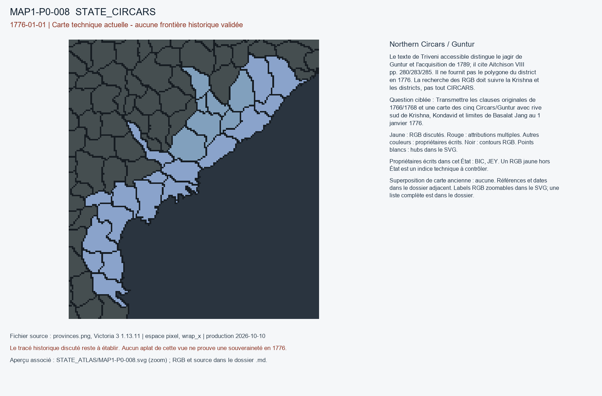

# MAP1-P0-008 — Northern Circars / Guntur

Statut : revue historique et géographique ouverte. Aucun transfert approuvé.

[Vue RGB zoomable](STATE_ATLAS/MAP1-P0-008.svg)

## Résultat de localisation technique

Le texte de Triveni accessible distingue le jagir de Guntur et l'acquisition de 1789; il cite Aitchison VIII pp. 280/283/285. Il ne fournit pas le polygone du district en 1776. La recherche des RGB doit suivre la Krishna et les districts, pas tout CIRCARS.

Décision de cette passe : NO_1789_RETROPROJECTION; REQUIRE_GUNTUR_POLYGON

## Question pour la recherche régionale

Transmettre les clauses originales de 1766/1768 et une carte des cinq Circars/Guntur avec rive sud de Krishna, Kondavid et limites de Basalat Jang au 1 janvier 1776.

## Références et limites

### R4_SOUTH_ASIA-S005

R. Sheshadri (Triveni journal). The Ceded Districts, the Circars, and the Nizam. Publication : UNKNOWN. Document : 1765-1789.

Référence : https://www.wisdomlib.org/history/compilation/triveni-journal/d/doc68070.html

Pages/carte : Discussion of 1766 and 1768 treaties; Aitchison Treaties vol VIII pp. 280, 283, 285 cited

Pertinence : Northern Circars four districts granted by 1768; Guntur not possessed until 1789

Biais/limites : Colonial interpretation strongly asserts sovereignty; no modern vector boundary; check cited treaty primary.

Accès MAP-1 : ACCESSED_CHRONOLOGY_CONFIRMED. T. Bhujanga Rao, Triveni Oct-Dec 1940, paragraphs on 1766/1768 and Guntur acquisition in 1789; colonial argument, treaty citations not original scans.

## Géoréférencement

Bitmap exact et contours pixel extraits. Aucun fond historique superposé, aucune projection GPS adoptée, aucun résidu de calage inventé. Les points des locators sont contrôlés dans le raster, pas contre un cadastre historique. Les noms de hubs peuvent être anachroniques ou erronés. Trois points indépendants et un point de contrôle hors ajustement restent requis pour un calage local de carte ancienne.

## RGB et propriétaires écrits

| RGB | Propriétaire(s) | Pixels | Hub déclaré |
|---|---|---:|---|
| x0AC82E | BIC | 232 | STATE_CIRCARS:farm:Nellore |
| x11F0A0 | BIC | 336 |  |
| x180640 | BIC | 152 |  |
| x207C4F | BIC | 260 |  |
| x365CC3 | BIC | 368 |  |
| x3EC5D1 | JEY | 318 |  |
| x42F4F2 | BIC | 129 |  |
| x477063 | BIC | 293 | STATE_CIRCARS:city:Vizagapatam|STATE_CIRCARS:port:Masulipatnam |
| x6B15F1 | JEY | 329 |  |
| x7166FA | JEY | 144 | STATE_CIRCARS:mine:Jeypore |
| x73B187 | BIC | 372 |  |
| x8B1F32 | BIC | 220 |  |
| x9070A0 | BIC | 282 | STATE_CIRCARS:wood:Rajahmundry |
| x9193B1 | BIC | 82 |  |
| xB00B6B | JEY | 60 |  |
| xB3DED5 | JEY | 404 |  |
| xC744F9 | JEY | 136 |  |
| xCDFBE6 | BIC | 354 |  |
| xCFF020 | BIC | 267 |  |
| xD19AD8 | JEY | 204 |  |
| xE2CF64 | BIC | 222 |  |
| xE9BCE7 | BIC | 357 |  |
| xEBBB7A | BIC | 163 |  |
| xF8BB81 | BIC | 381 |  |
