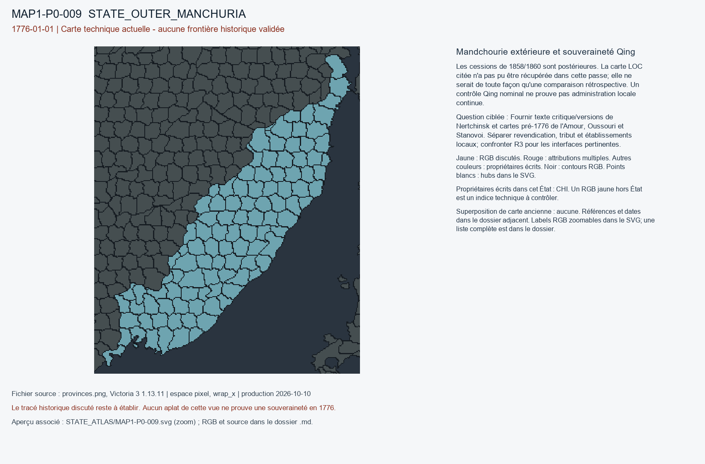

# MAP1-P0-009 — Mandchourie extérieure et souveraineté Qing

Statut : revue historique et géographique ouverte. Aucun transfert approuvé.

[Vue RGB zoomable](STATE_ATLAS/MAP1-P0-009.svg)

## Résultat de localisation technique

Les cessions de 1858/1860 sont postérieures. La carte LOC citée n'a pas pu être récupérée dans cette passe; elle ne serait de toute façon qu'une comparaison rétrospective. Un contrôle Qing nominal ne prouve pas administration locale continue.

Décision de cette passe : NO_RUS_EXPANSION_FROM_1858_1860_MAP

## Question pour la recherche régionale

Fournir texte critique/versions de Nertchinsk et cartes pré-1776 de l'Amour, Oussouri et Stanovoi. Séparer revendication, tribut et établissements locaux; confronter R3 pour les interfaces pertinentes.

## Références et limites

### R5_EAST_ASIA-S08

Tessa Morris-Suzuki. Indigenous Diplomacy: Sakhalin Ainu (Enchiw) in the Shaping of Modern East Asia (Part 1: Traders and Travellers). Publication : 2020-11-15. Document : 1732|1771|1790.

Référence : https://apjjf.org/2020/22/morris-suzuki

Pages/carte : Asia-Pacific Journal: Japan Focus 18(22), article 5512; sections Qing tribute / Matsumae trading posts

Pertinence : Sources Qing sur nominations hala-i-da en 1732; voyage japonais 1771; poste Shiranushi seulement 1790

Biais/limites : Aucune équivalence automatique entre clans attestés et territoires des TAGs du mod

Accès MAP-1 : CATALOG_ONLY_NOT_FETCHED. Notice importée, source originale non consultée indépendamment.

### R5_EAST_ASIA-S15

Plénipotentiaires Qing (Songgotu) et russes (F. A. Golovin). Treaty of Nerchinsk / Traité de Nertchinsk. Publication : 1689-08-27. Document : 1689-08-27.

Référence : Texte latin, éd. Henri Cordier, Histoire des Relations de la Chine avec les Puissances Occidentales, t. I; https://la.wikisource.org/wiki/Pactum_Nertschiae

Pages/carte : articles sur Argoun, Amour et monts Stanovoï; repérage topographique fin à confirmer

Pertinence : Frontière de droit applicable à la région Amour avant 1858

Biais/limites : Versions manchoue/latine/russe différentes; localisation de certains reliefs disputée; URL donnée pour accès secondaire

Accès MAP-1 : CATALOG_ONLY_NOT_FETCHED. Notice importée, source originale non consultée indépendamment.

### R5_EAST_ASIA-S16

Cartographe russe non identifié (édition d’Irkoutsk). Karta Amurskoĭ strany prisoedinënnoĭ k Rossii po Aĭgunskomu dogovoru. Publication : 1860-1869. Document : 1858|1860.

Référence : https://www.loc.gov/resource/gdc.2018694143/

Pages/carte : carte unique, anciennes et nouvelles frontières figurées

Pertinence : Comparaison rétrospective des limites avant/après 1858–1860

Biais/limites : Document postérieur et perspective impériale russe; ne prouve pas occupation locale en 1776

Accès MAP-1 : FETCH_FAILED. LOC resource link failed; never used to draw 1776 frontier.

## Géoréférencement

Bitmap exact et contours pixel extraits. Aucun fond historique superposé, aucune projection GPS adoptée, aucun résidu de calage inventé. Les points des locators sont contrôlés dans le raster, pas contre un cadastre historique. Les noms de hubs peuvent être anachroniques ou erronés. Trois points indépendants et un point de contrôle hors ajustement restent requis pour un calage local de carte ancienne.

## RGB et propriétaires écrits

| RGB | Propriétaire(s) | Pixels | Hub déclaré |
|---|---|---:|---|
| x020E07 | CHI | 216 |  |
| x0484A7 | CHI | 199 |  |
| x080E16 | CHI | 191 |  |
| x0824CA | CHI | 255 |  |
| x08BE7F | CHI | 288 |  |
| x0A4375 | CHI | 217 |  |
| x0B50B4 | CHI | 203 |  |
| x0D7B7C | CHI | 244 |  |
| x0E5076 | CHI | 230 |  |
| x0F199C | CHI | 213 |  |
| x0FFBEE | CHI | 284 |  |
| x1347CA | CHI | 342 |  |
| x1842A7 | CHI | 385 |  |
| x1D529E | CHI | 253 |  |
| x1E0962 | CHI | 150 |  |
| x1EA2A4 | CHI | 120 |  |
| x28E8B3 | CHI | 228 |  |
| x2F3C33 | CHI | 273 |  |
| x309CF9 | CHI | 248 |  |
| x30DDF1 | CHI | 255 |  |
| x323133 | CHI | 170 |  |
| x34DB64 | CHI | 268 |  |
| x3FBD7A | CHI | 239 |  |
| x41FBE5 | CHI | 259 |  |
| x454DCA | CHI | 140 |  |
| x45A652 | CHI | 115 |  |
| x4DB84A | CHI | 266 |  |
| x4ED3BB | CHI | 258 |  |
| x4FFF67 | CHI | 263 |  |
| x50B7B1 | CHI | 242 |  |
| x557928 | CHI | 223 |  |
| x55EDE2 | CHI | 192 |  |
| x571DFC | CHI | 240 |  |
| x573287 | CHI | 349 |  |
| x5742AA | CHI | 238 |  |
| x588B58 | CHI | 267 |  |
| x5A1EFF | CHI | 299 |  |
| x5B760A | CHI | 399 |  |
| x60D080 | CHI | 218 |  |
| x60D100 | CHI | 306 |  |
| x62E7E9 | CHI | 251 |  |
| x6574C2 | CHI | 211 |  |
| x659CA2 | CHI | 226 |  |
| x6892D3 | CHI | 197 |  |
| x6A230E | CHI | 236 |  |
| x6F9D8A | CHI | 364 |  |
| x7384FE | CHI | 228 |  |
| x765D85 | CHI | 268 |  |
| x79F88A | CHI | 192 | STATE_OUTER_MANCHURIA:port:Haishenwai |
| x7D6986 | CHI | 99 | STATE_OUTER_MANCHURIA:wood:Bazhongnuo |
| x81E2C0 | CHI | 200 |  |
| x842F0A | CHI | 323 |  |
| x8811C4 | CHI | 191 |  |
| x8A6194 | CHI | 345 |  |
| x8B26F4 | CHI | 273 |  |
| x8C14B7 | CHI | 219 |  |
| x8FBFEA | CHI | 179 |  |
| x90C920 | CHI | 346 |  |
| x90E2A0 | CHI | 116 |  |
| x9131BD | CHI | 236 |  |
| x913950 | CHI | 229 |  |
| x9434E1 | CHI | 198 |  |
| x9ADC13 | CHI | 218 |  |
| x9EEF86 | CHI | 154 |  |
| x9F61D4 | CHI | 209 |  |
| xA0AA3D | CHI | 91 |  |
| xA48A17 | CHI | 34 |  |
| xA748D2 | CHI | 196 |  |
| xA7DA2B | CHI | 146 |  |
| xAE877C | CHI | 251 |  |
| xAFA8BA | CHI | 355 |  |
| xB0A559 | CHI | 246 |  |
| xB131A0 | CHI | 229 |  |
| xB360DD | CHI | 271 |  |
| xB7B43B | CHI | 238 | STATE_OUTER_MANCHURIA:city:Boli |
| xBC9607 | CHI | 214 |  |
| xC2624F | CHI | 232 |  |
| xC5E68C | CHI | 183 |  |
| xC669D4 | CHI | 343 |  |
| xC780ED | CHI | 143 |  |
| xCD3C76 | CHI | 173 |  |
| xD69D1F | CHI | 197 |  |
| xD83D4C | CHI | 228 |  |
| xD93024 | CHI | 225 |  |
| xDC9333 | CHI | 243 |  |
| xDD5F68 | CHI | 217 |  |
| xDDAE0B | CHI | 156 |  |
| xE05180 | CHI | 165 | STATE_OUTER_MANCHURIA:mine:Yezhuhe |
| xE13F68 | CHI | 222 |  |
| xE1756B | CHI | 219 |  |
| xE18C83 | CHI | 84 | STATE_OUTER_MANCHURIA:farm:Yiman |
| xE1C5AB | CHI | 223 |  |
| xE354A7 | CHI | 209 |  |
| xE8B11C | CHI | 252 |  |
| xE8BE2B | CHI | 304 |  |
| xEC7336 | CHI | 158 |  |
| xEFA41F | CHI | 231 |  |
| xF03A34 | CHI | 202 |  |
| xF10966 | CHI | 205 |  |
| xF17D23 | CHI | 166 |  |
| xF44CBD | CHI | 262 |  |
| xF4C230 | CHI | 211 |  |
| xF51380 | CHI | 221 |  |
| xF77148 | CHI | 239 |  |
| xF8C942 | CHI | 193 |  |
| xFCDC34 | CHI | 216 |  |
