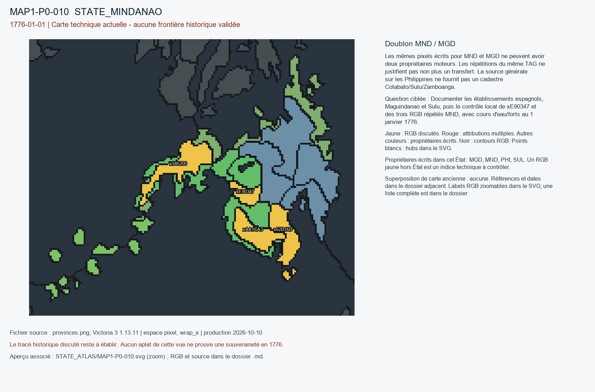

# MAP1-P0-010 — Doublon MND / MGD

Statut : revue historique et géographique ouverte. Aucun transfert approuvé.

[Vue RGB zoomable](STATE_ATLAS/MAP1-P0-010.svg)

## Résultat de localisation technique

Les mêmes pixels écrits pour MND et MGD ne peuvent avoir deux propriétaires moteurs. Les répétitions du même TAG ne justifient pas non plus un transfert. La source générale sur les Philippines ne fournit pas un cadastre Cotabato/Sulu/Zamboanga.

Décision de cette passe : KEEP_DUPLICATE_ATTRIBUTIONS_IN_INDEX_UNTIL_ARBITRATION

## Question pour la recherche régionale

Documenter les établissements espagnols, Maguindanao et Sulu, puis le contrôle local de xE90347 et des trois RGB répétés MND, avec cours d'eau/forts au 1 janvier 1776.

## Références et limites

### R6_SOUTHEAST_ASIA_OCEANIA-S013

Vicente L. Rafael. Colonial Contractions: The Making of the Modern Philippines, 1565–1946. Publication : 2019. Document : UNKNOWN.

Référence : https://history.washington.edu/sites/history/files/documents/research/vicente_l._rafael_colonial_contractions.pdf

Pages/carte : Oxford Research Encyclopedia of Asian History, PDF pp. 2–5 sur datus, colonisation inégale, Sulu, Maguindanao; 32 p.

Pertinence : Sulu, Maguindanao et espagnols XVIIIe siècle

Biais/limites : Les réseaux commerciaux et militaires ne délimitent pas seuls juridictions villageoises.

Accès MAP-1 : CATALOG_ONLY_NOT_FETCHED. Notice importée, source originale non consultée indépendamment.

## Géoréférencement

Bitmap exact et contours pixel extraits. Aucun fond historique superposé, aucune projection GPS adoptée, aucun résidu de calage inventé. Les points des locators sont contrôlés dans le raster, pas contre un cadastre historique. Les noms de hubs peuvent être anachroniques ou erronés. Trois points indépendants et un point de contrôle hors ajustement restent requis pour un calage local de carte ancienne.

## RGB et propriétaires écrits

| RGB | Propriétaire(s) | Pixels | Hub déclaré |
|---|---|---:|---|
| x0180F0 | SUL | 310 |  |
| x2D5E65 | MND | 336 | STATE_MINDANAO:city:Davao |
| x355FBE | MGD | 132 |  |
| x4C67A7 | MGD | 355 | STATE_MINDANAO:mine:Cotabato |
| x585200 | MND | 404 |  |
| x62D16D | MND | 318 |  |
| x678557 | MGD | 214 |  |
| x7B364D | PHI | 238 |  |
| x988CCA | MND | 437 |  |
| x99D030 | SUL | 62 |  |
| xAA1CA3 | MND | 288 |  |
| xBC5002 | MND | 461 | STATE_MINDANAO:farm:Cagayan de Oro |
| xC3EC2D | MND | 582 |  |
| xCAFE73 | PHI | 412 | STATE_MINDANAO:wood:Butuan |
| xE804B7 | MGD | 266 |  |
| xE90347 | MGD / MND | 137 |  |
| xF0014A | PHI | 39 | STATE_MINDANAO:port:Zamboanga |
