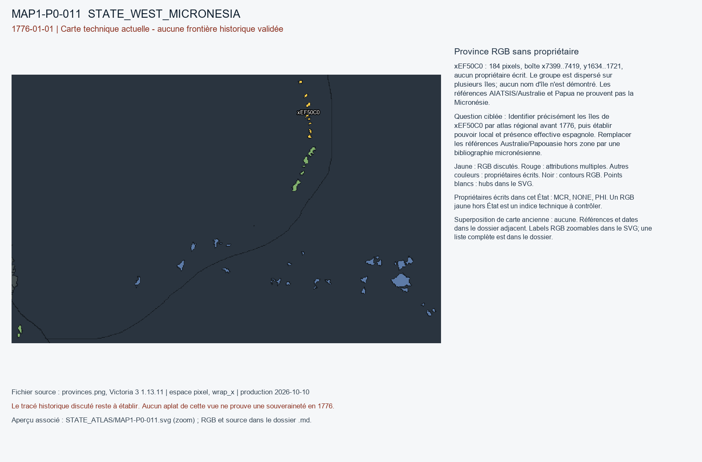

# MAP1-P0-011 — Province RGB sans propriétaire

Statut : revue historique et géographique ouverte. Aucun transfert approuvé.

[Vue RGB zoomable](STATE_ATLAS/MAP1-P0-011.svg)

## Résultat de localisation technique

xEF50C0 : 184 pixels, boîte x7399..7419, y1634..1721, aucun propriétaire écrit. Le groupe est dispersé sur plusieurs îles; aucun nom d'île n'est démontré. Les références AIATSIS/Australie et Papua ne prouvent pas la Micronésie.

Décision de cette passe : NO_DEFAULT_ASSIGNMENT_TO_MCR_OR_PHI; SOURCES_OUT_OF_SCOPE

## Question pour la recherche régionale

Identifier précisément les îles de xEF50C0 par atlas régional avant 1776, puis établir pouvoir local et présence effective espagnole. Remplacer les références Australie/Papouasie hors zone par une bibliographie micronésienne.

## Références et limites

### R6_SOUTHEAST_ASIA_OCEANIA-S013

Vicente L. Rafael. Colonial Contractions: The Making of the Modern Philippines, 1565–1946. Publication : 2019. Document : UNKNOWN.

Référence : https://history.washington.edu/sites/history/files/documents/research/vicente_l._rafael_colonial_contractions.pdf

Pages/carte : Oxford Research Encyclopedia of Asian History, PDF pp. 2–5 sur datus, colonisation inégale, Sulu, Maguindanao; 32 p.

Pertinence : Sulu, Maguindanao et espagnols XVIIIe siècle

Biais/limites : Les réseaux commerciaux et militaires ne délimitent pas seuls juridictions villageoises.

Accès MAP-1 : CATALOG_ONLY_NOT_FETCHED. Notice importée, source originale non consultée indépendamment.

### R6_SOUTHEAST_ASIA_OCEANIA-S014

David R. Horton / AIATSIS. The AIATSIS Map of Indigenous Australia. Publication : 1996. Document : UNKNOWN.

Référence : https://shop.aiatsis.gov.au/products/the-aiatsis-map?variant=33993273442440

Pages/carte : Carte nationale et avertissement de l’AIATSIS

Pertinence : Localisation générale des nations et groupes, sans frontières fixes rétroprojetables en 1776

Biais/limites : AIATSIS souligne explicitement frontières non fixes, informations contestées, pas de valeur foncière.

Accès MAP-1 : CATALOG_ONLY_NOT_FETCHED. Notice importée, source originale non consultée indépendamment.

### R6_SOUTHEAST_ASIA_OCEANIA-S022

University of Auckland. What’s at stake in West Papua. Publication : 2019-12-31. Document : UNKNOWN.

Référence : https://www.auckland.ac.nz/en/news/2020/01/03/whats-at-stake-in-west-papua.html

Pages/carte : Paragraphe: Dutch claim of West New Guinea 1828

Pertinence : Premier établissement/prise de position coloniale néerlandaise 1828

Biais/limites : Source rétrospective; suzeraineté locale de Tidore exige étude séparée.

Accès MAP-1 : CATALOG_ONLY_NOT_FETCHED. Notice importée, source originale non consultée indépendamment.

## Géoréférencement

Bitmap exact et contours pixel extraits. Aucun fond historique superposé, aucune projection GPS adoptée, aucun résidu de calage inventé. Les points des locators sont contrôlés dans le raster, pas contre un cadastre historique. Les noms de hubs peuvent être anachroniques ou erronés. Trois points indépendants et un point de contrôle hors ajustement restent requis pour un calage local de carte ancienne.

## RGB et propriétaires écrits

| RGB | Propriétaire(s) | Pixels | Hub déclaré |
|---|---|---:|---|
| x414170 | MCR | 851 | STATE_WEST_MICRONESIA:mine:Relong |
| x6E4206 | PHI | 75 |  |
| x71414D | MCR | 641 | STATE_WEST_MICRONESIA:city:Weno|STATE_WEST_MICRONESIA:farm:Igup|STATE_WEST_MICRONESIA:wood:Peniata |
| xA7F7E3 | PHI | 283 | STATE_WEST_MICRONESIA:port:Onoun |
| xEF50C0 | NONE | 184 |  |
