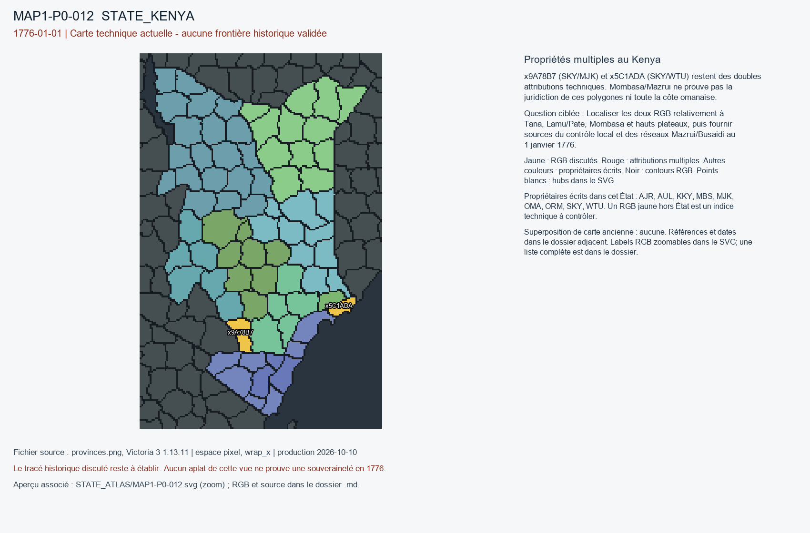

# MAP1-P0-012 — Propriétés multiples au Kenya

Statut : revue historique et géographique ouverte. Aucun transfert approuvé.

[Vue RGB zoomable](STATE_ATLAS/MAP1-P0-012.svg)

## Résultat de localisation technique

x9A78B7 (SKY/MJK) et x5C1ADA (SKY/WTU) restent des doubles attributions techniques. Mombasa/Mazrui ne prouve pas la juridiction de ces polygones ni toute la côte omanaise.

Décision de cette passe : NO_GENERIC_OMA_COAST_TRANSFER

## Question pour la recherche régionale

Localiser les deux RGB relativement à Tana, Lamu/Pate, Mombasa et hauts plateaux, puis fournir sources du contrôle local et des réseaux Mazrui/Busaidi au 1 janvier 1776.

## Références et limites

### R7_SUBSAHARAN_AFRICA-S020

F. J. Berg. The Swahili Community of Mombasa, 1500–1900. Publication : 1968. Document : UNKNOWN.

Référence : https://doi.org/10.1017/S0021853700008343

Pages/carte : Journal of African History 9(1), pp. 35–56; résumé Mazrui 1735–1837

Pertinence : Mombasa indépendante sous Mazrui au 1er janvier 1776.

Biais/limites : Hégémonie côtière non assimilable à contrôle continu de la côte ni de l’intérieur.

Accès MAP-1 : CATALOG_ONLY_NOT_FETCHED. Notice importée, source originale non consultée indépendamment.

### R7_SUBSAHARAN_AFRICA-S021

M. Reda Bhacker. Family strife and foreign intervention: causes in the separation of Zanzibar from Oman: a reappraisal. Publication : 1991. Document : UNKNOWN.

Référence : https://doi.org/10.1017/S0041977X00014786

Pages/carte : Bulletin of SOAS 54(2), pp. 269–280

Pertinence : Oman, Mazrui, Banu Nabhan, autonomie citadine, montée des Busaidi après 1776.

Biais/limites : Analyse centrée sur le XIXe; couverture omanaise précise en 1776 non démontrée.

Accès MAP-1 : CATALOG_ONLY_NOT_FETCHED. Notice importée, source originale non consultée indépendamment.

## Géoréférencement

Bitmap exact et contours pixel extraits. Aucun fond historique superposé, aucune projection GPS adoptée, aucun résidu de calage inventé. Les points des locators sont contrôlés dans le raster, pas contre un cadastre historique. Les noms de hubs peuvent être anachroniques ou erronés. Trois points indépendants et un point de contrôle hors ajustement restent requis pour un calage local de carte ancienne.

## RGB et propriétaires écrits

| RGB | Propriétaire(s) | Pixels | Hub déclaré |
|---|---|---:|---|
| x005C29 | ORM | 220 |  |
| x03C8B4 | SKY | 186 |  |
| x089446 | SKY | 288 |  |
| x08B945 | AJR | 200 |  |
| x0AF9FB | AJR | 152 |  |
| x19CFEC | AUL | 212 |  |
| x21A090 | OMA | 149 |  |
| x22D39E | MBS | 194 |  |
| x28843B | KKY | 239 | STATE_KENYA:city:Embu |
| x2F7464 | SKY | 157 |  |
| x30D3AC | MJK | 165 |  |
| x33566A | KKY | 233 |  |
| x35554F | MBS | 228 |  |
| x356777 | SKY | 261 |  |
| x405F8E | SKY | 180 |  |
| x40DE9B | KKY | 189 |  |
| x4168F3 | AJR | 273 |  |
| x46B3F6 | SKY | 129 |  |
| x47F824 | AUL | 194 |  |
| x4816E8 | ORM | 187 |  |
| x4E4C18 | SKY | 166 |  |
| x58526D | SKY | 193 |  |
| x5C1ADA | SKY / WTU | 115 |  |
| x5CB34D | MJK | 164 |  |
| x5EA4B6 | KKY | 248 |  |
| x63DAA0 | SKY | 245 |  |
| x65632F | SKY | 281 |  |
| x6B52F1 | OMA | 258 | STATE_KENYA:farm:Malindi |
| x6C071A | MJK | 247 |  |
| x6CCF4B | WTU | 138 |  |
| x77319E | SKY | 200 |  |
| x8079E2 | AUL | 233 |  |
| x834AD2 | AJR | 280 |  |
| x88F1D5 | AUL | 171 |  |
| x89BA83 | ORM | 428 | STATE_KENYA:mine:Meru |
| x8FF25F | AJR | 324 |  |
| x90F646 | SKY | 194 |  |
| x941594 | MBS | 80 |  |
| x95C403 | AJR | 272 |  |
| x996D62 | MJK | 381 |  |
| x9A78B7 | MJK / SKY | 202 |  |
| x9AE44A | SKY | 235 |  |
| x9BA0B4 | AJR | 268 |  |
| x9E9F57 | OMA | 79 |  |
| x9FDE2D | AUL | 208 |  |
| xA02190 | OMA | 104 | STATE_KENYA:port:Mombasa |
| xA0A011 | AUL | 382 |  |
| xA0A090 | KKY | 332 |  |
| xA2D8EF | SKY | 185 |  |
| xA40CF9 | KKY | 242 |  |
| xA7A757 | AUL | 195 |  |
| xADF3C8 | MJK | 262 |  |
| xB0DB1C | SKY | 254 |  |
| xB5BCCC | AJR | 253 |  |
| xB97349 | AUL | 140 |  |
| xBD067F | AJR | 224 |  |
| xBFCF3E | AUL | 253 |  |
| xC2118A | SKY | 186 |  |
| xC52E48 | OMA | 196 |  |
| xC53497 | OMA | 279 |  |
| xC80CAC | ORM | 231 |  |
| xC8B790 | ORM | 244 |  |
| xC95AAB | AJR | 284 |  |
| xD0A631 | ORM | 242 |  |
| xD775AC | SKY | 238 |  |
| xD8A2A3 | ORM | 86 |  |
| xE007A1 | AJR | 303 |  |
| xE23000 | OMA | 153 |  |
| xE5F986 | AJR | 337 |  |
| xECA4C0 | SKY | 208 |  |
| xF59538 | ORM | 202 | STATE_KENYA:wood:Garissa |
| xF89944 | SKY | 221 |  |
| xFE3967 | AUL | 91 |  |
| xFE3DAB | SKY | 155 |  |
