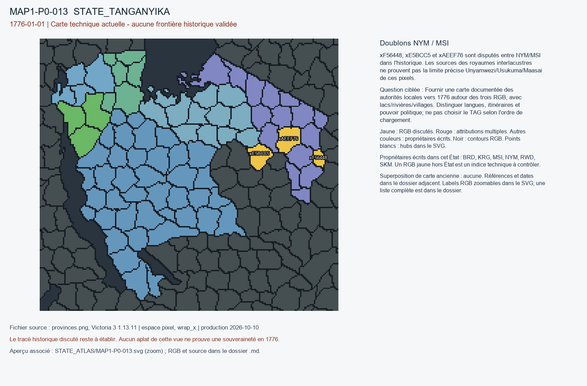

# MAP1-P0-013 — Doublons NYM / MSI

Statut : revue historique et géographique ouverte. Aucun transfert approuvé.

[Vue RGB zoomable](STATE_ATLAS/MAP1-P0-013.svg)

## Résultat de localisation technique

xF56448, xE5BCC5 et xAEEF76 sont disputés entre NYM/MSI dans l'historique. Les sources des royaumes interlacustres ne prouvent pas la limite précise Unyamwezi/Usukuma/Maasai de ces pixels.

Décision de cette passe : NO_AUTOMATIC_ETHNONYM_BORDER

## Question pour la recherche régionale

Fournir une carte documentée des autorités locales vers 1776 autour des trois RGB, avec lacs/rivières/villages. Distinguer langues, itinéraires et pouvoir politique; ne pas choisir le TAG selon l'ordre de chargement.

## Références et limites

### R7_SUBSAHARAN_AFRICA-S001

Roland Oliver; Anthony Atmore. Medieval Africa 1250–1800: Epilogue. Publication : 2001. Document : UNKNOWN.

Référence : https://doi.org/10.1017/CBO9780511811036.016

Pages/carte : Epilogue; passage sur les comptoirs européens et les souverainetés africaines

Pertinence : Synthèse quasi contemporaine de 1776; distinction très nette entre comptoirs, pistes et empires.

Biais/limites : Synthèse continentale, pas une carte de provinces; ne démontre aucune attribution RGB.

Accès MAP-1 : CATALOG_ONLY_NOT_FETCHED. Notice importée, source originale non consultée indépendamment.

### R7_SUBSAHARAN_AFRICA-S022

J. E. G. Sutton. The Antecedents of the Interlacustrine Kingdoms. Publication : 1993. Document : UNKNOWN.

Référence : https://doi.org/10.1017/S0021853700032990

Pages/carte : Journal of African History 34(1), pp. 33–64

Pertinence : Formation des pouvoirs Buganda Bunyoro Nkore Karagwe Rwanda.

Biais/limites : Généalogies et datations débattues; ne prouve pas les limites par province.

Accès MAP-1 : CATALOG_ONLY_NOT_FETCHED. Notice importée, source originale non consultée indépendamment.

## Géoréférencement

Bitmap exact et contours pixel extraits. Aucun fond historique superposé, aucune projection GPS adoptée, aucun résidu de calage inventé. Les points des locators sont contrôlés dans le raster, pas contre un cadastre historique. Les noms de hubs peuvent être anachroniques ou erronés. Trois points indépendants et un point de contrôle hors ajustement restent requis pour un calage local de carte ancienne.

## RGB et propriétaires écrits

| RGB | Propriétaire(s) | Pixels | Hub déclaré |
|---|---|---:|---|
| x02207F | NYM | 256 |  |
| x04F5F9 | NYM | 315 |  |
| x0E2596 | KRG | 181 | STATE_TANGANYIKA:wood:Bukoba |
| x16915A | BRD | 305 | STATE_TANGANYIKA:mine:Gitega |
| x1D96A3 | NYM | 213 |  |
| x206030 | NYM | 347 |  |
| x25315B | SKM | 190 |  |
| x2691C1 | NYM | 116 |  |
| x2729FD | NYM | 250 |  |
| x31DDA2 | MSI | 253 |  |
| x337D6C | NYM | 153 |  |
| x33EBC0 | MSI | 123 |  |
| x34EFF0 | RWD | 437 | STATE_TANGANYIKA:city:Kigali |
| x385BCF | SKM | 282 |  |
| x38E17B | SKM | 201 |  |
| x3F4074 | MSI | 458 |  |
| x405CA8 | NYM | 338 |  |
| x425AA5 | SKM | 157 |  |
| x4511CE | NYM | 86 |  |
| x46E610 | NYM | 390 |  |
| x494A2E | NYM | 205 |  |
| x4C93A2 | KRG | 80 |  |
| x4F3573 | NYM | 192 |  |
| x5073C4 | NYM | 176 |  |
| x5093DF | BRD | 354 |  |
| x51AA49 | KRG | 195 |  |
| x536B97 | MSI | 256 |  |
| x56F303 | MSI | 216 |  |
| x585D0C | KRG | 124 |  |
| x5954AA | RWD | 163 |  |
| x5F51AC | NYM | 268 |  |
| x5FB098 | NYM | 275 |  |
| x61218F | SKM | 208 |  |
| x642C7C | MSI | 218 |  |
| x662B31 | RWD | 189 |  |
| x6936D4 | NYM | 205 |  |
| x6CFAFE | NYM | 92 |  |
| x6E958D | NYM | 299 |  |
| x735985 | MSI | 213 |  |
| x78575F | NYM | 330 |  |
| x7CA754 | MSI | 148 |  |
| x7CE03A | NYM | 231 |  |
| x80DF50 | RWD | 182 |  |
| x839660 | MSI | 226 |  |
| x83BED8 | NYM | 115 |  |
| x858E45 | MSI | 261 |  |
| x89572B | NYM | 215 |  |
| x8C4477 | SKM | 227 |  |
| x8C8524 | SKM | 302 |  |
| x8D4D80 | NYM | 298 |  |
| x8EAA8A | NYM | 169 |  |
| x8F39A2 | NYM | 255 |  |
| x940FCF | MSI | 114 |  |
| x958123 | NYM | 230 |  |
| x97523A | MSI | 215 |  |
| xA9BAF1 | NYM | 191 |  |
| xA9F940 | NYM | 230 |  |
| xAD3AA2 | MSI | 227 |  |
| xAEEF76 | MSI / NYM | 274 |  |
| xBCE7C6 | NYM | 194 |  |
| xC40CD1 | NYM | 208 |  |
| xC8EA56 | NYM | 194 |  |
| xCA829D | NYM | 266 |  |
| xCAC52D | NYM | 154 |  |
| xCBDC0C | NYM | 285 |  |
| xD0FF5C | SKM | 155 | STATE_TANGANYIKA:farm:Mwanza |
| xD54938 | NYM | 319 |  |
| xD8B2ED | BRD | 392 |  |
| xDD184B | SKM | 214 |  |
| xDF9923 | KRG | 390 |  |
| xDFA030 | MSI | 118 |  |
| xDFB528 | KRG | 154 |  |
| xE15FF5 | SKM | 281 |  |
| xE257AF | NYM | 232 |  |
| xE5BCC5 | MSI / NYM | 248 |  |
| xEBBE80 | NYM | 249 |  |
| xECBF22 | NYM | 160 |  |
| xF25F2A | MSI | 210 |  |
| xF3365F | NYM | 287 |  |
| xF56448 | MSI / NYM | 98 |  |
| xFCA852 | SKM | 244 |  |
| xFDF261 | SKM | 288 |  |
