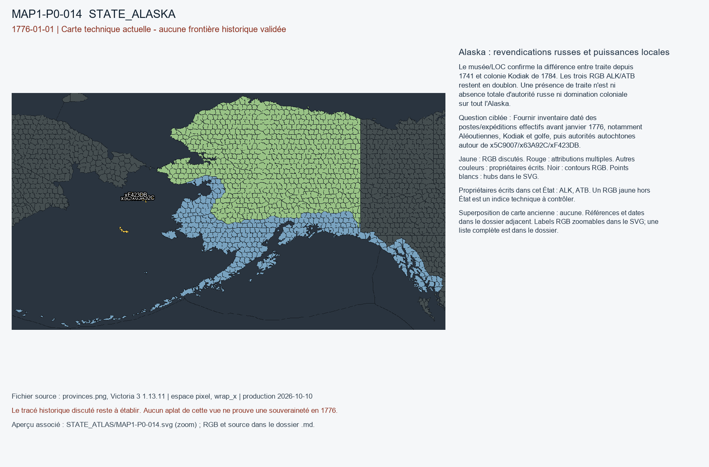

# MAP1-P0-014 — Alaska : revendications russes et puissances locales

Statut : revue historique et géographique ouverte. Aucun transfert approuvé.

[Vue RGB zoomable](STATE_ATLAS/MAP1-P0-014.svg)

## Résultat de localisation technique

Le musée/LOC confirme la différence entre traite depuis 1741 et colonie Kodiak de 1784. Les trois RGB ALK/ATB restent en doublon. Une présence de traite n'est ni absence totale d'autorité russe ni domination coloniale sur tout l'Alaska.

Décision de cette passe : NO_1784_OR_1799_COLONY_RETROPROJECTION

## Question pour la recherche régionale

Fournir inventaire daté des postes/expéditions effectifs avant janvier 1776, notamment Aléoutiennes, Kodiak et golfe, puis autorités autochtones autour de x5C9007/x63A92C/xF423DB.

## Références et limites

### R8_NORTH_AMERICA_CARIBBEAN-S015

U.S. National Park Service. Three Saints Bay Site National Historic Landmark. Publication : UNKNOWN. Document : UNKNOWN.

Référence : https://www.nps.gov/places/three-saints-bay-site.htm

Pages/carte : Founded August 1784; Kodiak first Russian colony

Pertinence : 1776-01-01; interpret dates within the source

Biais/limites : Secondary synthesis: not a verified transfer to any game province.

Accès MAP-1 : CATALOG_ONLY_NOT_FETCHED. Notice importée, source originale non consultée indépendamment.

### R8_NORTH_AMERICA_CARIBBEAN-S016

Library of Congress. Crown & Commerce in Russian America. Publication : UNKNOWN. Document : UNKNOWN.

Référence : https://www.loc.gov/exhibits/russian/russch2.html

Pages/carte : Fur hunters after 1741; colonial establishment 1784

Pertinence : 1776-01-01; interpret dates within the source

Biais/limites : Secondary synthesis: not a verified transfer to any game province.

Accès MAP-1 : ACCESSED_CHRONOLOGY_CONFIRMED. LOC exhibit separates fur trade after 1741 from colony in 1784. Exhibit map dated 1802 not overlaid.

## Géoréférencement

Bitmap exact et contours pixel extraits. Aucun fond historique superposé, aucune projection GPS adoptée, aucun résidu de calage inventé. Les points des locators sont contrôlés dans le raster, pas contre un cadastre historique. Les noms de hubs peuvent être anachroniques ou erronés. Trois points indépendants et un point de contrôle hors ajustement restent requis pour un calage local de carte ancienne.

## RGB et propriétaires écrits

| RGB | Propriétaire(s) | Pixels | Hub déclaré |
|---|---|---:|---|
| x0017A3 | ATB | 225 |  |
| x01014E | ATB | 223 |  |
| x014D28 | ALK | 406 |  |
| x021948 | ATB | 279 |  |
| x02B436 | ATB | 183 |  |
| x02D229 | ALK | 248 |  |
| x03C148 | ATB | 233 |  |
| x0481C2 | ALK | 409 |  |
| x050A36 | ATB | 233 |  |
| x051CA7 | ALK | 148 |  |
| x052092 | ATB | 215 |  |
| x055B65 | ALK | 210 |  |
| x05AA2F | ALK | 297 |  |
| x05DAFE | ATB | 321 |  |
| x062126 | ATB | 293 |  |
| x064764 | ATB | 208 |  |
| x07688A | ATB | 244 |  |
| x079E6F | ATB | 238 |  |
| x07BEB5 | ATB | 231 |  |
| x07C641 | ATB | 174 |  |
| x07CE0C | ATB | 204 |  |
| x08D187 | ATB | 254 |  |
| x0938B7 | ATB | 259 |  |
| x093B34 | ALK | 150 |  |
| x0948A5 | ATB | 219 |  |
| x0975BC | ATB | 209 |  |
| x098E2F | ATB | 312 |  |
| x09D5DB | ATB | 104 |  |
| x0A1FF9 | ATB | 189 |  |
| x0A94C6 | ALK | 245 |  |
| x0AAB61 | ATB | 222 |  |
| x0AEDE7 | ATB | 285 |  |
| x0AF925 | ALK | 377 |  |
| x0B215E | ATB | 231 |  |
| x0B8E9E | ATB | 198 |  |
| x0BDD2C | ATB | 208 |  |
| x0C1683 | ATB | 192 |  |
| x0C2257 | ATB | 228 |  |
| x0C2EAC | ATB | 234 |  |
| x0C6194 | ALK | 452 |  |
| x0C8377 | ATB | 264 |  |
| x0C947B | ATB | 225 |  |
| x0CD360 | ALK | 150 |  |
| x0CFB30 | ATB | 243 |  |
| x0D0BF4 | ATB | 216 |  |
| x0DD63D | ATB | 253 |  |
| x0EFBA2 | ATB | 210 |  |
| x0EFCC4 | ALK | 248 |  |
| x0F51A3 | ATB | 136 |  |
| x0FA728 | ATB | 184 |  |
| x1084B8 | ATB | 235 |  |
| x109112 | ATB | 242 |  |
| x10FB9E | ALK | 195 |  |
| x118711 | ATB | 256 |  |
| x11966B | ALK | 300 |  |
| x125F4D | ATB | 248 |  |
| x12848D | ATB | 129 |  |
| x12A4C3 | ALK | 165 |  |
| x12B6BA | ALK | 299 |  |
| x12DF58 | ATB | 245 |  |
| x134775 | ATB | 224 |  |
| x135EA4 | ATB | 143 |  |
| x136CAC | ATB | 219 |  |
| x13A14F | ALK | 279 |  |
| x145948 | ATB | 230 |  |
| x147817 | ATB | 267 |  |
| x14BE37 | ATB | 211 |  |
| x150B2F | ATB | 192 |  |
| x15B407 | ALK | 262 |  |
| x15E299 | ATB | 225 |  |
| x1608A2 | ALK | 211 |  |
| x164737 | ATB | 222 |  |
| x16BF3F | ATB | 233 |  |
| x1711CF | ATB | 245 |  |
| x17211C | ALK | 186 | STATE_ALASKA:wood:Valdez |
| x175438 | ATB | 297 |  |
| x176098 | ATB | 244 |  |
| x177B79 | ATB | 303 |  |
| x1780AF | ATB | 217 |  |
| x18375A | ATB | 217 |  |
| x187903 | ALK | 393 |  |
| x191D87 | ATB | 180 |  |
| x192984 | ATB | 252 |  |
| x193407 | ATB | 218 |  |
| x196F16 | ATB | 250 |  |
| x19A941 | ALK | 131 |  |
| x19E72F | ATB | 187 |  |
| x1A3FD2 | ALK | 186 |  |
| x1AADF8 | ATB | 212 |  |
| x1ACBF6 | ALK | 388 |  |
| x1AF72A | ALK | 260 |  |
| x1B00F0 | ATB | 192 |  |
| x1B7C13 | ATB | 219 |  |
| x1B8BE4 | ATB | 205 |  |
| x1B967E | ATB | 313 |  |
| x1BB4AE | ALK | 230 |  |
| x1C1D5C | ALK | 253 |  |
| x1C913E | ALK | 200 |  |
| x1D760A | ATB | 238 |  |
| x1DA1F0 | ATB | 259 |  |
| x1DBFB3 | ATB | 237 |  |
| x1DCB1D | ATB | 234 |  |
| x1E26E1 | ATB | 224 |  |
| x1E6BCF | ATB | 237 |  |
| x1EA9EC | ALK | 220 |  |
| x1F1596 | ATB | 384 |  |
| x1F2AB3 | ATB | 203 |  |
| x1F2BC9 | ATB | 307 |  |
| x1F3AE9 | ATB | 251 |  |
| x1F8C10 | ALK | 241 |  |
| x1F91CD | ALK | 204 |  |
| x1F9404 | ALK | 107 |  |
| x1FC5DB | ATB | 319 |  |
| x1FD8CA | ALK | 121 |  |
| x1FF2FE | ATB | 244 |  |
| x1FF6F0 | ATB | 130 |  |
| x20427C | ATB | 242 |  |
| x20542B | ALK | 229 |  |
| x206858 | ATB | 135 |  |
| x2094F9 | ATB | 305 |  |
| x209FA6 | ATB | 218 |  |
| x20C17A | ATB | 151 |  |
| x20CCD9 | ATB | 298 |  |
| x2118D9 | ATB | 275 |  |
| x2137C4 | ATB | 215 |  |
| x214628 | ATB | 222 |  |
| x21F1E2 | ATB | 181 |  |
| x220552 | ATB | 295 |  |
| x22103F | ATB | 237 |  |
| x221290 | ATB | 237 |  |
| x2246A1 | ATB | 224 |  |
| x2251C7 | ATB | 201 |  |
| x226493 | ATB | 203 |  |
| x22FF97 | ALK | 257 |  |
| x2320E4 | ATB | 289 |  |
| x234E0D | ALK | 741 |  |
| x239E2F | ATB | 226 |  |
| x23D48A | ALK | 293 |  |
| x23DD75 | ALK | 393 |  |
| x242DE2 | ATB | 172 |  |
| x24370A | ALK | 238 |  |
| x2457C5 | ATB | 181 |  |
| x24BE2A | ALK | 225 |  |
| x253000 | ATB | 242 |  |
| x253F33 | ATB | 216 |  |
| x253FF9 | ALK | 266 |  |
| x257BAE | ATB | 334 |  |
| x25A09F | ATB | 229 |  |
| x264B7A | ATB | 223 |  |
| x26FFD5 | ALK | 382 |  |
| x27049B | ALK | 318 |  |
| x278079 | ATB | 241 |  |
| x2833EA | ALK | 228 |  |
| x283D3D | ATB | 270 |  |
| x288902 | ATB | 237 |  |
| x28B754 | ALK | 214 |  |
| x28EC03 | ATB | 207 |  |
| x28EC12 | ATB | 195 |  |
| x2919A0 | ATB | 216 |  |
| x29F3A6 | ATB | 252 |  |
| x2A1C97 | ATB | 205 |  |
| x2A245E | ATB | 171 |  |
| x2A88BE | ATB | 269 |  |
| x2A9054 | ATB | 300 |  |
| x2AD37E | ALK | 184 |  |
| x2B301E | ATB | 219 |  |
| x2B83B7 | ATB | 256 |  |
| x2BA484 | ATB | 196 |  |
| x2BABD1 | ALK | 263 |  |
| x2BB077 | ATB | 208 |  |
| x2BBEDD | ATB | 229 |  |
| x2BE1B4 | ATB | 97 |  |
| x2BEA43 | ATB | 223 |  |
| x2C09FA | ATB | 236 |  |
| x2C4A4D | ATB | 429 |  |
| x2C67FE | ATB | 233 |  |
| x2C6A78 | ALK | 394 |  |
| x2CEF6D | ATB | 330 |  |
| x2CF213 | ALK | 218 |  |
| x2D9E6C | ATB | 258 |  |
| x2E34E5 | ATB | 121 |  |
| x2E8502 | ATB | 208 |  |
| x2ECA46 | ALK | 326 |  |
| x2EF781 | ATB | 122 |  |
| x2F56C5 | ATB | 245 |  |
| x2FA59B | ATB | 216 |  |
| x2FAD9F | ALK | 220 |  |
| x2FD897 | ATB | 246 |  |
| x2FDB96 | ALK | 196 |  |
| x3050C5 | ATB | 252 |  |
| x305FA1 | ALK | 219 |  |
| x3080F3 | ATB | 285 |  |
| x30B851 | ATB | 149 |  |
| x30BF2A | ATB | 202 |  |
| x313EB4 | ATB | 301 |  |
| x31711B | ATB | 281 |  |
| x31861A | ATB | 212 |  |
| x32050F | ATB | 238 |  |
| x32B588 | ALK | 240 |  |
| x33369E | ATB | 147 |  |
| x333DD5 | ATB | 225 |  |
| x335E8E | ATB | 180 |  |
| x3383E0 | ATB | 210 |  |
| x338931 | ALK | 295 |  |
| x339B2C | ATB | 236 |  |
| x33B2D7 | ATB | 264 |  |
| x33E102 | ATB | 240 |  |
| x33F024 | ATB | 203 |  |
| x3489FE | ATB | 206 |  |
| x34B2EB | ALK | 227 |  |
| x34BBBD | ATB | 180 |  |
| x360420 | ATB | 299 |  |
| x363D7D | ALK | 202 |  |
| x365308 | ATB | 321 |  |
| x3670BC | ATB | 246 |  |
| x36D556 | ATB | 241 |  |
| x37A238 | ATB | 225 |  |
| x37C789 | ATB | 314 |  |
| x37E27D | ATB | 162 |  |
| x37EB3F | ATB | 199 |  |
| x38170E | ATB | 114 |  |
| x3828AD | ATB | 205 |  |
| x38D5C7 | ATB | 281 |  |
| x39275A | ATB | 229 |  |
| x3927CD | ATB | 236 |  |
| x392CBF | ATB | 237 |  |
| x39FF7E | ATB | 217 |  |
| x3A610F | ALK | 212 |  |
| x3A766F | ATB | 280 |  |
| x3A820B | ALK | 273 |  |
| x3ACB3B | ATB | 276 |  |
| x3B07FC | ATB | 236 |  |
| x3B2981 | ATB | 188 |  |
| x3BD86A | ATB | 232 |  |
| x3BFC39 | ATB | 268 |  |
| x3C10FA | ATB | 285 |  |
| x3C131F | ATB | 234 |  |
| x3C4807 | ATB | 245 |  |
| x3C7542 | ATB | 218 |  |
| x3C9B4E | ATB | 233 |  |
| x3DB4D7 | ATB | 160 |  |
| x3DC76F | ATB | 228 |  |
| x3DCE92 | ATB | 240 |  |
| x3DD5D3 | ATB | 229 |  |
| x3DEC00 | ATB | 195 |  |
| x3E24C2 | ALK | 282 |  |
| x3E347B | ATB | 160 |  |
| x3F01EE | ATB | 210 |  |
| x3F3355 | ALK | 170 |  |
| x3F4B9B | ATB | 265 |  |
| x3F5233 | ALK | 245 |  |
| x3F537F | ATB | 195 |  |
| x3F7A53 | ATB | 276 |  |
| x3F8861 | ATB | 253 |  |
| x3FF213 | ATB | 254 |  |
| x405DCA | ATB | 280 |  |
| x40B2DE | ATB | 249 |  |
| x40F546 | ATB | 244 |  |
| x41185D | ATB | 235 |  |
| x4125BE | ATB | 225 |  |
| x4156EE | ATB | 147 |  |
| x4178F3 | ALK | 228 |  |
| x41A3C7 | ATB | 234 |  |
| x41C4B1 | ATB | 190 |  |
| x426CC6 | ATB | 227 |  |
| x428625 | ALK | 331 |  |
| x4303A0 | ALK | 139 |  |
| x43162E | ATB | 165 |  |
| x431843 | ATB | 117 |  |
| x43525A | ATB | 244 |  |
| x4352E8 | ATB | 269 |  |
| x43BD4A | ALK | 127 |  |
| x441080 | ATB | 210 |  |
| x4439B6 | ALK | 160 |  |
| x445E37 | ATB | 204 |  |
| x449E10 | ATB | 238 |  |
| x44ACBD | ATB | 235 |  |
| x458462 | ATB | 127 |  |
| x45A8BD | ATB | 188 |  |
| x45AD0B | ALK | 700 |  |
| x4611B7 | ALK | 369 |  |
| x461F1E | ATB | 178 |  |
| x46B363 | ALK | 221 |  |
| x46C024 | ATB | 226 |  |
| x47DAB9 | ATB | 269 |  |
| x480772 | ALK | 214 |  |
| x482346 | ALK | 350 |  |
| x483E8A | ATB | 231 |  |
| x4882E2 | ALK | 366 |  |
| x4892C6 | ALK | 250 |  |
| x489832 | ATB | 232 |  |
| x48B422 | ATB | 247 |  |
| x490E95 | ATB | 235 |  |
| x491F76 | ATB | 194 |  |
| x49B6A7 | ALK | 226 |  |
| x49F08A | ATB | 202 |  |
| x4A5AAC | ATB | 204 |  |
| x4AA500 | ATB | 157 |  |
| x4ACA7D | ALK | 258 |  |
| x4B0B65 | ATB | 307 |  |
| x4B17DB | ATB | 218 |  |
| x4B6A2E | ATB | 299 |  |
| x4B965D | ATB | 223 |  |
| x4B9FCF | ALK | 172 |  |
| x4BD9C0 | ALK | 232 |  |
| x4BF073 | ALK | 269 |  |
| x4C153A | ATB | 203 |  |
| x4C6183 | ATB | 241 |  |
| x4C7F1B | ATB | 205 |  |
| x4CD34B | ATB | 208 |  |
| x4D40FB | ATB | 213 |  |
| x4D61C5 | ATB | 181 |  |
| x4DD511 | ATB | 214 |  |
| x4DDB14 | ATB | 231 |  |
| x4E223C | ATB | 238 |  |
| x4E2DE8 | ALK | 396 |  |
| x4F5E4C | ATB | 271 |  |
| x4FDC2B | ATB | 214 |  |
| x500225 | ALK | 233 |  |
| x503546 | ALK | 243 |  |
| x5064B0 | ATB | 222 |  |
| x50B90A | ATB | 110 |  |
| x50E9C9 | ALK | 354 |  |
| x50F6C0 | ATB | 134 |  |
| x514DDC | ATB | 235 |  |
| x51626E | ATB | 204 |  |
| x5252F1 | ALK | 203 |  |
| x525437 | ALK | 308 |  |
| x52646B | ATB | 323 |  |
| x52B770 | ATB | 346 |  |
| x52D2F1 | ATB | 345 |  |
| x52DE28 | ATB | 237 |  |
| x52F647 | ATB | 216 |  |
| x530023 | ALK | 225 |  |
| x53399C | ATB | 233 |  |
| x53460F | ALK | 237 |  |
| x53D559 | ATB | 203 |  |
| x53DDFF | ATB | 228 |  |
| x53ECD7 | ATB | 231 |  |
| x543A2C | ATB | 216 |  |
| x54420B | ALK | 229 |  |
| x5493CE | ALK | 169 |  |
| x54CCD1 | ALK | 272 |  |
| x556A9C | ALK | 239 |  |
| x559FE2 | ATB | 233 |  |
| x55B895 | ATB | 287 |  |
| x55BDBD | ATB | 59 |  |
| x55C7D7 | ATB | 234 |  |
| x55DF4F | ATB | 242 |  |
| x568651 | ATB | 209 |  |
| x5691E1 | ALK | 247 |  |
| x56AA1D | ATB | 200 |  |
| x5701DA | ATB | 295 |  |
| x57538A | ATB | 251 |  |
| x576151 | ATB | 249 |  |
| x577F5A | ATB | 231 |  |
| x578EC0 | ALK | 221 |  |
| x57DDA0 | ATB | 115 |  |
| x58273A | ATB | 285 |  |
| x583292 | ATB | 179 |  |
| x586777 | ALK | 238 |  |
| x5944CF | ATB | 205 |  |
| x59792F | ATB | 219 |  |
| x597D5B | ALK | 204 |  |
| x598AE1 | ATB | 252 |  |
| x5993E2 | ATB | 243 |  |
| x5A3AC0 | ATB | 223 |  |
| x5A76D4 | ATB | 113 |  |
| x5AB097 | ATB | 274 |  |
| x5B4881 | ATB | 236 |  |
| x5BCBEF | ALK | 224 |  |
| x5BF345 | ATB | 280 |  |
| x5C1431 | ATB | 270 |  |
| x5C153E | ATB | 219 |  |
| x5C16DA | ALK | 210 |  |
| x5C1B94 | ALK | 262 |  |
| x5C2504 | ALK | 224 |  |
| x5C257E | ATB | 217 |  |
| x5C3A5B | ATB | 279 |  |
| x5C61D9 | ATB | 228 |  |
| x5C9007 | ALK / ATB | 388 |  |
| x5C9E7F | ATB | 257 |  |
| x5CF8E8 | ATB | 193 |  |
| x5D05D1 | ATB | 208 |  |
| x5D3DBE | ATB | 214 |  |
| x5D47CB | ALK | 508 |  |
| x5D63E2 | ATB | 233 |  |
| x5D85E6 | ALK | 290 |  |
| x5E40F0 | ALK | 234 |  |
| x5E8C2F | ATB | 218 |  |
| x5EB7E7 | ATB | 232 |  |
| x5EDA62 | ATB | 308 |  |
| x5EDB0A | ATB | 309 |  |
| x5FCC5F | ATB | 109 |  |
| x5FEBC5 | ALK | 230 |  |
| x60097A | ALK | 252 |  |
| x6023B2 | ATB | 191 |  |
| x602C66 | ATB | 229 |  |
| x603022 | ATB | 269 |  |
| x60FD80 | ALK | 255 |  |
| x60FF15 | ALK | 210 |  |
| x61044C | ALK | 124 |  |
| x612D4C | ATB | 228 |  |
| x614A0B | ATB | 297 |  |
| x6153B9 | ATB | 213 |  |
| x615B55 | ATB | 201 |  |
| x6191B6 | ATB | 225 |  |
| x621713 | ALK | 218 |  |
| x62BAA1 | ALK | 494 |  |
| x62CBC5 | ATB | 152 |  |
| x62CD2D | ATB | 195 |  |
| x62DCD3 | ATB | 238 |  |
| x63763A | ALK | 232 | STATE_ALASKA:farm:New Archangel |
| x6382DD | ATB | 182 |  |
| x63A349 | ATB | 200 |  |
| x63A92C | ALK / ATB | 505 |  |
| x63D2B4 | ATB | 112 |  |
| x641A73 | ATB | 236 |  |
| x645235 | ATB | 313 |  |
| x648923 | ATB | 587 |  |
| x650AF8 | ATB | 259 |  |
| x651ABF | ATB | 231 |  |
| x657466 | ATB | 215 |  |
| x65AFCB | ATB | 209 |  |
| x65F4A4 | ALK | 168 |  |
| x66DDBD | ATB | 249 |  |
| x66E939 | ATB | 219 |  |
| x66FD83 | ALK | 181 |  |
| x6703FD | ATB | 226 |  |
| x67FE84 | ATB | 221 |  |
| x6849EB | ALK | 198 |  |
| x686709 | ALK | 356 |  |
| x688A87 | ATB | 230 |  |
| x68A4C2 | ATB | 295 |  |
| x68C2CF | ALK | 297 |  |
| x68E22B | ATB | 223 |  |
| x69404C | ALK | 204 |  |
| x69F4C8 | ATB | 222 |  |
| x6A2079 | ALK | 242 |  |
| x6A6A6A | ATB | 415 |  |
| x6A8756 | ATB | 214 |  |
| x6A8F99 | ATB | 191 |  |
| x6AC829 | ALK | 167 |  |
| x6B1788 | ATB | 239 |  |
| x6B643E | ATB | 271 |  |
| x6B64B0 | ATB | 219 |  |
| x6B7246 | ATB | 224 |  |
| x6B7277 | ATB | 176 |  |
| x6BA2F0 | ATB | 225 |  |
| x6BDCBC | ATB | 233 |  |
| x6BEC88 | ATB | 112 |  |
| x6BF8A0 | ATB | 297 |  |
| x6C2B3F | ATB | 289 |  |
| x6CBD13 | ATB | 238 |  |
| x6CCC4E | ATB | 206 |  |
| x6D2760 | ATB | 174 |  |
| x6D4AA5 | ATB | 212 |  |
| x6D881E | ALK | 246 |  |
| x6DB0BF | ATB | 284 |  |
| x6DD994 | ATB | 285 |  |
| x6E9306 | ALK | 212 |  |
| x6E9D61 | ATB | 264 |  |
| x6F0069 | ALK | 255 |  |
| x6F0EE2 | ALK | 142 |  |
| x6F12FB | ATB | 57 |  |
| x6F77EF | ATB | 311 |  |
| x6F83E3 | ATB | 201 |  |
| x6F939A | ALK | 368 |  |
| x6F98D3 | ATB | 178 |  |
| x7164EB | ATB | 216 |  |
| x718119 | ATB | 275 |  |
| x72651D | ATB | 218 |  |
| x727644 | ALK | 268 |  |
| x72A43D | ATB | 231 |  |
| x72B56D | ATB | 279 |  |
| x73119D | ALK | 534 |  |
| x73148E | ATB | 230 |  |
| x736A5E | ATB | 137 |  |
| x73C640 | ATB | 249 |  |
| x73CFB5 | ATB | 180 |  |
| x743984 | ATB | 289 |  |
| x747BC4 | ALK | 256 |  |
| x74E20C | ATB | 206 |  |
| x7505CE | ATB | 326 |  |
| x756618 | ATB | 234 |  |
| x757B4E | ALK | 338 |  |
| x758C34 | ATB | 318 |  |
| x75E9F3 | ALK | 224 |  |
| x762DCA | ATB | 219 |  |
| x762FBB | ATB | 240 |  |
| x764722 | ATB | 208 |  |
| x765687 | ATB | 275 |  |
| x76D66C | ATB | 286 |  |
| x7721EC | ATB | 195 |  |
| x779C7E | ALK | 173 |  |
| x77EABF | ALK | 257 |  |
| x781474 | ATB | 220 |  |
| x787759 | ATB | 244 |  |
| x78D3B9 | ATB | 238 |  |
| x78DB78 | ALK | 92 |  |
| x790E2B | ATB | 311 |  |
| x7990AD | ATB | 325 |  |
| x79EDDF | ALK | 238 |  |
| x7A5194 | ALK | 258 | STATE_ALASKA:port:Juneau |
| x7A9E4A | ALK | 152 |  |
| x7B0564 | ALK | 317 |  |
| x7B4B44 | ALK | 235 |  |
| x7B73F1 | ATB | 245 |  |
| x7B994C | ATB | 211 |  |
| x7BA13E | ALK | 232 |  |
| x7BEC33 | ALK | 239 |  |
| x7BFA16 | ALK | 209 |  |
| x7C1DBC | ATB | 254 |  |
| x7C2F94 | ATB | 263 |  |
| x7C547D | ATB | 365 |  |
| x7C56A7 | ATB | 227 |  |
| x7C9D2C | ATB | 221 |  |
| x7CBA6B | ALK | 199 |  |
| x7CBE0B | ATB | 227 |  |
| x7CC77F | ATB | 209 |  |
| x7CF944 | ALK | 160 |  |
| x7D1262 | ATB | 218 |  |
| x7D1BF9 | ATB | 207 |  |
| x7D2E7D | ATB | 252 |  |
| x7DD59E | ATB | 75 |  |
| x7E592E | ALK | 245 |  |
| x7E7B8F | ATB | 213 |  |
| x7E85A9 | ATB | 251 |  |
| x7EA51A | ATB | 218 |  |
| x7EA5BE | ALK | 146 |  |
| x7EBFD2 | ATB | 339 |  |
| x7EDDFF | ALK | 269 |  |
| x7F179D | ATB | 219 |  |
| x7F2642 | ALK | 245 |  |
| x7F31C7 | ATB | 276 |  |
| x7F4063 | ATB | 234 |  |
| x7F9405 | ATB | 249 |  |
| x805860 | ATB | 268 |  |
| x81BDFD | ATB | 224 |  |
| x81EBF5 | ATB | 220 |  |
| x829FA5 | ALK | 310 |  |
| x82A904 | ALK | 213 |  |
| x82AFA4 | ALK | 416 |  |
| x82B66A | ATB | 223 |  |
| x831C37 | ATB | 194 |  |
| x8394A1 | ATB | 207 |  |
| x83CBFA | ALK | 219 |  |
| x845384 | ALK | 232 |  |
| x845ADE | ALK | 266 |  |
| x8471CE | ATB | 219 |  |
| x849EF6 | ATB | 210 |  |
| x84B0F6 | ATB | 264 |  |
| x84EB43 | ATB | 302 |  |
| x857C6C | ATB | 214 |  |
| x85F7FB | ATB | 255 |  |
| x863BE3 | ATB | 293 |  |
| x87179A | ATB | 261 |  |
| x871BDC | ATB | 194 |  |
| x873584 | ALK | 220 |  |
| x875118 | ATB | 232 |  |
| x878CBF | ATB | 227 |  |
| x881E54 | ATB | 221 |  |
| x88609E | ALK | 236 |  |
| x89449F | ATB | 238 |  |
| x895877 | ATB | 221 |  |
| x89EE66 | ALK | 179 |  |
| x8A9C85 | ALK | 160 |  |
| x8AA630 | ATB | 163 |  |
| x8AB034 | ATB | 144 |  |
| x8B5AB4 | ATB | 190 |  |
| x8C1A14 | ATB | 234 |  |
| x8C1AF2 | ATB | 206 |  |
| x8C3A89 | ATB | 316 |  |
| x8C4339 | ATB | 238 |  |
| x8C4397 | ALK | 243 |  |
| x8C649B | ATB | 109 |  |
| x8C656D | ATB | 225 |  |
| x8C7D32 | ATB | 122 |  |
| x8C8283 | ATB | 224 |  |
| x8CED2A | ATB | 221 |  |
| x8CFA62 | ATB | 247 |  |
| x8D4313 | ATB | 201 |  |
| x8D801C | ATB | 230 |  |
| x8E0FC3 | ATB | 205 |  |
| x8E111C | ATB | 214 |  |
| x8E62F9 | ATB | 263 |  |
| x8E6A1D | ATB | 206 |  |
| x8EA9A3 | ATB | 179 |  |
| x8F553A | ATB | 219 |  |
| x8F7436 | ATB | 313 |  |
| x8F9677 | ATB | 201 |  |
| x8F97A6 | ATB | 255 |  |
| x8FE2A1 | ALK | 207 |  |
| x8FE5AB | ATB | 231 |  |
| x8FF205 | ATB | 214 |  |
| x905042 | ATB | 172 |  |
| x907257 | ALK | 133 |  |
| x90EB0E | ATB | 231 |  |
| x910EE4 | ATB | 266 |  |
| x916497 | ATB | 155 |  |
| x9165B6 | ATB | 226 |  |
| x9168F2 | ALK | 170 |  |
| x919129 | ATB | 216 |  |
| x91D2E4 | ATB | 179 |  |
| x91D56A | ATB | 233 |  |
| x922E7D | ATB | 206 |  |
| x92CFCD | ALK | 470 |  |
| x92E894 | ATB | 224 |  |
| x93145A | ATB | 185 |  |
| x93459C | ATB | 248 |  |
| x93D9AF | ALK | 243 |  |
| x943D34 | ATB | 210 |  |
| x94668A | ALK | 324 |  |
| x949950 | ALK | 148 |  |
| x94BEF4 | ATB | 218 |  |
| x954256 | ATB | 253 |  |
| x9569C3 | ATB | 234 |  |
| x960E69 | ALK | 198 |  |
| x962817 | ATB | 203 |  |
| x964EE4 | ATB | 217 |  |
| x96B11B | ATB | 228 |  |
| x96B4F6 | ATB | 287 |  |
| x9709C3 | ATB | 315 |  |
| x970FD6 | ATB | 302 |  |
| x9721EB | ATB | 233 |  |
| x97314F | ATB | 261 |  |
| x977569 | ATB | 184 |  |
| x97C429 | ALK | 388 |  |
| x980CEE | ALK | 206 |  |
| x989C23 | ATB | 320 |  |
| x98B340 | ATB | 302 |  |
| x98E7C3 | ATB | 222 |  |
| x991DD8 | ATB | 225 |  |
| x9A0689 | ATB | 213 |  |
| x9A1ECB | ATB | 218 |  |
| x9A9180 | ATB | 312 |  |
| x9ADA02 | ATB | 246 |  |
| x9B4806 | ALK | 241 |  |
| x9B8D45 | ATB | 218 |  |
| x9BC91A | ATB | 257 |  |
| x9BE9C7 | ALK | 151 |  |
| x9BF19F | ATB | 227 |  |
| x9BF3C8 | ATB | 246 |  |
| x9C1A90 | ATB | 248 |  |
| x9C1CEF | ATB | 190 |  |
| x9C23A8 | ALK | 350 |  |
| x9CD17E | ATB | 228 |  |
| x9D07DD | ATB | 227 |  |
| x9D7645 | ATB | 231 |  |
| x9DA82C | ATB | 219 |  |
| x9E05B5 | ATB | 233 |  |
| x9E2117 | ALK | 254 |  |
| x9E3090 | ALK | 306 |  |
| x9E34D9 | ATB | 274 |  |
| x9E71D4 | ATB | 214 |  |
| x9E9917 | ATB | 174 |  |
| x9EC0CD | ALK | 230 |  |
| x9F05DF | ATB | 209 |  |
| x9F5DFB | ATB | 184 |  |
| xA01E46 | ATB | 205 |  |
| xA09BF8 | ATB | 244 |  |
| xA0B9B8 | ALK | 217 |  |
| xA0C734 | ATB | 222 |  |
| xA11D55 | ALK | 195 |  |
| xA16724 | ATB | 208 |  |
| xA19C08 | ATB | 236 |  |
| xA1D683 | ALK | 226 |  |
| xA1E2EB | ATB | 249 |  |
| xA25F8D | ALK | 290 |  |
| xA29A6E | ATB | 210 |  |
| xA2ABFA | ATB | 204 |  |
| xA2F971 | ATB | 212 |  |
| xA38174 | ATB | 194 |  |
| xA3D3A6 | ALK | 217 |  |
| xA42148 | ATB | 186 |  |
| xA4730D | ATB | 346 |  |
| xA48248 | ATB | 208 |  |
| xA5A4F0 | ATB | 212 |  |
| xA5AA6C | ATB | 196 |  |
| xA5C0D6 | ATB | 240 |  |
| xA6666F | ATB | 201 |  |
| xA68D7B | ATB | 250 |  |
| xA6C859 | ALK | 328 |  |
| xA6F50B | ATB | 247 |  |
| xA7B1F4 | ATB | 247 |  |
| xA7B36A | ATB | 213 |  |
| xA888D5 | ATB | 214 |  |
| xA8A9CA | ATB | 196 |  |
| xA8B818 | ATB | 226 |  |
| xA924A2 | ALK | 243 |  |
| xA97C02 | ATB | 221 |  |
| xA98724 | ATB | 253 |  |
| xA99FCF | ALK | 335 |  |
| xA9C595 | ATB | 234 |  |
| xA9DBA9 | ATB | 197 |  |
| xA9EBA4 | ATB | 242 |  |
| xAA098D | ALK | 276 |  |
| xAA1837 | ATB | 228 |  |
| xAA1A65 | ATB | 219 |  |
| xAA1CD5 | ATB | 251 |  |
| xAA6FE9 | ALK | 193 |  |
| xAAC817 | ATB | 197 |  |
| xAB9CFD | ALK | 231 |  |
| xABDF84 | ATB | 174 |  |
| xAC4581 | ATB | 227 |  |
| xACEC06 | ATB | 242 |  |
| xAD005A | ATB | 214 |  |
| xAD5ACC | ATB | 279 |  |
| xAD7828 | ATB | 195 |  |
| xADA9EE | ALK | 137 |  |
| xADC0BA | ATB | 226 |  |
| xADC7CF | ATB | 195 |  |
| xAE038D | ATB | 234 |  |
| xAE1E42 | ATB | 148 |  |
| xAE6212 | ATB | 254 |  |
| xAF2FDB | ALK | 249 |  |
| xAF6CAA | ATB | 265 |  |
| xAFE705 | ATB | 155 |  |
| xB017EA | ATB | 220 |  |
| xB03FB7 | ATB | 299 |  |
| xB06F38 | ALK | 257 |  |
| xB091B4 | ATB | 230 |  |
| xB0C6FE | ATB | 181 |  |
| xB13372 | ATB | 291 |  |
| xB14641 | ATB | 243 |  |
| xB16711 | ATB | 192 |  |
| xB171E7 | ALK | 96 |  |
| xB1928E | ATB | 201 |  |
| xB2529E | ALK | 288 |  |
| xB2AFC0 | ATB | 169 |  |
| xB2B25D | ALK | 234 |  |
| xB2DD8C | ALK | 272 |  |
| xB2FE95 | ATB | 213 |  |
| xB35046 | ATB | 255 |  |
| xB35CD6 | ATB | 220 |  |
| xB37342 | ATB | 224 |  |
| xB43459 | ALK | 296 |  |
| xB47BD1 | ALK | 98 |  |
| xB48393 | ALK | 218 |  |
| xB542BF | ALK | 83 |  |
| xB60FE3 | ALK | 267 |  |
| xB62FF6 | ATB | 259 |  |
| xB6C546 | ATB | 258 |  |
| xB6FB53 | ALK | 120 |  |
| xB71F67 | ATB | 293 |  |
| xB7576C | ATB | 189 |  |
| xB75FDB | ATB | 268 |  |
| xB7CCF4 | ATB | 194 |  |
| xB7F9F9 | ALK | 301 |  |
| xB840EC | ALK | 121 |  |
| xB85DF0 | ALK | 294 |  |
| xB87E55 | ATB | 232 |  |
| xB8BADD | ATB | 315 |  |
| xB8D69A | ALK | 159 |  |
| xB92E1C | ATB | 231 |  |
| xB94969 | ALK | 197 |  |
| xB95C03 | ALK | 262 |  |
| xB97CB3 | ATB | 200 |  |
| xBA43EF | ATB | 219 |  |
| xBA71E6 | ATB | 193 |  |
| xBAACF1 | ATB | 230 |  |
| xBAF36E | ATB | 172 |  |
| xBAF8DF | ATB | 219 |  |
| xBBB0CF | ATB | 191 |  |
| xBBCFD6 | ATB | 292 |  |
| xBBE899 | ALK | 265 |  |
| xBBE95B | ATB | 207 |  |
| xBBEFB1 | ALK | 237 |  |
| xBC18D0 | ATB | 158 |  |
| xBC6EEB | ALK | 252 |  |
| xBCA55C | ATB | 205 |  |
| xBCFE54 | ATB | 263 |  |
| xBD23EA | ATB | 285 |  |
| xBD3E24 | ATB | 203 |  |
| xBD4CC3 | ATB | 219 |  |
| xBD645E | ALK | 290 |  |
| xBDDFD3 | ALK | 254 |  |
| xBE3282 | ATB | 266 |  |
| xBE50E0 | ALK | 245 |  |
| xBE7EF2 | ALK | 210 |  |
| xBED6A4 | ALK | 415 |  |
| xBEF1F0 | ATB | 261 |  |
| xBF19E4 | ALK | 226 |  |
| xBF25ED | ALK | 220 |  |
| xBF2C65 | ATB | 268 |  |
| xBF87AA | ATB | 234 |  |
| xBFCBCE | ALK | 313 |  |
| xBFD965 | ATB | 247 |  |
| xBFDADD | ATB | 176 |  |
| xBFF18A | ATB | 199 |  |
| xC00000 | ALK | 2251 |  |
| xC039B7 | ATB | 206 |  |
| xC06675 | ALK | 220 |  |
| xC127C3 | ATB | 278 |  |
| xC12EDD | ALK | 288 |  |
| xC14112 | ATB | 250 |  |
| xC2B7E3 | ALK | 263 |  |
| xC31379 | ATB | 242 |  |
| xC3425B | ATB | 228 |  |
| xC39386 | ATB | 230 |  |
| xC3D539 | ATB | 193 |  |
| xC43B66 | ALK | 314 |  |
| xC4D870 | ATB | 245 |  |
| xC5631B | ATB | 202 |  |
| xC58963 | ATB | 248 |  |
| xC5F076 | ALK | 254 |  |
| xC6746B | ATB | 217 |  |
| xC68367 | ALK | 202 |  |
| xC69FDD | ALK | 228 |  |
| xC71793 | ALK | 271 |  |
| xC74610 | ATB | 256 |  |
| xC77507 | ATB | 268 |  |
| xC7C953 | ATB | 278 |  |
| xC7D063 | ATB | 279 |  |
| xC7D17E | ALK | 495 |  |
| xC7E903 | ATB | 244 |  |
| xC83CB2 | ATB | 154 |  |
| xC86C05 | ATB | 180 |  |
| xC887C5 | ATB | 243 | STATE_ALASKA:mine:$Fairbanks$ |
| xC90E0E | ALK | 168 |  |
| xC91FE0 | ALK | 247 |  |
| xC9343B | ATB | 220 |  |
| xC96779 | ATB | 210 |  |
| xC96937 | ATB | 221 |  |
| xC97635 | ATB | 212 |  |
| xC98575 | ATB | 288 |  |
| xCA14D8 | ATB | 245 |  |
| xCA3299 | ATB | 248 |  |
| xCA5DC8 | ATB | 185 |  |
| xCAAAC5 | ATB | 226 |  |
| xCB054C | ATB | 156 |  |
| xCB2386 | ATB | 226 |  |
| xCB79A9 | ATB | 294 |  |
| xCB8FBE | ATB | 240 |  |
| xCBAB01 | ALK | 255 |  |
| xCBFADF | ATB | 206 |  |
| xCC0B86 | ATB | 337 |  |
| xCC2ED1 | ATB | 205 |  |
| xCC5FFD | ATB | 224 |  |
| xCC907A | ALK | 239 |  |
| xCCB18D | ALK | 231 |  |
| xCCE598 | ALK | 280 |  |
| xCDD4E0 | ATB | 188 |  |
| xCDD6E6 | ALK | 128 |  |
| xCDDE8C | ALK | 207 |  |
| xCDEC4F | ALK | 225 |  |
| xCEE90B | ATB | 235 |  |
| xCF080C | ATB | 237 |  |
| xCF3FED | ATB | 228 |  |
| xCF55DB | ATB | 238 |  |
| xCF5EF8 | ATB | 270 |  |
| xCF9C19 | ATB | 243 |  |
| xD01802 | ATB | 228 |  |
| xD051DB | ALK | 79 |  |
| xD065F1 | ALK | 226 |  |
| xD0B6C2 | ATB | 246 |  |
| xD10FEC | ATB | 248 |  |
| xD11235 | ATB | 196 |  |
| xD11D05 | ATB | 215 |  |
| xD14AD9 | ATB | 173 |  |
| xD1BB99 | ATB | 226 |  |
| xD1C123 | ATB | 293 |  |
| xD1EF00 | ATB | 195 |  |
| xD27808 | ATB | 260 |  |
| xD27C82 | ATB | 214 |  |
| xD2F9BB | ATB | 216 |  |
| xD30D06 | ATB | 204 |  |
| xD334F3 | ATB | 268 |  |
| xD34196 | ALK | 209 |  |
| xD3A476 | ATB | 243 |  |
| xD3D52A | ATB | 234 |  |
| xD3E02B | ATB | 250 |  |
| xD43DAE | ALK | 232 |  |
| xD4C390 | ATB | 317 |  |
| xD4E147 | ATB | 202 |  |
| xD4ED47 | ATB | 257 |  |
| xD5BE4A | ATB | 248 |  |
| xD67098 | ALK | 189 |  |
| xD6791C | ALK | 255 |  |
| xD68306 | ATB | 216 |  |
| xD82BF2 | ALK | 134 | STATE_ALASKA:city:Anchorage |
| xD84651 | ATB | 210 |  |
| xD84904 | ATB | 280 |  |
| xD89E7C | ALK | 250 |  |
| xD8FD31 | ATB | 287 |  |
| xD91154 | ATB | 256 |  |
| xD933E4 | ATB | 256 |  |
| xD93A7E | ALK | 225 |  |
| xD95C0B | ATB | 208 |  |
| xD997BA | ATB | 229 |  |
| xD9F1D6 | ALK | 250 |  |
| xD9F480 | ATB | 202 |  |
| xDB113E | ATB | 191 |  |
| xDB358C | ALK | 263 |  |
| xDB502E | ATB | 213 |  |
| xDB754C | ALK | 292 |  |
| xDB87B7 | ATB | 230 |  |
| xDBD6A3 | ATB | 242 |  |
| xDC03C9 | ATB | 200 |  |
| xDD248D | ATB | 209 |  |
| xDD4131 | ATB | 249 |  |
| xDE84A4 | ATB | 262 |  |
| xDF2A67 | ATB | 198 |  |
| xE0AEE7 | ATB | 245 |  |
| xE0FFCC | ATB | 192 |  |
| xE120CF | ATB | 235 |  |
| xE13253 | ATB | 225 |  |
| xE13BE7 | ALK | 207 |  |
| xE1A693 | ATB | 216 |  |
| xE22284 | ATB | 195 |  |
| xE22E41 | ALK | 212 |  |
| xE29434 | ATB | 228 |  |
| xE2E073 | ALK | 332 |  |
| xE2EEB3 | ATB | 236 |  |
| xE2FC83 | ATB | 119 |  |
| xE335C5 | ALK | 273 |  |
| xE35510 | ATB | 224 |  |
| xE37E1A | ATB | 205 |  |
| xE38EBD | ATB | 238 |  |
| xE3B9DD | ATB | 256 |  |
| xE3F393 | ATB | 223 |  |
| xE412C4 | ALK | 484 |  |
| xE440F8 | ATB | 228 |  |
| xE47149 | ATB | 297 |  |
| xE4D2C0 | ATB | 224 |  |
| xE4F7C8 | ALK | 250 |  |
| xE5C832 | ALK | 210 |  |
| xE5CA6A | ALK | 187 |  |
| xE66133 | ATB | 190 |  |
| xE665B2 | ATB | 256 |  |
| xE66B32 | ALK | 277 |  |
| xE6FFCA | ATB | 192 |  |
| xE7536B | ATB | 287 |  |
| xE79B4F | ATB | 199 |  |
| xE7A7A0 | ATB | 202 |  |
| xE7BB84 | ALK | 216 |  |
| xE83340 | ATB | 261 |  |
| xE859C7 | ATB | 233 |  |
| xE88D0A | ATB | 228 |  |
| xE8956A | ATB | 203 |  |
| xE8B145 | ALK | 270 |  |
| xE98306 | ATB | 255 |  |
| xE99351 | ALK | 337 |  |
| xE9B02B | ATB | 203 |  |
| xE9B55D | ATB | 289 |  |
| xEA2558 | ATB | 243 |  |
| xEAA023 | ATB | 386 |  |
| xEAAEB2 | ATB | 188 |  |
| xEAB445 | ATB | 250 |  |
| xEB22CE | ATB | 210 |  |
| xEB5425 | ATB | 247 |  |
| xEB7797 | ATB | 180 |  |
| xEC0332 | ATB | 220 |  |
| xEC0F84 | ALK | 263 |  |
| xEC3DB7 | ATB | 283 |  |
| xEC738A | ATB | 276 |  |
| xEC7C72 | ALK | 229 |  |
| xEC87AD | ATB | 244 |  |
| xED1257 | ALK | 262 |  |
| xED30D2 | ATB | 144 |  |
| xED78CE | ATB | 236 |  |
| xEE6D5F | ATB | 211 |  |
| xEE75BD | ATB | 229 |  |
| xEE840F | ALK | 335 |  |
| xEEA176 | ATB | 244 |  |
| xEF0536 | ATB | 221 |  |
| xEF956E | ALK | 318 |  |
| xEFA80C | ATB | 218 |  |
| xF04A61 | ATB | 236 |  |
| xF0CB3D | ALK | 170 |  |
| xF0F89B | ATB | 214 |  |
| xF181C1 | ALK | 236 |  |
| xF20258 | ATB | 238 |  |
| xF2A65E | ALK | 267 |  |
| xF2C82C | ALK | 226 |  |
| xF2D85D | ALK | 481 |  |
| xF323DB | ALK | 71 |  |
| xF34270 | ATB | 119 |  |
| xF3569C | ALK | 213 |  |
| xF35E72 | ALK | 198 |  |
| xF3698C | ALK | 242 |  |
| xF38808 | ATB | 237 |  |
| xF39AB9 | ALK | 202 |  |
| xF3DC5C | ALK | 169 |  |
| xF423DB | ALK / ATB | 99 |  |
| xF48040 | ATB | 192 |  |
| xF49BDC | ATB | 208 |  |
| xF4A312 | ALK | 301 |  |
| xF4E6EE | ATB | 260 |  |
| xF4F758 | ATB | 216 |  |
| xF504B3 | ATB | 274 |  |
| xF54742 | ALK | 240 |  |
| xF55596 | ALK | 201 |  |
| xF59546 | ATB | 219 |  |
| xF5FFDC | ATB | 188 |  |
| xF61916 | ALK | 199 |  |
| xF62433 | ALK | 160 |  |
| xF66766 | ATB | 208 |  |
| xF692C4 | ALK | 224 |  |
| xF76975 | ATB | 197 |  |
| xF7F983 | ALK | 183 |  |
| xF81433 | ATB | 276 |  |
| xF86B0B | ALK | 263 |  |
| xF8A372 | ATB | 236 |  |
| xF8D55C | ATB | 255 |  |
| xF8E85E | ALK | 142 |  |
| xF98C57 | ATB | 88 |  |
| xF9970B | ATB | 195 |  |
| xF9A1A2 | ALK | 91 |  |
| xF9F1F9 | ATB | 164 |  |
| xFA8312 | ATB | 208 |  |
| xFA9725 | ATB | 252 |  |
| xFAB0F8 | ATB | 205 |  |
| xFB1C89 | ATB | 242 |  |
| xFB564A | ATB | 233 |  |
| xFC2D40 | ATB | 219 |  |
| xFCA5FD | ATB | 245 |  |
| xFD9F16 | ATB | 191 |  |
| xFDA67A | ATB | 244 |  |
| xFDB4ED | ATB | 275 |  |
| xFE1835 | ATB | 232 |  |
| xFE76E8 | ATB | 257 |  |
| xFEA40C | ALK | 473 |  |
| xFECC2E | ATB | 239 |  |
| xFEE042 | ALK | 92 |  |
| xFF0829 | ATB | 237 |  |
| xFFA2D9 | ATB | 232 |  |
| xFFEF4A | ATB | 286 |  |
