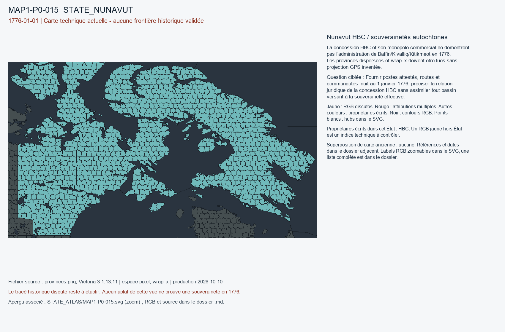

# MAP1-P0-015 — Nunavut HBC / souverainetés autochtones

Statut : revue historique et géographique ouverte. Aucun transfert approuvé.

[Vue RGB zoomable](STATE_ATLAS/MAP1-P0-015.svg)

## Résultat de localisation technique

La concession HBC et son monopole commercial ne démontrent pas l'administration de Baffin/Kivalliq/Kitikmeot en 1776. Les provinces dispersées et wrap_x doivent être lues sans projection GPS inventée.

Décision de cette passe : DO_NOT_VERIFY_HBC_WHOLE_STATE_FROM_CHARTER

## Question pour la recherche régionale

Fournir postes attestés, routes et communautés inuit au 1 janvier 1776; préciser la relation juridique de la concession HBC sans assimiler tout bassin versant à la souveraineté effective.

## Références et limites

### R8_NORTH_AMERICA_CARIBBEAN-S011

Edward Cavanagh. A Company with Sovereignty and Subjects of Its Own? The Case of the Hudson’s Bay Company, 1670–1763. Publication : 2013-01-02. Document : UNKNOWN.

Référence : https://www.cambridge.org/core/journals/canadian-journal-of-law-and-society-la-revue-canadienne-droit-et-societe/article/abs/company-with-sovereignty-and-subjects-of-its-own-the-case-of-the-hudsons-bay-company-16701763/563CE0342F496B292465D925BFF2DCE4

Pages/carte : Abstract; sovereignty as company-state

Pertinence : 1776-01-01; interpret dates within the source

Biais/limites : Period ends 1763; abstract accessible, specific 1776 distribution not supplied.

Accès MAP-1 : CATALOG_ONLY_NOT_FETCHED. Notice importée, source originale non consultée indépendamment.

### R8_NORTH_AMERICA_CARIBBEAN-S012

Theodore Binnema; Encyclopedia of the Great Plains / University of Nebraska–Lincoln. Hudson’s Bay Company. Publication : UNKNOWN. Document : UNKNOWN.

Référence : https://plainshumanities.unl.edu/encyclopedia/doc/egp.ind.029.html

Pages/carte : Charter 1670; northern Plains stations after 1780; contrast with Cumberland House 1774 documented at S013

Pertinence : 1776-01-01; interpret dates within the source

Biais/limites : Secondary synthesis: not a verified transfer to any game province.

Accès MAP-1 : CATALOG_ONLY_NOT_FETCHED. Notice importée, source originale non consultée indépendamment.

### R8_NORTH_AMERICA_CARIBBEAN-S014

Parks Canada. Thanadelthur National Historic Person (died 1717). Publication : UNKNOWN. Document : 1715.

Référence : https://parks.canada.ca/culture/designation/personnage-person/thanadelthur

Pages/carte : 1715–1716 peace and English-Dene trade; York Factory on Cree lands

Pertinence : 1776-01-01; interpret dates within the source

Biais/limites : Relationships and trade do not convey 1776 territorial title.

Accès MAP-1 : CATALOG_ONLY_NOT_FETCHED. Notice importée, source originale non consultée indépendamment.

### R8_NORTH_AMERICA_CARIBBEAN-S036

National Museum of American History, Smithsonian Institution. Unsettling the Continent, 1492–1776. Publication : UNKNOWN. Document : UNKNOWN.

Référence : https://americanhistory.si.edu/explore/exhibitions/many-voices/online/unsettling-continent-1492-1776

Pages/carte : Indigenous nations as actors; pre-1776 framework

Pertinence : 1776-01-01; interpret dates within the source

Biais/limites : Secondary synthesis: not a verified transfer to any game province.

Accès MAP-1 : CATALOG_ONLY_NOT_FETCHED. Notice importée, source originale non consultée indépendamment.

## Géoréférencement

Bitmap exact et contours pixel extraits. Aucun fond historique superposé, aucune projection GPS adoptée, aucun résidu de calage inventé. Les points des locators sont contrôlés dans le raster, pas contre un cadastre historique. Les noms de hubs peuvent être anachroniques ou erronés. Trois points indépendants et un point de contrôle hors ajustement restent requis pour un calage local de carte ancienne.

## RGB et propriétaires écrits

| RGB | Propriétaire(s) | Pixels | Hub déclaré |
|---|---|---:|---|
| x000EC0 | HBC | 204 |  |
| x00150B | HBC | 248 |  |
| x0020CB | HBC | 215 |  |
| x003D10 | HBC | 284 |  |
| x00684B | HBC | 199 |  |
| x014B3F | HBC | 295 |  |
| x01B1E4 | HBC | 254 |  |
| x01B54E | HBC | 195 |  |
| x01D0B8 | HBC | 237 |  |
| x020839 | HBC | 302 |  |
| x025750 | HBC | 166 |  |
| x0274BA | HBC | 230 |  |
| x02B1B4 | HBC | 188 |  |
| x02EA6D | HBC | 189 |  |
| x02F25C | HBC | 263 |  |
| x0365B1 | HBC | 128 |  |
| x039447 | HBC | 236 |  |
| x03A3F2 | HBC | 214 |  |
| x03E90C | HBC | 241 |  |
| x045D36 | HBC | 261 |  |
| x048659 | HBC | 288 |  |
| x048CDF | HBC | 147 |  |
| x04E4D2 | HBC | 180 |  |
| x04FAA6 | HBC | 205 |  |
| x051790 | HBC | 219 |  |
| x051F32 | HBC | 145 |  |
| x0561E5 | HBC | 223 |  |
| x059F5E | HBC | 311 |  |
| x05C63C | HBC | 223 |  |
| x05C757 | HBC | 243 |  |
| x05CE22 | HBC | 280 |  |
| x0657F4 | HBC | 253 |  |
| x0665A7 | HBC | 218 |  |
| x069300 | HBC | 204 |  |
| x0695E8 | HBC | 206 |  |
| x076948 | HBC | 228 |  |
| x079D69 | HBC | 302 |  |
| x07C96A | HBC | 220 |  |
| x07CD51 | HBC | 184 |  |
| x081414 | HBC | 243 |  |
| x0829BC | HBC | 183 |  |
| x084C64 | HBC | 259 |  |
| x08CFCE | HBC | 245 |  |
| x08D2D6 | HBC | 167 |  |
| x09098A | HBC | 280 |  |
| x0922D2 | HBC | 243 |  |
| x09249B | HBC | 233 | STATE_NUNAVUT:mine:Whale Cove |
| x097315 | HBC | 392 |  |
| x09FA5C | HBC | 364 |  |
| x0A7566 | HBC | 310 |  |
| x0A9CF3 | HBC | 241 |  |
| x0AD9CC | HBC | 224 |  |
| x0B1F9F | HBC | 312 |  |
| x0B39F5 | HBC | 184 |  |
| x0B75A6 | HBC | 221 |  |
| x0BA388 | HBC | 206 |  |
| x0BAC2D | HBC | 292 |  |
| x0BD7B1 | HBC | 351 |  |
| x0C3BE5 | HBC | 226 |  |
| x0CB226 | HBC | 218 |  |
| x0CB925 | HBC | 74 |  |
| x0D010B | HBC | 226 |  |
| x0D2EC0 | HBC | 132 |  |
| x0D41EF | HBC | 261 |  |
| x0D4483 | HBC | 252 |  |
| x0DFF69 | HBC | 220 |  |
| x0E3D6D | HBC | 292 |  |
| x0F4E06 | HBC | 234 |  |
| x0FA1E3 | HBC | 229 |  |
| x102D34 | HBC | 370 |  |
| x105609 | HBC | 278 |  |
| x1063F3 | HBC | 342 |  |
| x10D98F | HBC | 207 |  |
| x117789 | HBC | 226 |  |
| x11D353 | HBC | 221 |  |
| x120408 | HBC | 243 |  |
| x123B01 | HBC | 165 |  |
| x128B6A | HBC | 217 |  |
| x12E2BE | HBC | 192 |  |
| x1304A9 | HBC | 227 |  |
| x1315CF | HBC | 235 |  |
| x13448F | HBC | 225 |  |
| x134A15 | HBC | 241 |  |
| x134A47 | HBC | 267 |  |
| x1395CF | HBC | 247 |  |
| x139851 | HBC | 250 |  |
| x13A3F7 | HBC | 307 |  |
| x13EB95 | HBC | 251 |  |
| x141E8E | HBC | 284 |  |
| x144D66 | HBC | 307 |  |
| x147220 | HBC | 206 |  |
| x147F8C | HBC | 231 |  |
| x149149 | HBC | 251 |  |
| x149D0B | HBC | 337 |  |
| x14EC3C | HBC | 397 |  |
| x152692 | HBC | 137 |  |
| x155CC7 | HBC | 230 |  |
| x156DBE | HBC | 220 |  |
| x158D3A | HBC | 248 |  |
| x15BB4F | HBC | 287 |  |
| x16081B | HBC | 236 |  |
| x161E18 | HBC | 257 |  |
| x1650B2 | HBC | 206 |  |
| x16A502 | HBC | 233 |  |
| x16B917 | HBC | 279 |  |
| x16E611 | HBC | 95 |  |
| x176387 | HBC | 212 |  |
| x1767C4 | HBC | 248 |  |
| x1770A6 | HBC | 224 |  |
| x177E5D | HBC | 339 |  |
| x17E176 | HBC | 243 |  |
| x17F7C7 | HBC | 216 |  |
| x1825D5 | HBC | 202 |  |
| x184CF3 | HBC | 288 |  |
| x1870C8 | HBC | 203 |  |
| x18D607 | HBC | 241 |  |
| x18FE6F | HBC | 176 |  |
| x194628 | HBC | 297 |  |
| x1997E8 | HBC | 234 |  |
| x19AE2E | HBC | 226 |  |
| x1A08A5 | HBC | 237 |  |
| x1A3F4A | HBC | 223 |  |
| x1A8BDA | HBC | 223 |  |
| x1B29A0 | HBC | 215 |  |
| x1BA014 | HBC | 188 |  |
| x1BCEF6 | HBC | 171 |  |
| x1C0E3A | HBC | 196 |  |
| x1C2526 | HBC | 220 |  |
| x1C3480 | HBC | 257 |  |
| x1C7EA9 | HBC | 239 |  |
| x1C8DCE | HBC | 230 |  |
| x1D0897 | HBC | 228 |  |
| x1D136D | HBC | 258 |  |
| x1D745A | HBC | 311 |  |
| x1D9A87 | HBC | 231 |  |
| x1E4E7C | HBC | 241 |  |
| x1E703F | HBC | 180 |  |
| x1E90CB | HBC | 216 |  |
| x1EC8FC | HBC | 318 |  |
| x1F0416 | HBC | 257 |  |
| x1F2C8D | HBC | 197 |  |
| x1F8086 | HBC | 126 |  |
| x1F88D4 | HBC | 198 |  |
| x201AEE | HBC | 226 |  |
| x20438A | HBC | 272 |  |
| x2054C5 | HBC | 201 |  |
| x205C90 | HBC | 293 |  |
| x2074F9 | HBC | 181 |  |
| x209617 | HBC | 247 |  |
| x20B36F | HBC | 84 |  |
| x20B961 | HBC | 248 |  |
| x210EFF | HBC | 266 |  |
| x213D4F | HBC | 207 |  |
| x214295 | HBC | 265 |  |
| x2176EA | HBC | 193 |  |
| x219B09 | HBC | 215 |  |
| x225230 | HBC | 214 |  |
| x2301B5 | HBC | 302 |  |
| x230500 | HBC | 213 |  |
| x2370BF | HBC | 250 |  |
| x2398F2 | HBC | 215 |  |
| x23D587 | HBC | 274 |  |
| x23DF1E | HBC | 231 |  |
| x240567 | HBC | 277 |  |
| x244BDB | HBC | 195 |  |
| x246BA0 | HBC | 270 |  |
| x24B053 | HBC | 250 |  |
| x24BB62 | HBC | 272 |  |
| x24C25F | HBC | 202 |  |
| x24DF76 | HBC | 202 |  |
| x251F98 | HBC | 257 |  |
| x252A47 | HBC | 226 |  |
| x253FA3 | HBC | 269 |  |
| x25E88B | HBC | 345 |  |
| x262DBA | HBC | 219 |  |
| x27097C | HBC | 243 |  |
| x273ACD | HBC | 234 |  |
| x27F0CF | HBC | 240 |  |
| x281692 | HBC | 216 |  |
| x28228B | HBC | 263 |  |
| x284654 | HBC | 169 |  |
| x28941F | HBC | 269 |  |
| x28A4C4 | HBC | 362 |  |
| x28C8CD | HBC | 222 |  |
| x293FD0 | HBC | 311 |  |
| x299EE5 | HBC | 270 |  |
| x29A606 | HBC | 268 |  |
| x29AC5E | HBC | 249 |  |
| x29DE06 | HBC | 223 |  |
| x29ED74 | HBC | 162 |  |
| x29EDE0 | HBC | 24 |  |
| x29FAEF | HBC | 288 |  |
| x2A11BE | HBC | 237 |  |
| x2AE755 | HBC | 249 |  |
| x2AE9D6 | HBC | 117 |  |
| x2AFDCF | HBC | 233 |  |
| x2B0A7D | HBC | 146 |  |
| x2B377B | HBC | 232 |  |
| x2B6577 | HBC | 199 |  |
| x2B707C | HBC | 262 |  |
| x2BB631 | HBC | 296 |  |
| x2BCCD5 | HBC | 219 |  |
| x2BE42E | HBC | 278 |  |
| x2C9D0D | HBC | 244 |  |
| x2CA04D | HBC | 226 |  |
| x2CBC17 | HBC | 160 |  |
| x2D0E85 | HBC | 279 |  |
| x2D37BA | HBC | 236 |  |
| x2D89CE | HBC | 231 |  |
| x2DC264 | HBC | 238 |  |
| x2DD7B4 | HBC | 571 |  |
| x2E1DD5 | HBC | 200 |  |
| x2E4E07 | HBC | 214 |  |
| x2E95BC | HBC | 151 |  |
| x2F5BB2 | HBC | 224 |  |
| x303ED0 | HBC | 275 |  |
| x30737E | HBC | 272 |  |
| x30BC22 | HBC | 238 |  |
| x30E58E | HBC | 256 |  |
| x31047F | HBC | 364 |  |
| x315BC6 | HBC | 281 |  |
| x317A7D | HBC | 234 |  |
| x31D26E | HBC | 223 |  |
| x31E827 | HBC | 262 |  |
| x31FC79 | HBC | 252 |  |
| x32068B | HBC | 274 |  |
| x3230E6 | HBC | 235 |  |
| x325EC4 | HBC | 232 |  |
| x326C03 | HBC | 300 |  |
| x32AAA3 | HBC | 237 |  |
| x32DCA9 | HBC | 242 |  |
| x330AFA | HBC | 297 |  |
| x336F55 | HBC | 245 |  |
| x33EEDF | HBC | 210 |  |
| x3441EE | HBC | 203 |  |
| x345A68 | HBC | 190 |  |
| x350E3C | HBC | 254 |  |
| x352268 | HBC | 277 |  |
| x354EF1 | HBC | 242 |  |
| x356824 | HBC | 133 |  |
| x35EE2B | HBC | 217 |  |
| x361ECD | HBC | 217 |  |
| x366695 | HBC | 199 |  |
| x3693D6 | HBC | 235 |  |
| x369AAE | HBC | 220 |  |
| x372FF6 | HBC | 246 |  |
| x378A03 | HBC | 221 |  |
| x383CBD | HBC | 262 |  |
| x387E90 | HBC | 209 |  |
| x38BA37 | HBC | 345 |  |
| x38C8CE | HBC | 433 |  |
| x38CE28 | HBC | 285 |  |
| x38D086 | HBC | 255 |  |
| x38ED3F | HBC | 220 |  |
| x390D18 | HBC | 214 |  |
| x394E70 | HBC | 179 |  |
| x3A066D | HBC | 96 |  |
| x3A542B | HBC | 313 |  |
| x3A62B7 | HBC | 221 |  |
| x3ADB00 | HBC | 253 |  |
| x3AED96 | HBC | 174 |  |
| x3B871A | HBC | 250 |  |
| x3BFC3E | HBC | 267 |  |
| x3C4056 | HBC | 257 |  |
| x3D16AD | HBC | 93 |  |
| x3E101E | HBC | 115 |  |
| x3E7BBE | HBC | 230 |  |
| x3E8D6F | HBC | 229 |  |
| x3EB32E | HBC | 191 |  |
| x3EBA6C | HBC | 214 |  |
| x3EC1D5 | HBC | 207 |  |
| x3EDA5E | HBC | 241 |  |
| x3EEE4F | HBC | 126 |  |
| x3F6399 | HBC | 212 |  |
| x3F92E3 | HBC | 245 |  |
| x3FAD19 | HBC | 226 |  |
| x3FE8F9 | HBC | 223 |  |
| x4077D3 | HBC | 226 |  |
| x409145 | HBC | 242 |  |
| x40FD0B | HBC | 231 |  |
| x40FD62 | HBC | 171 |  |
| x414767 | HBC | 208 |  |
| x4159A8 | HBC | 187 |  |
| x420973 | HBC | 255 |  |
| x423A3C | HBC | 326 |  |
| x428AF3 | HBC | 228 |  |
| x42D933 | HBC | 218 |  |
| x43052F | HBC | 205 |  |
| x4324CA | HBC | 269 |  |
| x4389E1 | HBC | 147 |  |
| x439617 | HBC | 306 |  |
| x43EF0F | HBC | 275 |  |
| x43FC63 | HBC | 250 |  |
| x449075 | HBC | 166 |  |
| x44938C | HBC | 229 |  |
| x44B97A | HBC | 216 |  |
| x44BB63 | HBC | 217 |  |
| x44BDE0 | HBC | 277 |  |
| x44EB96 | HBC | 223 |  |
| x450D66 | HBC | 232 |  |
| x452A17 | HBC | 202 |  |
| x453196 | HBC | 329 |  |
| x4577E6 | HBC | 129 |  |
| x459C13 | HBC | 245 |  |
| x45A1A5 | HBC | 226 |  |
| x45D5E4 | HBC | 237 |  |
| x46174B | HBC | 165 |  |
| x468895 | HBC | 178 |  |
| x4702EC | HBC | 218 |  |
| x47AC1C | HBC | 306 |  |
| x47B4F4 | HBC | 217 |  |
| x47FF7E | HBC | 185 | STATE_NUNAVUT:city:Rankin Inlet |
| x483C9E | HBC | 269 |  |
| x4847F1 | HBC | 241 |  |
| x484D74 | HBC | 260 |  |
| x48B003 | HBC | 227 |  |
| x48E7BF | HBC | 248 |  |
| x4994E3 | HBC | 215 |  |
| x499956 | HBC | 210 |  |
| x49B677 | HBC | 162 |  |
| x49DA2B | HBC | 264 |  |
| x4A1D5D | HBC | 246 |  |
| x4A7357 | HBC | 272 |  |
| x4A97B1 | HBC | 302 |  |
| x4AB399 | HBC | 239 |  |
| x4AC96F | HBC | 250 |  |
| x4B20FD | HBC | 236 |  |
| x4B3B73 | HBC | 246 |  |
| x4B6E15 | HBC | 220 |  |
| x4BFF28 | HBC | 369 |  |
| x4C0F14 | HBC | 209 |  |
| x4CA28B | HBC | 181 |  |
| x4CD582 | HBC | 272 |  |
| x4D34F4 | HBC | 147 |  |
| x4D7F05 | HBC | 178 |  |
| x4D869B | HBC | 236 |  |
| x4D8F7B | HBC | 129 |  |
| x4DAC2B | HBC | 435 |  |
| x4E1C53 | HBC | 248 |  |
| x4E1F08 | HBC | 377 |  |
| x4EA4FA | HBC | 232 |  |
| x4EE10D | HBC | 198 |  |
| x4F294C | HBC | 276 |  |
| x4F37ED | HBC | 218 |  |
| x4FF0CD | HBC | 112 |  |
| x4FF341 | HBC | 162 |  |
| x4FFA55 | HBC | 194 |  |
| x5072CF | HBC | 262 |  |
| x508633 | HBC | 236 |  |
| x50E0B3 | HBC | 247 |  |
| x50EE73 | HBC | 232 |  |
| x51066D | HBC | 210 |  |
| x512A96 | HBC | 331 |  |
| x515F6D | HBC | 281 |  |
| x521A2B | HBC | 231 |  |
| x526C79 | HBC | 230 |  |
| x52A1F4 | HBC | 296 |  |
| x52CCD4 | HBC | 277 |  |
| x52E812 | HBC | 282 |  |
| x534C6C | HBC | 250 |  |
| x538E1E | HBC | 227 |  |
| x53AE16 | HBC | 244 |  |
| x53E8E1 | HBC | 205 |  |
| x54204B | HBC | 220 |  |
| x547339 | HBC | 90 |  |
| x548542 | HBC | 222 |  |
| x54D127 | HBC | 231 |  |
| x5531D2 | HBC | 224 |  |
| x55C8BE | HBC | 251 |  |
| x55D35B | HBC | 215 |  |
| x55F577 | HBC | 314 |  |
| x563573 | HBC | 224 |  |
| x5635F0 | HBC | 198 |  |
| x56B22A | HBC | 220 |  |
| x56EF36 | HBC | 201 |  |
| x57BBEA | HBC | 220 |  |
| x57C2A7 | HBC | 301 |  |
| x57CD2A | HBC | 243 |  |
| x57E690 | HBC | 212 |  |
| x57ED04 | HBC | 235 |  |
| x581AD2 | HBC | 248 |  |
| x583D16 | HBC | 195 |  |
| x585BF5 | HBC | 279 |  |
| x58EFA8 | HBC | 255 |  |
| x59068D | HBC | 208 |  |
| x595269 | HBC | 249 |  |
| x596AB7 | HBC | 275 |  |
| x597E64 | HBC | 229 |  |
| x598624 | HBC | 367 |  |
| x599D22 | HBC | 141 |  |
| x59B5A5 | HBC | 141 |  |
| x59D654 | HBC | 167 |  |
| x59F52B | HBC | 301 |  |
| x59FCB1 | HBC | 223 |  |
| x5A4DDE | HBC | 215 |  |
| x5A706A | HBC | 294 |  |
| x5A9EF3 | HBC | 262 |  |
| x5AA879 | HBC | 223 |  |
| x5AD1CB | HBC | 230 |  |
| x5AEFE3 | HBC | 180 |  |
| x5B3469 | HBC | 118 |  |
| x5B37CA | HBC | 217 |  |
| x5B4077 | HBC | 264 |  |
| x5B9B29 | HBC | 269 |  |
| x5BA815 | HBC | 268 |  |
| x5BAEBD | HBC | 264 |  |
| x5BAFDC | HBC | 229 |  |
| x5BEA85 | HBC | 97 |  |
| x5C657B | HBC | 346 |  |
| x5C9235 | HBC | 101 |  |
| x5C9D82 | HBC | 280 |  |
| x5CAFED | HBC | 238 |  |
| x5CE754 | HBC | 234 |  |
| x5CE953 | HBC | 242 |  |
| x5D3D51 | HBC | 233 |  |
| x5D6554 | HBC | 210 |  |
| x5D892B | HBC | 245 |  |
| x5E029F | HBC | 188 |  |
| x5E60C2 | HBC | 214 |  |
| x5E79DF | HBC | 173 |  |
| x5F481E | HBC | 298 |  |
| x5F640C | HBC | 286 |  |
| x5F7F75 | HBC | 262 |  |
| x5FB961 | HBC | 238 |  |
| x5FC494 | HBC | 106 |  |
| x6015F9 | HBC | 229 |  |
| x601FD2 | HBC | 232 |  |
| x609A10 | HBC | 66 |  |
| x61A22C | HBC | 314 |  |
| x62B6F9 | HBC | 219 |  |
| x62BD94 | HBC | 226 |  |
| x62EF0D | HBC | 235 |  |
| x62F2C5 | HBC | 304 |  |
| x6329E1 | HBC | 189 |  |
| x638100 | HBC | 219 |  |
| x63872B | HBC | 254 |  |
| x63E1C9 | HBC | 282 |  |
| x645B83 | HBC | 268 |  |
| x647648 | HBC | 238 |  |
| x65456F | HBC | 214 |  |
| x659004 | HBC | 253 |  |
| x66526E | HBC | 265 |  |
| x667BEA | HBC | 223 |  |
| x66C03A | HBC | 241 |  |
| x66F552 | HBC | 250 |  |
| x67767A | HBC | 282 |  |
| x6797A2 | HBC | 232 |  |
| x67BB39 | HBC | 228 |  |
| x683862 | HBC | 242 |  |
| x6900D7 | HBC | 322 |  |
| x691878 | HBC | 239 |  |
| x693BF1 | HBC | 195 |  |
| x69730E | HBC | 191 |  |
| x6A2231 | HBC | 252 |  |
| x6A8E0B | HBC | 289 |  |
| x6AB427 | HBC | 232 |  |
| x6AFCEE | HBC | 202 |  |
| x6B3184 | HBC | 242 |  |
| x6BA627 | HBC | 345 |  |
| x6BCDC6 | HBC | 199 |  |
| x6BE7C8 | HBC | 210 |  |
| x6C5F10 | HBC | 226 |  |
| x6C8722 | HBC | 170 |  |
| x6D10B9 | HBC | 213 |  |
| x6DB6B1 | HBC | 216 |  |
| x6DC177 | HBC | 218 |  |
| x6E6202 | HBC | 178 |  |
| x6F0829 | HBC | 244 |  |
| x6F28EA | HBC | 171 |  |
| x6F3383 | HBC | 353 |  |
| x6F8930 | HBC | 204 |  |
| x6FF061 | HBC | 173 |  |
| x700D0D | HBC | 193 |  |
| x7058A8 | HBC | 165 |  |
| x7079D1 | HBC | 225 |  |
| x70C845 | HBC | 281 |  |
| x7183D3 | HBC | 212 |  |
| x719D56 | HBC | 199 |  |
| x71A0CD | HBC | 58 |  |
| x71B938 | HBC | 316 |  |
| x71F363 | HBC | 283 |  |
| x721B68 | HBC | 223 |  |
| x72344D | HBC | 216 |  |
| x723626 | HBC | 217 |  |
| x724272 | HBC | 235 |  |
| x724504 | HBC | 223 |  |
| x728DA4 | HBC | 256 |  |
| x73292C | HBC | 305 |  |
| x7335F4 | HBC | 195 |  |
| x735661 | HBC | 244 |  |
| x736EEA | HBC | 276 |  |
| x73D9B6 | HBC | 211 |  |
| x73ECE8 | HBC | 232 |  |
| x7433CB | HBC | 371 |  |
| x743DC4 | HBC | 243 |  |
| x744E31 | HBC | 230 |  |
| x74993A | HBC | 217 |  |
| x7504D8 | HBC | 234 |  |
| x754B6E | HBC | 242 |  |
| x759E1F | HBC | 235 |  |
| x75A26E | HBC | 202 |  |
| x76ADA7 | HBC | 288 |  |
| x76CBA0 | HBC | 273 |  |
| x770BF2 | HBC | 210 |  |
| x772DE3 | HBC | 165 |  |
| x7751CA | HBC | 219 |  |
| x776735 | HBC | 212 |  |
| x77E9CF | HBC | 188 |  |
| x787BBB | HBC | 306 |  |
| x7885BB | HBC | 227 |  |
| x78A25B | HBC | 199 |  |
| x79014F | HBC | 225 |  |
| x79A4B0 | HBC | 194 |  |
| x79DE3A | HBC | 162 |  |
| x79E8F9 | HBC | 246 |  |
| x7A154B | HBC | 220 |  |
| x7A369E | HBC | 317 |  |
| x7A3B01 | HBC | 226 |  |
| x7A3BDC | HBC | 173 |  |
| x7A6D1D | HBC | 228 |  |
| x7A7DB4 | HBC | 213 |  |
| x7A7F0E | HBC | 227 |  |
| x7AA1BE | HBC | 147 |  |
| x7AEC68 | HBC | 238 |  |
| x7B2628 | HBC | 234 |  |
| x7B5176 | HBC | 156 |  |
| x7B7143 | HBC | 308 |  |
| x7BB335 | HBC | 226 |  |
| x7BBA4B | HBC | 213 |  |
| x7BDB7C | HBC | 337 |  |
| x7C0069 | HBC | 234 |  |
| x7C3410 | HBC | 269 |  |
| x7C6AE3 | HBC | 294 |  |
| x7C7A41 | HBC | 236 |  |
| x7CA0AC | HBC | 217 |  |
| x7CA2CC | HBC | 261 |  |
| x7CDAEB | HBC | 246 |  |
| x7D2E23 | HBC | 294 |  |
| x7DF3C2 | HBC | 200 |  |
| x7E2A07 | HBC | 203 |  |
| x7E3B11 | HBC | 121 |  |
| x7E9CDC | HBC | 160 |  |
| x7EDB82 | HBC | 212 |  |
| x7EDC3D | HBC | 232 |  |
| x7EF6ED | HBC | 251 |  |
| x7F3778 | HBC | 214 |  |
| x7F3B2A | HBC | 256 | STATE_NUNAVUT:wood:Brochet |
| x7F647A | HBC | 273 |  |
| x803359 | HBC | 171 |  |
| x803416 | HBC | 253 |  |
| x8052D4 | HBC | 221 |  |
| x807FB7 | HBC | 331 |  |
| x808907 | HBC | 276 |  |
| x808B9A | HBC | 380 |  |
| x810378 | HBC | 245 |  |
| x811307 | HBC | 256 |  |
| x81445F | HBC | 229 |  |
| x82079F | HBC | 210 |  |
| x82B862 | HBC | 67 |  |
| x82C386 | HBC | 229 |  |
| x82EE4E | HBC | 136 |  |
| x8304B1 | HBC | 238 |  |
| x834C0B | HBC | 218 |  |
| x835FB9 | HBC | 224 |  |
| x8375B9 | HBC | 148 |  |
| x83EB49 | HBC | 218 |  |
| x83F120 | HBC | 272 |  |
| x844B65 | HBC | 220 |  |
| x84F4DF | HBC | 203 |  |
| x84FAA6 | HBC | 112 |  |
| x85E45B | HBC | 203 |  |
| x861A2B | HBC | 211 |  |
| x862EC9 | HBC | 249 |  |
| x865D83 | HBC | 162 |  |
| x86892B | HBC | 125 |  |
| x86C5F8 | HBC | 214 |  |
| x871F81 | HBC | 74 |  |
| x875A6E | HBC | 214 |  |
| x8788F2 | HBC | 231 |  |
| x87A3C2 | HBC | 232 |  |
| x87B6F9 | HBC | 219 |  |
| x87C93A | HBC | 215 |  |
| x887034 | HBC | 192 |  |
| x88B2C0 | HBC | 235 |  |
| x898679 | HBC | 215 |  |
| x89BAB7 | HBC | 236 |  |
| x89C067 | HBC | 248 |  |
| x89E758 | HBC | 204 |  |
| x8A9401 | HBC | 355 |  |
| x8B151A | HBC | 202 |  |
| x8B1584 | HBC | 209 |  |
| x8B9532 | HBC | 275 |  |
| x8B9A07 | HBC | 155 |  |
| x8C0430 | HBC | 239 |  |
| x8C26BD | HBC | 227 |  |
| x8C5744 | HBC | 299 |  |
| x8CB2E7 | HBC | 251 |  |
| x8CF429 | HBC | 211 |  |
| x8D7ED7 | HBC | 214 |  |
| x8DBBD4 | HBC | 253 |  |
| x8DBCCF | HBC | 388 |  |
| x8DE06D | HBC | 236 |  |
| x8DEB1F | HBC | 128 | STATE_NUNAVUT:farm:Arviat |
| x8DFDBD | HBC | 180 |  |
| x8E6408 | HBC | 220 |  |
| x8E6B58 | HBC | 245 |  |
| x8EB4D8 | HBC | 360 |  |
| x8EB5E0 | HBC | 200 |  |
| x8ED295 | HBC | 201 |  |
| x8EDB2A | HBC | 168 |  |
| x8EF665 | HBC | 267 |  |
| x8F0CEB | HBC | 244 |  |
| x8FB8CD | HBC | 94 |  |
| x90094C | HBC | 408 |  |
| x902D34 | HBC | 173 |  |
| x9065F6 | HBC | 203 |  |
| x909060 | HBC | 261 |  |
| x90DD1D | HBC | 347 |  |
| x91A719 | HBC | 243 |  |
| x91BBC2 | HBC | 207 |  |
| x91DDB6 | HBC | 231 |  |
| x920E6C | HBC | 214 |  |
| x922575 | HBC | 244 |  |
| x9237FD | HBC | 228 |  |
| x92550C | HBC | 245 |  |
| x9285C7 | HBC | 322 |  |
| x92E331 | HBC | 134 |  |
| x9305DD | HBC | 241 |  |
| x937CDA | HBC | 223 |  |
| x9410AE | HBC | 241 |  |
| x943750 | HBC | 314 |  |
| x94F0FE | HBC | 202 |  |
| x95157C | HBC | 283 |  |
| x9544A7 | HBC | 222 |  |
| x95B4E6 | HBC | 213 |  |
| x962507 | HBC | 228 |  |
| x96B25E | HBC | 224 |  |
| x97182B | HBC | 257 |  |
| x97463D | HBC | 226 |  |
| x976D8B | HBC | 198 |  |
| x977BF7 | HBC | 76 |  |
| x979A52 | HBC | 394 |  |
| x97A316 | HBC | 244 |  |
| x97AAC9 | HBC | 302 |  |
| x97CEC8 | HBC | 178 |  |
| x98294F | HBC | 273 |  |
| x9855CA | HBC | 264 |  |
| x987E4C | HBC | 225 |  |
| x98A1D1 | HBC | 254 |  |
| x98C8C7 | HBC | 205 |  |
| x98D35C | HBC | 234 |  |
| x98FEC3 | HBC | 107 |  |
| x994148 | HBC | 209 |  |
| x995CE0 | HBC | 306 |  |
| x9A1755 | HBC | 223 |  |
| x9A1834 | HBC | 193 |  |
| x9A97FF | HBC | 324 |  |
| x9ABA13 | HBC | 217 |  |
| x9AC48B | HBC | 296 |  |
| x9B5562 | HBC | 220 |  |
| x9B7483 | HBC | 468 |  |
| x9BCC62 | HBC | 171 |  |
| x9BD803 | HBC | 238 |  |
| x9C1398 | HBC | 274 |  |
| x9C5E1F | HBC | 218 |  |
| x9C9A7C | HBC | 272 |  |
| x9C9BFB | HBC | 203 |  |
| x9C9CB2 | HBC | 235 |  |
| x9CB345 | HBC | 227 |  |
| x9CC6A6 | HBC | 231 |  |
| x9CF345 | HBC | 245 |  |
| x9D053D | HBC | 236 |  |
| x9D190A | HBC | 233 |  |
| x9D386E | HBC | 231 |  |
| x9DECC3 | HBC | 241 |  |
| x9E3E04 | HBC | 246 |  |
| x9E9A42 | HBC | 283 |  |
| x9F46DF | HBC | 159 |  |
| x9FA1BC | HBC | 168 |  |
| x9FC3B0 | HBC | 242 |  |
| xA0447F | HBC | 208 |  |
| xA063E3 | HBC | 136 |  |
| xA0816F | HBC | 320 |  |
| xA0C2BF | HBC | 270 |  |
| xA0C61A | HBC | 226 |  |
| xA0CC88 | HBC | 210 |  |
| xA0D363 | HBC | 235 |  |
| xA10641 | HBC | 221 |  |
| xA116F0 | HBC | 174 |  |
| xA150BA | HBC | 250 |  |
| xA151C9 | HBC | 228 |  |
| xA17BEC | HBC | 552 |  |
| xA290A7 | HBC | 239 |  |
| xA2A22C | HBC | 251 |  |
| xA34A24 | HBC | 296 |  |
| xA3BE73 | HBC | 252 |  |
| xA3CD40 | HBC | 245 |  |
| xA415E8 | HBC | 275 |  |
| xA45531 | HBC | 229 |  |
| xA48CDD | HBC | 239 |  |
| xA4BD38 | HBC | 218 |  |
| xA4C22C | HBC | 311 |  |
| xA4E315 | HBC | 273 |  |
| xA4FE33 | HBC | 248 |  |
| xA53899 | HBC | 226 |  |
| xA551DD | HBC | 275 |  |
| xA56F3F | HBC | 285 |  |
| xA5C17E | HBC | 240 |  |
| xA5DA35 | HBC | 198 |  |
| xA5E93E | HBC | 323 |  |
| xA60644 | HBC | 370 |  |
| xA6AAC4 | HBC | 255 |  |
| xA6B456 | HBC | 286 |  |
| xA6D21B | HBC | 220 |  |
| xA70EE6 | HBC | 272 |  |
| xA71DAE | HBC | 115 |  |
| xA748D7 | HBC | 200 |  |
| xA77CD4 | HBC | 228 |  |
| xA7F5FA | HBC | 39 |  |
| xA874E1 | HBC | 218 |  |
| xA8761F | HBC | 237 |  |
| xA8C727 | HBC | 336 |  |
| xA8C8E6 | HBC | 209 |  |
| xA8D5EA | HBC | 287 |  |
| xA90919 | HBC | 287 |  |
| xA930B6 | HBC | 241 |  |
| xA9B6BC | HBC | 457 |  |
| xA9F85A | HBC | 222 |  |
| xAA2596 | HBC | 148 |  |
| xAA27F5 | HBC | 241 |  |
| xAB40BD | HBC | 233 |  |
| xAB8C64 | HBC | 185 |  |
| xAB9139 | HBC | 233 |  |
| xABE62B | HBC | 184 |  |
| xABE819 | HBC | 241 |  |
| xAC0A3D | HBC | 305 |  |
| xAC4BA1 | HBC | 213 |  |
| xAC4C0E | HBC | 215 |  |
| xACD78F | HBC | 318 |  |
| xAD0330 | HBC | 124 |  |
| xAD0BA2 | HBC | 268 |  |
| xAD2362 | HBC | 202 |  |
| xAD37E5 | HBC | 225 |  |
| xADB26B | HBC | 351 |  |
| xAEDF7A | HBC | 227 |  |
| xAF0637 | HBC | 265 |  |
| xAF4B66 | HBC | 226 |  |
| xAF5847 | HBC | 171 |  |
| xAFB041 | HBC | 190 |  |
| xAFB314 | HBC | 253 |  |
| xAFCB42 | HBC | 241 |  |
| xAFD354 | HBC | 197 |  |
| xB050B6 | HBC | 233 |  |
| xB09521 | HBC | 243 |  |
| xB0A60F | HBC | 194 |  |
| xB0F65B | HBC | 134 |  |
| xB11019 | HBC | 245 |  |
| xB129AA | HBC | 224 |  |
| xB14D77 | HBC | 202 |  |
| xB1AAE7 | HBC | 221 |  |
| xB1B9EC | HBC | 295 |  |
| xB2776C | HBC | 238 |  |
| xB27942 | HBC | 240 |  |
| xB28818 | HBC | 243 |  |
| xB2B547 | HBC | 267 |  |
| xB2DCB2 | HBC | 219 |  |
| xB326D4 | HBC | 231 |  |
| xB33958 | HBC | 215 |  |
| xB37F05 | HBC | 135 |  |
| xB3A64E | HBC | 278 |  |
| xB3E66C | HBC | 222 |  |
| xB412B9 | HBC | 158 |  |
| xB554B7 | HBC | 188 |  |
| xB574F2 | HBC | 163 |  |
| xB588AE | HBC | 239 |  |
| xB599A4 | HBC | 280 |  |
| xB5B8B5 | HBC | 232 |  |
| xB5EFD2 | HBC | 247 |  |
| xB658AC | HBC | 201 |  |
| xB681BF | HBC | 249 |  |
| xB69219 | HBC | 137 |  |
| xB6D96A | HBC | 240 |  |
| xB71384 | HBC | 229 |  |
| xB74FB2 | HBC | 259 |  |
| xB7533B | HBC | 256 |  |
| xB76543 | HBC | 255 |  |
| xB7E39B | HBC | 172 |  |
| xB80CCB | HBC | 234 |  |
| xB8205A | HBC | 293 |  |
| xB8588E | HBC | 343 |  |
| xB85BA1 | HBC | 330 |  |
| xB87BE1 | HBC | 375 |  |
| xB9072A | HBC | 174 |  |
| xB92B2A | HBC | 233 |  |
| xB92D20 | HBC | 328 |  |
| xB942CD | HBC | 267 |  |
| xB9630A | HBC | 276 |  |
| xB9B933 | HBC | 264 |  |
| xB9F7C2 | HBC | 575 |  |
| xBA0A83 | HBC | 234 |  |
| xBA461D | HBC | 200 |  |
| xBA596D | HBC | 271 |  |
| xBA7ECF | HBC | 199 |  |
| xBA8AC9 | HBC | 243 |  |
| xBAEB0F | HBC | 317 |  |
| xBAEE96 | HBC | 210 |  |
| xBB08AE | HBC | 114 |  |
| xBB1DC6 | HBC | 219 |  |
| xBB1FD8 | HBC | 238 |  |
| xBB7644 | HBC | 240 |  |
| xBB9A0F | HBC | 227 |  |
| xBBA963 | HBC | 253 |  |
| xBBAFF0 | HBC | 282 |  |
| xBBDCD7 | HBC | 198 |  |
| xBBDD81 | HBC | 230 |  |
| xBC258A | HBC | 254 |  |
| xBC494A | HBC | 234 |  |
| xBC747A | HBC | 218 |  |
| xBC7BBC | HBC | 203 |  |
| xBCCC4A | HBC | 227 |  |
| xBD565B | HBC | 281 |  |
| xBD5A94 | HBC | 239 |  |
| xBD856D | HBC | 255 |  |
| xBD928D | HBC | 231 |  |
| xBE03D9 | HBC | 194 |  |
| xBE39FC | HBC | 198 |  |
| xBE3C13 | HBC | 249 |  |
| xBE5BA3 | HBC | 234 |  |
| xBE808D | HBC | 201 |  |
| xBECF32 | HBC | 191 |  |
| xBEDE94 | HBC | 173 |  |
| xBEE1A7 | HBC | 175 |  |
| xBF6BE7 | HBC | 213 |  |
| xBFD688 | HBC | 219 |  |
| xC02038 | HBC | 224 |  |
| xC04080 | HBC | 119 |  |
| xC0CFFB | HBC | 243 |  |
| xC1334B | HBC | 202 |  |
| xC1B54F | HBC | 234 |  |
| xC1CC9E | HBC | 218 |  |
| xC2C4E7 | HBC | 161 |  |
| xC2D067 | HBC | 213 |  |
| xC30EBF | HBC | 223 |  |
| xC32B73 | HBC | 197 |  |
| xC33C6C | HBC | 218 |  |
| xC38223 | HBC | 242 |  |
| xC3F529 | HBC | 199 |  |
| xC43290 | HBC | 340 |  |
| xC44667 | HBC | 229 |  |
| xC46499 | HBC | 254 |  |
| xC5290D | HBC | 210 |  |
| xC563DC | HBC | 211 |  |
| xC5A41C | HBC | 292 |  |
| xC5BFD8 | HBC | 242 |  |
| xC5F8ED | HBC | 193 |  |
| xC6EFFB | HBC | 242 |  |
| xC724BB | HBC | 331 |  |
| xC7269C | HBC | 265 |  |
| xC73B88 | HBC | 252 |  |
| xC7A430 | HBC | 213 |  |
| xC7A6EE | HBC | 244 |  |
| xC7C44A | HBC | 289 |  |
| xC859B3 | HBC | 204 |  |
| xC8698D | HBC | 158 |  |
| xC92FD7 | HBC | 258 |  |
| xC93F6C | HBC | 119 |  |
| xC98D90 | HBC | 226 |  |
| xC98F3A | HBC | 380 |  |
| xC9E49C | HBC | 194 |  |
| xCA4CF3 | HBC | 238 |  |
| xCA849F | HBC | 370 |  |
| xCAA831 | HBC | 330 |  |
| xCAC31F | HBC | 202 |  |
| xCB1DDB | HBC | 232 |  |
| xCB320A | HBC | 226 |  |
| xCB8541 | HBC | 239 |  |
| xCBAFA5 | HBC | 257 |  |
| xCBB064 | HBC | 226 |  |
| xCBB6FE | HBC | 200 |  |
| xCBC2A9 | HBC | 192 |  |
| xCC0903 | HBC | 309 |  |
| xCC2916 | HBC | 257 |  |
| xCC5625 | HBC | 239 |  |
| xCC7056 | HBC | 222 |  |
| xCC800D | HBC | 229 |  |
| xCCD14B | HBC | 217 |  |
| xCD1A61 | HBC | 232 |  |
| xCD526C | HBC | 420 |  |
| xCD9A92 | HBC | 198 |  |
| xCD9C82 | HBC | 208 |  |
| xCDC38F | HBC | 185 |  |
| xCDC856 | HBC | 217 |  |
| xCDD142 | HBC | 219 |  |
| xCDD6B3 | HBC | 295 |  |
| xCE7525 | HBC | 232 |  |
| xCF5004 | HBC | 186 |  |
| xCFE4B6 | HBC | 221 |  |
| xD07CB8 | HBC | 250 |  |
| xD0FCE8 | HBC | 299 |  |
| xD1A412 | HBC | 134 |  |
| xD205C1 | HBC | 213 |  |
| xD21C15 | HBC | 276 |  |
| xD226F2 | HBC | 226 |  |
| xD2391C | HBC | 238 |  |
| xD24F76 | HBC | 220 |  |
| xD26E62 | HBC | 223 |  |
| xD2AD4C | HBC | 172 |  |
| xD2D554 | HBC | 134 |  |
| xD2ECA0 | HBC | 352 |  |
| xD30909 | HBC | 280 |  |
| xD35265 | HBC | 148 |  |
| xD39522 | HBC | 196 |  |
| xD3F241 | HBC | 335 |  |
| xD4197B | HBC | 130 |  |
| xD45F96 | HBC | 233 |  |
| xD4DE95 | HBC | 200 |  |
| xD4E837 | HBC | 232 |  |
| xD55E8D | HBC | 225 |  |
| xD590EF | HBC | 278 |  |
| xD5FB6D | HBC | 243 |  |
| xD64E0F | HBC | 198 |  |
| xD68439 | HBC | 249 |  |
| xD6B890 | HBC | 201 |  |
| xD6D15C | HBC | 198 |  |
| xD6D613 | HBC | 277 |  |
| xD769A1 | HBC | 239 |  |
| xD79E7B | HBC | 196 | STATE_NUNAVUT:port:Chesterfield Inlet |
| xD7C79A | HBC | 342 |  |
| xD8A8DF | HBC | 190 |  |
| xD97708 | HBC | 238 |  |
| xD989BF | HBC | 217 |  |
| xD9D840 | HBC | 245 |  |
| xDA19D1 | HBC | 176 |  |
| xDA37AE | HBC | 384 |  |
| xDA49E0 | HBC | 229 |  |
| xDAA9F0 | HBC | 101 |  |
| xDAD8E2 | HBC | 222 |  |
| xDB42AA | HBC | 184 |  |
| xDB8E0E | HBC | 236 |  |
| xDBB0CD | HBC | 169 |  |
| xDC9676 | HBC | 304 |  |
| xDCB0F4 | HBC | 86 |  |
| xDCF7D4 | HBC | 244 |  |
| xDD80DE | HBC | 260 |  |
| xDDBDB3 | HBC | 189 |  |
| xDDCE1D | HBC | 480 |  |
| xDDDFD1 | HBC | 174 |  |
| xDE269D | HBC | 213 |  |
| xDE4226 | HBC | 224 |  |
| xDE64D9 | HBC | 249 |  |
| xDEAC95 | HBC | 203 |  |
| xDEAEB8 | HBC | 217 |  |
| xDEF595 | HBC | 307 |  |
| xDF38A6 | HBC | 207 |  |
| xDFAFEB | HBC | 211 |  |
| xDFE54A | HBC | 205 |  |
| xE0099C | HBC | 214 |  |
| xE032F8 | HBC | 223 |  |
| xE0374B | HBC | 221 |  |
| xE04ABF | HBC | 62 |  |
| xE12D96 | HBC | 270 |  |
| xE12FF8 | HBC | 181 |  |
| xE1303F | HBC | 171 |  |
| xE1636C | HBC | 228 |  |
| xE1876A | HBC | 213 |  |
| xE1A2B1 | HBC | 504 |  |
| xE1CE5E | HBC | 223 |  |
| xE21051 | HBC | 202 |  |
| xE27FAC | HBC | 208 |  |
| xE2B4B9 | HBC | 216 |  |
| xE2CBF6 | HBC | 58 |  |
| xE3D97E | HBC | 209 |  |
| xE406FA | HBC | 182 |  |
| xE42D32 | HBC | 247 |  |
| xE43B22 | HBC | 287 |  |
| xE4547A | HBC | 249 |  |
| xE4F6F8 | HBC | 177 |  |
| xE51C30 | HBC | 207 |  |
| xE5889B | HBC | 298 |  |
| xE5B1B1 | HBC | 130 |  |
| xE5C8C4 | HBC | 243 |  |
| xE5F662 | HBC | 81 |  |
| xE5F901 | HBC | 210 |  |
| xE60E1B | HBC | 126 |  |
| xE67571 | HBC | 334 |  |
| xE67A87 | HBC | 353 |  |
| xE68782 | HBC | 244 |  |
| xE6A9A8 | HBC | 229 |  |
| xE6FB0B | HBC | 207 |  |
| xE70367 | HBC | 229 |  |
| xE74D11 | HBC | 284 |  |
| xE7837C | HBC | 243 |  |
| xE7ABE7 | HBC | 201 |  |
| xE7BB54 | HBC | 204 |  |
| xE7DD40 | HBC | 265 |  |
| xE83180 | HBC | 206 |  |
| xE86172 | HBC | 201 |  |
| xE8826A | HBC | 228 |  |
| xE888BE | HBC | 167 |  |
| xE8A8E7 | HBC | 281 |  |
| xE8C6CA | HBC | 215 |  |
| xE8F996 | HBC | 223 |  |
| xE94866 | HBC | 194 |  |
| xE959D8 | HBC | 259 |  |
| xE9B493 | HBC | 202 |  |
| xE9C940 | HBC | 177 |  |
| xE9F823 | HBC | 304 |  |
| xEB4799 | HBC | 322 |  |
| xEB9C26 | HBC | 318 |  |
| xEC1A36 | HBC | 255 |  |
| xECE3CA | HBC | 277 |  |
| xED0CC0 | HBC | 230 |  |
| xED2DB8 | HBC | 236 |  |
| xED747D | HBC | 177 |  |
| xEDD574 | HBC | 330 |  |
| xEDD8EA | HBC | 236 |  |
| xEDFADF | HBC | 231 |  |
| xEE3F9A | HBC | 231 |  |
| xEEA62C | HBC | 221 |  |
| xEEC8C2 | HBC | 209 |  |
| xEECBDF | HBC | 219 |  |
| xEEEC84 | HBC | 220 |  |
| xEF0110 | HBC | 126 |  |
| xEF0BBF | HBC | 166 |  |
| xEF4ABA | HBC | 235 |  |
| xEF83F8 | HBC | 210 |  |
| xEFA6ED | HBC | 199 |  |
| xEFF48F | HBC | 204 |  |
| xF00278 | HBC | 266 |  |
| xF00FC2 | HBC | 283 |  |
| xF01B58 | HBC | 259 |  |
| xF03696 | HBC | 206 |  |
| xF045C3 | HBC | 178 |  |
| xF0E48E | HBC | 279 |  |
| xF0E62B | HBC | 302 |  |
| xF10A5A | HBC | 212 |  |
| xF11B46 | HBC | 248 |  |
| xF13D6A | HBC | 211 |  |
| xF15F50 | HBC | 237 |  |
| xF2577B | HBC | 213 |  |
| xF2B775 | HBC | 226 |  |
| xF3A5F1 | HBC | 223 |  |
| xF3B000 | HBC | 217 |  |
| xF4065F | HBC | 216 |  |
| xF4BA84 | HBC | 267 |  |
| xF508EB | HBC | 248 |  |
| xF53F21 | HBC | 194 |  |
| xF5578E | HBC | 238 |  |
| xF5E251 | HBC | 229 |  |
| xF639B8 | HBC | 185 |  |
| xF641BD | HBC | 170 |  |
| xF64EE0 | HBC | 222 |  |
| xF6543C | HBC | 244 |  |
| xF6638C | HBC | 232 |  |
| xF68AD7 | HBC | 230 |  |
| xF6DEB6 | HBC | 259 |  |
| xF73AA8 | HBC | 243 |  |
| xF82903 | HBC | 221 |  |
| xF8B109 | HBC | 253 |  |
| xF8FACA | HBC | 163 |  |
| xF92145 | HBC | 193 |  |
| xF9F7D6 | HBC | 251 |  |
| xFA3B63 | HBC | 260 |  |
| xFAB5BD | HBC | 262 |  |
| xFAB5D7 | HBC | 378 |  |
| xFAE311 | HBC | 164 |  |
| xFB0CCA | HBC | 238 |  |
| xFB1B37 | HBC | 192 |  |
| xFB1CA9 | HBC | 282 |  |
| xFC2928 | HBC | 303 |  |
| xFC8F38 | HBC | 267 |  |
| xFCB36B | HBC | 226 |  |
| xFCB424 | HBC | 259 |  |
| xFCD854 | HBC | 265 |  |
| xFD17A8 | HBC | 209 |  |
| xFD522E | HBC | 242 |  |
| xFD5AEB | HBC | 267 |  |
| xFDE2CE | HBC | 227 |  |
| xFF11A5 | HBC | 202 |  |
| xFF12F7 | HBC | 232 |  |
| xFF223A | HBC | 259 |  |
| xFF60AC | HBC | 144 |  |
| xFFA16B | HBC | 212 |  |
| xFFE780 | HBC | 279 |  |
| xFFF31D | HBC | 266 |  |
