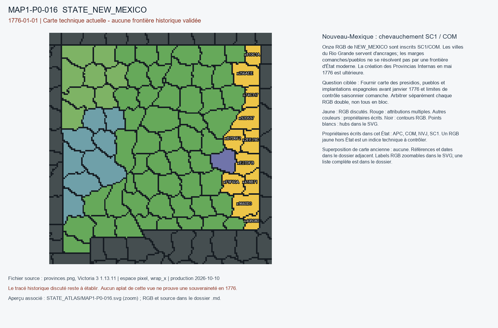

# MAP1-P0-016 — Nouveau-Mexique : chevauchement SC1 / COM

Statut : revue historique et géographique ouverte. Aucun transfert approuvé.

[Vue RGB zoomable](STATE_ATLAS/MAP1-P0-016.svg)

## Résultat de localisation technique

Onze RGB de NEW_MEXICO sont inscrits SC1/COM. Les villes du Rio Grande servent d'ancrages; les marges comanches/pueblos ne se résolvent pas par une frontière d'État moderne. La création des Provincias Internas en mai 1776 est ultérieure.

Décision de cette passe : NO_MODERN_NEW_MEXICO_OR_MAY_1776_RETROPROJECTION

## Question pour la recherche régionale

Fournir carte des presidios, pueblos et implantations espagnoles avant janvier 1776 et limites de contrôle saisonnier comanche. Arbitrer séparément chaque RGB double, non tous en bloc.

## Références et limites

### R8_NORTH_AMERICA_CARIBBEAN-S027

Texas State Historical Association. Comanche Indians. Publication : UNKNOWN. Document : UNKNOWN.

Référence : https://www.tshaonline.org/handbook/entries/comanche-indians

Pages/carte : Comanchería and 1772 San Antonio peace for one band; 1785 treaty later

Pertinence : 1776-01-01; interpret dates within the source

Biais/limites : Secondary synthesis: not a verified transfer to any game province.

Accès MAP-1 : CATALOG_ONLY_NOT_FETCHED. Notice importée, source originale non consultée indépendamment.

### R8_NORTH_AMERICA_CARIBBEAN-S028

Donald E. Chipman; Texas State Historical Association. Provincias Internas. Publication : UNKNOWN. Document : UNKNOWN.

Référence : https://www.tshaonline.org/handbook/entries/provincias-internas

Pages/carte : Royal approval May 1776; not yet established 1 January 1776

Pertinence : 1776-01-01; interpret dates within the source

Biais/limites : Secondary synthesis: not a verified transfer to any game province.

Accès MAP-1 : CATALOG_ONLY_NOT_FETCHED. Notice importée, source originale non consultée indépendamment.

### R8_NORTH_AMERICA_CARIBBEAN-S029

U.S. National Park Service. History and Significance of El Camino Real de Tierra Adentro. Publication : UNKNOWN. Document : UNKNOWN.

Référence : https://www.nps.gov/articles/000/history-and-significance-of-el-camino-real-de-tierra-adentro.htm

Pages/carte : Santa Fe Spanish reestablishment 1693; Pueblo self-government

Pertinence : 1776-01-01; interpret dates within the source

Biais/limites : Secondary synthesis: not a verified transfer to any game province.

Accès MAP-1 : CATALOG_ONLY_NOT_FETCHED. Notice importée, source originale non consultée indépendamment.

## Géoréférencement

Bitmap exact et contours pixel extraits. Aucun fond historique superposé, aucune projection GPS adoptée, aucun résidu de calage inventé. Les points des locators sont contrôlés dans le raster, pas contre un cadastre historique. Les noms de hubs peuvent être anachroniques ou erronés. Trois points indépendants et un point de contrôle hors ajustement restent requis pour un calage local de carte ancienne.

## RGB et propriétaires écrits

| RGB | Propriétaire(s) | Pixels | Hub déclaré |
|---|---|---:|---|
| x00E2A7 | SC1 | 189 |  |
| x0957D1 | SC1 | 242 |  |
| x0B1E97 | SC1 | 171 |  |
| x0DAC3E | SC1 | 195 |  |
| x0E8A94 | SC1 | 389 |  |
| x168663 | NVJ | 226 |  |
| x17660E | APC | 255 |  |
| x17E6C3 | NVJ | 279 |  |
| x1B611D | SC1 | 241 |  |
| x23E585 | SC1 | 226 |  |
| x256AEE | COM / SC1 | 279 |  |
| x2DF849 | NVJ | 262 |  |
| x2EE19C | COM / SC1 | 183 |  |
| x3385DD | SC1 | 281 |  |
| x37B6CF | APC | 201 |  |
| x38BB61 | SC1 | 116 |  |
| x3CC82C | SC1 | 241 |  |
| x3CD2D7 | SC1 | 216 |  |
| x4025EE | APC | 225 |  |
| x40B080 | COM / SC1 | 107 |  |
| x418B71 | COM / SC1 | 164 |  |
| x46C455 | SC1 | 248 |  |
| x4BBEE7 | SC1 | 245 |  |
| x504080 | SC1 | 343 |  |
| x50DED9 | SC1 | 270 |  |
| x53F9F0 | APC | 262 |  |
| x5967A1 | SC1 | 249 |  |
| x59E5C4 | SC1 | 200 |  |
| x5DA018 | SC1 | 283 | STATE_NEW_MEXICO:farm:Las Cruces |
| x5E769A | SC1 | 232 |  |
| x650434 | APC | 499 |  |
| x67B298 | SC1 | 189 |  |
| x74C317 | COM / SC1 | 151 |  |
| x79844B | SC1 | 144 |  |
| x7C809B | SC1 | 208 |  |
| x7D2451 | SC1 | 203 |  |
| x7EA360 | SC1 | 204 |  |
| x808AB5 | NVJ | 287 |  |
| x810C1A | COM / SC1 | 148 |  |
| x84CE0F | APC | 225 |  |
| x851687 | SC1 | 191 | STATE_NEW_MEXICO:mine:Albuquerque |
| x8A526A | SC1 | 203 |  |
| x8C6FA5 | SC1 | 246 |  |
| x90EA7D | SC1 | 356 |  |
| x92D597 | COM / SC1 | 239 |  |
| x940839 | SC1 | 280 |  |
| x9660D3 | COM / SC1 | 283 |  |
| x99C48C | SC1 | 124 |  |
| x9C0FED | NVJ | 218 |  |
| x9C15D3 | APC | 328 |  |
| xA156C7 | SC1 | 227 |  |
| xA84AFD | SC1 | 173 |  |
| xA858F4 | SC1 | 275 |  |
| xAA2075 | NVJ | 218 |  |
| xAE2568 | SC1 | 159 |  |
| xAE76ED | SC1 | 129 |  |
| xB0BB90 | SC1 | 260 | STATE_NEW_MEXICO:wood:Ruidose |
| xB566BA | SC1 | 308 |  |
| xB636E0 | SC1 | 142 |  |
| xB6EC9A | SC1 | 227 |  |
| xB7D6F2 | COM / SC1 | 190 |  |
| xBD8033 | NVJ | 282 |  |
| xC03080 | SC1 | 193 |  |
| xC03297 | COM | 228 |  |
| xC32AF4 | SC1 | 184 |  |
| xC50565 | SC1 | 238 |  |
| xCAEC7A | SC1 | 210 |  |
| xD3611A | SC1 | 234 |  |
| xD78928 | SC1 | 219 |  |
| xDBA81D | SC1 | 227 |  |
| xDF1965 | SC1 | 248 | STATE_NEW_MEXICO:city:Santa fe |
| xE27DFB | COM / SC1 | 234 |  |
| xE9C718 | SC1 | 208 |  |
| xEED52D | SC1 | 151 |  |
| xEF029F | NVJ | 230 |  |
| xF59F44 | SC1 | 230 |  |
| xF9F60A | COM / SC1 | 215 |  |
| xFB0FA8 | APC | 297 |  |
| xFD2B9D | SC1 | 84 |  |
