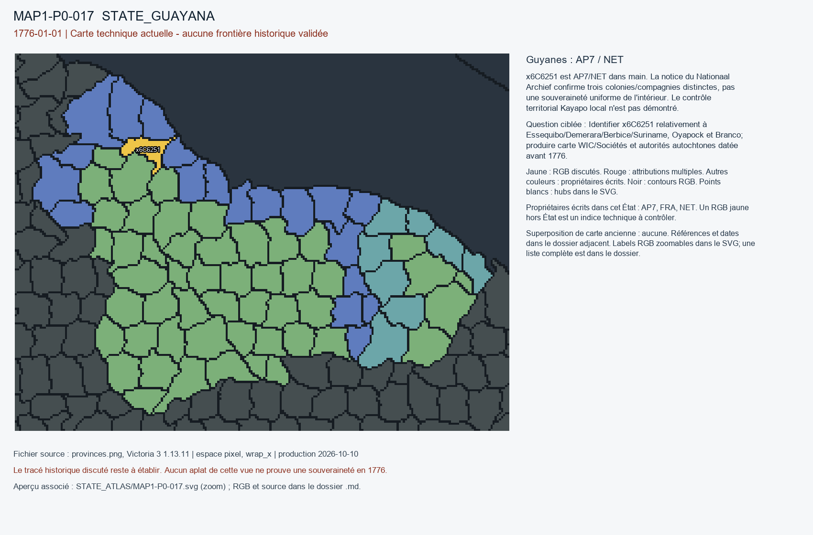

# MAP1-P0-017 — Guyanes : AP7 / NET

Statut : revue historique et géographique ouverte. Aucun transfert approuvé.

[Vue RGB zoomable](STATE_ATLAS/MAP1-P0-017.svg)

## Résultat de localisation technique

x6C6251 est AP7/NET dans main. La notice du Nationaal Archief confirme trois colonies/compagnies distinctes, pas une souveraineté uniforme de l'intérieur. Le contrôle territorial Kayapo local n'est pas démontré.

Décision de cette passe : DO_NOT_RESOLVE_DUPLICATE_BY_COLONIAL_COAST_LABEL

## Question pour la recherche régionale

Identifier x6C6251 relativement à Essequibo/Demerara/Berbice/Suriname, Oyapock et Branco; produire carte WIC/Sociétés et autorités autochtones datée avant 1776.

## Références et limites

### R9_SOUTH_AMERICA-S008

Gregório Ferreira Gomes Filho; Saul Eduardo Seiguer Milder. Forte São Joaquim: a ocupação portuguesa do Vale do Rio Branco no século XVIII. Publication : 2014. Document : 1775-1776.

Référence : https://revistaseletronicas.pucrs.br/oficinadohistoriador/article/view/13437

Pages/carte : Oficina do Historiador 7(1), p. 23-42, section expédition 1775; AHU Pará cx.74 d.6234

Pertinence : Crise et fortification sur Rio Branco en 1775, construction poursuivie en 1776

Biais/limites : Année d’achèvement du fort ultérieure; n’implique pas administration de toute la Guyane intérieure

Accès MAP-1 : CATALOG_ONLY_NOT_FETCHED. Notice importée, source originale non consultée indépendamment.

### R9_SOUTH_AMERICA-S009

Nationaal Archief, La Haye. Guyana, 1621–1813. Publication : UNKNOWN. Document : 1621-1813.

Référence : https://nationaalarchief.nl/onderzoeken/zoekhulpen/guyana-1621-1813

Pages/carte : Notice «Een gedeeld verleden», Essequibo, Demerara, Berbice, WIC et Sociëteit

Pertinence : Colonies de compagnies hollandaises actives en 1776

Biais/limites : Implantations littorales et fluviales, pas souveraineté uniforme sur arrière-pays

Accès MAP-1 : ACCESSED_CONTEXT_CONFIRMED. Nationaal Archief lists distinct Essequibo, Demerara and Berbice administrations; not an interior border map.

### R9_SOUTH_AMERICA-S010

Nationaal Archief, La Haye. Sociëteit van Suriname, 1683–1795. Publication : UNKNOWN. Document : 1683-1795.

Référence : https://www.nationaalarchief.nl/onderzoeken/zoekhulpen/societeit-van-suriname-1683-1795

Pages/carte : Notice et inventaire arch. 1.05.03, pouvoirs de gouvernement

Pertinence : Suriname gouverné par société à charte en 1776

Biais/limites : Distinguer Suriname des autres colonies néerlandaises; périmètre du State_ID incertain

Accès MAP-1 : CATALOG_ONLY_NOT_FETCHED. Notice importée, source originale non consultée indépendamment.

### R9_SOUTH_AMERICA-S028

PARES — Ministerio de Cultura de España. Bicentenario de las Independencias Iberoamericanas: Nueva Granada. Publication : UNKNOWN. Document : 1739-1793.

Référence : https://pares.cultura.gob.es/BicentenarioIndependencias/catalogo/description/7016904

Pages/carte : Notice «Nueva Granada», références AGI Santa Fe 541, 542 et Santa Fe 385

Pertinence : Affiliations Audiencias Quito, Guayana, Maracaibo et missions du haut Orénoque

Biais/limites : Synthèse archivistique avec rétroprojection jusqu’en 1793 : vérifier unités propres à 1776

Accès MAP-1 : CATALOG_ONLY_NOT_FETCHED. Notice importée, source originale non consultée indépendamment.

### R9_SOUTH_AMERICA-S031

Juan de la Cruz Cano y Olmedilla. Mapa geográfico de América Meridional. Publication : 1775. Document : 1775.

Référence : https://www.bne.es/es/colecciones/hispanoamerica/mapa-geografico-america-meridional

Pages/carte : Biblioteca Nacional de España, MV/25; 8 feuilles gravées (260 × 185 cm); avertissements et limites hispano-portugaises, scale environ 1:4 000 000

Pertinence : Carte dressée en 1775 avant la date cible, analyse chronologique complémentaire dans Almeida 2009 (S003)

Biais/limites : Carte de géographe commanditée sous la monarchie espagnole; BNE signale que des limites favorisant le Portugal conduisirent à la suspension de diffusion; aucune garantie du contrôle effectif

Accès MAP-1 : FETCH_FAILED. BNE returns 403/failed fetch. No map image or overlay inspected.

## Géoréférencement

Bitmap exact et contours pixel extraits. Aucun fond historique superposé, aucune projection GPS adoptée, aucun résidu de calage inventé. Les points des locators sont contrôlés dans le raster, pas contre un cadastre historique. Les noms de hubs peuvent être anachroniques ou erronés. Trois points indépendants et un point de contrôle hors ajustement restent requis pour un calage local de carte ancienne.

## RGB et propriétaires écrits

| RGB | Propriétaire(s) | Pixels | Hub déclaré |
|---|---|---:|---|
| x049E29 | FRA | 311 |  |
| x063557 | AP7 | 219 |  |
| x0753FE | AP7 | 196 |  |
| x102B13 | NET | 139 |  |
| x148FB5 | FRA | 271 |  |
| x19A3D9 | AP7 | 210 |  |
| x1F5190 | AP7 | 230 |  |
| x20DD27 | AP7 | 374 |  |
| x210190 | AP7 | 125 |  |
| x218011 | AP7 | 332 |  |
| x24A66B | NET | 225 |  |
| x27E268 | AP7 | 100 |  |
| x29D96A | NET | 213 |  |
| x350473 | AP7 | 328 |  |
| x3A069F | AP7 | 244 |  |
| x3EC2E7 | AP7 | 219 |  |
| x41552E | AP7 | 281 |  |
| x439BC2 | AP7 | 58 |  |
| x43E136 | NET | 212 |  |
| x4AE8F7 | AP7 | 229 |  |
| x4B427A | AP7 | 248 |  |
| x50D012 | NET | 312 | STATE_GUAYANA:city:Paramaribo |
| x518580 | AP7 | 138 |  |
| x58ABBF | AP7 | 223 |  |
| x61BE2C | FRA | 150 |  |
| x63ABD4 | NET | 194 |  |
| x6816FF | AP7 | 368 |  |
| x6B802F | NET | 249 |  |
| x6C6251 | AP7 / NET | 206 |  |
| x705AB9 | FRA | 253 |  |
| x719492 | AP7 | 230 |  |
| x734F81 | AP7 | 202 |  |
| x771D68 | AP7 | 190 |  |
| x7B4B5E | AP7 | 283 |  |
| x805A8C | NET | 174 |  |
| x80C050 | FRA | 188 |  |
| x822364 | NET | 94 |  |
| x8C64ED | FRA | 237 | STATE_GUAYANA:wood:Cayenne |
| x8E31E8 | NET | 165 | STATE_GUAYANA:port:Georgetown |
| x9A88B5 | NET | 427 |  |
| x9F0090 | FRA | 405 |  |
| x9FEDF7 | AP7 | 219 |  |
| xA00111 | AP7 | 118 |  |
| xA08011 | NET | 310 |  |
| xA082D3 | FRA | 249 |  |
| xA22A4C | AP7 | 350 |  |
| xA299AE | AP7 | 209 |  |
| xA350D5 | NET | 232 |  |
| xA52CE3 | AP7 | 304 | STATE_GUAYANA:farm:Linden |
| xA9777B | AP7 | 312 |  |
| xAA1153 | AP7 | 138 |  |
| xADE6C2 | AP7 | 233 |  |
| xB1960A | AP7 | 273 |  |
| xB21306 | AP7 | 270 |  |
| xB3512B | AP7 | 245 |  |
| xB6F7B4 | AP7 | 214 |  |
| xBB88B5 | AP7 | 277 | STATE_GUAYANA:mine:Noitgedacht |
| xC0C0D0 | AP7 | 180 |  |
| xC2E46E | NET | 155 |  |
| xC591AC | AP7 | 422 |  |
| xCD1A5A | AP7 | 240 |  |
| xD0678B | AP7 | 114 |  |
| xD0BA2B | NET | 403 |  |
| xD8362B | AP7 | 242 |  |
| xDB86CE | AP7 | 185 |  |
| xDBF640 | NET | 196 |  |
| xE18467 | AP7 | 264 |  |
| xE600F3 | AP7 | 202 |  |
| xE6BBD3 | NET | 294 |  |
| xE7864B | NET | 572 |  |
| xE85635 | AP7 | 214 |  |
| xE8D6CB | AP7 | 273 |  |
| xF17CCC | NET | 223 |  |
| xF1E3BF | AP7 | 203 |  |
| xF20136 | AP7 | 344 |  |
| xF23696 | AP7 | 196 |  |
| xF6408F | AP7 | 220 |  |
| xFAE8C5 | AP7 | 251 |  |
