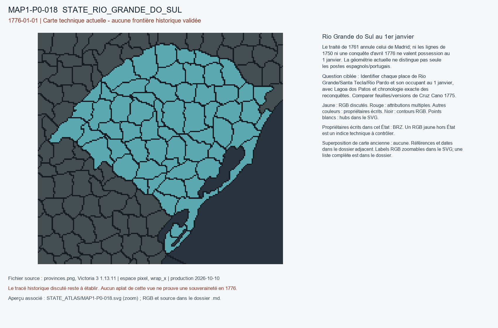

# MAP1-P0-018 — Rio Grande do Sul au 1er janvier

Statut : revue historique et géographique ouverte. Aucun transfert approuvé.

[Vue RGB zoomable](STATE_ATLAS/MAP1-P0-018.svg)

## Résultat de localisation technique

Le traité de 1761 annule celui de Madrid; ni les lignes de 1750 ni une conquête d'avril 1776 ne valent possession au 1 janvier. La géométrie actuelle ne distingue pas seule les postes espagnols/portugais.

Décision de cette passe : NO_APRIL_1776_CONQUEST_AT_START

## Question pour la recherche régionale

Identifier chaque place de Rio Grande/Santa Tecla/Rio Pardo et son occupant au 1 janvier, avec Lagoa dos Patos et chronologie exacte des reconquêtes. Comparer feuilles/versions de Cruz Cano 1775.

## Références et limites

### R9_SOUTH_AMERICA-S002

Carlos III / José Ier (plénipotentiaires Ricardo Wall et José de Silva Pesanha). Tratado de El Pardo, 1761. Publication : 1761-02-12. Document : 1761-02-12.

Référence : https://es.wikisource.org/wiki/Tratado_de_El_Pardo_(1761)

Pages/carte : Article I, annulation explicite du traité de Madrid de 1750

Pertinence : En vigueur en janvier 1776 quant à l’annulation formelle du traité de 1750

Biais/limites : Texte juridique, pas preuve de contrôle des villages et postes, transcrit dans une édition tardive

Accès MAP-1 : CATALOG_ONLY_NOT_FETCHED. Notice importée, source originale non consultée indépendamment.

### R9_SOUTH_AMERICA-S003

André Ferrand de Almeida. O Mapa Geográfico de América Meridional, de Juan de la Cruz Cano y Olmedilla. Publication : 2009. Document : 1775.

Référence : https://new.scielo.br/j/anaismp/a/wSwKLnf6QTqCPdWggbqGjJx/?lang=pt

Pages/carte : Anais do Museu Paulista 17(2), texte: édition d’octobre-novembre 1775, tracés concurrents; passages sur Rio Grande avril 1776

Pertinence : Analyse critique de la cartographie de 1775 et guerre de 1776

Biais/limites : Le tracé publié répond à une stratégie diplomatique espagnole; versions 1775, 1776, 1777 distinctes

Accès MAP-1 : CATALOG_ONLY_NOT_FETCHED. Notice importée, source originale non consultée indépendamment.

### R9_SOUTH_AMERICA-S031

Juan de la Cruz Cano y Olmedilla. Mapa geográfico de América Meridional. Publication : 1775. Document : 1775.

Référence : https://www.bne.es/es/colecciones/hispanoamerica/mapa-geografico-america-meridional

Pages/carte : Biblioteca Nacional de España, MV/25; 8 feuilles gravées (260 × 185 cm); avertissements et limites hispano-portugaises, scale environ 1:4 000 000

Pertinence : Carte dressée en 1775 avant la date cible, analyse chronologique complémentaire dans Almeida 2009 (S003)

Biais/limites : Carte de géographe commanditée sous la monarchie espagnole; BNE signale que des limites favorisant le Portugal conduisirent à la suspension de diffusion; aucune garantie du contrôle effectif

Accès MAP-1 : FETCH_FAILED. BNE returns 403/failed fetch. No map image or overlay inspected.

## Géoréférencement

Bitmap exact et contours pixel extraits. Aucun fond historique superposé, aucune projection GPS adoptée, aucun résidu de calage inventé. Les points des locators sont contrôlés dans le raster, pas contre un cadastre historique. Les noms de hubs peuvent être anachroniques ou erronés. Trois points indépendants et un point de contrôle hors ajustement restent requis pour un calage local de carte ancienne.

## RGB et propriétaires écrits

| RGB | Propriétaire(s) | Pixels | Hub déclaré |
|---|---|---:|---|
| x00E2C3 | BRZ | 398 | STATE_RIO_GRANDE_DO_SUL:farm:Santa Maria |
| x036508 | BRZ | 164 |  |
| x0445FE | BRZ | 360 |  |
| x067BE3 | BRZ | 266 |  |
| x118F07 | BRZ | 312 |  |
| x161E6F | BRZ | 321 |  |
| x16C462 | BRZ | 386 |  |
| x1956D3 | BRZ | 234 |  |
| x19E79D | BRZ | 206 |  |
| x22956B | BRZ | 257 |  |
| x26F3A4 | BRZ | 243 | STATE_RIO_GRANDE_DO_SUL:wood:Caxias do Sul |
| x38328C | BRZ | 250 |  |
| x38A72A | BRZ | 117 |  |
| x45B9DF | BRZ | 160 |  |
| x48F668 | BRZ | 319 |  |
| x4BBCCC | BRZ | 277 |  |
| x4EF206 | BRZ | 185 |  |
| x529B8E | BRZ | 299 |  |
| x52B247 | BRZ | 377 | STATE_RIO_GRANDE_DO_SUL:port:Rio Grande |
| x583BA0 | BRZ | 271 |  |
| x5F39AB | BRZ | 255 |  |
| x5F9728 | BRZ | 269 |  |
| x628161 | BRZ | 169 |  |
| x633FB2 | BRZ | 310 |  |
| x6E0564 | BRZ | 308 |  |
| x7600E6 | BRZ | 379 |  |
| x7678F5 | BRZ | 135 |  |
| x782568 | BRZ | 212 |  |
| x783434 | BRZ | 122 |  |
| x7DEC91 | BRZ | 105 |  |
| x7F701B | BRZ | 377 |  |
| x8953B5 | BRZ | 93 |  |
| x8A15FA | BRZ | 266 |  |
| x8E3579 | BRZ | 272 |  |
| x8F1635 | BRZ | 205 |  |
| x9A598B | BRZ | 158 |  |
| x9BDDA2 | BRZ | 116 |  |
| x9D8150 | BRZ | 210 |  |
| x9FE393 | BRZ | 328 | STATE_RIO_GRANDE_DO_SUL:mine:Cruz Alta |
| xA41E15 | BRZ | 208 |  |
| xA787A2 | BRZ | 277 |  |
| xA950E8 | BRZ | 236 |  |
| xB88B11 | BRZ | 300 |  |
| xBEAF68 | BRZ | 153 |  |
| xC7E5A1 | BRZ | 339 | STATE_RIO_GRANDE_DO_SUL:city:Porto Alegre |
| xCC2135 | BRZ | 96 |  |
| xCD5D1E | BRZ | 172 |  |
| xCD9ECD | BRZ | 172 |  |
| xD3A197 | BRZ | 224 |  |
| xD8696A | BRZ | 231 |  |
| xD9D235 | BRZ | 111 |  |
| xE17D15 | BRZ | 319 |  |
| xE5C3BD | BRZ | 310 |  |
| xE69F64 | BRZ | 135 |  |
| xE761EB | BRZ | 245 |  |
| xE933B3 | BRZ | 197 |  |
| xED55D2 | BRZ | 218 |  |
| xF0F96F | BRZ | 358 |  |
| xF1B2D9 | BRZ | 264 |  |
| xFF2920 | BRZ | 128 |  |
