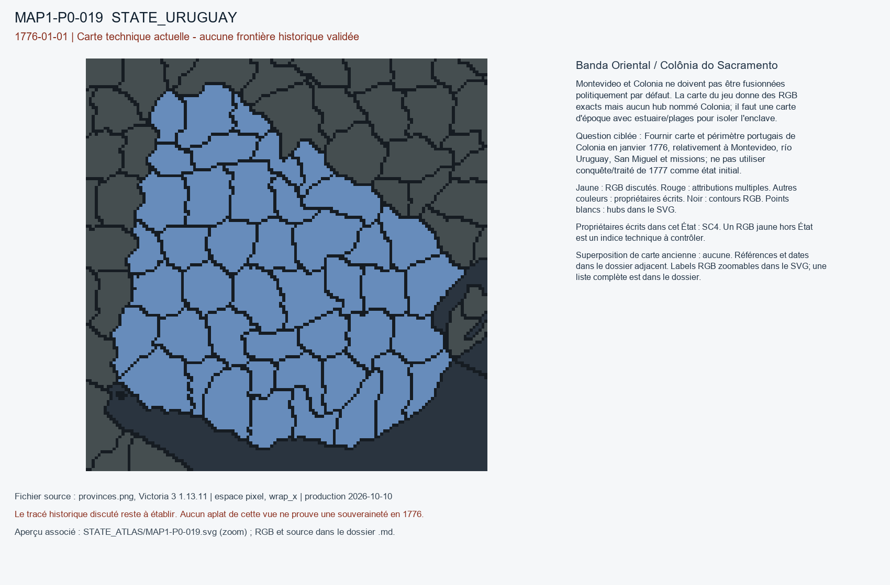

# MAP1-P0-019 — Banda Oriental / Colônia do Sacramento

Statut : revue historique et géographique ouverte. Aucun transfert approuvé.

[Vue RGB zoomable](STATE_ATLAS/MAP1-P0-019.svg)

## Résultat de localisation technique

Montevideo et Colonia ne doivent pas être fusionnées politiquement par défaut. La carte du jeu donne des RGB exacts mais aucun hub nommé Colonia; il faut une carte d'époque avec estuaire/plages pour isoler l'enclave.

Décision de cette passe : NO_WHOLE_URUGUAY_SC4_VALIDATION

## Question pour la recherche régionale

Fournir carte et périmètre portugais de Colonia en janvier 1776, relativement à Montevideo, río Uruguay, San Miguel et missions; ne pas utiliser conquête/traité de 1777 comme état initial.

## Références et limites

### R9_SOUTH_AMERICA-S001

Carlos III, roi d’Espagne. Real Cédula de erección / nomination de Pedro de Cevallos. Publication : 1776-08-01. Document : 1776-08-01.

Référence : https://es.wikisource.org/wiki/Real_c%C3%A9dula_de_erecci%C3%B3n_del_virreinato_del_R%C3%ADo_de_la_Plata

Pages/carte : Texte de la cédule, paragraphes «EL REY» et «Dada en San Ildefonso á primero de Agosto»; provinces énumérées

Pertinence : Document ultérieur de sept mois, prouve l’absence de la nouvelle vice-royauté au 1er janvier et les dépendances antérieures

Biais/limites : Nomination initialement liée à une expédition militaire; ne pas rétroprojeter le statut 1777 sur janvier 1776

Accès MAP-1 : ACCESSED_NOT_FULLY_REVIEWED. Wikisource transcription accessible; post-cutoff August 1776 act, no automatic retroprojection.

### R9_SOUTH_AMERICA-S002

Carlos III / José Ier (plénipotentiaires Ricardo Wall et José de Silva Pesanha). Tratado de El Pardo, 1761. Publication : 1761-02-12. Document : 1761-02-12.

Référence : https://es.wikisource.org/wiki/Tratado_de_El_Pardo_(1761)

Pages/carte : Article I, annulation explicite du traité de Madrid de 1750

Pertinence : En vigueur en janvier 1776 quant à l’annulation formelle du traité de 1750

Biais/limites : Texte juridique, pas preuve de contrôle des villages et postes, transcrit dans une édition tardive

Accès MAP-1 : CATALOG_ONLY_NOT_FETCHED. Notice importée, source originale non consultée indépendamment.

### R9_SOUTH_AMERICA-S003

André Ferrand de Almeida. O Mapa Geográfico de América Meridional, de Juan de la Cruz Cano y Olmedilla. Publication : 2009. Document : 1775.

Référence : https://new.scielo.br/j/anaismp/a/wSwKLnf6QTqCPdWggbqGjJx/?lang=pt

Pages/carte : Anais do Museu Paulista 17(2), texte: édition d’octobre-novembre 1775, tracés concurrents; passages sur Rio Grande avril 1776

Pertinence : Analyse critique de la cartographie de 1775 et guerre de 1776

Biais/limites : Le tracé publié répond à une stratégie diplomatique espagnole; versions 1775, 1776, 1777 distinctes

Accès MAP-1 : CATALOG_ONLY_NOT_FETCHED. Notice importée, source originale non consultée indépendamment.

### R9_SOUTH_AMERICA-S015

Julia Sarreal. Disorder, Wild Cattle, and a New Role for the Missions: The Banda Oriental, 1776–1786. Publication : 2015. Document : 1776-1786.

Référence : https://www.cambridge.org/core/journals/americas/article/abs/disorder-wild-cattle-and-a-new-role-for-the-missions-the-banda-oriental-17761786/0C1B16A63E5076AA6DA457D2F3FEE7FE

Pages/carte : The Americas, résumé et article, paragraphes missions guaraní et réforme post-1768

Pertinence : Missions dans la Banda Oriental et après départ des jésuites

Biais/limites : L’article démarre en 1776 sans fournir un cadastre de janvier 1776

Accès MAP-1 : CATALOG_ONLY_NOT_FETCHED. Notice importée, source originale non consultée indépendamment.

## Géoréférencement

Bitmap exact et contours pixel extraits. Aucun fond historique superposé, aucune projection GPS adoptée, aucun résidu de calage inventé. Les points des locators sont contrôlés dans le raster, pas contre un cadastre historique. Les noms de hubs peuvent être anachroniques ou erronés. Trois points indépendants et un point de contrôle hors ajustement restent requis pour un calage local de carte ancienne.

## RGB et propriétaires écrits

| RGB | Propriétaire(s) | Pixels | Hub déclaré |
|---|---|---:|---|
| x02C6DE | SC4 | 236 |  |
| x061EE6 | SC4 | 278 | STATE_URUGUAY:mine:Bagé |
| x08CCA6 | SC4 | 132 |  |
| x104529 | SC4 | 251 |  |
| x139DC8 | SC4 | 232 |  |
| x302DDA | SC4 | 245 | STATE_URUGUAY:city:Montevideo |
| x3588C8 | SC4 | 105 |  |
| x3AF263 | SC4 | 299 |  |
| x3D3A57 | SC4 | 300 |  |
| x3EA75C | SC4 | 175 |  |
| x3F05CB | SC4 | 233 |  |
| x449F06 | SC4 | 262 |  |
| x44A7CD | SC4 | 277 |  |
| x466506 | SC4 | 334 |  |
| x46C43D | SC4 | 206 |  |
| x490187 | SC4 | 312 |  |
| x4934E2 | SC4 | 186 |  |
| x49D0F9 | SC4 | 218 |  |
| x4E1442 | SC4 | 368 |  |
| x65E74D | SC4 | 248 |  |
| x754BF8 | SC4 | 205 |  |
| x7764E0 | SC4 | 263 |  |
| x7AADBF | SC4 | 276 |  |
| x8136C4 | SC4 | 143 |  |
| x9C6453 | SC4 | 279 |  |
| xA282BC | SC4 | 207 |  |
| xA46ED2 | SC4 | 247 | STATE_URUGUAY:port:Punta del Este |
| xA7EB2E | SC4 | 303 |  |
| xABC305 | SC4 | 292 |  |
| xC2A28B | SC4 | 157 |  |
| xC53004 | SC4 | 148 |  |
| xC707C7 | SC4 | 139 |  |
| xCB8D8C | SC4 | 224 |  |
| xD45E0C | SC4 | 244 |  |
| xD5325F | SC4 | 163 | STATE_URUGUAY:wood:Melo |
| xD8A185 | SC4 | 184 |  |
| xD8A44F | SC4 | 194 |  |
| xDD1206 | SC4 | 228 |  |
| xE25670 | SC4 | 253 |  |
| xE2BE85 | SC4 | 281 |  |
| xE2D434 | SC4 | 115 |  |
| xE69F06 | SC4 | 138 |  |
| xEE9484 | SC4 | 145 | STATE_URUGUAY:farm:Paysandú |
| xFEBAD0 | SC4 | 213 |  |
