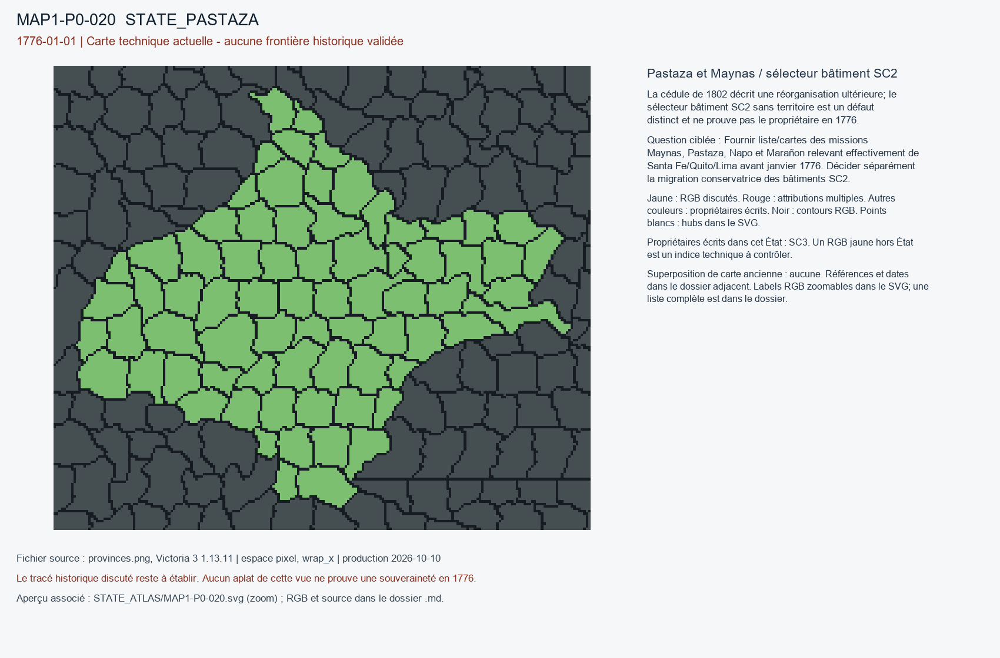

# MAP1-P0-020 — Pastaza et Maynas / sélecteur bâtiment SC2

Statut : revue historique et géographique ouverte. Aucun transfert approuvé.

[Vue RGB zoomable](STATE_ATLAS/MAP1-P0-020.svg)

## Résultat de localisation technique

La cédule de 1802 décrit une réorganisation ultérieure; le sélecteur bâtiment SC2 sans territoire est un défaut distinct et ne prouve pas le propriétaire en 1776.

Décision de cette passe : NO_OWNER_INFERENCE_FROM_ORPHAN_BUILDINGS_OR_1802

## Question pour la recherche régionale

Fournir liste/cartes des missions Maynas, Pastaza, Napo et Marañon relevant effectivement de Santa Fe/Quito/Lima avant janvier 1776. Décider séparément la migration conservatrice des bâtiments SC2.

## Références et limites

### R9_SOUTH_AMERICA-S019

Carlos IV, roi d’Espagne. Real Cédula del Gobierno y Comandancia de Maynas. Publication : 1802-07-15. Document : 1802-07-15.

Référence : https://es.wikisource.org/wiki/Real_C%C3%A9dula_de_1802

Pages/carte : Texte: les missions de Maynas sont retranchées du virreinato de Santa Fé et rattachées à Lima

Pertinence : Rétrospectif: atteste juridiction antérieure Santa Fe sur des missions de Maynas

Biais/limites : 1802 est 26 années après la date cible; ne prouve pas administration effective de tout Pastaza

Accès MAP-1 : ACCESSED_NOT_FULLY_REVIEWED. Wikisource transcription accessible; post-cutoff 1802 document, not a 1776 boundary proof.

### R9_SOUTH_AMERICA-S028

PARES — Ministerio de Cultura de España. Bicentenario de las Independencias Iberoamericanas: Nueva Granada. Publication : UNKNOWN. Document : 1739-1793.

Référence : https://pares.cultura.gob.es/BicentenarioIndependencias/catalogo/description/7016904

Pages/carte : Notice «Nueva Granada», références AGI Santa Fe 541, 542 et Santa Fe 385

Pertinence : Affiliations Audiencias Quito, Guayana, Maracaibo et missions du haut Orénoque

Biais/limites : Synthèse archivistique avec rétroprojection jusqu’en 1793 : vérifier unités propres à 1776

Accès MAP-1 : CATALOG_ONLY_NOT_FETCHED. Notice importée, source originale non consultée indépendamment.

### R9_SOUTH_AMERICA-S031

Juan de la Cruz Cano y Olmedilla. Mapa geográfico de América Meridional. Publication : 1775. Document : 1775.

Référence : https://www.bne.es/es/colecciones/hispanoamerica/mapa-geografico-america-meridional

Pages/carte : Biblioteca Nacional de España, MV/25; 8 feuilles gravées (260 × 185 cm); avertissements et limites hispano-portugaises, scale environ 1:4 000 000

Pertinence : Carte dressée en 1775 avant la date cible, analyse chronologique complémentaire dans Almeida 2009 (S003)

Biais/limites : Carte de géographe commanditée sous la monarchie espagnole; BNE signale que des limites favorisant le Portugal conduisirent à la suspension de diffusion; aucune garantie du contrôle effectif

Accès MAP-1 : FETCH_FAILED. BNE returns 403/failed fetch. No map image or overlay inspected.

## Géoréférencement

Bitmap exact et contours pixel extraits. Aucun fond historique superposé, aucune projection GPS adoptée, aucun résidu de calage inventé. Les points des locators sont contrôlés dans le raster, pas contre un cadastre historique. Les noms de hubs peuvent être anachroniques ou erronés. Trois points indépendants et un point de contrôle hors ajustement restent requis pour un calage local de carte ancienne.

## RGB et propriétaires écrits

| RGB | Propriétaire(s) | Pixels | Hub déclaré |
|---|---|---:|---|
| x0080D0 | SC3 | 209 |  |
| x01CA2C | SC3 | 158 |  |
| x096D46 | SC3 | 291 |  |
| x0EA863 | SC3 | 251 |  |
| x248E5D | SC3 | 286 |  |
| x2521E8 | SC3 | 107 |  |
| x272E8C | SC3 | 154 |  |
| x27EF71 | SC3 | 137 |  |
| x299588 | SC3 | 129 |  |
| x3799DE | SC3 | 246 |  |
| x38C3BD | SC3 | 206 |  |
| x3C0D20 | SC3 | 324 |  |
| x3DBF3C | SC3 | 244 |  |
| x3E32E2 | SC3 | 223 |  |
| x411597 | SC3 | 243 |  |
| x439628 | SC3 | 255 |  |
| x4F0E85 | SC3 | 217 |  |
| x51F069 | SC3 | 259 |  |
| x598DEB | SC3 | 105 |  |
| x60DC96 | SC3 | 291 |  |
| x63ED6E | SC3 | 203 |  |
| x6675F2 | SC3 | 162 | STATE_PASTAZA:mine:Chiriaco |
| x667AE7 | SC3 | 273 |  |
| x6B096B | SC3 | 236 |  |
| x6B0A5B | SC3 | 131 |  |
| x6D7047 | SC3 | 219 |  |
| x6DCE38 | SC3 | 187 |  |
| x737C7E | SC3 | 299 |  |
| x7AC512 | SC3 | 208 |  |
| x7E3539 | SC3 | 169 |  |
| x7FE0D2 | SC3 | 220 |  |
| x804050 | SC3 | 218 |  |
| x8080D0 | SC3 | 408 |  |
| x877BF7 | SC3 | 219 |  |
| x8A1A0D | SC3 | 262 |  |
| x8C41E2 | SC3 | 234 |  |
| x8CD643 | SC3 | 157 |  |
| x8FE675 | SC3 | 106 |  |
| x9110AC | SC3 | 245 |  |
| x917883 | SC3 | 144 |  |
| x97F39F | SC3 | 197 |  |
| x9B0B43 | SC3 | 139 |  |
| x9EAA88 | SC3 | 234 |  |
| x9FEB80 | SC3 | 238 |  |
| xA28606 | SC3 | 176 |  |
| xA29A00 | SC3 | 327 |  |
| xA54AD4 | SC3 | 268 |  |
| xA5ACFD | SC3 | 245 |  |
| xB16F01 | SC3 | 265 |  |
| xB47529 | SC3 | 225 |  |
| xB7C18D | SC3 | 332 |  |
| xC5B9B8 | SC3 | 206 |  |
| xC778AE | SC3 | 266 |  |
| xCF5C7B | SC3 | 111 |  |
| xD0BAEC | SC3 | 107 |  |
| xD0D212 | SC3 | 324 |  |
| xD18F33 | SC3 | 214 |  |
| xD21383 | SC3 | 308 |  |
| xD37CBF | SC3 | 231 |  |
| xD61646 | SC3 | 93 |  |
| xDCA8CF | SC3 | 90 |  |
| xDF9283 | SC3 | 297 | STATE_PASTAZA:city:Iquitos |
| xE043D2 | SC3 | 168 | STATE_PASTAZA:farm:Nauta |
| xE05359 | SC3 | 251 |  |
| xE85DC6 | SC3 | 244 |  |
| xEB5ADD | SC3 | 325 |  |
| xF2735E | SC3 | 246 |  |
| xF479D2 | SC3 | 213 | STATE_PASTAZA:wood:Yurimaguas |
| xF73F96 | SC3 | 234 |  |
| xF86ADF | SC3 | 210 |  |
| xFB499C | SC3 | 210 |  |
| xFD054C | SC3 | 211 |  |
| xFD33D9 | SC3 | 168 |  |
