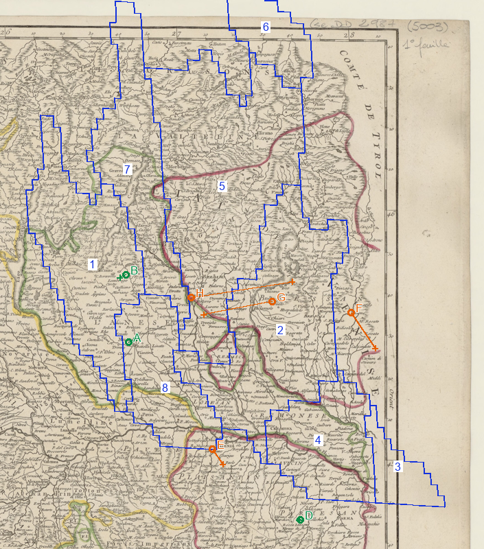

# MAP1-P0-002 — Lombardie austro-vénitienne

Date cible : 1er janvier 1776. **Les limites dessinées sont diagnostiques.**

Voir [scan occidental sans contours](lombardy_west_1750_1600.png), [scan oriental sans contours](lombardy_1750_1600.png), [superposition entière](lombardy_historical_overlay.png), [légende RGB](lombardy_overlay_legend.csv).

Bleu : contours du jeu. Chiffres : RGB ci-dessous. Cercles verts : ajustement, orange : contrôles ou diagnostics exclus du calcul; croix : prédictions. A Milan, B Como, C Gênes, D Parme, E Plaisance, F Vérone; G Brescia, H Bergame sont les **noms du jeu testés séparément**, pas des points d'ajustement. Sources originales en deux feuillets, pas une carte actuelle recolorée.

## Lecture

R1-0008/0009 sont confrontés aux deux scans Robert de Vaugondy de 1750 et aux notices institutionnelles LOM-03/04. Adda, Oglio, Pô et lacs situent les limites; Milan/Pavie et Mantoue ne doivent pas être confondus avec Bergame/Brescia/Crema. Les divisions de 1786 sont exclues. Crema impose un contrôle particulier : son enclave et son corridor ne sont pas assimilables à un grand bloc vénitien continu.

**Nouveau diagnostic :** les locators du jeu étiquetés Brescia et Bergame sont d'ouest en est dans l'ordre contraire aux villes sur le scan. Résidus : **11,173 et 16,537 pixels du jeu**, contre **4,786** au plus pour les deux vrais contrôles. Ils sont exclus du calcul; aucune ville du jeu n'est renommée ou déplacée par MAP1B.

`xD04060`, repère 8, recouvre diagnostiquement le secteur milanais/pavesan : **maintien AUS proposé**, confiance moyenne pour le noyau, faible aux limites. L'Adda et Crema restent à vérifier avant toute validation entière. Le grand contour 2 approche à la fois Brescia et Crémone : le TAG AUS existant ne prouve pas que sa totalité est autrichienne. Le contour 5 couvre Bergame et des vallées mais sa frange alpine demande une source locale. Le petit contour 6 se trouve trop au nord, au-dessus du cadre du feuillet occidental : **il n'est pas une preuve de Mantoue**. Le feuillet oriental consulté montre Mantoue près du Pô; il n'a pas été ajusté artificiellement pour sauver cette attribution.

## Méthode et protection

Seul le maintien proposé du RGB 8 relève provisoirement de A (provinces existantes). Les autres cas restent indéterminés. Un mélange apparent dans un overlay imparfait ne justifie pas encore C (scission du bitmap); améliorer le contrôle local, tester A puis B avant C.

Le candidat non fusionné attribuant `x867A90` à AUS sans retirer VEN produirait une double propriété : **rejet technique maintenu**, sans arbitrage territorial inventé. Aucune population ni aucun bâtiment AUS/VEN n'est modifié.

<!-- PER_PROVINCE_TABLE -->

| Repère | RGB | Écritures actuelles | Lecture géographique (diagnostic) | Décision | Preuve supplémentaire nécessaire |
|---|---|---|---|---|---|
| 1 | x3F1E38 | AUS | Como et lacs, prolongement septentrional | SUSPENDRE | Séparer Como et territoires suisses; carte de districts de 1757 et limite alpine. |
| 2 | x4713EE | AUS | Brescia–Crémone, Oglio; recoupe plusieurs territoires dans le diagnostic | SUSPENDRE | Tracer frontière Brescia–Crémone et enclaves; cadastre milanais/Carte des districts antérieure à 1776. |
| 3 | x50C060 | AUS | Bord oriental de la carte occidentale; feuillet oriental nécessaire | SUSPENDRE | Alignement local du feuillet oriental sur Mantoue, Vérone et Pô; frontière Mantoue–Ferrare. |
| 4 | x70B8A9 | AUS | Mantoue/Bozzolo et Pô | SUSPENDRE | Frontières du Mantouan avec Venise et Parme; feuillet oriental à géoréférencer localement. |
| 5 | x867A90 | VEN | Bergame et vallées; Adda, Iseo; grande emprise alpine | SUSPENDRE | Territoire des vallées bergamasques/brescianes et bord nord; carte administrative vénitienne, district par district. |
| 6 | x9AC196 | VEN | 79 pixels; ancre au-dessus du cadre cartographique occidental | SUSPENDRE | Carte alpine couvrant ce polygone et raccordement indépendant. Ne pas attribuer ce RGB à Mantoue sur son TAG. |
| 7 | xA40CE9 | AUS | Lacs et Valtellina; plusieurs juridictions possibles | SUSPENDRE | Carte administrative Valtellina/Grisons/Como datée pour 1776; comparaison locale. |
| 8 | xD04060 | AUS | Milan–Pavie; à l’ouest du domaine vénitien principal | CONSERVER_PROPOSÉ | Vérifier bord oriental sur Adda et enclave de Crema; plan cadastral/administratif du Milanais, pas divisions de 1786. |
