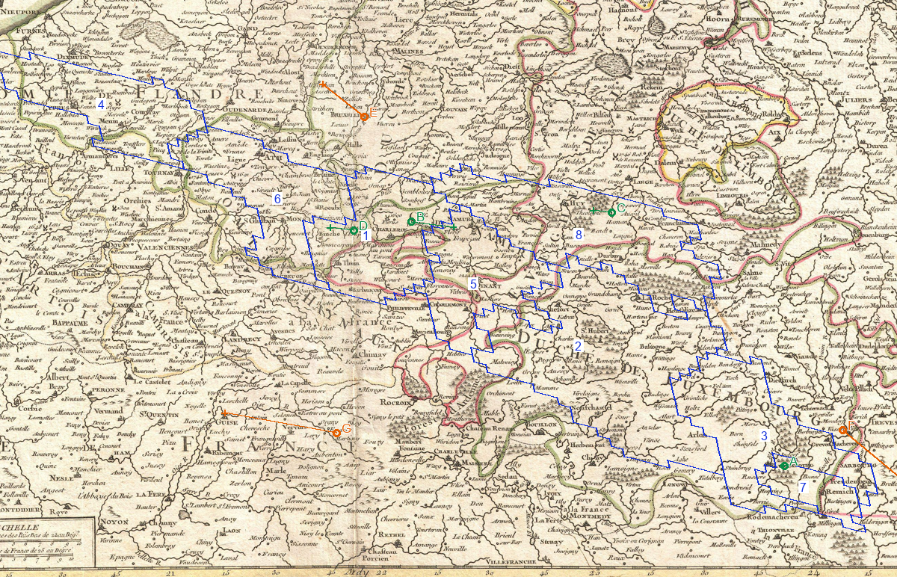

# MAP1-P0-001 — Luxembourg et Wallonie

Date cible : 1er janvier 1776. Analyse du 10 octobre 2026. **Diagnostic, pas frontière validée.**

Voir aussi [carte historique entière, sans tracés](lux_1771_1600.png), [superposition entière](lux_historical_overlay.png), [légende RGB](lux_overlay_legend.csv) et [points de contrôle](GCP_AND_CONTROLS.csv).

Bleu : contours exacts des pixels du jeu, transformés par un ajustement affine local. Chiffres : RGB du tableau ci-dessous. Cercle vert : ville lue sur le scan utilisée dans l'ajustement; cercle orange : contrôle indépendant. Croix : emplacement prédit du repère du jeu; segment : écart. Lettres A–G : Luxembourg, Namur, Liège, Charleroi, Bruxelles, Trèves, Reims. Les couleurs anciennes ne constituent pas une légende moderne de souveraineté.

## Lecture et limite

La carte effectivement consultée est celle de Janvier, notice datée 1771, planche 6 : le duché dépasse visiblement le petit contour 7 autour de Luxembourg-ville. Chiny, Arlon, Bastogne et Saint-Hubert servent de repères distincts, pas de synonymes de `xD001A0`. La Semois, la Meuse et la Moselle facilitent la lecture, mais les huit polygones ne suivent pas automatiquement ces juridictions.

Le contrôle maximal vaut **10,122 pixels du jeu**. `xD001A0` ne mesure que **47 pixels**, dans une boîte de **9 × 8** : cet ajustement ne peut démontrer ses limites entières. L'incertitude n'est pas effacée par le fait que le locator de Luxembourg tombe dans ce RGB.

R1-0001/0004/0035 sont repris : institutions luxembourgeoises distinctes sous souveraineté habsbourgeoise, coexistence avec Liège et Bouillon, pas de Belgique indépendante déduite du TAG BEO. L'étude LUX-02 traite notamment des contestations avec Trèves : les prétentions ne doivent pas devenir une propriété certaine. Les pièces de mai 1776 et le règlement de 1779 ne valent pas rétroactivement au 1er janvier.

**Décision : suspension des huit correspondances entières.** Une représentation jouable/dépendante LUX reste un choix de gameplay distinct de la souveraineté; aucune absorption dans BEO ou AUS n'est autorisée ici.

## Dépendances protégées

Les quatre populations LUX écrites restent 81 113 + 56 156 + 447 + 165 = **137 881**. Le candidat du collaborateur remplaçait ce total par 100 000 : perte de 37 881, non intégrée. Deux commandes de création d'administration sont recensées dans MAP1; elles ne prouvent pas deux niveaux effectifs additionnés par le moteur. Bâtiments, capitale WALLONIA, formations et relations/transit diplomatique restent intacts. Voir [dépendances préexistantes](../../MAP1/MAP1_DEPENDENCY_DOSSIERS/STATE_WALLONIA.json).

<!-- PER_PROVINCE_TABLE -->

| Repère | RGB | Écritures actuelles | Lecture géographique (diagnostic) | Décision | Preuve supplémentaire nécessaire |
|---|---|---|---|---|---|
| 1 | x2D32D7 | BEO | Charleroi et abords de Namur; polygone traversant plusieurs limites colorées | SUSPENDRE | Limites de Hainaut, Namur et Liège autour de Charleroi; feuilles Ferraris avec juridictions. |
| 2 | x3A5FB9 | BEO | Saint-Hubert, Chiny et Semois dans le voisinage diagnostique | SUSPENDRE | Frontière Chiny–Bouillon, villages et enclaves; cadastre A-XIV et feuilles Ferraris locales. |
| 3 | x5180A0 | BEO | Arlon/Bastogne au nord de Luxembourg-ville | SUSPENDRE | Limites nord et orientales du duché et changements 1769; Ferraris et clauses territoriales de 1769. |
| 4 | x8080A0 | BEO | Hainaut occidental; bord de la fenêtre de comparaison | SUSPENDRE | Limite Hainaut–France et enclaves; Ferraris/accord 1769, pas frontière belge actuelle. |
| 5 | x916574 | BEO | Namur/Dinant; Meuse et territoires imbriqués | SUSPENDRE | Villages de Namur et Liège sur les deux rives; feuilles Ferraris avec limites politiques. |
| 6 | xB0A0C0 | BEO | Mons et Hainaut; extrémités du polygone | SUSPENDRE | Limites administratives locales et franges françaises; Ferraris local. |
| 7 | xD001A0 | LUX | Luxembourg-ville; 47 pixels, boîte 9 × 8 pixels | SUSPENDRE | Le RGB entier tient-il dans le duché au 01-01-1776? Ferraris local + traité 1769; choix distinct du statut jouable LUX. |
| 8 | xEF2040 | BEO | Liège, Huy, Durbuy et La Roche; polygone multi-juridiction possible | SUSPENDRE | Limites de Liège/Namur/Luxembourg et Stavelot; atlas politique documenté et Ferraris local. |
