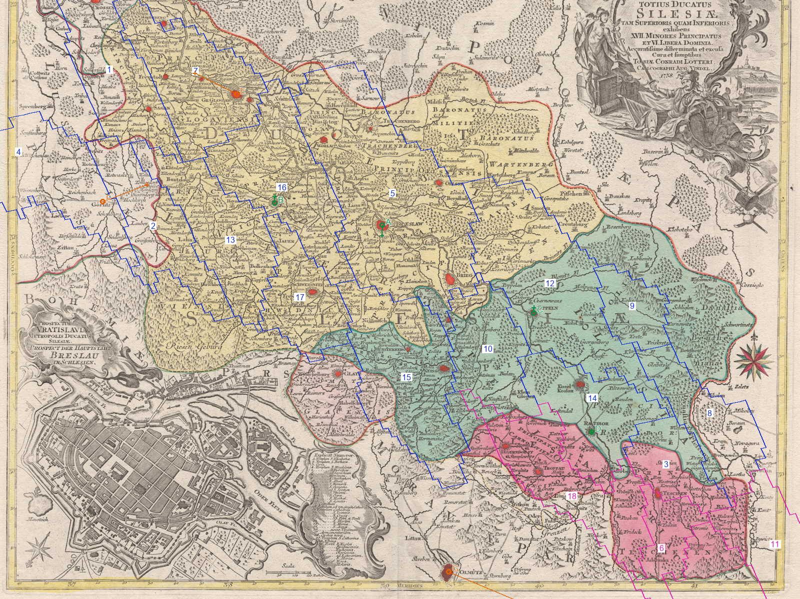

# MAP1-P0-003 — Haute ET Basse Silésie

Date cible : 1er janvier 1776. **Diagnostic cartographique incomplet, pas démarcation validée.**

Voir [scan entier sans tracés](silesia_1758_1600.png), [superposition entière](silesia_historical_overlay.png), [légende RGB](silesia_overlay_legend.csv), [page historique consultée](silesia_article-11.png).

Bleu : provinces définies en Haute/Basse Silésie; magenta : trois RGB supplémentaires écrits sous Haute-Silésie mais définis ailleurs. Chiffres : RGB ci-dessous. A Breslau, B Liegnitz, C Oppeln, D Ratibor (ajustement); E Glogau, F Görlitz, G Olomouc (contrôles). Cercle = observation sur scan, croix = position prédite, trait = écart. Les couleurs jaune/vert/rose de la carte différencient des territoires historiques; elles ne constituent **pas** à elles seules une attribution PRU/AUS.

## Lecture

Les conclusions R2-0001/0002/0003 sont reprises et confrontées à Lotter 1758 et au **texte complet**, notamment p. imprimée 19 (PDF 11), de SIL-02, auparavant référencé dans R2 par son résumé. La partition de 1742, sa démarcation en 1743 et sa confirmation en 1763 sont le cadre antérieur à 1776 : majorité silésienne et Glatz prussiens, reliquats méridionaux habsbourgeois. Les opérations militaires de 1758 ne sont pas extrapolées comme contrôle effectif de 1776.

Propositions prudentes : conserver PRU pour les noyaux de **Breslau (`x6E617F`, 5)** et **Liegnitz (`xC108EA`, 16)**. Aucun transfert ni contour entier n'est vérifié. Oder, Neisse, Troppau et Teschen servent à poser les questions frontalières, pas à tirer une ligne inventée.

La région occidentale comporte des espaces indiqués comme Lusace sur la carte : la définition actuelle LOWER_SILESIA ne prouve pas une souveraineté PRU en 1776, et il faut exclure une rétroprojection après 1815. Les franges orientales exigent aussi un contrôle postérieur à la partition polonaise de 1772.

## Échec de contrôle à conserver

Glogau : **6,632** pixels jeu; Görlitz : **9,429**; Olomouc : **27,864**. Le dernier écart invalide un emploi précis de ce modèle au sud. Il n'est ni supprimé des statistiques ni remplacé par un point utilisé pour l'ajustement. Les erreurs mêlent distorsions de la carte, observations manuelles et placement des locators du jeu; elles ne peuvent pas être attribuées au seul document historique.

## Scope et propriété : deux questions différentes

`x71E080` et `xF0E080` : géométrie **STATE_MORAVIA**, écritures historiques sous **STATE_UPPER_SILESIA**, propriétaires écrits **AUS|PRU**. `x9061E0` : géométrie **STATE_WEST_GALICIA**, écriture UPPER_SILESIA, propriétaire **AUS seulement**. Ce dernier n'est pas un doublon AUS/PRU. Trois anomalies de scope sont démontrées par MAP1; aucune ne suffit à prouver une souveraineté. La superposition apporte un voisinage Troppau/Teschen, mais le mauvais contrôle méridional interdit de trancher leurs polygones entiers.

<!-- PER_PROVINCE_TABLE -->

| Repère | RGB | Écritures actuelles | Lecture géographique (diagnostic) | Décision | Preuve supplémentaire nécessaire |
|---|---|---|---|---|---|
| 1 | x1B72C9 | PRU | Bord nord-ouest; polygone sortant des limites silésiennes dessinées | SUSPENDRE | Carte politique Silésie–Lusace–Brandebourg après 1763, annexes territoriales locales. |
| 2 | x272E48 | PRU | Görlitz et marge occidentale; écart de contrôle 9,429 pixels | SUSPENDRE | Carte politique de Lusace en 1776 et frontière avec Silésie; ne pas projeter la situation après 1815. |
| 3 | x5E9091 | PRU | Rybnik–Teschen, bord de la partition méridionale | SUSPENDRE | Démarcation 1743 et confirmation 1763, villages de la frontière; meilleur calage local requis. |
| 4 | x614121 | PRU | Emprise occidentale hors de la zone détaillée de Silésie | SUSPENDRE | Carte politique de Lusace datée avant 1776 et feuille de raccordement géographique. |
| 5 | x6E617F | PRU | Breslau et intérieur de Basse-Silésie; Oder | CONSERVER_PROPOSÉ | Contrôle indépendant local supplémentaire au nord/est; annexes de 1763 pour exclure toute enclave. |
| 6 | x71E080 | AUS|PRU | Teschen, partie méridionale; géométrie MORAVIA, écritures AUS|PRU | SUSPENDRE | Frontière de Teschen village par village et calage méridional; corriger scope seulement après arbitrage propriétaire. |
| 7 | x732DC0 | PRU | Glogau et frontière septentrionale de Silésie | SUSPENDRE | Carte politique nord-silésienne après 1763, limite avec territoires voisins; contrôle Glogau 6,632 pixels. |
| 8 | x7B2F62 | PRU | Gleiwitz–Pless et bord oriental | SUSPENDRE | Frontière Pless–Teschen et limite orientale après 1772; source locale applicable au 01-01-1776. |
| 9 | x821F52 | PRU | Lublinitz/Beuthen, bord de Silésie | SUSPENDRE | Limite orientale de Haute-Silésie après 1772; villages et enclaves, contrôle indépendant. |
| 10 | x88194B | PRU | Neisse/Nysa et marge sud | SUSPENDRE | Partage du duché de Neisse dans les annexes 1742/1743 confirmées en 1763. |
| 11 | x9061E0 | AUS | Teschen/Bielsko, déborde la carte; géométrie WEST_GALICIA | SUSPENDRE | Carte locale après partition de 1772 et définition frontière Teschen/Galicie; scope UPPER_SILESIA erroné ≠ preuve souveraineté. |
| 12 | x90B12B | PRU | Oppeln, Oder, large polygone de Haute-Silésie | SUSPENDRE | Contrôle indépendant à l’est et carte des limites politiques post-1763/post-1772. |
| 13 | x94D624 | PRU | Sagan/Hirschberg et bord lusacien | SUSPENDRE | Limite Lusace–Silésie et piémont; carte administrative politique datée. |
| 14 | xAF9F20 | PRU | Ratibor, Troppau; bord de la partition | SUSPENDRE | Démarcation Oder/Opava de 1743, villages frontaliers; calage méridional amélioré. |
| 15 | xC00121 | PRU | Glatz et piémont de Neisse; couleurs ≠ souveraineté | SUSPENDRE | Frontière du comté de Glatz et duché de Neisse selon annexes de 1743/1763. |
| 16 | xC108EA | PRU | Liegnitz et intérieur de Basse-Silésie | CONSERVER_PROPOSÉ | Contrôle local indépendant supplémentaire et exclusion des enclaves; les contours entiers restent proposés. |
| 17 | xCE74AB | PRU | Schweidnitz et montagnes | SUSPENDRE | Limite Silésie–Bohême et enclaves; source administrative confirmée après 1763. |
| 18 | xF0E080 | AUS|PRU | Troppau et Neisse, géométrie MORAVIA, écritures AUS|PRU | SUSPENDRE | Démarcation sud-Silésie 1743/1763 et contrôle méridional; doublon moteur à traiter séparément. |
