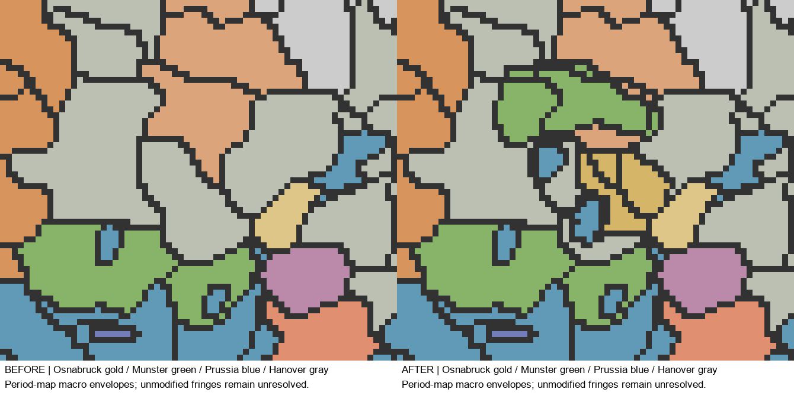

# MAP-2L — Rhin–Westphalie : continuation effective au 1er janvier 1776

État statique : **PASS_STATIC_ENGINE_DEFERRED** ; validation manuelle : **PASS_RUNTIME_USER_VALIDATED pour les modifications inspectées**, reçue le 14 octobre 2026. Le joueur a lancé une nouvelle partie, inspecté territoires, pays, capitales, gouvernements, infrastructures, économies et mécanismes impériaux, puis laissé passer un mois sans problème signalé. Voir `../RUNTIME_USER_VALIDATION_RHINE_SWABIA.json`. Aucun test moteur automatisé ni certification historique des frontières. L’achèvement territorial global demeure partiel ; les problèmes ouverts et les mentions d’attente de la livraison initiale sont conservés. Ce sous-lot n’a modifié ni Erfurt–Eichsfeld ni la Souabe.

## Avant / après réellement appliqué

| Juridiction tracée | Avant | Après | Cellules transférées |
|---|---|---|---:|
| Noyau distinct du haut-stift d'Osnabrück | HAN 135 + OLD 24 | WPO, nouveau pays impérial | 159 |
| Noyaux du Niederstift Münster | HAN 114 + OLD 151 | WPM, pays déjà présent | 265 |
| Noyau de la Basse-Lingen | HAN | PRU | 31 |
| Noyau de Tecklenburg | HAN | PRU | 34 |
| Total | | | **489** |

Un seul nouveau TAG : **WPO**, principauté épiscopale d'Osnabrück, protestante sous son prince-évêque nominal Frédéric-Auguste de Brunswick-Lunebourg, âgé de douze ans à la date de départ. Le lien dynastique et la tutelle hanovrienne ne sont pas convertis en annexion territoriale de 1802. La théocratie native et la liberté de conscience sont une approximation institutionnelle du régime mixte ; aucune mécanique nouvelle de régence ou d'union personnelle n'est inventée. Aucune voix électorale ou ville libre n'est ajoutée.

Six parents, tous dans **STATE_HANNOVER (69)** : `x4D62A0`, `xBF00DF`, `x4101E0`, `x8080E0`, `x784B8E`, `xC00161`. HAN et OLD restent présents dans cette région économique partagée. Les **1 540 cellules** des six parents sont intégralement conservées. **15 nouveaux RGB `xEDAC00`–`xEDAC0E`**, 495 cellules recolorées : ce nombre est différent des 489 changements de propriétaire. Le détail de chaque RGB, y compris les franges non transférées, est dans [TERRITORIAL_CHANGES.csv](TERRITORIAL_CHANGES.csv).

Registre : **435 → 450 RGB**, étendue constante **62 580 cellules**. Les droits de jure sont réaffectés explicitement et les textures de la carte principale et du journal sont recompilées. Aucun agrandissement automatique de l'Empire à toutes les possessions d'un membre.



## Justification et degré de précision

La feuille de Schenk déjà conservée est réutilisée ; aucune nouvelle campagne cartographique générale. Les enveloppes passent dans les juridictions nommées et laissent les bordures ambiguës à leurs propriétaires précédents. Ses couleurs ne sont jamais considérées, à elles seules, comme une preuve de souveraineté en 1776.

- Osnabrück demeure un haut-stift avant son absorption de 1802. Le régime confessionnel fixé en 1650 et l'annexion tardive sont documentés par le [diocèse d'Osnabrück](https://bistum-osnabrueck.de/geschichte-schnelldurchlauf/). La [chronologie universitaire de Justus Möser](https://www.remarque.uni-osnabrueck.de/moeser/Kurzchronik.htm) situe l'élection de Frédéric en février 1764. Le navigateur de recherche a retourné son extrait indexé, mais pas un téléchargement décodable de toute cette page ; aucun scan complet n'est revendiqué.
- Meppen, Cloppenburg et Vechta forment le Niederstift, distinct du diocèse d'Osnabrück et des possessions d'Oldenbourg. La [chronologie de l'Offizialat de Vechta](https://www.offizialat-vechta.de/das_offi/ueber_das_bmo/zeittafel) distingue explicitement juridiction temporelle et ancienne appartenance diocésaine ; voir aussi le [dossier Münster du LWL](https://www.lwl.org/westfaelische-geschichte/portal/Internet/input_felder/langDatensatz_ebene4.php?urlID=109&url_tabelle=tab_websegmente).
- Lingen passe à Brandenburg-Prusse en 1702 ; Tecklenburg en 1707. Les dates sont confirmées par le [dossier LWL](https://www.lwl.org/westfaelische-geschichte/portal/Internet/input_felder/langDatensatz_ebene4.php?urlID=124&url_tabelle=tab_websegmente) et l'[inventaire des Archives de Basse-Saxe](https://www.arcinsys.niedersachsen.de/arcinsys/windowprintdetail.action?detailid=b3044). Il ne s'agit donc pas d'anticiper les acquisitions de 1802 ou 1815.

Le raccord approximatif de **RHINE_WESTPHALIA** est réutilisé sans nouvel ajustement. Les divergences natives de Cologne/Bonn (environ 8–11 pixels) restent publiées ; les franges septentrionales ne sont pas certifiées au pixel. Aucune précision cadastrale, aucun déplacement arbitraire de sept pixels. Les noyaux constituent une approximation politique de gameplay, non une localisation urbaine vérifiée.

**Correction de lecture importante :** le point `[1130,1148]` appelé « Osnabrück » dans le diagnostic de Minden se trouve dans Tecklenburg. L'agrandissement `../MINDEN_RAVENSBERG/OSNABRUCK_READING.png` permet de constater la contradiction ; `OSNABRUCK_TOWN_CLEAN.png` conserve la lecture complémentaire. Ce point est exclu du présent raccord, pas silencieusement déplacé. La couche déjà intégrée de Minden n'est ni retracée ni présentée comme historiquement certifiée. Le locator rural du jeu nommé Osnabrück reste physiquement immobile, dans le noyau PRU de Tecklenburg : son nom ne prouve pas la localisation de la ville historique. La capitale WPO est validée au niveau de sa subdivision possédée dans STATE_HANNOVER, pas comme un nouveau centre urbain exact.

## Populations et dépendances

**194 493 habitants réaffectés**, jamais créés : WPO 67 750, WPM 97 701, PRU 29 042. Les six profils sources de culture/religion sont ventilés en entiers à partir des subdivisions source complètes, pas par une densité fictive limitée aux parents tracés. [POPULATION_VALIDATION.csv](POPULATION_VALIDATION.csv) conserve les entrées et totaux. Les populations catholiques/protestantes existantes ne sont pas converties à la religion du nouveau pays.

- Population mondiale inchangée : **835 804 980** ; profils, attributs et religions effectives conservés.
- Tous les fichiers de bâtiments demeurent inchangés, avec les PM et propriétaires économiques. Les bâtiments ferroviaires déjà présents restent des données de départ préexistantes, pas des ajouts de ce lot.
- Unités, formations et recrutements inchangés ; aucune armée fictive ajoutée à WPO.
- Pays/capitales/lois/gouvernements existants inchangés. WPO seul reçoit des variantes juridiques de départ dédiées, limitées à son TAG, sans technologie tardive ajoutée.
- Aucun locator physique déplacé ; références prime-land adaptées à l'identité des enfants en conservant exactement leur surface.
- Drapeau WPO : roue rouge stylisée avec un emblème natif existant ; illustration fonctionnelle, pas une restitution héraldique certifiée.

## Protection et tests

**455/455 contrôles** du nouveau sous-lot. **16/16** contrôles hors moteur du mode de carte, dont compilation du seul helper HLSL, pas du shader complet du jeu. **10 tests** du registre et **3 tests** des reçus manuels passent. Une première invocation des tests unitaires depuis un mauvais chemin d'import a échoué avant exécution ; relancés directement, ils passent.

Les 13 suites cumulatives ont été relancées ; résultats détaillés dans [NON_REGRESSION.json](NON_REGRESSION.json). Les 10 anciennes suites conservent leur échec brut de métadonnées Git : leurs baselines précèdent le commit `f34a6b8` explicitement autorisé par le joueur. Tous leurs contrôles de données passent. Les baselines et les échecs bruts ne sont pas réécrits pour les faire disparaître. HEAD et l'index sont inchangés pendant cette continuation.

Les **44 doublons RGB** et **12 erreurs de références hérités** restent identiques ; aucune nouvelle régression dans ces listes. Les deux anciennes lignes d'espaces finaux héritées restent présentes ; les trois lignes nouvellement insérées ont été nettoyées sans reformater les fichiers.

Conservés pixel par pixel et propriétaire par propriétaire : les 84 cellules KCL, les huit `xEDAB00`–`xEDAB07`, la couche Minden, les vingt nouveaux RGB et 1 081 cellules restaurées du premier lot Rhin–Westphalie. Les autres lots sont contrôlés par replay exact des migrations, sans exemption générale aux erreurs.

## Fichiers et reproductibilité

- Bitmap, terrains, états économiques partagés et historique des populations ; **aucun historique des bâtiments/unités modifié**.
- Nouveau pays/histoire/ruler WPO, lois limitées à WPO, drapeaux et localisations FR/EN : [PLAN.json](PLAN.json) donne tous les chemins.
- Registre impérial, migration ordonnée, sorties du compilateur : [IMPERIAL_FILES.json](IMPERIAL_FILES.json) liste les **16** sorties effectivement changées. Carte du journal, masque et sentinelle natifs mis à jour.
- Orchestration `tools/map2l_rhine_completion.py`, validation `tools/validate_map2l_rhine_completion.py`, ordre explicite dans `tools/map2l_registry.py`. Les trois validateurs précédents rejouent désormais les seuls ajouts déclarés ultérieurs, sans autoriser la modification d'un ancien pays ou d'une cellule protégée.

La baseline est immuable. Ne pas relancer `capture`, `geometry` ou `prepare` sur le résultat installé. Les commandes de validation et `summary` sont réutilisables. Aucun commit, merge, reset, changement de branche ni push effectué.

## Limites restantes et contrôle en jeu

[UNRESOLVED.csv](UNRESOLVED.csv) couvre les quatre priorités : noyaux prussiens conservés, Gueldre post-1713 non certifiée, limites Ravensberg/Herford, Bentheim et son administration gagée, Steinfurt, Rietberg, Corvey, Essen/Werden, Dortmund, branches de Nassau et dernières bordures colognaises. Aucune souveraineté absente n'est inventée à partir d'un locator. **Ce sous-lot n'achève donc pas toutes les souverainetés du Rhin–Westphalie**, et la Souabe n'est pas lancée.

En nouvelle partie : contrôler WPO distinct de HAN/WPM, prince-évêque mineur protestant, localisation FR/EN, capitale partagée, accès au bloc et au journal sans crash, frontières et éventuels accès militaires, maintien de Münster/Paderborn/Juliers–Berg/Minden/Cologne/Lippe/SCM. Vérifier notamment les franges conservées autour d'Oldenbourg et l'aspect du locator rural mal nommé. La validation manuelle des précédents secteurs n'est pas étendue à ce nouveau lot.

## ColGrep : constat mesuré, pas économie de quota inventée

Deux tentatives `--agent` : la première a été refusée par l'environnement (`Path does not exist` / accès refusé), la seconde, avec chemin absolu et autorisation d'accès, a terminé avec **deux emplacements**. Commande :

```powershell
& 'C:/Users/simeo/.cargo/bin/colgrep.exe' --agent 'Locate existing country initialization templates appropriate for adding the independent Protestant prince-bishopric of Osnabruck in 1776 and MAP2L new-country validation hooks. Return relevant paths and lines only. Do not edit files.' 'C:/Users/simeo/Documents/Paradox Interactive/Victoria 3/mod/1776_Age_of_Revolutions_fork'
```

`tools/map2l_registry.py:41-50` est vérifié et pertinent ; `common/character_templates/country_dei.txt:1-23` existe mais concerne un dirigeant colonial et a été rejeté. Donc **une recherche locale aboutie, un résultat utile sur deux**. L'exécution du mode agent configuré local est effective ; la sortie conservée ne donne pas de télémétrie GGUF/GPU ou de tokens. Aucun modèle ni paramètre d'intégration changé. La durée totale exacte et le nombre exhaustif d'appels classiques n'ont pas été instrumentés : ne pas en inventer une mesure.

Le code connu a surtout été retrouvé directement et les identifiants exacts contrôlés avec `rg`. La délégation a offert une piste valide, mais peu de recherches évitées ici puisque l'architecture était déjà connue ; aucun gain exact de quota ne peut être conclu. Images PNG/JPG/DDS et frontières bitmap ne sont pas une recherche sémantique textuelle : inspection raster native et correspondances explicites utilisées. Aucun rafraîchissement/rebuild de l'index n'était nécessaire pour une nouvelle recherche après les éditions ; le prochain appel ordinaire pourra effectuer sa mise à jour incrémentale.
