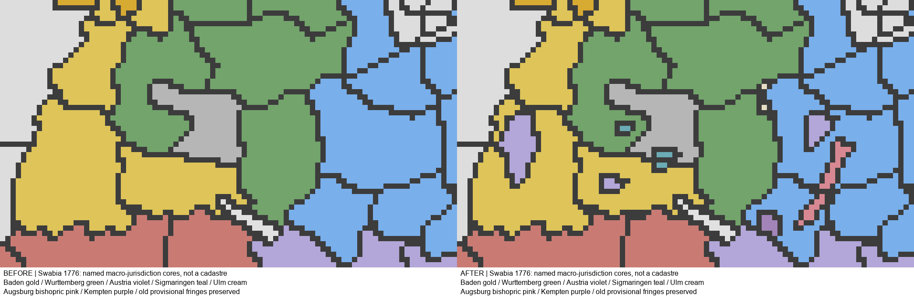

# MAP-2L — Souabe, première restitution des noyaux politiques au 1er janvier 1776

**PASS_STATIC_ENGINE_DEFERRED** : 529/529 contrôles du sous-lot. La couverture territoriale reste partielle : ne pas présenter les franges ou les villes non traitées comme historiques. Ni validation moteur ni nouvelle validation manuelle attribuée.

Le joueur a explicitement annoncé effectuer les vérifications **après ce lot**. Cette consigne directe reporte le préalable du texte joint à un test groupé Rhin–Westphalie/Souabe. Le dernier Rhin–Westphalie demeure non testé en jeu, et **aucun checkpoint GitHub n'a été créé ni publié**.

## Corrections effectivement appliquées

| Juridiction | Avant → après | Cellules |
|---|---|---:|
| Brisgau habsbourgeois autour de Fribourg, hors Hochberg | BAD → AUS | 70 |
| Noyau de Nellenburg | BAD → AUS | 12 |
| Petit noyau temporel de la ville de Constance après 1548, pas son diocèse | BAD → AUS | 4 |
| Noyau de Burgau habsbourgeois | BAV → AUS | 28 |
| Sigmaringen et Haigerloch, distincts de Hechingen | BAD 7 + HOH 9 + WUR 6 → HSG | 22 |
| Ville impériale d'Ulm et noyau d'Albeck | WUR → SUU | 11 |
| Domaine temporel méridional du prince-évêché d'Augsbourg | BAV → SAG | 47 |
| Noyau rural de l'abbaye-principauté de Kempten | BAV → SKE | 17 |
| Total | | **211** |

**Quatre nouveaux pays** : HSG, SUU, SAG et SKE. Pas de nouveau pays pour chaque petite abbaye ou chaque point urbain. Le petit candidat de l'évêché de Constance ne représentait que six cellules : il n'a pas été intégré ni artificiellement agrandi. Les villes de Kempten et d'Augsbourg restent juridiquement distinctes des établissements ecclésiastiques, mais leurs propres enclaves ne sont pas reconstruites dans ce sous-lot.

HSG possède des subdivisions dans STATE_BADEN et STATE_WURTTEMBERG, avec capitale dans sa subdivision possédée de STATE_WURTTEMBERG. SUU a sa capitale dans cette dernière région ; SAG et SKE dans leurs subdivisions possédées de STATE_BAVARIA. Le partage des régions économiques est conservé, pas remplacé par une nouvelle State Region par principauté.

HOH représente désormais **Hohenzollern-Hechingen**, avec Joseph-Frédéric-Guillaume né le 12 novembre 1717. Le fichier natif aurait créé Karl-Anton et Leopold, personnages du XIXe siècle et de la branche de Sigmaringen : un petit fichier de même nom les remplace sans modifier un fichier de personnages existant du mod ni les recrutements. HSG reçoit Charles-Frédéric, né le 9 janvier 1724. Les deux principautés restent distinctes de la Prusse ; aucun rattachement de 1849/1850 anticipé. Les franges conservées de HOH restent provisoires, pas un tracé intégral certifié de Hechingen.

Le **Wurtemberg est un duché**, pas un royaume : son unique champ `tier` est corrigé de `kingdom` à `principality`, tier du duché natif européen. Capitale, couleur, cultures et autres champs sont conservés. Le margraviat de **Bade reste un seul pays**, après la réunion de 1771, et reçoit un type de gouvernement affichant le titre de margrave ; aucun second Bade-Bade ou Bade-Durlach créé. Karl Eugen et Karl Friedrich préexistants sont conservés.

Clément-Wenceslas de Saxe est représenté comme prince-évêque d'Augsbourg ; le personnage préexistant de Trèves n'est pas remplacé. Deux instances natives du même prélat représentent les deux établissements distincts, sans union personnelle fictive. Kempten reçoit Honorius Roth von Schreckenstein. Les souverains ne deviennent pas électeurs du seul fait de leur création.

## Bitmap, registres et comparaison

Huit parents exclusivement : `xB08061`, `xAEBA2A`, `x8F0060`, `x908060`, `xDBB84C`, `x118060`, `xC347B1`, `x704A5F`. Ils appartiennent aux régions économiques STATE_BADEN, STATE_WURTTEMBERG et STATE_BAVARIA. Aucun parent nouvellement créé par les lots précédents n'est redécoupé.

**14 nouveaux RGB `xEDAD00`–`xEDAD0D`**, **516 cellules recolorées** ; ce nombre diffère des **211 changements de propriétaire**, car les franges non transférées sont aussi subdivisées en composantes connexes. Aucun RGB original supprimé, aucune province sans propriétaire ni nouveau doublon. [TERRITORIAL_CHANGES.csv](TERRITORIAL_CHANGES.csv) donne chaque parent/enfant, l'ancien et le nouveau propriétaire, l'enveloppe et ses limites.

Registre impérial : **450 → 464 RGB**, étendue physique inchangée **62 580 cellules**. Cartes de jure du journal et de la carte principale recompilées. Ulm est aussi ajoutée à la véritable liste de villes libres du compilateur impérial : elle ne figure pas uniquement comme nouveau TAG sur la carte. La liste du journal et la cohésion utilisent ce statut ; ni HSG ni les deux pays ecclésiastiques ne sont classés comme villes libres.

## Sources et approximations assumées

Réutilisation de R2-0057/0058, R2-0158/0159, des migrations de Mayence et des conventions d'intégration franconiennes. R2 avertissait que ces recommandations ne contenaient pas de correspondance RGB historique certifiée. Les cartes conservées de Franconie et du Rhin ne fournissaient pas un tracé suffisamment détaillé de toute la Souabe.

Un **seul supplément cartographique régional** est donc acquis : [Circulus Suevicus, Homann/Funck, bibliothèque de Berne](https://www.e-rara.ch/bes_1/content/titleinfo/29527171), collection Ryhiner MUE Ryh 4801:52. Le catalogue date cet exemplaire **vers 1693**, et non de 1776 ni de 1740. `HOMANN_SOURCE.json` conserve le manifeste IIIF, l'institution et le hash de la reproduction à 3 500 pixels. Les noms des juridictions permettent de tracer des noyaux conservateurs ; les couleurs ne constituent pas des preuves de souveraineté à la date cible.

La continuité et les différences chronologiques sont vérifiées séparément :

- Le [Historischer Atlas de LEO-BW](https://www.leo-bw.de/fr/web/guest/karte-vollbild) distingue Bade-Bade et Bade-Durlach jusqu'à 1771 : les deux ensembles cartographiques anciens ne sont pas convertis en deux pays de 1776.
- La [ville de Haigerloch](https://www.haigerloch.de/de/Unsere-Stadt/Stadtgeschichte) distingue les possessions de Sigmaringen et le rattachement ultérieur à la Prusse. Les [archives régionales](https://www.landesarchiv-bw.de/sixcms/media.php/120/Archivnachrichten_49.pdf) identifient Charles-Frédéric, 1724–1785. Les acquisitions de 1786/1787 et les possessions néerlandaises réunies en 1781 ne sont pas ajoutées à partir de cette carte ancienne.
- [LEO-BW](https://www.leo-bw.de/detail/-/Detail/details/PERSON/wlbblb_personen/129884251/Hohenzollern-Hechingen%2BJoseph%2BFriedrich%2BWilhelm%2BEugen%3B%2BF%C3%BCrst%2Bvon) et la [ville de Hechingen](https://www.entdecke-hechingen.de/fuerstengarten/entstehungsgeschichte) attestent le souverain de Hechingen, distinct des princes natifs du XIXe siècle.
- Le [Stadtlexikon d'Augsbourg](https://www.stadtlexikon-augsburg.de/stadtlexikon-augsburg/artikel/stadtlexikon/klemens-wenzeslaus/4413) situe Clément-Wenceslas à la tête du haut-stift de 1768 à 1812. L'[Historisches Lexikon Bayerns](https://www.historisches-lexikon-bayerns.de/Lexikon/Augsburg%2C_Hochstift%3A_Verwaltung) traite les possessions temporelles, qui ne couvrent pas tout le diocèse. La ville libre n'est pas annexée au prince-évêché depuis un simple point urbain.
- Le [Haus der Bayerischen Geschichte](https://hdbg.eu/kloster/index.php/detail/geschichte?id=KS0167) distingue le stift de Kempten de la ville et situe la destruction de ce régime en 1802/1803. Le [catalogue des portraits de la HAB](https://dev.hab.de/portraits/person/14596/) atteste le règne d'Honorius de 1760 à 1785.

Le raccord Homann/jeu est un ajustement à **cinq locators économiques approximatifs**, pas une géolocalisation urbaine certifiée. Les résidus d'ajustement vont d'environ 2,48 à 4,69 pixels. Le contrôle séparé de la mine appelée Lindau donne **9,575 pixels**, conservés dans `CALIBRATION_DIAGNOSTICS.json`. Cette distance n'est pas transformée en erreur géographique certifiée de la ville. Aucun seuil cadastral fictif, aucun déplacement physique des locators, aucune modification de `provinces.png` pour ajouter une grille. Le prototype d'Erfurt n'est pas recalibré et ses frontières restent inchangées.

Les noyaux demeurent des approximations de gameplay. Les franges badoises/wurtembergeoises et de nombreuses petites juridictions ne sont pas certifiées par leur simple conservation. Ulm est représentée par des noyaux tracés de son territoire, pas par toute la province contenant son nom.

## Conservation et dépendances

**126 388 habitants réaffectés**, jamais créés : AUS 78 289 ; HSG 13 949 ; SUU 10 849 ; SAG 17 112 ; SKE 6 189. Ventilation entière de chaque profil existant à partir des superficies des subdivisions source complètes. Ce n'est pas un recensement historique : les populations des nouveaux pays, notamment Kempten, ne prétendent pas restituer leurs effectifs historiques totaux.

- Population mondiale **835 804 980**, profils culturels, religions écrites/effectives et autres attributs inchangés. [POPULATION_VALIDATION.csv](POPULATION_VALIDATION.csv) conserve les douze profils sources.
- Aucun bâtiment ajouté artificiellement. Les niveaux, PM et attributs pondérés sont conservés. Les allocations transfèrent certaines fractions entières du fichier `98_build_start_1776_world_redistribution.txt` ; les propriétaires privés et leurs quantités sont conservés. Les subdivisions source restent présentes pour les propriétés et recrutements.
- Unités, formations et recrutements inchangés ; aucune armée fictive attribuée aux nouveaux TAGs.
- Les définitions des autres pays restent identiques. La correction du seul tier WUR est déclarée par les deux signatures exactes, puis reconstruite indépendamment en ne changeant que ce champ. Les tests négatifs rejettent une modification de capitale ou d'un autre pays.
- Lois de départ réutilisées via quatre variantes à portée dédiée ; aucune technologie tardive de république ou d'abolition ajoutée. Localisations FR/EN avec BOM, couleurs distinctes et drapeaux procéduraux d'identification, sans revendication de restitution héraldique exacte.
- Tous les locators conservent leur position et leur RGB. Les listes `prime_land` sont adaptées aux enfants avec une empreinte physique identique.

## Validation manuelle du joueur — 14 octobre 2026

**PASS_RUNTIME_USER_VALIDATED pour les modifications inspectées.** Nouvelle partie, inspection des territoires, pays, capitales, gouvernements, infrastructures, économies et mécanismes impériaux, puis un mois de jeu sans problème signalé. Témoignage du joueur, pas un test moteur automatisé ni une certification historique des frontières. Reçu séparé : `../RUNTIME_USER_VALIDATION_RHINE_SWABIA.json` ; les contrôles statiques et problèmes ouverts restent distincts.

Les captures signalent deux descriptions de gouvernement manquantes : Baden et Ulm. Leurs descriptions FR/EN et celles des principautés Hohenzollern sont ajoutées ; leur affichage corrigé reste à revoir en jeu. Les corrections territoriales ultérieures ne bénéficient pas automatiquement de cette validation. Les mentions d’attente ci-dessous décrivent la livraison initiale, antérieure à ce reçu.

## Validations et protection

**529/529** contrôles du nouveau sous-lot ; **16/16** contrôles hors moteur du mode de carte, avec compilation du helper HLSL seulement. **13 tests** de migrations exactes et **3 tests** de reçus manuels passent.

Les suites cumulatives et résultats bruts sont dans [NON_REGRESSION.json](NON_REGRESSION.json). Les dix anciennes attestations Git restent en échec parce que leurs baselines précèdent le commit `f34a6b8` autorisé par le joueur ; ces échecs ne sont pas effacés ni confondus avec une régression de données. HEAD et l'index de ce lot restent inchangés. Les **44 doublons RGB** et **12 références invalides** hérités restent identiques. Les deux anciennes lignes d'espaces finaux restent présentes ; aucun nettoyage global.

Les régions belges, les couches franconiennes, les électorats, les Alpes/Italie et toutes les cellules de Rhin–Westphalie — y compris les 84 cellules KCL, EDAB00–07, Minden, WPO et EDAC00–0E — sont préservées. Les compilations constitutionnelles ne modifient pas les mécanismes électoraux, mais ajoutent les membres et le statut de ville libre explicitement déclarés.

Deux problèmes de développement ont été résolus avant livraison : le premier aperçu visait par héritage le dossier précédent ; ses images dérivées ont été régénérées depuis leurs entrées immuables, sans modifier le bitmap ancien. Un contrôle de ville libre utilisait initialement un nom de constante inexistant ; il a été remplacé par la vérification du vrai trigger compilé, après intégration d'Ulm. Un défaut de substitution de portée des lois a été corrigé avant leur installation. Ces échecs intermédiaires ne sont pas présentés comme des validations moteur.

## Fichiers et contrôle groupé en jeu

[PLAN.json](PLAN.json) liste les fichiers historiques réellement modifiés, les allocations et l'override natif de Hechingen. [IMPERIAL_FILES.json](IMPERIAL_FILES.json) conserve l'union des **16 sorties** du compilateur effectivement changées. S'y ajoutent bitmap, terrains, registre/migration, textures de jure et outils `map2l_swabia.py`, `validate_map2l_swabia.py`. Les validateurs cumulatifs n'autorisent que la correction déclarée du tier WUR et les ajouts explicites ; aucune exemption aux capitaux, cultures ou pays voisins.

En **nouvelle partie**, vérifier : Stuttgart/Ludwigsbourg/Tübingen et le titre de duc ; Karlsruhe/Rastatt et le margraviat unique ; Hechingen et Sigmaringen distincts avec les bons princes ; Fribourg et Burgau sous AUS ; Ulm en ville libre dans le bloc et le journal ; SAG et SKE distincts des villes voisines ; accès militaire, budgets/capacité administrative des petits pays, cartes de jure et ouverture du journal sans crash. Tester aussi le dernier Rhin–Westphalie, toujours en attente. Aucun `PASS_RUNTIME_USER_VALIDATED` n'est ajouté tant que le joueur n'a pas confirmé ce test.

La **Souabe n'est pas entièrement achevée** : [UNRESOLVED.csv](UNRESOLVED.csv) conserve Montbéliard, les autres villes libres, Weingarten/Salem, les franges d'Augsbourg et de Constance, Fürstenberg/Waldburg/Ellwangen et les autres juridictions. Aucun autre lot démarré automatiquement. Aucun commit, merge, reset, changement de branche, push ou checkpoint.

## ColGrep local

Un appel `colgrep --agent`, terminé avec code 0 en **192,211 secondes** ; configuration locale 2B existante conservée, aucun changement d'intégration. Les trois chemins retournés et les plages de lignes ont été vérifiés : migration de MAINZ_COMPLETION, fonction d'inspection franconienne, avertissements R2. Il s'agissait de pistes utiles pour l'architecture, mais **aucun nouveau tracé souabe prêt à appliquer** n'a été trouvé. Les images et RGB ont donc été inspectés par les outils raster et les recherches exactes adaptées.

`COLGREP_METRICS.json` contient la commande/question, la durée et les limites. Le total exhaustif des recherches classiques et les tokens de quota ne sont pas disponibles. Sans comparaison contrôlée, aucune économie de quota exacte n'est annoncée. Aucun rebuild de l'index ; une prochaine recherche ordinaire pourra actualiser les nouvelles modifications de manière incrémentale.
