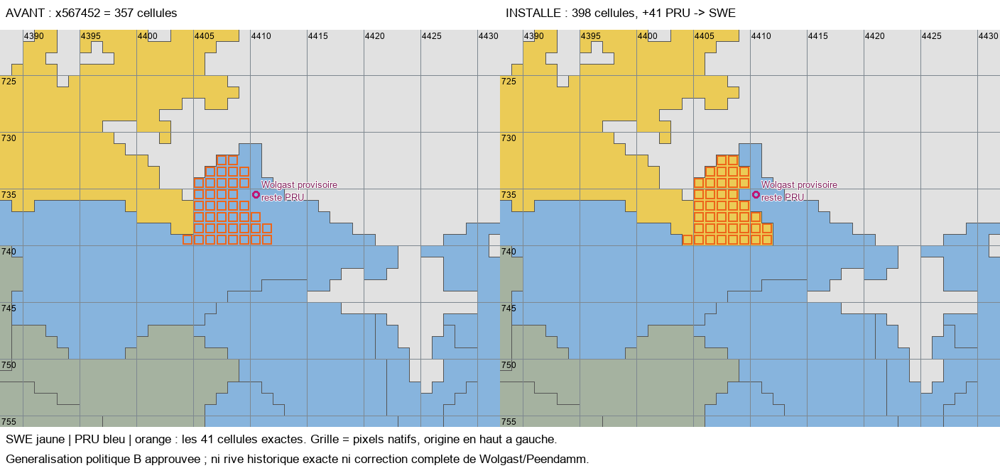

# MAP-2M-R8 — Variante B de la Peene installée

Statut : **MAP-2M-R8_READY_FOR_RUNTIME_VALIDATION**. Contrôles statiques : **60/60 PASS** ; tests de protection : **26/26 PASS**. Aucun lancement de Victoria 3 effectué par ces outils. La nouvelle partie et le mois de simulation restent à effectuer par le joueur.

## Modification réellement installée

**41 cellules**, et non 44, passent de `xE1A03A` PRU à `x567452` SWE dans `STATE_POMERANIA`. Il s'agit exactement de la variante B approuvée dans la demande R8. Ses trois cellules communes avec A ne sont pas comptées une seconde fois.

| Empreinte | Avant R8 | Après R8 | Propriétaire |
| --- | ---: | ---: | --- |
| x567452 | 357 | 398 | SWE |
| xE1A03A | 333 | 292 | PRU |
| xEDB010, Bromberg | 85 | 85 | PRU |
| xFCC7B7, résidu polonais | 142 | 142 | PLC |
| x41A021, Thorn | 153 | 153 | PRU, anomalie réservée au prochain correctif |

Le transfert est une **B_APPROVED_APPROXIMATION** : généralisation politique acceptée, pas rive historique certifiée. Les 41 cellules sont terrestres, à l'ouest de toutes les variantes de l'aide de dessin du Peenestrom et reliées par un côté aux terres suédoises déjà installées. Les deux provinces restent chacune d'un seul tenant. Aucun RGB, State_ID ou pays nouveau.

Le point provisoire de Wolgast `(4410,735)` reste prussien. Aucun locator n'est déplacé. Toutes les lignes Y≥740 restent intégralement identiques, y compris les approches d'Anklam/Peendamm. Demmin, Usedom et Wollin ne sont pas transférées. **La frontière entière n'est pas déclarée historiquement achevée.**

## Population et dépendances

La méthode déterministe de MAP-2L/R2/R3 est réutilisée : proportion des cellules transférées dans la région prussienne de Poméranie avant R8, puis arrondi par plus forts restes, séparément pour chaque profil. Poids : PRU 3 588, SWE 41, total 3 629. C'est une convention de ventilation des historiques, pas un recensement historique du corridor.

**4 820 habitants passent de PRU à SWE** :

| Profil conservé | PRU avant | PRU après | Transfert à SWE |
| --- | ---: | ---: | ---: |
| north_german, religion implicite inchangée | 378 628 | 374 350 | 4 278 |
| north_german, catholic | 38 651 | 38 214 | 437 |
| polish, religion implicite inchangée | 7 434 | 7 350 | 84 |
| ashkenazi, religion implicite inchangée | 1 859 | 1 838 | 21 |
| Total | 426 572 | 421 752 | 4 820 |

La population suédoise de cette région passe de 41 964 à 46 784. Le total régional reste **468 536**. La population mondiale reste exactement **835 804 980** ; cultures, religions résolues, attributs et types explicites/implicites restent conservés. Aucun habitant artificiel.

Le contrôle de répartition des niveaux donne zéro bâtiment à déplacer. Tous les niveaux, PM, réserves, propriétaires économiques, infrastructures, unités et recrutements sont identiques à la référence R8. L'intégralité des bâtiments est comparée, pas seulement leurs totaux.

## Fichiers

Seuls deux fichiers fonctionnels diffèrent du workspace capturé avant installation :

- `map_data/provinces.png` : exactement 41 pixels RGB, sans redimensionnement ni filtrage.
- `common/history/pops/00_west_europe.txt` : quatre réductions prussiennes et quatre fragments suédois correspondants, dans la seule Poméranie.

Outils ajoutés : `tools/map2m_r8.py`, `tools/test_map2m_r8.py`. Les autres fichiers créés sont les preuves et livrables du présent dossier. Aucun historique de propriété ou définition de province n'a besoin de changer : les deux RGB existaient et avaient déjà les bons propriétaires et State_ID. Le registre impérial n'est pas modifié.

Empreinte bitmap avant : `98acf247aa6269bebde06eaf12b1117585e3b3e370552ab9243a8f74e494484b`.

Empreinte installée : `4215acbfc274753df113979a2edb515c67ac41924696c087b15778ec52f7a054`.

## Validations et limites

`VALIDATION.json` détaille les 60 contrôles : rejeu exact de B, source PRU, support figé, eau exclue, rive occidentale, continuité, références uniques des RGB concernés, empreintes protégées, rejeu des cellules R2/R3, conservation globale et régionale, attributs démographiques, bâtiments complets, économie acceptée, archives antérieures et Git.

Les **44 doublons RGB et 12 références invalides hérités** sont inchangés ; ils ne sont ni corrigés ici ni déclarés comme de nouvelles régressions. Leurs listes exactes sont conservées dans `BASELINE.json`, sous `inventory.duplicates` et `inventory.errors`.

Les six niveaux d'armes du Brandebourg, les cinq du Rhône, les dix niveaux du centre de commerce et cinq niveaux de port du Guangdong, ainsi que l'absence de centres chinois extérieurs au Guangdong, sont explicitement contrôlés. Les autres changements économiques et diplomatiques sont protégés par les empreintes de l'ensemble des fichiers fonctionnels.

Les **333 fichiers R1–R7 capturés** sont inchangés. Leurs anciens rapports restent des instantanés historiques : leurs attentes « 357 cellules » ne sont pas modifiées pour simuler un succès après R8. Les anciens générateurs écrivant dans ces dossiers ne sont pas relancés. La validation différentielle R8 réutilise leurs lecteurs, inventaires, allocation et rejeu de cellules, sans leur faire réécrire leurs résultats.

`TEST_RESULTS.md` consigne les huit tests R8 et les dix-huit tests existants du registre MAP-2L, tous réussis. Ce ne sont pas des tests moteur.

## Thorn préparée, non modifiée

`THORN_AUDIT.md` documente les 153 cellules de `x41A021`, l'unique locator natif, les voisins, les populations et bâtiments au niveau État/propriétaire. La province s'étend sur 14×18 pixels de boîte englobante, soit environ 1 593 km² selon le profil diagnostique figé : elle ne correspond pas au seul noyau urbain fortifié visible sur Pfau.

Le CSV énumère les 153 cellules et distingue un **scénario technique minimal d'une seule cellule au hub natif**, non validé historiquement, de toutes les cellules laissées en attente. Ce n'est pas une autorisation de déplacer Thorn sur la foi du nom d'une ferme. Aucun nouveau RGB n'est réservé, aucun transfert appliqué. Le placement de la ville et les possessions rurales de 1776 restent à vérifier dans la mission autonome suivante.

La Netze ne reçoit aucune modification. Le noyau de Bromberg est conservé ; le conflit de datation du liseré méridional reste ouvert.

## Recherche locale

Zéro appel ColGrep dans R8 : les chemins R2/R3/R7 et les identifiants nécessaires étaient déjà connus ; les règles ColGrep demandent de ne pas lancer de recherche sémantique sans besoin. Lectures ciblées et recherches exactes `rg` uniquement, aucune réindexation ni nouvelle calibration. Aucun compteur de tokens Codex propre à cette tâche n'est disponible ; aucune économie de quota n'est chiffrée.

Aucun commit, merge, reset, push, changement de branche ou modification de l'index. HEAD et empreinte de l'index correspondent à la capture préalable. Aucun R9 créé.
