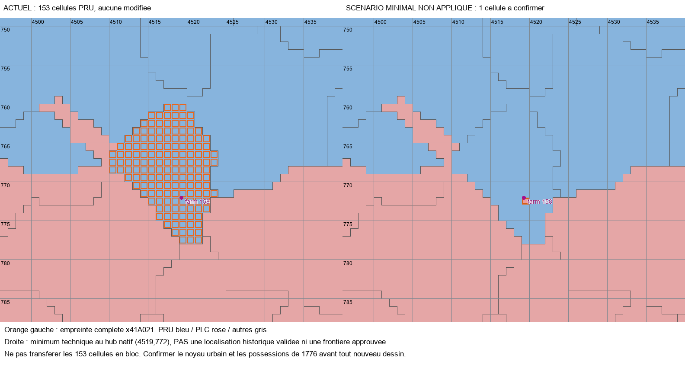

# Thorn/Toruń — Audit sans modification

**Zéro cellule transférée dans R8.** Thorn appartient encore à la Pologne-Lituanie en 1776, et non à la Prusse avant 1793. Cette souveraineté urbaine ne justifie pas de transférer automatiquement toute la province native portant son nom de hub.

## Empreinte et références réelles

- RGB : `x41A021`, **153 pixels**, un seul composant par connexions de côtés.
- Boîte englobante inclusive : X **4510–4523**, Y **760–777**, soit 14×18 pixels.
- State_ID symbolique : `STATE_WEST_PRUSSIA`, identifiant numérique **158**. Ce n'est pas un identifiant de province ni une couleur RGB.
- Propriétaire : **PRU**, une seule déclaration, aucune propriété concurrente.
- Définition : `map_data/state_regions/02_east_europe.txt`, province et hub `farm` (lignes 117 et 121 au moment de la lecture).
- Propriété : `common/history/states/00_states.txt`, déclaration prussienne comprenant le RGB (ligne 8015).
- Terrain : `map_data/province_terrains.txt`, `tundra` (ligne 21977), valeur héritée signalée, pas corrigée dans R8.

Le profil R5 figé donne une aire diagnostique d'environ **1 593,2 km²**, environ **10,41 km² par pixel** au centre de la province. Les centres de pixels couvrent approximativement 18,129–18,692°E et 52,682–53,231°N. Ces estimations servent à constater l'étendue régionale ; ce ne sont pas des mesures certifiées des possessions de Thorn. Aucun nouveau calage n'a été effectué.

La province dépasse manifestement le seul noyau urbain fortifié visible sur la feuille Pfau : une correction en bloc de 153 pixels ne serait pas une simple restitution de la ville. La totalité des possessions rurales de Thorn n'est pas établie ici : ni leur attribution à la Prusse ni celle à la Pologne n'est inférée de la seule taille du RGB.

## Locator et risque de raisonnement circulaire

Un seul locator de hub effectif tombe dans ce RGB : **farm, ID 158**, position native `(4519.314941, 0, 2843.895264)`, soit bitmap **(4519.314941, 772.104736)** puisque sa hauteur vaut 3616. Cellule contenant le point : `(4519,772)`.

Il provient du jeu : `C:/Games/Victoria 3/game/gfx/map/map_object_data/generated_map_object_locators_farm.txt`, instance ligne 950, position ligne 952. Le nom français effectif du hub est « Toruń » (`hub_names_l_french.yml`, clé `HUB_NAME_STATE_WEST_PRUSSIA_farm`, ligne 723). Cela établit l'association technique voulue par le jeu, **pas la position géographique exacte du centre historique**.

Le premier calage ancien de Güssefeld utilisait déjà cette ferme comme point d'ajustement. Il ne peut donc pas servir de vérification indépendante de cette même ferme. Aucun déplacement de locator ni transfert automatique depuis un nom de bâtiment n'est autorisé par cet audit.

## Voisinage natif, côtés partagés

| RGB voisin | State_ID | Propriétaire | Arêtes de pixels communes |
| --- | --- | --- | ---: |
| x55FD02 | STATE_WEST_PRUSSIA | PRU | 18 |
| x945000 | STATE_WEST_PRUSSIA | PRU | 14 |
| x2F0D92 | STATE_GREATER_POLAND | PLC | 4 |
| xC02121 | STATE_POSEN | PLC | 18 |
| xE165F5 | STATE_MAZOVIA | PLC | 7 |
| xFCC7B7 | STATE_POSEN | PLC | 5 |

Le sud et plusieurs franges sont donc déjà polonais ; il ne faut ni annexer ces voisins ni effacer les deux raccords prussiens pour faire une enclave symétrique. Ces comptes sont topologiques, pas des longueurs frontalières historiques.

## Populations, bâtiments et armée

Les historiques n'affectent pas de population ni de bâtiment directement à un pixel RGB. Ils travaillent au niveau **État/propriétaire**. Dans `STATE_WEST_PRUSSIA` : **325 344 habitants PRU**, **41 521 PLC**, total **366 865**. Aucune quantité ne peut être honnêtement appelée « population de x41A021 » à partir de ces fichiers seuls.

Déclarations de niveaux lues, y compris couches additionnelles (leur addition n'est pas présentée comme une mesure d'emploi moteur) :

| Propriétaire | Bâtiment | Niveaux déclarés |
| --- | --- | ---: |
| PRU | réseau d'infrastructure, building_railway | 4 |
| PRU | élevages | 1 + 9 |
| PRU | fermes de seigle | 2 + 2 |
| PRU | usines à papier | 2 |
| PLC | camps de bûcherons | 1 |

PM et structures complètes de propriété économique sont conservés dans `THORN_INVENTORY.json`. L'infrastructure prussienne utilise `pm_traditional_road_network` et les variantes sans canaux/rail ; cet audit ne les modifie pas. Un recrutement prussien de **1 unité d'infanterie de ligne conscrite** référence cette région ; il doit être maintenu du côté prussien tant qu'une subdivision n'établit pas un autre besoin explicite.

## Confrontation documentaire, sans nouveau recalage

Deux sources déjà acquises ont été relues et recadrées dans R8 :

- **Güssefeld 1775**, `MAP2M/EVIDENCE/GUESSEFELD_1775.jpg` : Thorn et le tracé régional coloré ; ce document permet de distinguer la ville et la nouvelle province, mais n'a pas ici de placement natif indépendant assez solide pour attribuer chacune des 153 cellules.
- **Pfau, feuille 45**, `R4/EVIDENCE/PFAU_45.jpg` : noyau fortifié « Thoren », Vistule et localités adjacentes, utiles pour un contrôle physique local. Levés 1772–1773, gravure 1775–1778, publication [1778] selon le catalogue R4 : ne pas traiter toute limite de cette édition comme automatiquement valable au 1er janvier 1776. Le document topographique ne fournit pas à lui seul le polygone des juridictions de 1776.

Les notices de bornage vers Thorn de 1776 et de régulation de 1777 sont des métadonnées sans manuscrits consultés ; la première n'établit pas une entrée en vigueur au 1er janvier. Aucun tracé de 1793 n'est importé.

## Scénario technique minimal, non autorisé à installer

La solution architecturale la plus simple est une **subdivision du RGB**, sans nouveau pays ni nouvel État : garder le résidu `x41A021` prussien et attribuer un nouveau RGB urbain à PLC dans le même `STATE_WEST_PRUSSIA`, où une région polonaise existe déjà. Cela protège les possessions légitimement prussiennes au lieu de transférer toute l'enveloppe native.

Pour rendre le plan techniquement explicite sans inventer une frontière, `THORN_PROPOSED_CORRECTION.csv` énumère **toutes les 153 cellules**. Il montre un scénario de coût minimal : seulement `(4519,772)`, cellule contenant le hub natif, serait détachée ; les 152 autres resteraient inchangées en attente de preuves. **Cette cellule n'est pas approuvée géographiquement**, et ce scénario n'est ni le territoire complet de Thorn ni une recommandation d'application immédiate. Le PNG le montre distinctement comme hypothèse technique, pas comme résultat installé.

Si le centre historique est confirmé ailleurs, cette cellule doit être rejetée, pas utilisée par commodité. Si les possessions rurales de 1776 justifient plusieurs cellules, leur polygone doit être documenté avant d'élargir ce scénario. R8 ne fixe donc pas une frontière historique définitive de Thorn.

### Plan de fichiers pour la mission ultérieure

1. Confirmer le noyau urbain par au moins un repère physique indépendant sur les cartes conservées ; documenter séparément le contour des possessions de 1776.
2. Choisir les cellules suffisamment justifiées dans le CSV, éventuellement hors de la cellule illustrative ; réserver alors seulement une couleur réellement libre après contrôle du bitmap, des définitions et du terrain. **Aucun RGB fictif n'est préalloué ici.**
3. Modifier `map_data/provinces.png` uniquement dans le contour retenu ; conserver le reste de `x41A021` PRU, vérifier les connexions de chaque résultat.
4. Ajouter le nouveau RGB aux `provinces` de `map_data/state_regions/02_east_europe.txt`, conserver l'ID 158. Si le hub natif reste valide et tombe dans le nouveau RGB, rebinder la référence `farm` à ce RGB, sans déplacer le point. Examiner les conséquences pour les deux régions partagées ; sinon conserver la référence existante et documenter le décalage plutôt que déplacer le locator pour forcer l'attribution.
5. Ajouter une entrée au terrain après examen local, sans propager automatiquement le `tundra` hérité ; ajouter seulement le nouveau RGB à `create_state` PLC dans `common/history/states/00_states.txt`. Ne pas retirer tout `x41A021` à PRU.
6. Répartir la population prussienne de cette région par la même méthode déterministe, depuis l'état courant capturé, dans `common/history/pops/02_east_europe.txt`. Conserver intégralement profils et total mondial ; ne pas inventer une population urbaine.
7. Revoir les bâtiments par la même allocation et leurs propriétaires économiques avant toute migration ; ne pas attribuer l'usine à papier ou toutes les routes au nouveau pixel sur la seule foi du locator. Ne toucher aux historiques de bâtiments que si une allocation non nulle est justifiée. Conserver les PM, réserves et recrutement prussien.
8. Comparer l'intégrité RGB/State_ID, la conservation démographique, les voisins, les locators et toutes les empreintes protégées, puis validation en nouvelle partie distincte.

Le registre impérial ne doit pas recevoir Thorn par simple effet de cette restitution : ce dossier ne constitue aucune preuve d'appartenance de cette ville polonaise au Saint-Empire.

