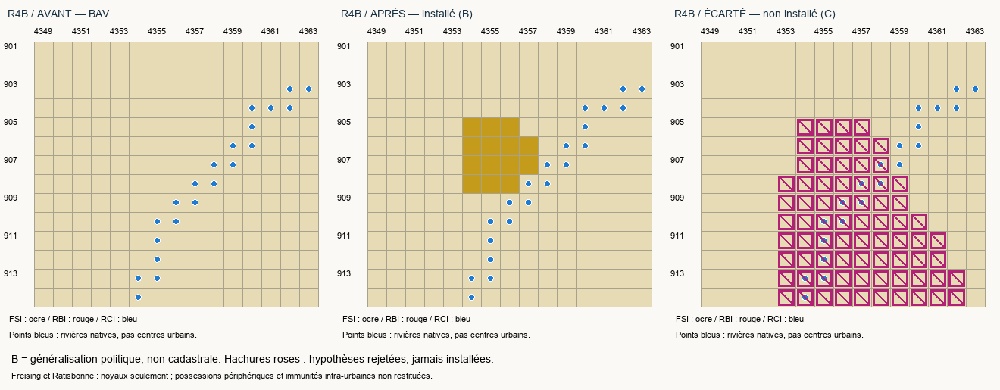
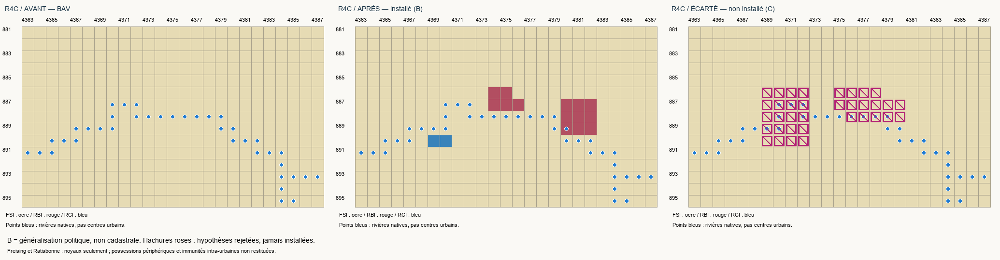

# MAP-2W-R4-B/C — Freising et Ratisbonne

18 octobre 2026. Date représentée : **1er janvier 1776**.

- **MAP2W_R4B_READY_FOR_SCOPED_RUNTIME_VALIDATION** : noyau temporel de Freising installé.
- **MAP2W_R4C_READY_FOR_SCOPED_RUNTIME_VALIDATION** : ville impériale et deux noyaux du prince-évêché de Ratisbonne installés séparément.
- **Passau : PASS_RUNTIME_USER_VALIDATED**, attestation manuelle enregistrée dans [son dossier](../PASSAU/RUNTIME_USER_ATTESTATION.json). Huit vérifications réussies, nouvelle partie, un mois, sauvegarde/rechargement sans anomalie. Elles ne couvrent pas ces nouveaux ajouts.

Ces statuts concernent les **noyaux installés, tous de catégorie B**. Ni le diocèse de Freising, ni le diocèse de Ratisbonne, ni l'ensemble des possessions périphériques ne sont déclarés reconstruits. Aucun test moteur automatisé ou manuel des nouveaux pays n'a été effectué par l'agent.

## Changements réellement installés

| Secteur / souveraineté | TAG | RGB parent (BAV) | Nouveau RGB | Cellules | Parent restant BAV |
| --- | --- | --- | --- | ---: | ---: |
| Noyau Freising / Burgfrieden généralisé | FSI | x68CE1C | xEDBA10 | 14 | 167 |
| Noyau épiscopal Donaustauf | RBI | x3101A0 | xEDBA11 | 5 | 219 après les deux prélèvements |
| Noyau épiscopal Wörth | RBI | x3101A0 | xEDBA12 | 9 | même parent |
| Ville impériale de Ratisbonne, moitié occidentale | RCI | xA7094D | xEDBA13 | 1 | 126 |
| Ville impériale de Ratisbonne, moitié orientale | RCI | xFE59E7 | xEDBA14 | 1 | 165 |

**30 cellules**, cinq nouveaux RGB, tous dans **STATE_BAVARIA / State_ID 71**. Ce State_ID est une région économique partagée, pas le pays BAV ni un identifiant historique. Les deux cellules urbaines sont adjacentes ; les noyaux épiscopaux forment deux composantes de 5 et 9 cellules, sans corridor inventé. Cette abstraction ne prétend pas que les possessions historiques complètes étaient entièrement disjointes : leur connexion étroite n'est pas restituée.

[Cellules complètes R4-B](R4B/TERRITORIAL_CHANGES.md), [cellules R4-C](R4C/TERRITORIAL_CHANGES.md), [données JSON](TERRITORIAL_CHANGES.json). Les parents résiduels restent connexes ; les composantes bavaroises de l'État passent de 3404/5/3 à **3374/5/3**, sans nouvelle enclave. Aucun RGB d'un ancien noyau MAP n'est subdivisé.

## Hypothèses confrontées

| Proposition | Conséquence | Décision |
| --- | --- | --- |
| Freising réduit, 14 cellules | Près du secteur Isar au nord de Munich, ne prend aucun hub | **B installé** : souveraineté attestée, macro-position et voisins défendables, contour simplifié |
| Grande bande Freising–Munich, 110 cellules | Prendrait le hub natif de Munich ; coupe aussi le parent x68CE1C en 93/20 | **C rejeté** : attribution trop large, pas une seconde option acceptée |
| Deux noyaux Donaustauf/Wörth, 5 + 9 | Distingue les principaux secteurs temporels et laisse les raccords délicats hors lot | **B installé**, même pays RBI |
| Bloc épiscopal continu, 15 cellules | Ne distingue pas correctement les juridictions interposées et le raccord étroit observés sur la planche HAB | **C rejeté**, aucune installation de ce contour |
| Ville impériale réduite, 2 cellules | Portion urbaine politiquement distincte au sud du secteur danubien, à l'ouest des noyaux épiscopaux | **B installé**, pas une position urbaine cadastrale |
| Ville étendue sur les deux rives, 20 cellules | Confondrait le secteur de Stadtamhof bavarois avec la ville ; créerait aussi une cellule résiduelle isolée du parent xA7094D | **C rejeté** |

Les secteurs de lecture historiques, leurs voisinages et les rivières natives sont confrontés aux RGB existants. Les locators servent à détecter des conflits, **pas à certifier un centre urbain ou la souveraineté d'un RGB entier**. Aucun nouveau modèle Miller/Homann, ajustement hydrographique, translation moyenne ou déplacement des hubs. L'écart indépendant R4 de 4,674 pixels n'est ni effacé ni transformé en précision certaine ; il n'est pas non plus le seul motif d'exclusion.

[Source Freising annotée](FREISING_SOURCE_ANNOTATED.png), [contexte territorial de Ratisbonne](REGENSBURG_SOURCE_CONTEXT.png), [audit RGB avant intervention](NATIVE_AUDIT.json). [Inventaire historique et institutions](HISTORICAL_EVIDENCE.md), [sources et provenance](SOURCES.md), [options C et exclusions](UNRESOLVED.md).

## Pays, gouvernements, titulaires

- **FSI** : prince-évêché catholique, Ludwig Joseph von Welden, né le 11 mai 1727, 48 ans. Gouvernement ecclésiastique et titre de prince-évêque.
- **RBI** : prince-évêché catholique, Anton Ignaz von Fugger, mêmes clés de nom et âge initial que sa représentation existante à Ellwangen (64 ans). Aucun changement d'Ellwangen ni union personnelle native imposée.
- **RCI** : ville impériale protestante, conseil urbain distinct du prélat. L'institution est attestée ; **aucun bourgmestre historique individuel inventé**. Le moteur peut générer son représentant ; il ne s'agit pas d'une biographie historique garantie. Succession technique du modèle républicain natif, non reconstitution électorale municipale détaillée.

Lois et technologies : modèles existants de Passau, avec principes républicains, oligarchie et liberté de conscience pour RCI. Aucun nouveau mécanisme économique, militaire ou religieux, aucune sujétion native automatique. Trois gouvernements spécifiques et leurs sous-textes dynamiques, 14 clés FR/EN uniques et concordantes. Drapeaux distincts : armes historiques de Freising ; bande d'argent sur rouge pour le pays épiscopal ; clés d'argent croisées sur rouge pour la ville. Rendus héraldiques schématiques, pas trois bannières de 1776 attestées dans chaque détail.

Les trois capitales techniques utilisent la région partagée Bavière et doivent être vérifiées à l'intérieur des portions possédées, sans déplacer ses hubs. Aucun changement de ressource, terrain du parent hérité par chaque nouveau RGB, arable, port ou industrie régionale.

## Populations et économie : portée exacte

| Pays | Population technique | Sud-germaniques, religion par défaut catholique | Sud-germaniques protestants | Ashkénazes, religion par défaut conservée |
| --- | ---: | ---: | ---: | ---: |
| FSI | 4 994 | 4 875 | 104 | 15 |
| RBI | 4 993 | 4 874 | 104 | 15 |
| RCI | 713 | 696 | 15 | 2 |

**10 700 personnes redistribuées depuis BAV**, aucun habitant ajouté. Pondération conservatrice des profils existants par les cellules : BAV 3382, FSI 14, RBI 14, RCI 2, total 3412. Monde **835 801 255 avant/après** ; compositions brutes et religions effectivement résolues identiques. Passau reste à 14 267.

Ce sont des **allocations techniques, pas des estimations démographiques historiques**. En particulier, 713 habitants ne reconstituent pas la population historique de Ratisbonne ; la majorité catholique du profil transféré ne devient pas une affirmation sur la confession de sa bourgeoisie. L'institution politique est protestante, les profils n'ont pas été convertis artificiellement. Taille et composition historiques de ces populations restent un sujet séparé, explicitement ouvert.

Tous les niveaux de bâtiments, PM, propriétaires économiques, formations et recrutements sont conservés. Les actifs BAV restent sur leur subdivision survivante ; aucun bâtiment ou soldat injecté dans les nouveaux pays. Leur autonomie économique et le fonctionnement d'une ville aussi petite restent à observer en jeu, pas à déclarer garantis.

## Validation technique et tests

**228/228 contrôles actuels réussis** : bitmap mondial exact, propriété unique des nouveaux RGB, régions/ressources/hubs, profils, actifs, références, registres, capitales définies, gouvernements, lois/technologies, syntaxe, clés FR/EN et drapeaux. Registre **568 → 569 après R4-B → 573 après R4-C**, même emprise impériale physique. Neuf électeurs inchangés ; RCI seule nouvelle ville libre. Compilation cumulative : 73 fichiers vérifiés, 17 actualisés ; carte du journal régénérée.

**37/37 nouveaux tests actuels réussis**, dont garde négative des cellules, propriétaires, membres, capitales techniques, couches cumulatives et attestation Passau. Suite cumulée : **258/260 réussis**. Deux anciens tests supposent encore que Passau est la dernière couche du registre. Ils échouent sur cette hypothèse de fin de phase, pas sur un transfert perdu ; **ils n'ont pas été réécrits ni masqués**. Leurs traces intégrales sont conservées dans [TESTS.json](TESTS.json). Le nouvel ordre exact `Passau → R4-B → R4-C` et les deux empreintes de géométrie sont contrôlés strictement par les nouveaux contrats. Ne pas présenter cette suite comme « 260 tests verts ».

**44 doublons RGB et 12 références invalides préexistants**, identiques au départ ; aucune nouvelle référence invalide ni régression détectée par les contrôles exécutés. Aucun changement fonctionnel inattendu hors périmètre entre capture et validation ; travaux USA/FRA, Saint-Gobain, Anzin, finances, Minutemen, unités et événements concurrents conservés. Aucune restauration depuis une vieille baseline.

HEAD et index Git inchangés, anciens tests/calibrations non réécrits, vanilla en lecture seule. Aucun commit, staging, changement de branche ou push. [Validation actuelle](VALIDATION.json), [populations](POPULATION_VALIDATION.json), [fichiers modifiés](FILES_MODIFIED.json), [empreintes de livraison](DELIVERY_MANIFEST.json), [guide moteur](PLAYER_GUIDE.md).

## Limites de clôture

Le périmètre testable est livré, **pas la reconstitution exhaustive des deux principautés**. Burgrain, Werdenfels, la bande d'Ismaning, Hohenburg et les immunités intra-urbaines restent identifiés et documentés séparément. R3 Hohenlohe et Erfurt–Eichsfeld restent intacts ; aucune autre région ne commence automatiquement.
