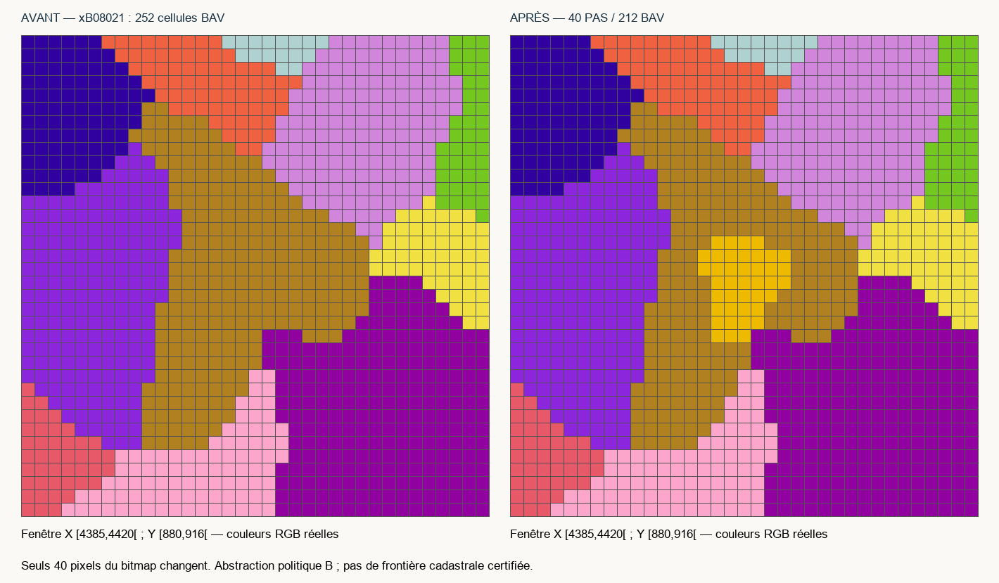

# Passau — pilote politique, 18 octobre 2026

> Suite territoriale distincte : [Freising et Ratisbonne R4-B/C](../FREISING_REGENSBURG/REPORT.md), noyaux installés mais non testés en jeu. Les reçus d'installation ci-dessous restent datés du pilote ; le registre cumulatif courant atteint 573 RGB, dont les 568 du stade Passau conservés et subdivisés uniquement par les nouvelles couches approuvées. Les 40 cellules PAS restent intactes.

**PASS_RUNTIME_USER_VALIDATED**, attestation reçue le 18 octobre 2026 : nouvelle partie en 1776, huit vérifications réussies, un mois simulé, sauvegarde et rechargement réussis, aucune anomalie signalée. Les huit vérifications ne sont pas détaillées individuellement dans l'attestation. [Attestation manuelle](RUNTIME_USER_ATTESTATION.json). Aucun test moteur automatisé exécuté par l'agent ; les reçus statiques d'installation sont conservés.

Le noyau reste **B : approximation politique documentée**, sans certification cadastrale. Ni l'intégralité du Hochstift ni les autres juridictions bavaroises ne sont terminées. Cette validation ne couvre pas les futurs ajouts Freising/Ratisbonne.

## Comparaison et décision

| Hypothèse | Transfert envisagé, BAV → PAS | Conséquences | Décision |
| --- | ---: | --- | --- |
| 1. Noyau méridional minimal | 40 cellules, parent xB08021, État 71 | PAS continu ; parent résiduel BAV de 212 cellules continu. Composantes BAV de l'État : 3444/5/3 → 3404/5/3, sans nouvelle enclave. | **B, installée** |
| 2. Extension septentrionale | 83 cellules du même parent | PAS continu mais BAV aurait les composantes 3306/52/5/3/1/1/1 : nouvel îlot de 52 cellules et trois cellules isolées sans justification historique. | **C, écartée**, extension non installée |
| 3. Report | 0 | Maintient l'omission politique de Passau | Non retenue pour le noyau ; maintien ailleurs non certifié |

Indices confrontés : confluent natif Inn–Danube [4400,902], relations territoriales sur la feuille conservée de Reilly, chronologie indépendante du HLB, souverainetés voisines et connexité du bitmap réel. Le confluent est un repère physique d'orientation, pas un centre urbain exact. Les locators ne déterminent pas les transferts.

Le noyau évoque Passau–Oberhaus et l'Abteiland méridional/oriental vers Hauzenberg, sans certifier chaque commune. Aucun recalage Miller/Homann, translation moyenne ou nouvel ajustement hydrographique : l'écart indépendant R4 de **4,674 pixels** reste connu, non corrigé artificiellement. La sélection est un cartogramme politique, pas un tracé métrique. Aucun territoire n'est classé A.

Après examen, l'option 2 ne reste pas une attribution acceptée concurrente : ses nouvelles enclaves ne sont pas défendables. L'option 1 est seule retenue dans le périmètre minimal ; les franges sont exclues plutôt qu'incorporées par défaut.

[Comparatif sur grille native](OPTIONS_COMPARISON.png), [RGB avant intervention](NATIVE_GRID_RGB.png), [source annotée](HISTORICAL_JURISDICTIONS.png), [grille du scan](PASSAU_SOURCE_GRID.png). Les flèches désignent des secteurs de lecture ; aucune superposition métrique scan/jeu revendiquée. Les cartes distinguent installé, écarté et exclusions indécidables.

## Installation

- **PAS**, prince-évêché catholique sud-germanique, capitale dans la région économique partagée STATE_BAVARIA / **71**. Aucun hub déplacé.
- Leopold Ernst von Firmian, historique, **67 ans**, titulature de prince-évêque, gouvernement dédié. Lois et technologies initialisées sur le modèle ecclésiastique existant EIC et références vérifiées.
- **xEDBA00, 40 cellules**, issues de **xB08021**, auparavant BAV. Parent résiduel : 212 BAV. Aucun ancien noyau MAP, territoire autrichien ou bohémien transféré.
- Localisations FR/EN, succession dynamique conservée, drapeau au loup rouge sur argent : rendu du motif historique, pas fac-similé d'une bannière de 1776.
- Registre **567 → 568 RGB**, emprise impériale physique inchangée, neuf électeurs inchangés. PAS est membre, ni électeur ni ville libre ; aucun statut de sujet natif ajouté. Compilation impériale : 17 fichiers actualisés sur 73 ; carte du journal régénérée, sans refonte des mécanismes ni de sa prose.

## Conservation et tests

**207/207 contrôles**, **223/223 tests statiques ciblés** : 30 nouveaux contrats Passau et 193 tests existants (registre, mécanismes impériaux, R1/R2/R2-B, R3 retiré/calibration, R4 documentaire, Saint-Gobain). Aucun test ignoré ; ce n'est pas tous les tests du dépôt. Voir [VALIDATION.json](VALIDATION.json) et [TESTS.json](TESTS.json).

**14 267 personnes techniquement transférées** BAV → PAS : 13 927 sud-germaniques catholiques par défaut, 298 sud-germaniques protestants et 42 ashkénazes avec religion par défaut conservée. Pondération des profils existants par 40/3452 cellules de la subdivision donneuse ; **pas un recensement historique de Passau**. Monde avant/après : **835 801 255**. Aucun habitant artificiel.

Bâtiments, niveaux, PM, propriétaires économiques, formations et recrutements identiques. Les actifs bavarois restent sur la subdivision donneuse encore existante ; aucun niveau industriel injecté dans PAS. Cette conservation ne garantit pas l'équilibre économique du petit pays, à observer en jeu.

Comparaison des empreintes fonctionnelles à la capture immédiate : aucune écriture inattendue hors périmètre, aucun changement concurrent nouveau détecté. Les travaux USA/FRA présents à la capture, les anciennes passes et Erfurt sont préservés. Les **44 doublons RGB et 12 références invalides préexistants** sont inchangés, aucune nouvelle régression détectée par les contrôles exécutés. HEAD et index Git inchangés, aucune opération Git d'écriture, aucun fichier vanilla modifié.

## Preuves, limites, suite

[Décision](DECISION.json), [toutes les cellules et propriétaires](TERRITORIAL_CHANGES.json), [géométrie](GEOMETRY.json), [profils démographiques](POPULATION_VALIDATION.json), [exclusions](UNRESOLVED.md), [sources](SOURCES.md), [guide joueur](PLAYER_GUIDE.md), [prochains sous-lots bavarois](NEXT_SECTORS.md).

[BASELINE.json](BASELINE.json) est la capture immuable ; [CANDIDATES.json](CANDIDATES.json) archive les hypothèses **avant** sélection, non l'état installé. [FILES_MODIFIED.json](FILES_MODIFIED.json) et [DELIVERY_MANIFEST.json](DELIVERY_MANIFEST.json) listent les fichiers et empreintes de livraison, sans assimiler tous les fichiers sales à ce pilote.

Aucun nouvel appel ColGrep : les emplacements étaient connus de R4 ; recherches exactes seulement. Appels antérieurs documentés dans [SOURCES R4](../../SOURCES.md). Tokens Codex et économie exacte non mesurables ici ; aucune recherche répétée pour produire des statistiques.
