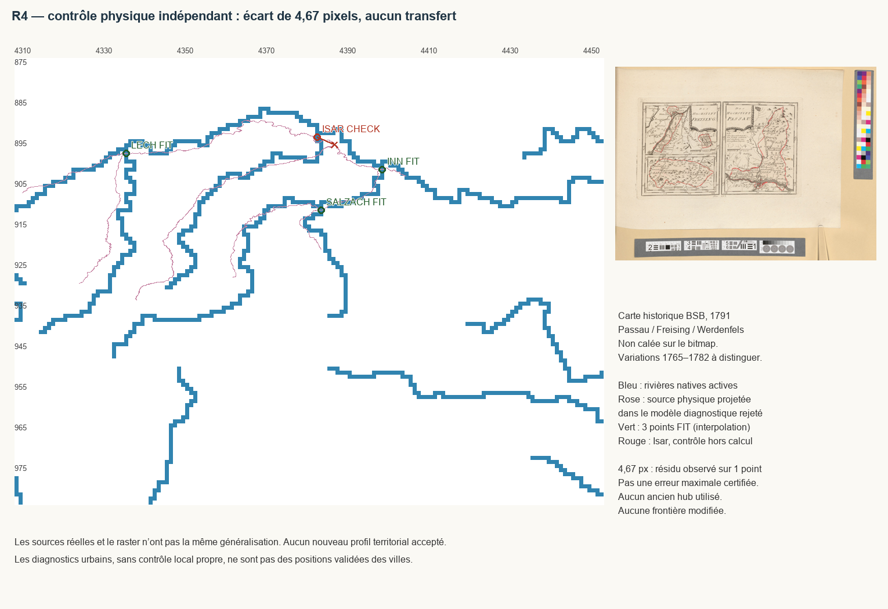
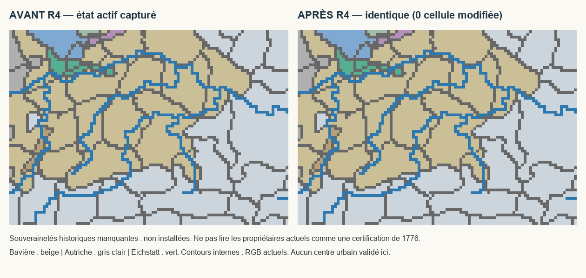

# MAP-2W-R4 — livraison du diagnostic bavarois

> **Suite R4-B/C, 18 octobre 2026 :** Freising et les deux souverainetés de Ratisbonne disposent maintenant de noyaux politiques B installés : 30 cellules, cinq nouveaux RGB, trois pays ; registre 573. **R4-B et R4-C prêts pour validation manuelle limitée**, pas encore testés en jeu. 228/228 contrôles actuels, 37/37 nouveaux contrats, suite 258/260 avec deux anciennes assertions de fin de phase non réécrites. [Rapport courant, exclusions et protocole](POLITICAL_REPRESENTATION/FREISING_REGENSBURG/REPORT.md). Les diagnostics et statuts antérieurs ci-dessous restent archivés ; les possessions périphériques ne sont pas déclarées achevées.

> **Attestation Passau, 18 octobre 2026 : PASS_RUNTIME_USER_VALIDATED** pour le seul noyau PAS/xEDBA00 de 40 cellules. Nouvelle partie 1776, huit vérifications réussies, un mois, sauvegarde/rechargement sans anomalie. [Attestation](POLITICAL_REPRESENTATION/PASSAU/RUNTIME_USER_ATTESTATION.json). Validation manuelle, pas test automatisé ni certification cadastrale ; Freising/Ratisbonne non couverts.

> **Suite du 18 octobre 2026 — nouvelle méthode politique autorisée :** noyau minimal de Passau désormais installé en catégorie B, 40 cellules BAV → PAS, xEDBA00. **MAP2W_R4_READY_FOR_SCOPED_RUNTIME_VALIDATION** pour ce seul pilote : 207 contrôles et 223 tests ciblés réussis, aucun test moteur exécuté. [Livraison actuelle](POLITICAL_REPRESENTATION/PASSAU/REPORT.md). Le diagnostic bloqué ci-dessous est conservé comme état antérieur ; ses constats géodésiques ne sont pas effacés. Les autres juridictions bavaroises restent ouvertes.

18 octobre 2026. **`MAP2W_R4_BLOCKED`**.

L’audit historique et cartographique est livré. **Aucune correction territoriale n’est installée** : aucun nouveau pays, RGB, personnage ou gouvernement ; aucun transfert de population ou bâtiment. La reconstitution fonctionnelle reste à faire. R4 n’est pas prêt pour une validation en jeu.

## Ce qui a été vérifié avant toute proposition

Les passes Franconie et Franconie-continuation représentent déjà les noyaux d’Eichstätt, Bamberg et Würzburg. EIC conserve 103 cellules sur quatre RGB ; ces parties ne sont pas refaites. Freising, Passau et les deux juridictions de Ratisbonne ne sont pas trouvés comme propriétaires territoriaux distincts dans l’état actuel. Les notes anciennes ne sont pas prises pour preuve de l’état effectif : inventaire et empreintes sont capturés dans `BASELINE.json`.

L’inventaire historique sépare territoires immédiats, diocèses spirituels, droits fonciers et magistrature urbaine : [HISTORICAL_INVENTORY.md](HISTORICAL_INVENTORY.md). Les dates et titulaires proviennent de sources indépendantes, recensées dans [SOURCES.md](SOURCES.md). La carte de 1791 est conservée, mais pas rétroprojetée automatiquement sur 1776.

## Résultat physique concret

Un nouveau diagnostic utilise trois confluents natifs, pas des hubs urbains : Lech–Danube, Inn–Danube, Salzach–Inn. Un quatrième confluent, **Isar–Danube**, reste exclu du calcul.

| Mesure | Résultat |
| --- | ---: |
| Couples FIT / paramètres | 3 / 6 |
| Contrôles physiques indépendants | 1 |
| Résidu indépendant moyen | **4,674390 px** |
| Résidu indépendant maximal observé | **4,674390 px**, un seul contrôle |
| Borne d’incertitude locale certifiée | **Non déterminée** |
| Cellules corrigées | **0** |

L’erreur est comparable à la taille utile des juridictions visées. Même pour Passau, le test d’aire ne démontre pas de noyau suffisamment intérieur, et aucun contrôle indépendant ne valide les franges septentrionales. Les secteurs de Freising, Werdenfels et Ratisbonne sont en extrapolation. **Ce n’est pas l’imposition d’un seuil cadastral universel : c’est l’absence de marge spatiale défendable pour ces cas précis.**

[Diagnostic détaillé et méthode alternative](CALIBRATION.md) ; [cas ouverts](UNRESOLVED.md).

## Tableau des transferts réellement appliqués

| Provinces / RGB | Avant | Après | Cellules transférées | Justification |
| --- | --- | --- | ---: | --- |
| Aucune | Propriétaires existants | Identiques | 0 | Géométrie nouvelle non validée ; aucun transfert arbitraire |

`TERRITORIAL_CHANGES.json` contient une liste vide, non une proposition déguisée. `GEOGRAPHIC_ASSESSMENT.json` fournit les RGB et State_ID lus dans des **fenêtres diagnostiques non validées**, ainsi que les quatre RGB EIC réellement conservés. Un RGB échantillonné à une prédiction de ville n’est jamais déclaré territoire historique de celle-ci.

## Conservation et validation

Résultats courants : `VALIDATION.json`, `POPULATION_VALIDATION.json`, `TESTS.json`. **24/24 contrôles de protection et 193/193 tests statiques ciblés réussis** (26 tests R4 et 167 tests existants, sans test ignoré). Ce n’est pas l’exécution de tous les validateurs historiques du dépôt, ni un test moteur. Les empreintes de tous les fichiers fonctionnels capturés complètent cette sélection cumulative.

Population mondiale avant/après : **835 801 255** ; profils régionaux, bâtiments et unités identiques. Les **44 doublons RGB et 12 références invalides** de départ sont exactement conservés : dette préexistante, aucune nouvelle régression détectée dans les contrôles exécutés.

Pendant R4, neuf chemins du chantier américain concurrent ont évolué (réforme des Minutemen et textes associés). `CONCURRENT_OBSERVATION.json` les énumère avec empreintes avant/après ; leurs scripts sont lus et analysés syntaxiquement, jamais écrits ou restaurés. Tous les autres chemins fonctionnels restent byte-identiques à la capture. Cette observation ne certifie pas le fonctionnement de la réforme américaine.

Le registre impérial, les neuf électeurs, les lois et gouvernements MAP existants, les populations, bâtiments et armées ne sont pas réécrits. R3 reste retiré. Aucun fichier vanilla modifié ; aucune opération Git d’écriture.

**Aucun test moteur exécuté.** Les anciennes validations manuelles restent limitées aux lots réellement inspectés par le joueur. [Guide joueur et protocole futur](PLAYER_GUIDE.md).

## Reprise recommandée

Ne pas interpoler le quatrième confluent pour effacer son écart, ni refaire les mêmes ajustements. Il faut une planche territoriale exploitable et des contrôles physiques natifs supplémentaires encadrant le noyau choisi, ou un arbitrage explicite d’une généralisation politique documentée si le dessin natif est irréductiblement schématique. Passau peut rester le premier pilote, sans commencer une autre région ni rouvrir Hohenlohe ou Erfurt.

## Fichiers livrés par cette passe

- Ajouts documentaires, données sources et images dans `docs/reports/map/MAP2W/R4/` ; inventaire des preuves et empreintes dans `EVIDENCE_MANIFEST.json`.
- Outils indépendants `tools/map2w_r4_bavaria.py`, `tools/map2w_r4_sources.py`, `tools/test_map2w_r4_bavaria.py` ; aucun installateur territorial.
- Ajout de suivi au rapport général `docs/reports/map/MAP2W/REPORT.md`, sans réécriture de ses anciens résultats ni des changements préexistants.
- Aucun fichier fonctionnel du mod modifié par R4 ; les chemins américains observés ne font pas partie de cette livraison.
