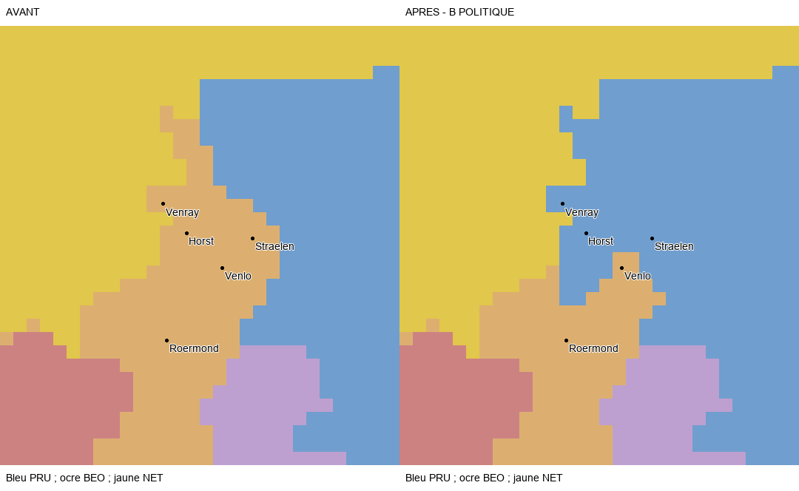

# SERG TERRITORIAL 1.0 — PROGRESSION : 39,57 %

Livraison du 5 novembre 2026, limitée à **Clèves, Gueldre et Mark**, dans le worktree massa-carrara-finalisation. **SC5-PRUSSIAN-WEST reste IN_PROGRESS** ; deux sous-lots installés **IMPLEMENTED_READY_FOR_RUNTIME_VALIDATION**, aucun reçu humain. Les essais moteur restent différés à la fin de la Prusse selon le joueur.

## Correction installée

**72 cellules BEO→PRU**, dans la région économique Gueldre existante :

| Sous-lot | Cellules | Périmètre politique B |
| --- | ---: | --- |
| PW-GUELDRE-B53 | 53 | Noyau Venray/Horst/Sevenum–Straelen et prolongement intérieur vers Kessel/Krickenbeck |
| PW-CLEVE-GUELDRE-NORTH-B19 | 19 | Complément septentrional Gennep/Middelaar–Afferden/Well, Clèves et Gueldre prussiennes |

Le parent `x0000DF` conserve **165 cellules BEO** et une forme continue ; son enfant `xEEC600` forme un ensemble PRU continu de 72 cellules. Aucun pixel NET ou d'un autre parent n'a changé. La région économique n'est ni agrandie ni redécoupée ; une portion nationale PRU incorporée est ajoutée. Tous les anciens noyaux PRU, Clèves/Mark, Ravensberg/Minden, Lippe et voisins protégés sont conservés.

[Sources et limites](SOURCES.md), [cellules et RGB](GEOMETRY.json), [complément septentrional](NORTHERN_RECONCILIATION.json). La correction rapproche trois cartes et une chronologie institutionnelle ; ce n'est pas une garantie cadastrale. Le modèle R5 est conservé. Les faibles résidus des lectures de l'image ne mesurent pas l'erreur de position dans le jeu. Les vieux recalages improductifs et le candidat Berg de 39 cellules ne sont pas repris.

## Conservation technique

**10 548 habitants existants** sont réaffectés de BEO/Gueldre à PRU/Gueldre, par allocation technique entière des profils existants, sans recensement prétendu. Les effectifs mondiaux, cultures et religions écrites et résolues sont conservés. BEO conserve 24 173 habitants écrits dans cette portion ; NET/Gueldre est inchangé.

Le parent BEO ne contenait aucun bâtiment initial écrit. Aucun bâtiment NET n'est pris pour peupler artificiellement la nouvelle portion PRU ; les bâtiments, niveaux, PM, détenteurs, unités et technologies de tout le workspace sont conservés. Subsistance, accès au marché et fonctionnement effectif de la portion PRU doivent être contrôlés en jeu. Aucun locator physique déplacé, aucun hub réaffecté, terrain hérité du parent.

Le registre impérial passe de **598 à 599 titres**, par subdivision et rattachement du nouveau titre à PRU : mêmes étendue physique, membres et neuf électeurs. Treize fichiers texte/registre/outil existants et le bitmap sont modifiés, dont sept dérivés impériaux régénérés seulement après contrôle de concordance. Aucun changement du vanilla, de l'autre copie du mod ou de Git.

## Contrôles exécutés

- **38/38 contrôles statiques de conservation réussis** : cellules exactes, propriétaires mondiaux, populations, bâtiments/PM/unités, intégration de la nouvelle portion, registre, anciennes preuves et approbation Glatz/Silésie, autres fichiers fonctionnels et index Git.
- **73 tests ciblés exécutés : 72 réussis, 1 exclu, aucun échec ni erreur.** L’exclusion concerne le contrôle historique d’initialisation sans modification ; la conservation de cette livraison est vérifiée séparément. **Validateur canonique PASS et 15/15 contrôles finaux réussis.**
- Le premier contrôle de chaîne impériale, dans le même processus que l'installation, a vu le module Python chargé avant sa modification : 37/38. Résultat brut préservé dans `VALIDATION_PRE_RELOAD.json`. Une exécution fraîche lit bien la nouvelle chaîne et réussit 38/38 ; le vérificateur recharge désormais explicitement le module installé. Ce n'était ni un résultat moteur ni une régression de la carte.
- Les **11 erreurs de références héritées** et **14 clés de références cartographiques dupliquées** de l'inventaire global restent documentées et inchangées ; aucun nouvel écart n'est ajouté. Elles ne sont pas présentées comme corrigées.

[Installation](INSTALLATION.json), [validation](VALIDATION.json), [suite brute](TEST_RESULTS_RAW.txt), [résultats](TEST_RESULTS.json), [conservation concurrente](CONCURRENT_CHANGES.json), [contrôles finaux](FINAL_CHECKS.json). Seules les exécutions de cette passe font foi ici ; les anciens résultats restent archivés.

## Réserves et suite

**Mark : aucun nouveau transfert défendable établi dans cette passe**, donc maintien de ses ensembles existants. Les bords Clèves/Emmerich, Unna/Meinerzhagen et Berg restent non certifiés ; un point de ville projeté ne justifie pas de modifier un noyau protégé. Ce maintien borné n'est pas une clôture régionale approuvée.

**Venlo et Beesel sont historiquement néerlandais mais restent BEO dans le jeu.** Ils sont exclus des cellules transférées à PRU. Cette attribution restante n'est pas approuvée comme correcte. Une réconciliation vers NET nécessiterait aussi un traitement provincial explicite du registre impérial, sans attribuer une adhésion nationale à NET. Les autres franges et micro-juridictions ne sont pas réouvertes. [Réserves structurées](REGIONAL_RESIDUALS.json).

Progression canonique avant/après : **93/235 → 93/235, 39,57 % → 39,57 %, 32/81 → 32/81**. Aucun point de clôture n'est acquis par l'installation de ces noyaux. Les 81 tâches, 235 points et le périmètre 1.0.0 sont conservés.

Le [protocole groupé cumulatif](PLAYER_TEST_PROTOCOL_GROUPED.md) ajoute B53 et B19 aux obligations antérieures. Prochaine action prévue : présenter les réserves occidentales pour arbitrage du périmètre V1 avant la réception moteur groupée prussienne. **Aucune deuxième région, Bavière ou autre tâche commencée.** Aucun PASS_RUNTIME_USER_VALIDATED créé.
