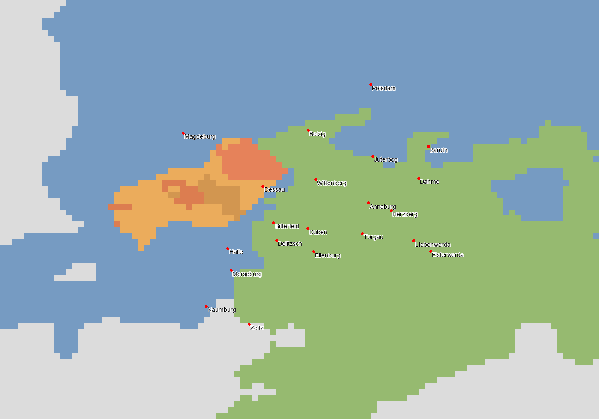

# SERG TERRITORIAL 1.0 — PROGRESSION : 39,57 %

**Nord saxon 1 installé le 5 novembre 2026, en attente du test joueur.** Une seule passe, centrée sur les frontières prussiennes de 1776. Aucun travail sur la frontière polonaise, la Bavière ou les micro-États.

## Changements installés

**606 cellules PRU → SAX supplémentaires** : **NS1-KURKREIS, 352 cellules** dans Anhalt technique (Wittenberg–Torgau–Annaburg et raccord Bitterfeld/Düben/Delitzsch/Eilenburg) ; **NS1-FLAMING-MEISSEN, 254 cellules** dans le Brandebourg (Belzig/Jüterbog, Dahme/Baruth, Herzberg et raccord Liebenwerda/Elsterwerda).

La carte de Schenk de **1758** a été effectivement examinée, avec contrôle chronologique par les notices du Staatsarchiv. [Sources, décision et incertitudes](SOURCES.md). Le résultat est une **approximation politique B**, sans certification cadastrale. Les résidus de transformation de la feuille, 0,73–1,85 cellule, ne constituent pas une précision validée indépendamment.

| Parent | SAX | PRU conservé |
| --- | ---: | ---: |
| x34386E | 93 | 0 |
| x83B1A8 | 72 | 280 |
| x9B9076 | 25 | 111 |
| xA65DA6 | 60 | 152 |
| xCF5D8E | 259 | 141 |
| xDF4020 | 97 | 85 |

Cinq RGB nouveaux, `xEEC100` à `xEEC104` ; `x34386E` réattribué entier (**93 cellules**, même couleur). **513 cellules sont recolorées**, les 93 autres changent seulement de propriétaire. Deux ajustements B sont explicités : une cellule adjacente pour Baruth et **30 cellules de raccord interne saxon** entre les feuilles Schenk et Lotter. Les deux poches PRU de 27 et 3 cellules provenaient de ce raccord, pas d'une possession prussienne attestée. Aucun locator ou hub déplacé ; aucune référence de hub ne nécessite de changement.

Le registre passe de **587 à 592 titres** par subdivision, **avec la même étendue impériale**, les mêmes membres et les neuf électeurs. Les titres des portions transférées appartiennent à SAX. Les sept sorties impériales effectivement concernées sont régénérées depuis le workspace courant ; les autres sorties restent identiques. [Précontrôle du générateur](COMPILER_PREFLIGHT.json), [différence révisable](REVIEW.diff).

## Conservation et population

Les **811 cellules lusaciennes de la livraison précédente sont strictement préservées**, ainsi que toutes ses preuves et son outil. Leur attente de validation humaine demeure. Les noyaux d'Anhalt et tous les pixels initialement non prussiens sont inchangés. Cottbus/Peitz conserve son enclave prussienne de **86 cellules** ; Halle, Magdebourg et Potsdam restent prussiennes.

Redistribution technique des populations déjà écrites : **106070** habitants vers SAX/Anhalt et **46093** vers SAX/Brandebourg, soit **152163** habitants existants. Aucun nouveau recensement, aucune correction historique d'effectif. Les ventilations culturelles/religieuses et le total mondial écrit (**837328654**) sont conservés exactement.

**Aucun bâtiment ni niveau, aucun PM, détenteur économique, armement, recrutement ou unité modifié.** Aucun nouveau pays ou profil technologique. Les limites des régions économiques, ressources, terrains parents, capitales et autres historiques sont préservés. L'initialisation économique réelle des portions saxonnes reste à observer en jeu.

## Vérifications réellement exécutées

- Contrôles différentiels actuels : **64/64 PASS** ; [résultats](VALIDATION.json).
- 46 tests exécutés : 45 réussites, 1 exclusion, 0 échec, 0 erreur. L'exclusion est le contrôle ancien d'initialisation sans modification ; la conservation du workspace courant est vérifiée séparément. [Résultats](TEST_RESULTS.json), [sortie brute](TEST_RESULTS_RAW.txt).
- Conservation des fichiers concurrents hors des modifications déclarées, des populations, bâtiments, unités, géométrie protégée, preuves et chaîne ordonnée du registre. Les anomalies héritées de références restent identiques, sans nouveau défaut dans le périmètre.
- Liste exacte des **14 fichiers installés**, avec empreintes avant/après : [installation](INSTALLATION.json). Contrôle final et état de concurrence dans `FINAL_CHECKS.json` et `CONCURRENT_CHANGES.json`.
- Aucun test moteur effectué par l'agent, aucun résultat humain nouveau, aucune opération Git d'écriture ou modification du vanilla.

Les premières préparations de contour et le précontrôle antérieur au raccord n'ont pas été installés. Seul le candidat final de 606 cellules figure dans le manifeste d'installation. Aucun ancien résultat brut ou ancienne baseline n'est réécrit pour rendre cette passe conforme.

## Statut, limites et prochaine action

Les deux nouveaux sous-lots sont **IMPLEMENTED_READY_FOR_RUNTIME_VALIDATION**. `SC3-BRANDENBURG` reste **BLOCKED** : Magdebourg/Halberstadt, Gommern/Barby, les parts de Mansfeld/Saale et les autres obligations régionales ne sont pas clôturés. Le diagnostic grossier de Mersebourg/Naumbourg et les franges d'Anhalt n'est pas résolu artificiellement. `SC3-SILESIA-LUSATIA` et les 79 autres fiches sont inchangées.

Le noyau Nord saxon 1 de cette passe est livré ; il ne représente pas toutes les corrections saxonnes possibles. Les petites îles de souveraineté et les franges non traitées sont documentées dans les sources ; elles ne sont pas déclarées historiquement exactes par défaut.

**Progression officielle : 93/235 → 93/235 points, 39,57 % → 39,57 %, 32/81 tâches qualifiées**, périmètre 1.0.0. Aucun point pour une installation partielle non reçue. Aucune nouvelle attestation `PASS_RUNTIME_USER_VALIDATED`.

**Prochaine action : [protocole joueur Nord saxon 1](PLAYER_TEST_PROTOCOL.md), groupable avec les Lusaces précédentes. Prochaine passe demandée : frontière polonaise prussienne, non commencée.** Les obligations mises en pause ne sont ni effacées ni créditées.

La livraison fonctionnelle se trouve uniquement dans **C:/Users/simeo/.codex/worktrees/massa-carrara-finalisation/1776_Age_of_Revolutions_fork**. Les autres copies du mod et le hotfix ne sont pas synchronisés automatiquement.
