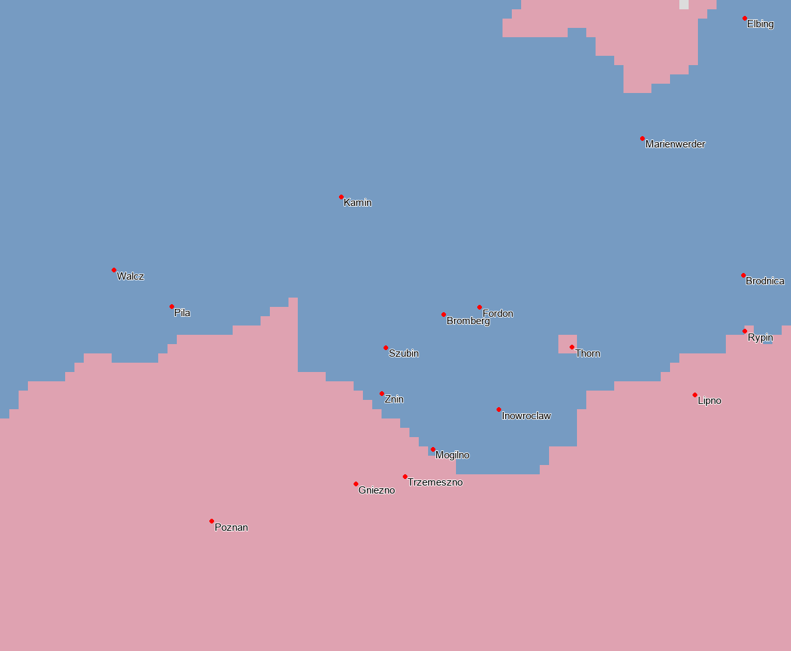
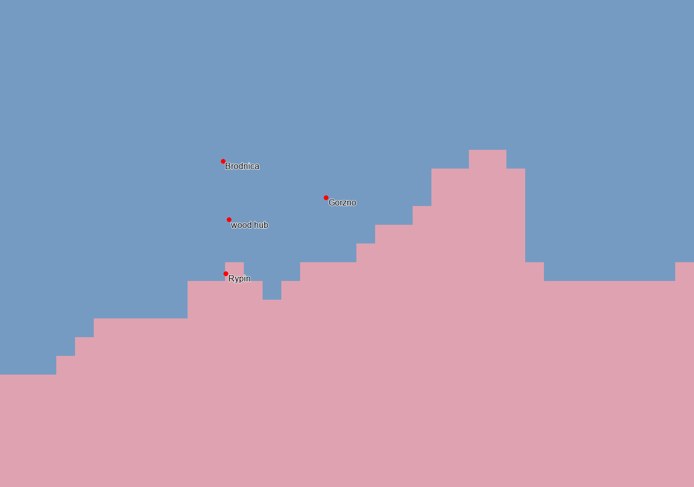

# SERG TERRITORIAL 1.0 — PROGRESSION : 39,57 %

**Frontière polono-prussienne : trois sous-lots installés le 5 novembre 2026, en attente du test joueur.** Mission centrée sur la Prusse ; aucune Bavière, aucun micro-État ou autre chantier commencé.

## Installation concrète

**PP-NETZE-CORE : 222 cellules PLC → PRU**, autour de Bromberg/Bydgoszcz, Żnin, Mogilno et Inowrocław. Les 85 cellules reçues antérieurement restent exactes ; Trzemeszno, Gniezno et Poznań restent polonaises. **PP-THORN-CORE : 4 cellules PRU → PLC**, noyau urbain sur la rive nord de la Vistule ; 149 cellules rurales restent PRU. **PP-DOBRZYN-FRINGE : 59 cellules PRU → PLC**, secteur de Rypin, tandis que Brodnica/Górzno et le repère forestier restent prussiens.

| Parent | Transfert | Cellules transférées | Résidu conservé |
| --- | --- | ---: | ---: |
| x41A021 | PRU → PLC | 4 | 149 |
| xC02121 | PLC → PRU | 124 | 199 |
| xFCC7B7 | PLC → PRU | 98 | 44 |
| x374AC3 | PRU → PLC | 59 | 162 |

**285 cellules recolorées**, quatre RGB nouveaux `xEEC200` à `xEEC203`, mêmes deux régions économiques et mêmes pays. Les nouveaux noyaux sont connexes ; les deux fragments du résidu RGB de Dobrzyń restent reliés par les provinces prussiennes voisines. Le manifeste [INSTALLATION.json](INSTALLATION.json) décrit les **7 fichiers installés** et leurs empreintes exactes.

Le seul repère **farm158/Toruń** est déplacé d'environ cinq cellules, de la rive sud vers le noyau PLC de rive nord. La référence provinciale suit réellement son nouveau point ; aucun autre repère, rotation ou échelle n'est modifié. Le nouveau terrain de Thorn est `plains` ; l'ancien `tundra` du parent rural n'est pas corrigé ou recopié sur le noyau urbain. Les noms de ville préexistants sont conservés ; aucune nouvelle ville nommée n'est créée à Inowrocław ou Rypin.

## Sources et portée historique

La livraison est une **généralisation politique B**, pas une frontière cadastrale certifiée. Les scans antérieurs sont réutilisés, les anciens recalages rejetés ne sont pas relancés. L'encart **révisé de 1780** est confronté aux chronologies institutionnelles : Żnin et Mogilno sous contrôle prussien dès 1774, Trzemeszno demeurant polonaise jusqu'en 1793. L'édition de 1780, postérieure à la cible, n'est pas appliquée intégralement à janvier 1776. Le liseré méridional de 1775 dont la date d'effet était contestée reste exclu.

La frontière orientale de Dobrzyń est lue sur la feuille **contemporaine de 1775**, avec Rypin polonaise jusqu'en 1793. Thorn est distinguée de ses campagnes ; les cartes politiques et la configuration riveraine de Pfau justifient le noyau B, sans inventer une approbation des anciennes variantes U1/U2 ou une validation du nouveau choix. [Sources, lectures, points et limites](SOURCES.md).

**Le contour complet des quatre districts de la Netze, les possessions rurales de Thorn et les rectifications non datées restent ouverts.** Les diagnostics de villes sont grossiers, pas des locators homologués. Les résidus des nouvelles lectures de feuilles ne démontrent pas une précision uniforme des frontières. L'effet sur le rendu des repères, les accès au marché et le fonctionnement économique doit être observé en jeu ; aucune panne moteur n'a été constatée par l'agent, qui n'a pas lancé le jeu.

## Conservation

Les **811 + 606 cellules saxonnes précédentes**, leurs preuves et leurs outils sont préservés. Leurs attentes de réception demeurent. Anhalt, Cottbus/Peitz, les réparations MAP2A et les autres noyaux validés sont hors des quatre parents et restent exacts. Tous les rapports/reçus/résultats bruts MAP2M sont conservés sans réécriture.

Redistribution technique des populations existantes : **83864** habitants PLC → PRU dans Posen, **10926** PRU → PLC dans Prusse occidentale. Ces nombres portent sur les portions État/propriétaire ; aucun n'est un recensement de Thorn ou de Rypin. Les profils culturels/religieux explicites et résolus et le total mondial écrit, **837328654**, restent identiques.

**Tous les bâtiments, PM, niveaux, détenteurs économiques, armements, formations et recrutements sont inchangés.** Aucun nouveau pays, technologie ou recette. Les fortifications, le Corps du génie et les travaux économiques/concurrents restent protégés par empreintes et comparaison d'inventaire.

Ces territoires sont **extérieurs au Saint-Empire** : les **592 titres impériaux**, leur étendue, les membres et les électeurs restent inchangés ; aucun script impérial ou texte de localisation n'est régénéré. Seul un manifeste géométrique extérieur est ajouté à la chaîne technique. Les **81 fiches SERG restent intégralement identiques** ; la livraison est suivie séparément sans point ni changement du dénominateur.

## Contrôles réellement exécutés

- **64/64 contrôles différentiels PASS** sur le workspace installé : [VALIDATION.json](VALIDATION.json).
- 56 tests ciblés exécutés : **55 réussites, 1 exclusion, 0 échec et 0 erreur**. [Résultats](TEST_RESULTS.json), [sortie brute](TEST_RESULTS_RAW.txt).
- La suite photographique R9 a aussi été exécutée avant et après : **8 tests, 2 échecs avant, 3 après, aucune erreur**. Les deux premiers portent sur un raster limité aux seules deux cellules de R9 et l'identité de tous les anciens repères, déjà dépassés avant cette mission. Le nouvel écart est l'assertion « Thorn inchangée, 153 cellules », volontairement remplacée par le correctif autorisé (149 + 4) et son contrôle différentiel exact. Aucun test ancien, résultat brut ou baseline n'est modifié pour masquer ces écarts. [Avant](LEGACY_BEFORE.json), [après](LEGACY_AFTER.json), [interprétation](LEGACY_EXPECTATIONS.md).
- Aucun reçu humain nouveau, aucune exécution moteur automatisée. Git HEAD/branche/index inchangés ; aucune opération Git d'écriture, aucune modification du vanilla. Les contrôles finaux, manifestes et protections se trouvent dans `FINAL_CHECKS.json`, `FILES_MODIFIED.json` et `CONCURRENT_CHANGES.json`.

## Suivi et prochaine action

Les trois sous-lots sont **IMPLEMENTED_READY_FOR_RUNTIME_VALIDATION**. Aucun `PASS_RUNTIME_USER_VALIDATED` créé. Leurs incertitudes ne sont pas effacées par les tests statiques.

**Progression SERG avant/après : 93/235 → 93/235 points, 39,57 % → 39,57 %, 32/81 tâches qualifiées**, périmètre 1.0.0 inchangé. Aucun crédit pour une correction extérieure au SERG.

**Prochaine action : [test joueur groupé](PLAYER_TEST_PROTOCOL.md)** des trois sous-lots polono-prussiens et, dans la même partie si souhaité, des installations saxonnes encore en attente. Aucun autre territoire commencé automatiquement.

La livraison est dans **C:/Users/simeo/.codex/worktrees/massa-carrara-finalisation/1776_Age_of_Revolutions_fork**. Les autres copies du mod et le hotfix ne sont pas synchronisés automatiquement ; vérifier le chemin chargé dans le lanceur.
