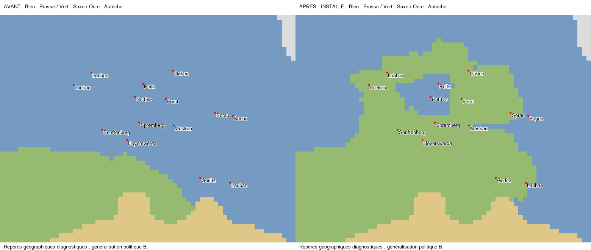

# SERG TERRITORIAL 1.0 — PROGRESSION : 39,57 %

Passe Prusse commencée le 2 novembre et finalisée le 5 novembre 2026 dans le worktree **massa-carrara-finalisation**. **Sous-lots lusaciens installés, IMPLEMENTED_READY_FOR_RUNTIME_VALIDATION ; aucune validation humaine nouvelle.** L'ensemble des frontières prussiennes n'est pas déclaré exact ou terminé.

## Résultat concret

**811 cellules PRU → SAX** : 393 dans la région technique Brandebourg, 418 dans la région technique Basse-Silésie. La carte restitue les ensembles saxons de Luckau/Lübben, Guben/Forst/Sorau, Hoyerswerda/Spremberg/Muskau et Görlitz/Lauban. Cottbus/Peitz reste une possession prussienne distincte ; Sagan et les portions silésiennes orientales sont conservées à la Prusse.

Les deux feuilles Lotter conservées à Berne ont été réellement lues. Leurs districts non coloriés, dont Muskau et Neuzelle/Pforten, ont été distingués des frontières de souveraineté. La décision et le tracé sont de **catégorie B** : limites généralisées à la résolution du jeu, sans garantie cadastrale. [Sources, lectures et incertitudes](SOURCES.md).

| Parent | Saxe | Prusse conservée |
| --- | ---: | ---: |
| x1B72C9 | 27 | 174 |
| x272E48 | 131 | 48 |
| x60BF20 | 124 | 10 |
| x614121 | 260 | 0 |
| x76EF4E | 75 | 231 |
| xB90BFF | 36 | 326 |
| xDF4020 | 158 | 182 |

Six RGB nouveaux `xEEC000` à `xEEC005`, un parent réattribué entier (`x614121`, 260 cellules), sept parents concernés. **551 cellules sont recolorées**, les 260 autres gardent leur RGB et changent de propriétaire dans l'historique. Le raccord de la référence minière de Basse-Silésie suit son point natif ; aucun locator déplacé. Les ressources, capacité agraire, terrains parents, capitales et frontières des régions économiques sont conservés. Le nombre de titres impériaux passe de **581 à 587** par subdivision ; leur **étendue physique reste identique**. Aucun nouveau pays, membre ou électeur ; les titres des portions restituées appartiennent à SAX.

## Populations et économie

Redistribution technique conservatrice : **71316** habitants vers SAX/Brandebourg et **145606** vers SAX/Basse-Silésie, soit **216922** habitants existants. Chaque profil écrit est conservé mondialement. Total mondial écrit : **837328654**, delta zéro. Ces nombres ne sont pas un recensement historique des Lusaces.

Un niveau d'élevage de Basse-Silésie est réaffecté à la portion saxonne. Pour l'infrastructure traditionnelle du Brandebourg, chacune des deux déclarations historiques concernées passe de cinq niveaux PRU à quatre PRU et un SAX ; ces couches ne sont pas présentées comme deux niveaux moteur additionnels. Les recettes, PM et détenteurs économiques sont conservés. Les six niveaux d'armement prussiens, toutes les unités et tous les recrutements restent inchangés. Aucune révision technologique ou économique autonome.

## Vérifications réellement exécutées

- Contrôle différentiel sur le workspace actuel : **69/69**, statut **PASS** ; [résultats](VALIDATION.json).
- 45 réussites, 1 exclusion(s), 0 échec(s), 0 erreur(s), sur 46 tests canoniques et contrats de migration. L’exclusion concerne uniquement le contrôle ancien d’initialisation sans modification ; la conservation actuelle est contrôlée séparément. [Résultats bruts](TEST_RESULTS.json).
- Préparation des sorties impériales comparée d'abord au générateur sur l'état courant ; aucune divergence concurrente écrasée. [Précontrôle](COMPILER_PREFLIGHT.json), [différence révisable](REVIEW.diff).
- Propriétaires, références, populations, bâtiments/PM/détenteurs, unités, acquis extérieurs aux sept parents et fichiers concurrents contrôlés. Les anomalies techniques héritées restent celles de la capture, sans nouveau défaut de scope ou de référence.
- Aucun test moteur exécuté par l'agent. Aucun reçu humain créé. Git HEAD, branche et index conservés ; aucune opération Git d'écriture ni modification du vanilla.
- `git diff --check` : code de sortie zéro ; seules les informations de conversion LF/CRLF du workspace sont émises. Aucun ancien rapport n'est nettoyé pour les supprimer.

Les premières lectures provisoires et leur candidat rejeté sont conservés sous `PRELIMINARY_REJECTED_*`. Ils n'ont jamais été installés. Les modifications installées exactes et leurs empreintes sont dans [INSTALLATION.json](INSTALLATION.json).

## Portée restante et prochaine action

`SC3-BRANDENBURG` et `SC3-SILESIA-LUSATIA` restent **BLOCKED** pour leurs obligations régionales ; leurs sous-lots installés attendent le joueur. Le correctif ne clôt pas Magdebourg/Halberstadt, le nord de l'électorat saxon devenu prussien en 1815, toutes les franges de Glatz/Silésie, les limites occidentales, ni Netze/Thorn/Inowrocław. Les anomalies polonaises restent identifiées dans MAP2M/R9 ; aucun transfert de leurs grands RGB depuis un seul nom de ville.

**Prochaine action : [test joueur groupé de cette installation prussienne](PLAYER_TEST_PROTOCOL.md)**. Ensuite, poursuivre uniquement les grands écarts prussiens encore ouverts, notamment la frontière saxonne septentrionale et la frontière polonaise. Aucune Bavière commencée. Les micro-États sortent de la file active selon l'instruction utilisateur ; leurs obligations, preuves, statuts et points ne sont pas effacés.

Progression avant/après : **93/235 → 93/235**, **39,57 % → 39,57 %**, **32/81 tâches qualifiées**. Le dénominateur, les 81 tâches et le périmètre 1.0.0 sont conservés. Une livraison territoriale non reçue n'apporte aucun point de validation.

La livraison fonctionnelle est dans **C:/Users/simeo/.codex/worktrees/massa-carrara-finalisation/1776_Age_of_Revolutions_fork**. Les autres copies du mod et le hotfix ne sont pas synchronisés automatiquement ; le protocole demande de vérifier le chemin de la copie effectivement lancée.
