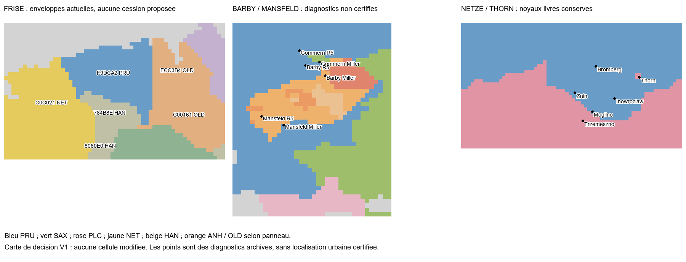

# SERG TERRITORIAL 1.0 — PROGRESSION : 39,57 %

**Revue finale prussienne achevée ; aucun nouveau transfert défendable trouvé, aucun fichier fonctionnel modifié.** Les 14 installations reçues par le joueur et toutes les décisions acquises sont conservées. La conclusion concrète est de proposer le gel de cette carte pour la V1 avec report explicite des obligations résiduelles, sans les proclamer historiquement résolues. La Bavière n’est pas commencée.

## Décisions concrètes

[Tableau destiné au joueur](DECISION_FOR_PLAYER.md), [décisions structurées](DECISION_MATRIX.json), [sources et limites](SOURCES.md), [lecture de la carte actuelle](NATIVE_REVIEW.json).

- **Barby** : souveraineté saxonne confirmée ; les diagnostics archivés désignent PRU ou Anhalt selon le modèle. Aucun point urbain natif certifié ni sous-ensemble permettant de reprendre Anhalt validé. Proposition : maintien des noyaux installés pour la V1 et report de la réserve locale C.
- **Mansfeld** : la présence d’une part sous suzeraineté PRU est antérieure à l’incorporation de 1780. Une réattribution globale à SAX ou un nouveau pays indépendant serait injustifiée. Proposition : maintenir l’agrégation politique actuelle, en conservant ouverte la frontière fine des parts saxonnes/prussiennes.
- **Leer/Rheiderland** : 319 cellules PRU acceptées conservées. Les enveloppes sud HAN 107 et ouest NET 331 ne constituent pas des erreurs prouvées ; aucun sous-ensemble source/bitmap défendable n’est identifié. Proposition : conserver la carte pour la V1, reporter la correspondance méridionale sans annexer les voisins.
- **Netze/Thorn** : 22/22 diagnostics grossiers conformes aux propriétaires attendus ; trois noyaux reçus préservés. Proposition : maintenir le B installé et reporter les contours ruraux/intégraux non démontrés. Extérieur au SERG, aucun point.
- **Glatz/Silésie et Clèves/Mark/Berg** : maintiens et arbitrages existants conservés, sans rouvrir leur précision.

Les points de la figure sont explicitement des diagnostics archivés, pas des positions urbaines certifiées. Les réserves C ne sont pas reclassées B par convenance. La quantité d’erreurs restant à corriger demeure inconnue ; aucun volume d’enveloppe n’est présenté comme un nombre d’erreurs. Aucun ancien modèle, réglage, pixel ou territoire approuvé n’a été modifié.

## Démographie et portée de la clôture

[DEMOGRAPHY_SEPARATION.json](DEMOGRAPHY_SEPARATION.json) publie les effectifs écrits actuels des portions techniques utiles. Ce sont des données de scénario, pas de nouveaux recensements historiques. Les questions démographiques restent attribuées aux tâches existantes et n’entraînent aucune retouche de frontière dans cette passe. Aucun critère historique n’est effacé ou réputé acquis.

Les 14 reçus existants restent inchangés ; aucun nouveau PASS ni attestation moteur n’est créé. [Conséquence pour le test joueur](PLAYER_TEST_PROTOCOL.md) : aucun nouveau test demandé puisqu’aucune modification fonctionnelle n’est installée.

## Choix à recevoir pour arrêter la Prusse V1

[PROPOSED_V1_DECISION.json](PROPOSED_V1_DECISION.json) propose les reports P1 non bloquants de **SC3-BRANDENBURG (4), SC3-SILESIA-LUSATIA (3), SC5-PRUSSIAN-WEST (4), SC5-EAST-FRISIA-SOUTH (2)**. Après accord explicite seulement, le statut serait **DEFERRED_APPROVED** pour ces obligations résiduelles ; les noyaux resteraient validés en jeu. Cette voie permet une fin opérationnelle du chantier de carte Prusse V1 sans certificat de complétude historique.

**Progression acquise avant/après : 93/235 → 93/235, 39,57 % → 39,57 %, 32/81 → 32/81.** Aucun report n’est approuvé par l’agent. Projection conditionnelle du calcul canonique si les quatre reports sont reçus explicitement : **106/235, 45,11 %, 36/81**. Ces 13 points représenteraient des reports P1 approuvés, pas de nouvelles frontières corrigées. Périmètre 1.0.0, 81 tâches et dénominateur 235 inchangés.

L’autorisation « Ok, vas-y alors » est enregistrée comme mandat de revue et de correction défendable, pas comme une approbation anticipée de ces quatre reports nommés ensuite. La règle de suivi `DEFERRED_APPROVED` exige un accord utilisateur sourcé ; l’approbation est la prochaine action après réalisation des contrôles. Aucun état hypothétique avec accord humain n’est enregistré.

## Suite proposée

Après réception du choix, candidate prioritaire : **Bavière V1 — grands contours, en commençant par l’interface BAV/AUS et l’Innviertel**. L’interface relève de SC2-AUSTRIA ; le périmètre des autres obligations sera cartographié avant toute future évolution de suivi. Les noyaux Salzbourg, Passau, Freising et Ratisbonne resteront protégés. Aucun nouveau 82e item ni modification du scope n’est créé, aucun lot bavarois commencé. L’approbation de la proposition de gel ne lance pas automatiquement ce lot.

## Vérifications

Les contrôles réellement exécutés sont dans [CURRENT_REVIEW_CHECKS.json](CURRENT_REVIEW_CHECKS.json), [TEST_RESULTS.json](TEST_RESULTS.json), [CANONICAL_CHECK.json](CANONICAL_CHECK.json), [FINAL_CHECKS.json](FINAL_CHECKS.json) et [FILES_MODIFIED.json](FILES_MODIFIED.json). Les anciens tests, échecs, rapports, reçus, données et travaux concurrents sont préservés ; aucune opération Git d’écriture ni modification du vanilla.

Résultats de cette exécution : **8/8 contrôles de revue, 21/21 contrôles finaux ; 73 tests ciblés exécutés, 72 réussis, 1 ignoré explicitement, aucun échec ni erreur.** L’exclusion concerne le snapshot d’initialisation ancienne sans écriture ; la conservation actuelle est contrôlée directement. **2 881 fichiers fonctionnels et 1 834 anciennes pièces d’archives/reçus inchangés.** Les quatre simulations négatives sont rejetées par le validateur : aucun report non approuvé ne gagne de point. Les 11 références héritées et 14 clés dupliquées de l’inventaire restent visibles, sans nouvelle dette. Le contrôle global Git des différences signale deux lignes avec espaces finaux dans le fichier concurrent common/history/military_formations/07_military_formations_subsaharan_africa.txt (491 et 505). Son empreinte est identique à la capture de début de revue : dette préexistante, fichier préservé. La comparaison directe des six fichiers canoniques avec leurs préimages passe le contrôle d’espaces. Les résultats bruts restent dans DIFF_CHECK.json et leur classification dans CONCURRENT_CHANGES.json ; aucune configuration Git changée.
