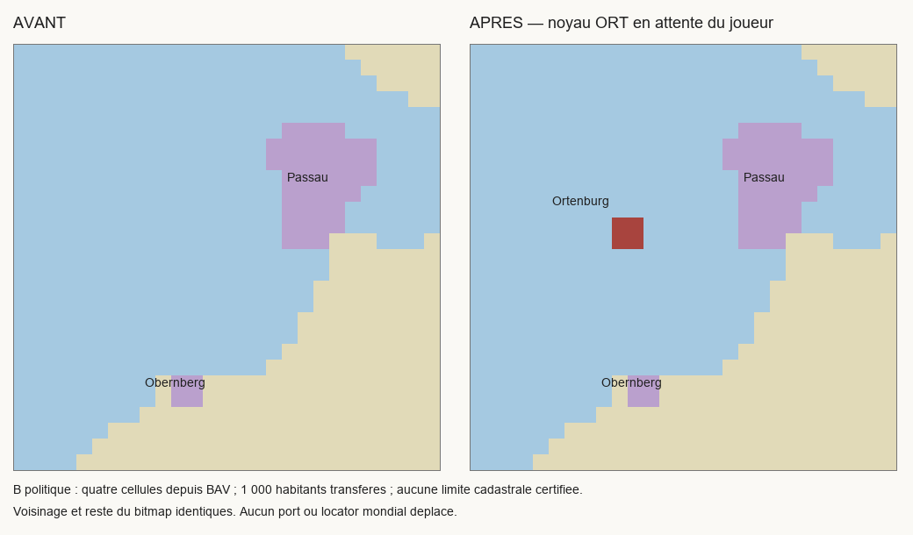

# SERG TERRITORIAL 1.0 — PROGRESSION : 34,89 %

Passe du 25 octobre 2026 : **SC1-ORTENBURG**, phase 1, priorité P1, sans dépendance.
Une seule nouvelle étape territoriale. **82/235 points, 24/81 tâches qualifiées avant/après.**

## Réception de Ratisbonne

Le joueur déclare : « Ok, Ratisbonne passe. Tu peux passer à Ortenburg. »
Un reçu distinct enregistre `PASS_RUNTIME_USER_VALIDATED` pour **RG-D-CITY** seulement.
Les blocs RCI (11 000 habitants) et RBI (4 993) correspondent à la livraison ; aucune
date effective du test, observation économique détaillée ou capture n'est ajoutée.
SC1-REGENSBURG-DEMOGRAPHY reste BLOCKED pour ses autres obligations et ne reçoit
aucun point régional. Ce reçu ne couvre pas un autre territoire.

## Résultat installé

Le nouveau TAG **ORT**, nommé **Ortenburg** en anglais et **Ortenbourg** en français,
représente un noyau souverain marché/résidence de l'ancien comté immédiat.
Les quatre cellules [4392,901], [4392,902], [4393,901], [4393,902] forment le nouveau
`xEDC100`, extrait du seul `x8C26DD` BAV (276 → 272 cellules, connecté).

La carte Valck, après 1705, conservée à Berne, a été téléchargée et réellement lue :
Ortenburg y figure au sud-ouest de Passau, au sud de Vilshofen et au nord de Griesbach.
La traduction au raster est **B politique**, sans ancien recalage R4 ou tracé cadastral
prétendu. Le carré ne certifie pas les limites de tous les villages du comté.
Söldenau, Dorfbach, Buch, Neudeck, Egglham et Hirschbach ne deviennent pas des
possessions souveraines ORT depuis les seuls droits fonciers/judiciaires des comtes.

**1 000 habitants sud-germaniques protestants** passent du pool bavarois protestant
de Bavière (25 173 → 24 173) à ORT. Aucun habitant nouveau, aucune conversion forcée
de catholiques, aucune profession ou richesse ajoutée. Le total mondial et la
répartition globale des cultures/confessions sont conservés. La population choisie
est une estimation du noyau, éclairée par un repère ultérieur de marché, pas un
recensement de 1776 ni le total des ressorts ruraux.

**Karl III von Ortenburg** est conservé en janvier, avant l'avènement de son fils
Karl Albrecht en cours de 1776. Âge moteur arrondi 60 ans, sans anniversaire inventé
ou succession datée artificiellement. Gouvernement comtal héréditaire, religion
protestante et scolarité confessionnelle locale. Aucun pacte PRU, union bavaroise,
port, mine, nouvelle armée ou subvention n'est créé.

Neuf technologies traditionnelles sont initialisées explicitement, avec prérequis
contrôlés. Aucun paquet militaire/administratif bavarois copié, aucune nouvelle
technologie commune créée. Le modèle politique général initialement essayé
demandait des lois incompatibles avec ce profil : il a été remplacé par des lois
locales explicites (économie traditionnelle, aucune police professionnelle, levées
paysannes), sans offrir les technologies manquantes. L'essai et ses diagnostics
restent dans FIRST_VALIDATION.json et START_POLICY_REFINEMENT.json.

Une petite **Chancellerie comtale**, niveau 1 non extensible, offre 100 postes et
consomme 0,5 papier à pleine activité. Elle est dimensionnée comme capacité technique,
sans personnel d'archives, production ou rentabilité prétendument observés.
Les subsistances et l'emploi réel relèvent du moteur. Les noms de portion et de
capitale sont limités au propriétaire ORT ; aucun locator mondial n'est déplacé.
L'emblème rouge à bande argent est une évocation simplifiée, détail héraldique P2.

## Intégration impériale et conservation

Le registre passe de 579 à **580 titres**, dans la même emprise impériale.
ORT est un membre comtal, pas une ville libre ni un dixième électeur. La nouvelle
couche est ajoutée à la chaîne protégée dans `map2l_registry.py`, sans remplacement
des couches acceptées. Les scripts impériaux sont compilés depuis la version
courante après précontrôle ; leurs préimages et sorties sont conservées.

Les pixels de Passau, Obernberg, Ratisbonne ville/évêché, Freising, Salzbourg,
Berchtesgaden, Trente et Brixen restent conservés. Les pays existants gardent leurs
technologies. Aucun fichier de recettes des alliages/quincaillerie, de fortification,
de génie, des États-Unis ou des industries françaises n'est écrit.

WORLD BALKANS-03 a finalisé ses propres documents pendant la passe ; ses preuves
archivent séparément notre évolution Ortenburg. ECON a actualisé son manifeste.
Ces changements documentaires indépendants sont lus et conservés dans
PEER_DOCUMENTARY_REVIEW.json, sans restauration ni écriture de leur suivi.
La première alerte de conservation documentaire n'est pas effacée.

Aucun commit, push, staging, merge, reset, rebase ou changement de branche.
Vanilla consulté en lecture seule. Contrôles détaillés : VALIDATION.json ; tests :
TARGETED_TESTS.json, CUMULATIVE_TESTS.json et TEST_REVIEW.json après leur exécution.
Aucun lancement moteur par l'agent.

## Statuts, blocages et suite

**OR-I-CORE : IMPLEMENTED_READY_FOR_RUNTIME_VALIDATION.** Aucun reçu humain Ortenburg.
La tâche régionale **SC1-ORTENBURG demeure BLOCKED P1** pour le périmètre des villages
immédiats hors du marché/résidence et leur démographie comparable de 1776. Les
sources consultées permettent le noyau, pas une homologation de l'ensemble rural.
Reprise concrète : carte de la Grafschaft de 1564 repérée dans les archives, atlas
historique régional et registres paroissiaux antérieurs à 1776, en distinguant les
Hofmarken médiates. Les problèmes secondaires de précision graphique ne suppriment
pas l'installation ni les autres tâches indépendantes.

Prochaine action joueur : `PLAYER_TEST_PROTOCOL.md`, nouvelle partie en 1776,
vérifications ORT et témoins, un mois complet puis sauvegarde/rechargement.
La candidate territoriale suivante sera calculée et identifiée dans le suivi ;
elle ne sera pas commencée dans cette passe. La réussite future du seul noyau ne
certifiera pas automatiquement tout le comté ni une frontière cadastrale.

## Résultats finaux effectivement obtenus

146/146 contrôles statiques, 16/16 ciblés et 497/512 cumulatifs ; quatorze assertions historiques classées (dix snapshots de registre, quatre absences de reçus humains), une exclusion héritée. Aucun échec inexpliqué, aucun moteur lancé. OR-I-CORE seul attend le joueur ; région BLOCKED P1, zéro point. SC2-TESCHEN seulement identifié.

Le résultat brut FAIL de la suite cumulative est conservé, avec chaque trace et sa classification, sans suppression ni modification des anciens tests. La nouvelle couche ajoute exactement un titre ORT et préserve tous les 579 anciens ; les tests négatifs refusent un autre bénéficiaire et une cellule déplacée.

