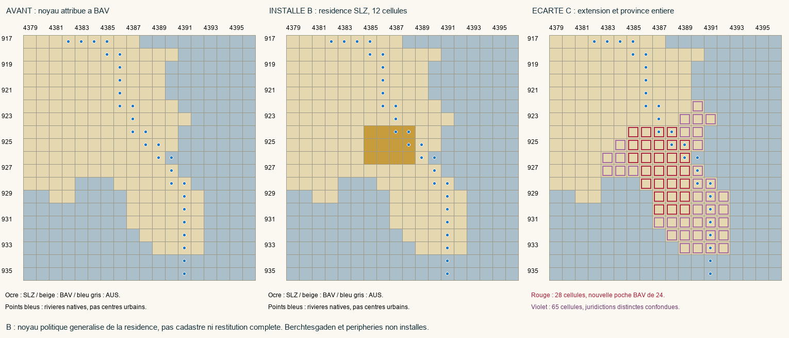

# SC1-SALZBURG — noyau de résidence installé

**SERG TERRITORIAL 1.0 — PROGRESSION : 25,53 %**

18 octobre 2026 · Phase 1 · P0 · périmètre 1.0.0 · **READY_FOR_SCOPED_RUNTIME_VALIDATION**. Statut structuré : `IMPLEMENTED_READY_FOR_RUNTIME_VALIDATION`. Aucun nouveau `PASS_RUNTIME_USER_VALIDATED` et aucun reçu humain créé.

Progression avant/après : **60/235 = 25,53 % → 60/235 = 25,53 %**. L’installation ne donne aucun point avant validation explicite. Les 19 socles, leurs reçus et les huit validations antérieurement en attente sont conservés.

## Décision et emprise

Le pays **SLZ** représente un **noyau B de la résidence de Salzbourg**, sans certification cadastrale ni restitution de l’ensemble du prince-archevêché. Les [sources](SOURCES.md) établissent le pouvoir temporel distinct, le titulaire et l’ordre de grandeur démographique urbain. La carte historique est confrontée au bitmap et à son hydrographie pour une généralisation politique ; les diagnostics urbains R4 ne sont pas des coordonnées exactes de ville. Aucun recalage, translation ou nouveau modèle de projection n’a été appliqué.

| Option examinée | Cellules | Résultat | Décision |
| --- | ---: | --- | --- |
| Résidence minimale | 12 | SLZ contigu, parent résiduel contigu ; composantes BAV 3374/5/3 → 3362/5/3 | **B installée** |
| Extension du bassin vers Hallein | 28 | Résidu du parent en trois composantes ; nouvelle poche BAV de 24 cellules | **C écartée** |
| Province native entière | 65 | Confond le secteur de la résidence avec les juridictions méridionales distinctes | **C écartée** |

| RGB / région / State_ID | Avant | Après |
| --- | --- | --- |
| `x6EA29B` / STATE_BAVARIA / 71 | BAV, 65 cellules | BAV, 53 cellules |
| `xEDBB00` / STATE_BAVARIA / 71 | Absent ; 12 cellules du parent | SLZ, 12 cellules |

Toutes les cellules sont énumérées dans [GEOMETRY.json](GEOMETRY.json). Aucune possession AUS, aucun ancien RGB de noyau validé, aucun hub ni identifiant régional n’est modifié. Le résidu BAV est conservé sans être déclaré historiquement exact. Le TAG et le RGB ont été vérifiés libres dans les données effectives et le bitmap avant installation.

## Pays, démographie et économie

- Prince-archevêché catholique sud-germanique, titulaire historique **Hieronymus von Colloredo**, né le 31 mai 1732, 43 ans au départ. Gouvernement dédié, titre et succession dynamique ; modèle moteur ecclésiastique existant, sans succession héréditaire ajoutée. FR/EN et armes territoriales stylisées, actifs vanilla.
- Capitale politique : Salzbourg ; capitale moteur dans sa propre subdivision SLZ de **STATE_BAVARIA / 71**, selon le modèle des petits pays voisins déjà acceptés. Le hub régional de Munich n’est pas déplacé. Le point et le libellé de capitale dans l’interface doivent être vérifiés en jeu ; aucun rendu moteur n’est attesté par l’agent.
- **16 000 habitants**, estimation urbaine arrondie, transférés depuis le profil sud-germanique catholique donneur BAV, sans règle proportionnelle à la surface. [DEMOGRAPHY.json](DEMOGRAPHY.json) explicite sources, intervalle et limites. Aucun chiffre de minorité inventé. Population mondiale écrite inchangée : **835 801 255** ; profils globaux et religions résolues conservés. Les populations PAS/FSI/RBI/RCI restent identiques.
- **Un niveau d’administration publique SLZ ajouté explicitement**, pour représenter la cour et l’administration souveraine attestées. Les trois méthodes sont disponibles dans la version locale. Ce niveau est une unité abstraite du moteur ; aucune équivalence historique précise de ses emplois n’est revendiquée. L’unique niveau bavarois n’est pas retiré. Tous les bâtiments et propriétaires préexistants sont inchangés ; le total écrit d’administration augmente de **1**.
- Aucun niveau industriel, aucune nouvelle formation, aucun recrutement ni transfert d’unité. Le niveau de vie, l’emploi, les capacités fiscales et la viabilité du petit pays restent à observer pendant le mois de test.

## Intégration et protection

Registre cumulatif **573 → 574 RGB**, emprise physique impériale inchangée. La [migration](REGISTRY_MIGRATION.json) s’applique à la couche réelle R4-C ; elle ajoute seulement SLZ et son RGB. SLZ est membre, sans électorat ni statut de ville libre, sans sujet natif imposé. Les **neuf électeurs** sont conservés.

Le compilateur impérial correspondait aux **73/73 fichiers** courants avant intervention. L’intégration met à jour **17 fichiers** dépendant des membres et des droits ; aucun texte de journal n’est réécrit. La carte du journal est régénérée. Les modifications américaines, françaises, Saint-Gobain/Anzin et tous les autres fichiers fonctionnels sont protégés par la capture immédiate, pas restaurés depuis une ancienne baseline.

Les fichiers fonctionnels propres à cette passe et leurs empreintes figurent dans [FILES_MODIFIED.json](FILES_MODIFIED.json). Les seuls outils antérieurs ajustés sont le garde du registre et le rendu du suivi ; les anciens tests et outils de calibration restent inchangés. HEAD, branche et index Git sont conservés. Aucune opération Git d’écriture ; vanilla consulté en lecture seule.

## Contrôles et limites

[VALIDATION.json](VALIDATION.json) : **209/209 contrôles statiques réussis**, dont bitmap global exact, tous propriétaires, profils démographiques, bâtiments, méthodes, unités, droits, compilateur cumulatif, localisations et conservation des fichiers hors périmètre. Aucune nouvelle erreur de référence ni doublon ; les **44 doublons RGB et 12 références invalides hérités** restent inchangés.

[TESTS.json](TESTS.json) et [TESTS.log](TESTS.log) : suite cumulative de **288 tests**, **284 réussites**, **3 échecs d’assertions d’ancienne dernière couche**, **1 exclusion prévue par le test d’initialisation**. Les trois échecs concernent seulement la position finale de R2-B, Passau ou R4-B/C dans une chaîne maintenant prolongée. Ils sont conservés, sans réécriture des anciens tests ni résultat PASS global fictif. Le contrôle d’initialisation exclu exige que les fichiers restent ceux d’avant toute installation autorisée ; le contrôle de conservation de cette passe utilise sa capture immédiate.

Les **12 tests SC1 supplémentaires passent** : ils contrôlent la chaîne complète, rejettent translations/extensions/prises de noyaux et empêchent le crédit ou le reçu humain automatique. Avec les tests du suivi relancés, le bilan est **39 réussites sur 40 cas, aucun échec, une exclusion d’initialisation expliquée**, dans [SCOPED_TESTS.json](SCOPED_TESTS.json). Les trois assertions anciennes sont rapprochées de leurs contrôles cumulatifs actuels dans [TEST_REVIEW.json](TEST_REVIEW.json). Le suivi canonique passe séparément dans [TRACKER_VALIDATION.json](TRACKER_VALIDATION.json).

Le noyau B reste une représentation politique, avec incertitude de position dans une carte grossière. **Berchtesgaden, Rupertiwinkel, Mühldorf, Pinzgau/Pongau/Lungau et les possessions tyroliennes ou autres périphéries ne sont pas reconstitués ici.** Leur maintien technique n’est pas une preuve de souveraineté BAV/AUS ; cette incertitude reste visible dans la fiche. La suite n’est ni une annexion totale de Bavière/Autriche, ni une clôture du dossier alpin.

Prochaine action : [test en jeu du seul sous-lot](PLAYER_TEST_PROTOCOL.md), nouvelle partie 1776, un mois et sauvegarde/rechargement, puis confirmation explicite du joueur. Le candidat P0 territorial suivant **SC2-BOHEMIA** est préparé dans `NEXT_ACTION.md`, sans être commencé ; les dépendances de Trente/Brixen/Berchtesgaden ne sont pas levées par les seuls contrôles statiques.
