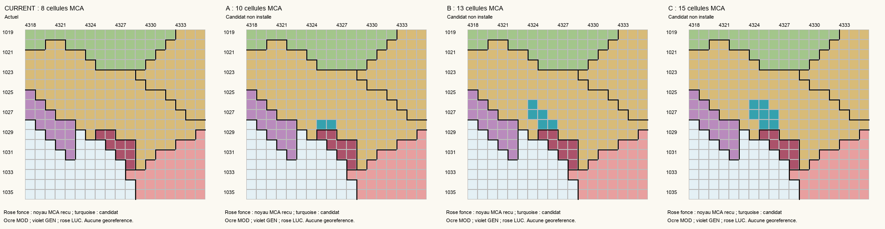

# Carrare et Avenza — périmètre politique et candidats

**Conclusion : aucune extension n'est installée.** La table démographique est maintenant vérifiée directement et les candidats sont recomptés sur le bitmap courant, mais ni la carte de 1750 ni les notices consultées ne permettent de rattacher les principaux ensembles de Carrare et d'Avenza à l'un des contours sans choix arbitraire.

## Territoire politique de référence

S2 confirme la principauté avec Carrare, Avenza, Bedizzano, Castelpoggio, Codena, Colonnata, Fontia, Fossola, Moneta, Gragnana, Noceto, Miseglia, Sorgnano et Torano. En 1776, ces lieux relèvent de Marie-Thérèse Cybo-Malaspina dans le cadre politique déjà représenté par MCA ; aucun changement de titulaire ou acte d'annexion ultérieur n'est anticipé. La liste de 1663 et la succession de 1731 soutiennent cette appartenance, mais ne fournissent pas un polygone cadastral vérifié au départ de 1776. `JURISDICTION_REVIEW.csv` distingue chaque localité et les voisins exclus.

Ne pas attribuer Sarzana/Lerici génois, Montignoso lucquois, Pietrasanta/Seravezza toscanes, la Garfagnana modénaise ou tous les fiefs Malaspina au seul titre du patronyme ou du mariage. Ces exclusions déjà documentées restent protégées. Le noyau MCA, son administration et sa souveraine ne sont pas reconstruits.

## Géométrie réelle, relue sur le bitmap actuel

`CURRENT_GEOMETRY_AND_OPTIONS.json` donne la liste complète des cellules actuelles et des candidats, à partir de `map_data/provinces.png`, pas des seules listes de 2026-10-23. Résultat : **xEDBC00 = 8 cellules MCA ; xF08021 = 108 cellules MOD**, sans dérive par rapport à l'état acquis. Les coordonnées ci-dessous sont zéro-indexées.

| Option | Cellules candidates MOD vers MCA | Après, MCA / parent MOD | Connexité locale à quatre voisins | Décision de cette passe |
| --- | --- | --- | --- | --- |
| A | [4325,1028], [4326,1028] | 10 / 106 | Un bloc chacun | Non installée : extension minimale vers le nord-ouest ; ne démontre pas la couverture de la ville et des villages du ressort. |
| B | [4325,1028], [4326,1028], [4325,1027], [4324,1027], [4324,1026] | 13 / 103 | Un bloc chacun | Hypothèse B de travail proposée, non homologuée : pointe intérieure vers le nord-ouest, continuité préservée ; couverture Carrare/Avenza non démontrée. |
| C | [4325,1028], [4326,1028], [4325,1027], [4324,1027], [4326,1027], [4324,1026], [4325,1026] | 15 / 101 | Un bloc chacun | Non installée : deux cellules de plus que B, sans preuve historique supplémentaire pour les attribuer. |
| Ancienne proposition de trois | [4324,1028], [4325,1028], [4326,1028] | 11 / 105 | MOD se divise en **104 + 1** | **Rejetée en l'état**, cellule modénaise isolée injustifiée. |

Aucun ancien propriétaire n'est déduit d'une couleur d'illustration : le contrôle des trois options vérifie le RGB réel du parent MOD pour chaque cellule. Les analyses de continuité du territoire MOD complet sont conservées dans `CANDIDATE_COUNTRY_TOPOLOGY.json`. Le bilan de cellules du couple parent/enfant reste 116 pour chaque simulation. Ces essais se font en mémoire ; ils ne changent pas le bitmap.

## Comparaison historique effective et limite précise

Sur Robert 1750, Carrare se situe au nord-ouest de Massa, en retrait de la côte et à l'est de l'interface Sarzana/Lerici. Les trois options vont dans une direction globalement compatible avec cette relation : c'est un indice d'orientation, **pas une localisation**. Le point d'Avenza et les principaux villages ne sont pas identifiés sur le détail à une résolution permettant leur appariement aux cellules. Aucun tracé historique numérisé ne permet donc de dire que les deux cellules supplémentaires de C, ou la pointe nord de B, appartiennent bien à la principauté et non à une frange voisine.

L'illustration montre les hypothèses côte à côte ; ce n'est pas une superposition géographique. Aucun nouveau calage sur les locators de Parme, Modène ou Lucques n'a été tenté. On ne transforme pas l'ancien noyau de résidence massais en point géodésique certifié. Les limites contemporaines ne sont pas utilisées comme frontières de 1776.

La preuve manquante est désormais ciblée : **reproduction des cartes d'Avenza b.84–86 et de Carrare b.87–88, datées de 1775, puis quelques repères indépendants sur le réseau côtier/relief et le bitmap**. Les cartes voisines de Fontia, Moneta et Gragnana permettent de vérifier les franges si elles sont nécessaires. Les cotes sont établies par l'inventaire institutionnel S3, pp. 2–3 ; les cartes originales ne sont pas encore lues. Un rapprochement des grands ensembles suffit pour une approximation politique B : pas besoin d'un cadastre parfait.

Le nombre d'habitants ne peut pas choisir le contour à la place de cette preuve. L'absence de régression topologique ne démontre pas l'autorité historique de ces cellules.
