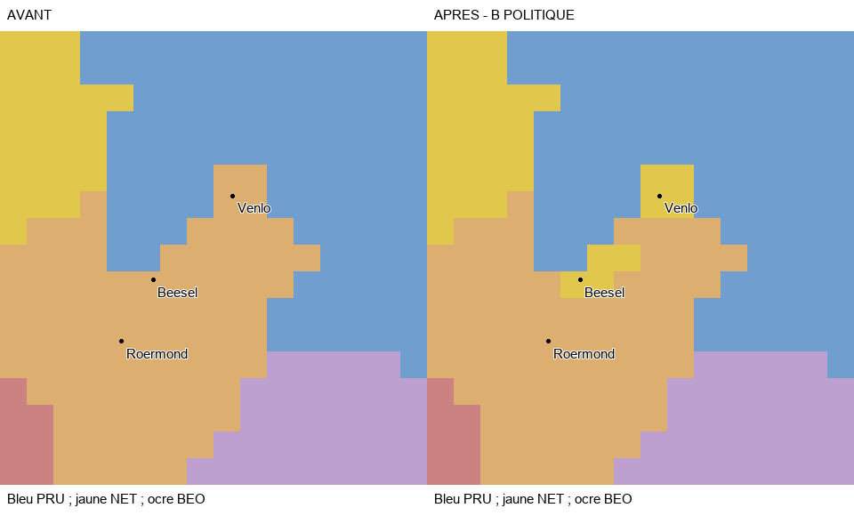

# SERG TERRITORIAL 1.0 — PROGRESSION : 39,57 %

Passe du 5 novembre 2026 : **réserves occidentales arbitrées pour la V1**, sur délégation explicite du joueur. Deux noyaux néerlandais installés ; aucune autre région commencée. Les essais moteur restent différés selon le joueur. `SC5-PRUSSIAN-WEST` reste **IN_PROGRESS**, sans clôture régionale ni nouveau reçu humain.

## Décisions et résultat installé

- **Clèves/Emmerich, Mark/Unna–Meinerzhagen et Berg : maintien de la représentation actuelle en catégorie B pour la V1.** Aucun nouveau transfert suffisamment établi sur ces franges ; le candidat Berg de 39 cellules n'est pas installé. Les anciens recalages ne sont pas relancés. Cet arbitrage opérationnel ne certifie ni cadastre ni exactitude intégrale des ensembles conservés.
- **Venlo et Beesel/Belfeld : huit cellules BEO→NET**, deux noyaux de quatre cellules, `PW-VENLO-NET-B4` et `PW-BEESEL-NET-B4`. Deux nouveaux RGB `xEEC700` et `xEEC701`, dans la région Gueldre existante et sa portion NET déjà présente. Le parent BEO conserve **157 cellules continues** ; Roermond reste BEO. Les 72 cellules PRU de Clèves/Gueldre et les 32 cellules de Ravensberg précédemment installées restent intactes.
- **Restitution impériale : aucun droit BEO sur les huit cellules néerlandaises, aucun titre NET créé.** Les **599 titres**, la liste des membres et les neuf électeurs restent identiques. L'étendue enregistrée du domaine de restitution diminue exactement de huit cellules ; aucun autre pixel n'est exclu. Cette décision bornée ne résout pas toute la doctrine des rapports entre cercle de Bourgogne, Pays-Bas et Empire.

[Arbitrage, sources et limites](SOURCES_AND_ARBITRATION.md), [décision structurée](ARBITRATION.json), [cellules exactes](GEOMETRY.json). Les sources établissent la souveraineté ; le passage à la grille native comprend des **arrondis B déclarés**, notamment à Venlo pour éviter un résidu BEO artificiel. Pas de prétention cadastrale, aucun pixel PRU ou autre parent utilisé pour ces arrondis. Les brouillons restent dans [PREPARATION_DIAGNOSTICS.json](PREPARATION_DIAGNOSTICS.json).

## Populations et conservation

**1 171 habitants existants** passent de BEO/Gueldre à NET/Gueldre : 362 néerlandais avec religion par défaut de culture, 702 néerlandais catholiques, 83 wallons protestants et 24 ashkénazes avec religion par défaut de culture. Ces profils sont copiés depuis les données actuelles, pas estimés historiquement. BEO/Gueldre passe de **24 173 à 23 002**, NET/Gueldre de **580 568 à 581 739** ; PRU/Gueldre reste à **10 548**. Total mondial et profils écrits/résolus inchangés. Ce n'est ni un recensement de 1776 ni la population intégrale des ressorts historiques.

La portion source BEO n'avait aucun bâtiment initial écrit. Aucun bâtiment, niveau, PM, propriétaire économique, unité, technologie, capitale ou locator physique modifié. Aucun nouveau pays, aucune nouvelle portion nationale créée ; intégration existante de NET conservée. Les terrains héritent du parent, les références de région restent cohérentes.

**Six fichiers existants modifiés** : bitmap, définition des provinces de Gueldre, attribution dans l'historique des États, population, terrains et chaînage explicite de la migration dans l'outil du registre. Le registre actif et les scripts impériaux conservent leurs octets ; compilation de contrôle avec **zéro dérivé impérial à changer**, sans conflit concurrent. Aucun fichier vanilla, aucune autre copie du mod, aucune opération Git d'écriture.

## Vérifications de cette passe

**38/38 contrôles statiques réussis**, couvrant les huit cellules exactes, les anciens noyaux PRU, les propriétaires mondiaux, les populations, bâtiments/PM/unités, régions et intégration, l'absence de titre ou d'adhésion NET, la réduction bornée de l'étendue enregistrée, les preuves antérieures et la conservation du workspace/index Git. [VALIDATION.json](VALIDATION.json).

**73 tests ciblés exécutés : 72 réussis, 1 exclu, aucun échec ni erreur.** L'exclusion concerne le contrôle historique d'initialisation sans modification, remplacé pour cette passe par la conservation explicite des fichiers. **Validateur canonique PASS ; 15/15 contrôles finaux réussis**, dont la conservation des 80 autres tâches, des anciennes attestations, des événements, de la progression et des modifications concurrentes.

Les **11 erreurs de références héritées** et **14 clés de références cartographiques dupliquées** restent inchangées ; elles ne sont ni masquées ni présentées comme réparées. Le premier arrêt de préparation venait d'un contrôle de continuité du brouillon non installé, corrigé avant toute écriture fonctionnelle par l'arbitrage du contour de Venlo. Ce n'est pas un incident moteur observé.

[Résultats ciblés](TEST_RESULTS.json), [sortie brute](TEST_RESULTS_RAW.txt), [contrôle canonique](CANONICAL_CHECK.json), [contrôles finaux](FINAL_CHECKS.json), [fichiers modifiés](FILES_MODIFIED.json), [concurrence](CONCURRENT_CHANGES.json).

## Suivi et prochaine action

**93/235 → 93/235 points ; 39,57 % → 39,57 % ; 32/81 → 32/81 tâches qualifiées.** Périmètre 1.0.0, 81 tâches et 235 points conservés. L'arbitrage délégué n'est pas une attestation humaine et ne donne aucun point pour un noyau partiel. Les deux installations sont **IMPLEMENTED_READY_FOR_RUNTIME_VALIDATION** ; aucun `PASS_RUNTIME_USER_VALIDATED` ajouté.

La préparation occidentale V1 peut passer à sa **réception moteur groupée**, sans nouvelle recherche de précision automatique. Le [protocole cumulatif](PLAYER_TEST_PROTOCOL_GROUPED.md) remplace explicitement l'ancienne réserve BEO de Venlo/Beesel par les deux noyaux NET et conserve toutes les obligations prussiennes précédentes. Le joueur conserve son calendrier de test. La conformité historique intégrale des franges, les micro-enclaves et les autres obligations régionales restent limitées comme documenté ; aucune autre tâche ou Bavière n'est commencée.
