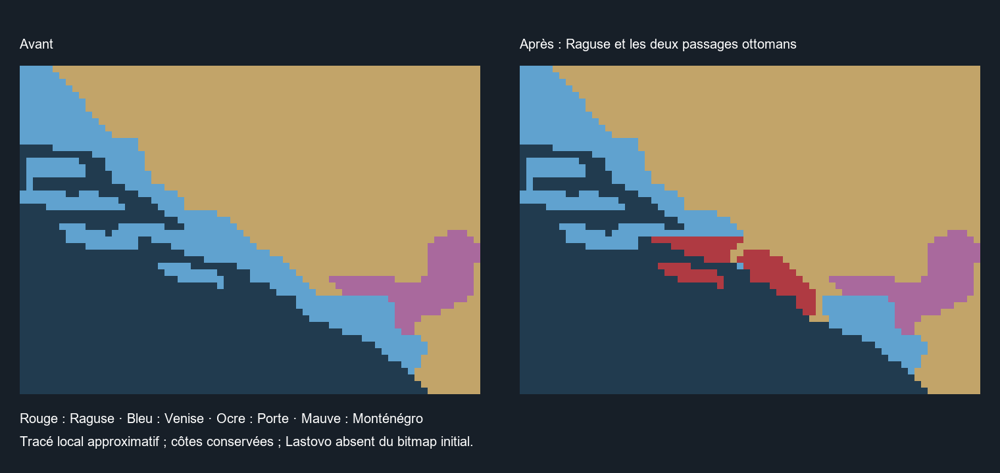

# WORLD 1776 — CHANTIER TERRITORIAL AUTONOME N° 2

Phase 1 — Balkans. Lot **BALKANS-02 — Raguse et Adriatique**, 24 octobre 2026.
Référence historique : **1er janvier 1776**.

Pays étudiés dans ce lot : **Raguse, Venise, Empire ottoman** ; Monténégro vérifié comme voisin conservé. Les possessions habsbourgeoises réservées ne sont pas reprises.

| Phase | Critères techniques vérifiés | Validation joueur nouvelle | État |
| --- | ---: | ---: | --- |
| Balkans | 5/80 — 6,25 % | 0 | En cours |
| Italie méridionale | 0/40 | 0 | Non commencée |
| Afrique subsaharienne | 0/80 | 0 | Non commencée |
| Maghreb | 0/48 | 0 | Non commencée |
| Amériques | 0/72 | 0 | Non commencée |

Total : **5/320 — 1,56 %**. Cette mesure compte des critères entièrement vérifiés, pas une surface territoriale. Les travaux partiels ne donnent pas de point.

## Résultat installé

Le TAG **RAG** représente désormais la République de Raguse, auparavant absorbée dans la Dalmatie vénitienne. Le lot crée son cadre patricien, un profil de 19 technologies, un port, une petite chancellerie et un lien tributaire spécifique avec la Porte. Le marché propre est accordé séparément. Aucun engagement automatique dans les guerres ottomanes, changement de souverain par le suzerain ou annexion automatique lors d'une formation nationale n'est prévu par ce statut.

La découpe porte sur **122 pixels terrestres du seul RGB dalmate `x11A0E0`** : 109 pour Raguse, sept pour Neum/Klek, six pour Sutorina. Trois RGB nouveaux sont enregistrés avec terrain et propriété uniques. Les deux passages ont un contact orthogonal avec la Bosnie ottomane et avec la mer. Le tracé est une approximation interprétative à l'échelle du bitmap, pas une frontière cadastrale certifiée.

Le littoral, les mers, les locators et toutes les autres provinces restent inchangés. Zadar, Split, les corps principaux de Korčula, Hvar et Vis, ainsi que les bouches de Cattaro demeurent vénitiens. Le noyau monténégrin reste intact. Aucun territoire AUS/HUN/TRS ni noyau SERG n'est transféré.

## Population et économie

**30 000 habitants croates** sont réaffectés du pool VEN de Dalmatie à RAG : 297 796 → 267 796 dans ce pool. Les deux autres groupes restent inchangés. La religion catholique implicite de la culture et l'absence de profession explicitement imposée sont conservées. Ce chiffre est une calibration prudente entre les relevés anciens et postérieurs étudiés ; ce n'est pas un recensement de 1776.

La population mondiale reste **834 936 539**, variation **zéro**. Les passages ottomans n'ont pas reçu de population inventée ; leur répartition démographique fine demeure ouverte.

Un niveau de pêche déjà présent passe de VEN à RAG : deux niveaux vénitiens et un ragusain remplacent les trois niveaux vénitiens. Le port de Zadar est conservé. Un port marchand indépendant et une chancellerie non extensible sont ajoutés pour le fonctionnement du pays restauré. Ces deux capacités supplémentaires sont des abstractions d'installation, pas des effectifs d'archives. Les trois bâtiments ragusains offrent **6 200 emplois** à pleine activité. Aucun apport artificiel de trésorerie ou armée de masse n'est ajouté.

Le profil technologique est explicite et ses prérequis sont fermés. Les méthodes initiales de pêche, de port et de chancellerie sont compatibles. Aucun service permanent du génie, chemin de fer, vapeur ou technologie industrielle de précision n'est accordé.

## Institutions et tribut : portée réelle

Les lois initiales associent république présidentielle et oligarchie ; un gouvernement spécifique emploie le titre de recteur. Elles représentent le gouvernement patricien des conseils, sans simuler intégralement la rotation mensuelle des offices.

Le recteur exactement en fonction au **1er janvier** n'a pas été identifié avec une preuve suffisante. Le jeu reçoit un personnage **procédural, `historical = no`** ; le paramètre de génération de son âge n'est pas une date biographique attestée. Luka Zamagna apparaît dans des listes annuelles pour 1776, insuffisantes pour l'attribuer à janvier. Le critère historique des dirigeants reste partiel.

La convention ottomane de 1703 prévoit 12 500 ducats tous les trois ans. Le pacte installé utilise une abstraction budgétaire continue de **5 % des revenus** ; il ne prétend ni convertir exactement les ducats en livres, ni reproduire une échéance triennale. Le pavillon armorial utilise les barres argent et gueules attestées, sans prétendre être le pavillon principal à saint Blaise.

## Limites à reprendre avant la clôture balkanique

- **Géographie** : Pelješac et Korčula sont imparfaitement séparés dans le bitmap initial. Un contact terrestre artificiel subsiste dans ce secteur insulaire. Les frontières précises et les passages doivent faire l'objet de la revue visuelle finale. Lastovo n'a pas d'île terrestre identifiable dans le secteur du bitmap et n'a pas été créée sur la mer.
- **State Region partagée** : Raguse demeure dans `STATE_DALMATIA`. Aucun hub n'est déplacé depuis Split ; le placement du chef-lieu et du port pour le propriétaire minoritaire doit être vérifié en jeu. Les traits et ressources de la région commune, notamment les chutes de la Krka, restent un héritage régional à isoler ou corriger avant de revendiquer une économie historique complète de Raguse.
- **Démographie** : nombre de 1776, minorités locales et population des passages non reconstitués précisément. Aucun changement culturel destiné à fabriquer une identité nationale supplémentaire.
- **Institutions** : recteur de janvier, rotation des offices, calendrier et valeur absolue du tribut restent ouverts.
- **Moteur et économie** : embauche effective, budget, marché indépendant, rendu du gouvernement, port et drapeau, stabilité après un mois et rechargement non testés dans le jeu.

Ce lot est un **noyau installé et vérifié statiquement**. Ni toute l'Adriatique, ni la phase Balkans ne sont déclarées achevées.

## Vérification et concurrence

Les **99 contrôles statiques** du lot passent au reçu `VALIDATION.json`. Les 20 domaines de contrôle de la mission sont explicités dans `TEST_MATRIX.md`, avec leurs limites historiques et moteur.

Le manifeste comprend **21 fichiers fonctionnels** : six fichiers partagés modifiés localement et quinze nouveaux fichiers spécifiques. Le contrôle part d'une baseline de 2 450 fichiers fonctionnels protégés et de **873 fichiers de preuves SERG**. Ceux-ci restent identiques ; l'image de provinces reste pixel pour pixel identique hors du masque déclaré. Les modifications TECH-R2 antérieures et les Cyclades du lot 01 sont conservées.

Dix fichiers existants ont évolué dans les chantiers parallèles ALLOYS et TECH-R3. Leurs reçus ou empreintes de départ les identifient séparément ; aucun n'est écrit par cet outil. Les nouveaux fichiers étrangers apparus pendant la passe sont également recensés. Cette attribution ne constitue pas une validation de leurs mécaniques économiques.

Les premiers diagnostics défaillants sont conservés : icône inexistante corrigée vers l'icône native du tribut, continuité de Sutorina et séparation au contact de Neum corrigées, nouveaux changements concurrents réconciliés. Aucun échec n'est masqué en reçu humain.

**Statut : `IMPLEMENTED_STATIC_VERIFIED_WITH_HISTORICAL_OBLIGATIONS`. Runtime : `NOT_RUN`.** Le protocole est réservé au test groupé de fin des Balkans. Aucune autre région ne sera commencée avant la confirmation explicite du joueur.

## Preuves

- [Sources et références consultées](SOURCES.md)
- [Contrôles dans les vingt domaines](TEST_MATRIX.md)
- [Tracé et mutations exactes des pixels](PIXEL_PATCH.json)
- [Manifeste fonctionnel](FILES_MODIFIED.json)
- [Compatibilité technologique et emploi](STARTING_TECH_CHECK.json)
- [Contrôles exécutés](VALIDATION.json)
- [Évolutions concurrentes](CONCURRENT_CHANGES.json)
- [Protocole à intégrer au test final](PLAYER_TEST_PROTOCOL.md)

Prochaine passe : Monténégro et interface de Cattaro, puis possessions ioniennes et enclaves de l'Épire. Reprendre les obligations ragusaines ci-dessus avant le bilan global des Balkans.
