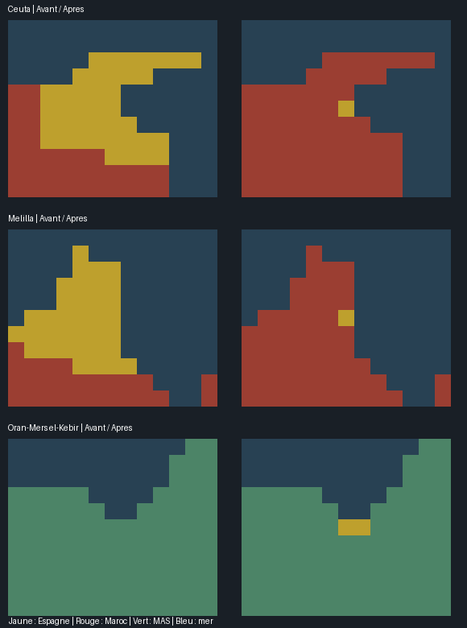

# MAGHREB-01 — Présides espagnols au 1er janvier 1776

26 octobre 2026. Statut IMPLEMENTED_READY_FOR_RUNTIME_VALIDATION. Carte uniquement ; moteur NOT_RUN, aucune attestation joueur.

## Corrections installées

| Secteur | Avant | Après |
| --- | --- | --- |
| Ceuta | xA0B0C0, 40 pixels, déclaré simultanément MOR et SPA | Un noyau côtier SPA xE8D231 au pixel (3973,1252) ; 39 pixels d’arrière-pays exclusivement MOR |
| Melilla | xCA9F75, 35 pixels, déclaré simultanément MOR et SPA | Un noyau côtier SPA xE8D232 au pixel (4029,1264) ; 34 pixels d’arrière-pays exclusivement MOR |
| Oran–Mers el-Kébir | xB735DB, 118 pixels MAS ; aucune portion espagnole | Deux pixels côtiers contigus (4081,1255)/(4082,1255), SPA/xE8D233 ; 116 pixels du parent restent MAS |

**Quatre pixels existants recoloriés, trois RGB nouveaux, deux doubles attributions supprimées.** Les anciennes couleurs et les autres régions gardent leurs propriétaires. Ceuta et Melilla ne reçoivent pas les vastes polygones natifs de leur arrière-pays. Le noyau d’Oran ne donne pas toute la région à l’Espagne. Les quatre fichiers partagés sont le bitmap, les historiques d’États, la définition régionale nord-africaine et l’enregistrement des terrains hérités.

La colonne avant montre la dernière déclaration SPA pour les anciennes provinces du Rif : leur double attribution rendait le résultat effectif dépendant du chargement. Elle n’est pas une capture moteur. Les noyaux après sont des approximations politiques minimales, pas une certification des limites cadastrales des fortifications. Les positions sources et la justification sont dans SOURCES.md / PIXEL_PATCH.json.

## Conservation et limites

Aucun personnage, bâtiment, unité, pays-type, loi, traité, technologie ou PM modifié. Zéro terre ou mer créée, hauteurs et rivages conservés. Ressources, hubs et locators communs ne sont pas déplacés. Le placement des icônes et le rendu des portions minoritaires ne sont pas déclarés observés en jeu.

Aucun habitant ajouté, supprimé ou réaffecté : **837 328 539 → 837 328 539**, delta zéro. Tous les fichiers de POPs sont identiques. La portion espagnole d’Oran créée par cette passe strictement cartographique ne reçoit pas de POP ou de bâtiment initial supplémentaire : cette absence d’initialisation n’est pas une estimation historique de population nulle. Les anciennes populations SPA/MOR du Rif ne sont pas recalibrées sur la surface des nouvelles cellules. L’initialisation économique/démographique détaillée reste hors du lot demandé.

Erratum documentaire B07 : son compte rendu citait par erreur 837 336 539 en reprenant le chiffre de B06 ; sa propre BASELINE.json et ses contrôles de conservation portaient déjà sur 837 328 539, comme la présente passe. Les preuves brutes et le compte rendu daté B07 sont préservés ; aucune correction de POP n’est faite ici pour recréer un ancien total.

Les autres présides minuscules (Vélez, Alhucemas), les îlots non dessinés et les frontières de l’intérieur restent à contrôler à la résolution réellement disponible ; Chafarinas n’est pas annexée à l’Espagne par anticipation de 1848. Les beylicats, possessions tribales et frontières des autres régences ne sont pas déclarés clos. Les doublons hérités de Tripoli restent signalés séparément par le contrôle : le lot n’en masque ni n’en corrige arbitrairement les attributions.

## Sources et vérification

Sources réellement consultées et limites : SOURCES.md. Le plan de Mazalquivir de novembre 1775 est effectivement reproduit et examiné ; les catalogues non téléchargés restent désignés comme tels. Le contrôle de la cession de 1791/1792 évite de retirer aux Espagnols ces places dès 1776.

**35/35 contrôles statiques réussis** : patchs textuels ciblés, quatre pixels seuls, dimensions/couleurs, propriétaires uniques des noyaux, maintien des arrière-pays, exact retrait de deux doublons, côtes, populations et Git conservés, extérieur des deux régions identique, tous fichiers hors lot et preuves antérieures préservés. Aucun moteur lancé.

Les 2542 fichiers fonctionnels antérieurs hors lot, 426 preuves WORLD et 1020 preuves SERG capturés restent identiques. La cellule ragusaine B07 est conservée. Aucune écriture Git, vanilla ou suivi SERG ; aucun retour à une ancienne baseline.

Cette première passe du Maghreb est installée. P4-01/P4-02 restent partiels, aucun nouveau point régional ni attestation humaine. Les contenus flavor restent différés. Suite : autres limites littorales, puis frontières de la régence d’Alger et des ensembles voisins ; pas de nouveaux personnages ni de raffinements de bâtiments.
